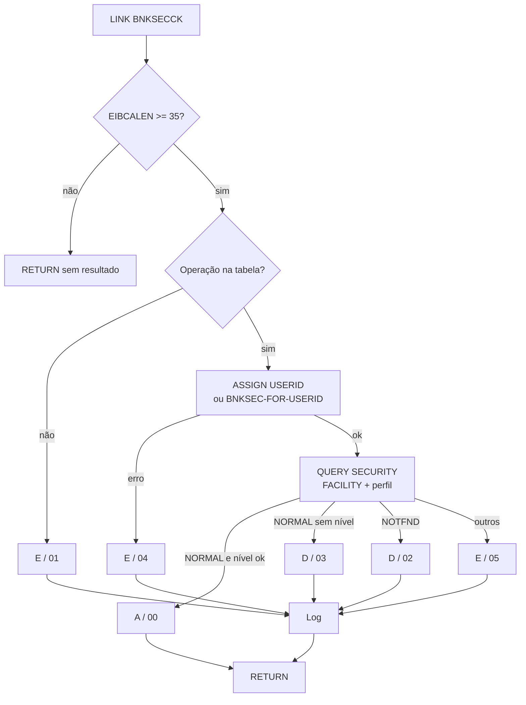

# Especificação Técnica — Subprograma CICS BNKSECCK (verificação de segurança)

**Versão:** 0.1  
**Data:** 2026-11-05  
**Autor:** Gerado via IBM Bob Z Architect  
**Status:** Rascunho para validação  
**Origem:** [`RACF-security-functional-spec.md`](RACF-security-functional-spec.md) (§5, §8.3, RF-11, RF-13, RF-21)  
**Índice geral:** [`RACF-security-technical-index.md`](RACF-security-technical-index.md)

> Itens marcados **[A VALIDAR]** dependem de confirmação na documentação do produto ou de decisão do responsável. Esta especificação **não altera código**; a implementação ocorre em modo Z Code.

---

## 1. Identificação do Programa

| Atributo | Valor |
|----------|-------|
| Nome do Programa | `BNKSECCK` (**novo**) |
| Linguagem | COBOL (Enterprise COBOL for z/OS) |
| Tipo | Subprograma CICS, chamado por `EXEC CICS LINK` |
| Cabeçalho de compilação | `CBL CICS('SP,EDF')` (não usa DB2, portanto sem `CBL SQL`) |
| Transação própria | Nenhuma (somente via LINK) |
| Fonte (a criar) | `src/base/cics/cobol/BNKSECCK.cbl` |
| Copybook de comunicação (a criar) | `src/base/cics/copy/BNKSEC.cpy` |
| Definição CICS (a criar) | `PROGRAM` em [`bank-of-z-definitions.yaml`](../../.setup/zconfig/bank-of-z-definitions.yaml) |

## 2. Objetivo

Centralizar a **autorização fina de aplicação** (camada L5 da spec funcional): dado o código de uma operação bancária, decidir se o usuário da tarefa pode executá-la, consultando o RACF via `EXEC CICS QUERY SECURITY`. A política (operação → perfil → nível de acesso) fica em **uma única tabela** neste programa, evitando duplicar a regra em oito programas de negócio.

Política padrão: **negar por padrão** (*fail-closed*). Perfil inexistente ou erro inesperado nunca resulta em permissão.

## 3. Origem dos Dados

Não acessa DB2 nem VSAM de negócio.

| Fonte | Uso |
|-------|-----|
| `EXEC CICS ASSIGN USERID` | Identidade da tarefa em execução |
| `EXEC CICS QUERY SECURITY RESCLASS('FACILITY')` | Nível de acesso do usuário ao perfil (READ / UPDATE) |
| COMMAREA `BNKSEC` | Entrada (código da operação) e saída (resultado) |

## 4. Regras de Negócio

| ID | Regra |
|----|-------|
| RN-01 | A operação é identificada por código de 8 posições (igual ao nome do programa de negócio). Código desconhecido → resultado `E`. |
| RN-02 | Cada operação mapeia para **um** perfil `FACILITY` e **um** nível mínimo (`READ` ou `UPDATE`), conforme §4.1. |
| RN-03 | `QUERY SECURITY` com RESP `NORMAL` e CVDA `READABLE`/`UPDATABLE` conforme o nível exigido → `A` (permitido). |
| RN-04 | CVDA `NOTREADABLE`/`NOTUPDATABLE` → `D` (negado). |
| RN-05 | RESP `NOTFND` (perfil não definido, recurso "não protegido") → **`D` (negado)**. Diverge do padrão do CICS de propósito (fail-closed). |
| RN-06 | RESP `INVREQ` (classe não definida ou RESID inválido), `ASSIGN` com erro ou qualquer outro RESP → `E`, com RESP/RESP2 devolvidos. |
| RN-07 | Com `SEC=NO` na região, o CICS informa tudo como permitido; o BNKSECCK **não** detecta isso. Mitigação operacional: `SEC=YES` obrigatório (já é o valor de [`config.yaml`](../../.setup/config/config.yaml)). |
| RN-08 | Toda negação (`D`) e todo erro (`E`) gera uma linha de log com usuário, operação e perfil. Nunca registra senhas. |
| RN-09 | COMMAREA menor que o layout `BNKSEC` (`EIBCALEN < LENGTH OF BNKSEC-COMMAREA`) → retorna sem processar (não é possível devolver resultado). O chamador, que usa `RESP`, trata o retorno como erro. |

### 4.1 Tabela de política (10 operações)

| # | Operação (`BNKSEC-OPERATION`) | Perfil `FACILITY` | Nível | Papéis com acesso (spec funcional §5/§8.3) |
|---|-------------------------------|-------------------|-------|--------------------------------------------|
| 1 | `INQCUST ` | `BANKZ.CUSTOMER` | READ | Teller, Mgr, Audit |
| 2 | `INQACC  ` | `BANKZ.ACCOUNT` | READ | Teller, Mgr, Audit |
| 3 | `CRECUST ` | `BANKZ.CREATE` | UPDATE | Teller, Mgr |
| 4 | `CREACC  ` | `BANKZ.CREATE` | UPDATE | Teller, Mgr |
| 5 | `DBCRFUN ` | `BANKZ.PAYMENT` | UPDATE | Teller, Mgr |
| 6 | `XFRFUN  ` | `BANKZ.PAYMENT` | UPDATE | Teller, Mgr |
| 7 | `UPDCUST ` | `BANKZ.CUSTOMER` | UPDATE | Mgr |
| 8 | `UPDACC  ` | `BANKZ.ACCOUNT` | UPDATE | Mgr |
| 9 | `DELCUS  ` | `BANKZ.DELETE` | UPDATE | Mgr |
| 10 | `DELACC  ` | `BANKZ.DELETE` | UPDATE | Mgr |

> **Lacuna identificada na spec funcional:** o §8.3 não define perfil para *criar* cliente/conta (Teller cria, mas só Mgr tem `UPDATE` em `BANKZ.CUSTOMER`/`ACCOUNT`). Esta spec introduz o perfil **`BANKZ.CREATE`** (UPDATE: Teller, Mgr). A spec funcional deve ser atualizada (v0.2).

Os RESIDs têm 12 a 14 caracteres, sem brancos embutidos (limite: 1 a 246).

## 5. Lógica de Processamento

```
PREMIERE SECTION / A010
  1. IF EIBCALEN < LENGTH OF BNKSEC-COMMAREA  -> EXEC CICS RETURN
  2. INITIALIZE campos de saída; BNKSEC-RESULT = 'E'; BNKSEC-REASON = '00'
  3. PERFORM RESOLVE-OPERATION      (busca na tabela; não achou -> reason '01', sai)
  4. PERFORM GET-USERID             (ASSIGN USERID; erro -> reason '04', sai)
  5. PERFORM CHECK-ACCESS           (QUERY SECURITY; classifica o RESP)
  6. IF resultado <> 'A' PERFORM LOG-SECURITY-EVENT
  7. PERFORM GET-ME-OUT-OF-HERE     (EXEC CICS RETURN)
```

### 5.1 Consulta ao RACF

```cobol
EXEC CICS QUERY SECURITY
     RESCLASS('FACILITY')
     RESID(WS-RESID)
     RESIDLENGTH(WS-RESID-LEN)
     UPDATE(WS-CVDA-UPD)          *> ou READ(WS-CVDA-RD) para nível READ
     RESP(WS-CICS-RESP) RESP2(WS-CICS-RESP2)
END-EXEC
```

Exatamente um nível de acesso é consultado por chamada (a documentação exige ao menos um).

### 5.2 Classificação do RESP

| RESP | CVDA | Resultado | `BNKSEC-REASON` |
|------|------|-----------|-----------------|
| `NORMAL` | atende o nível | `A` | `00` |
| `NORMAL` | `NOTREADABLE` / `NOTUPDATABLE` | `D` | `03` |
| `NOTFND` | — | `D` | `02` |
| `INVREQ` | — | `E` | `05` |
| outros | — | `E` | `05` |

### 5.3 Identidade do usuário

- Padrão: `ASSIGN USERID(WS-USERID)` (usuário da tarefa).
- Cenário API com usuário técnico `BZLNKID` (RF-17): `ASSIGN USERID` devolveria sempre o usuário do link, que tem privilégio máximo — a checagem seria inócua. Por isso a COMMAREA reserva `BNKSEC-FOR-USERID`: se preenchido, é passado em `QUERY SECURITY USERID(...)`.
  - **[A VALIDAR]** Com `USERID` informado, o CICS faz verificação *surrogate* e pode devolver `NOTAUTH`; o `BZLNKID` precisaria de permissão surrogate. Tratar `NOTAUTH` como `E` / reason `06`.
  - **[A VALIDAR]** O comportamento do `USERAUTH` do IPCONN determina o que `ASSIGN USERID` devolve no IPIC.

## 6. Copybook `BNKSEC.cpy` (nível 03, a criar)

```cobol
           03 BNKSEC-OPERATION        PIC X(8).
           03 BNKSEC-FOR-USERID       PIC X(8).
           03 BNKSEC-USERID           PIC X(8).
           03 BNKSEC-RESULT           PIC X.
              88 BNKSEC-ALLOWED       VALUE 'A'.
              88 BNKSEC-DENIED        VALUE 'D'.
              88 BNKSEC-ERROR         VALUE 'E'.
           03 BNKSEC-REASON           PIC X(2).
           03 BNKSEC-RESP             PIC S9(8) COMP.
           03 BNKSEC-RESP2            PIC S9(8) COMP.
```

Tamanho: 8 + 8 + 8 + 1 + 2 + 4 + 4 = **35 bytes**. Uso nos chamadores:

```cobol
       01 BNKSEC-COMMAREA.
           COPY BNKSEC.
```

| Campo | Direção | Descrição |
|-------|---------|-----------|
| `BNKSEC-OPERATION` | entrada | Código da operação (§4.1) |
| `BNKSEC-FOR-USERID` | entrada | Opcional. Brancos = usuário da tarefa |
| `BNKSEC-USERID` | saída | Usuário efetivamente verificado (reutilizável para auditoria) |
| `BNKSEC-RESULT` | saída | `A` permitido, `D` negado, `E` erro |
| `BNKSEC-REASON` | saída | `00` ok; `01` operação desconhecida; `02` perfil inexistente; `03` sem nível; `04` falha no ASSIGN; `05` RESP inesperado; `06` NOTAUTH surrogate |
| `BNKSEC-RESP`/`RESP2` | saída | RESP/RESP2 do último comando CICS, para diagnóstico |

## 7. Estrutura do Programa COBOL

Segue o padrão do projeto ([`bank-of-z-coding-standards`](../../.bob/skills/bank-of-z-coding-standards/SKILL.md)).

| Elemento | Detalhe |
|----------|---------|
| `WORKING-STORAGE` | `WS-CICS-WORK-AREA` (`WS-CICS-RESP`, `WS-CICS-RESP2` nível 05, `S9(8) COMP`); `SWITCHES` com 88-level; tabela de política (10 entradas, `OCCURS` + `SEARCH` com índice); `WS-RESID`, `WS-RESID-LEN`; `WS-CVDA-UPD`/`WS-CVDA-RD`; `ABNDINFO-REC` (`COPY ABNDINFO`) |
| `LINKAGE SECTION` | `01 DFHCOMMAREA. COPY BNKSEC.` |
| `PROCEDURE DIVISION` | `USING DFHCOMMAREA` |
| Seções | `PREMIERE` (A010/A999), `RESOLVE-OPERATION` (RO010/RO999), `GET-USERID` (GU010/GU999), `CHECK-ACCESS` (CA010/CA999), `LOG-SECURITY-EVENT` (LS010/LS999), `GET-ME-OUT-OF-HERE` (GMOFH010/GMOFH999) |
| Regras do padrão | Todo `EXEC CICS` com `RESP`/`RESP2` e checagem imediata; sem `HANDLE CONDITION`; seções terminam em `xxx999. EXIT.` |
| Saída | `EXEC CICS RETURN END-EXEC` seguido de `GOBACK` (sem `TRANSID`) |
| Erro inesperado | Preencher `ABNDINFO-REC` e `LINK PROGRAM('ABNDPROC')` apenas para **registrar**; **não abendar** — devolver `E` para o chamador decidir (fail-closed). **[A DECIDIR D-3]**: o padrão do projeto é abendar com `HBNK`; aqui se propõe não abendar para não derrubar telas por falha de segurança. |

### 7.1 Log de negação (`LOG-SECURITY-EVENT`)

Linha única com: data/hora, `EIBTRNID`, `EIBTASKN`, usuário, operação, perfil, resultado e reason. Mecanismo proposto: `DISPLAY` (já usado em `DELCUS` e `CREACC`). **[A VALIDAR]** se `QUERY SECURITY` gera registro SMF/`ICH408I` por si só; caso não gere, avaliar `EXEC CICS WRITEQ TD` em fila dedicada ou `WRITE OPERATOR` para atender RF-20.

## 12. Códigos de Retorno

| `BNKSEC-RESULT` | `BNKSEC-REASON` | Significado | Ação do chamador |
|-----------------|-----------------|-------------|------------------|
| `A` | `00` | Permitido | Prossegue |
| `D` | `02` | Perfil inexistente | Falha `'S'` |
| `D` | `03` | Sem nível de acesso | Falha `'S'` |
| `E` | `01`, `04`, `05`, `06` | Erro de segurança | Falha `'X'` |
| (retorno sem resultado) | — | COMMAREA curta ou `LINK` falhou | Falha `'X'` |

Códigos de falha adotados nos programas de negócio: **`'S'` = acesso negado**, **`'X'` = erro de segurança**. A busca por literais `'S'` e `'X'` em `src/base/cics/cobol/` não retornou ocorrências, portanto os códigos estão livres (**[A VALIDAR]** novamente antes da implementação).

## 15. Testes

Não há diretório `tests/` no repositório (o `AGENTS.md` o menciona); os testes abaixo exigem região CICS com `SEC=YES` e usuários de teste por papel.

| ID | Cenário | Esperado |
|----|---------|----------|
| T-01 | Usuário `BZMGR`, operação `DELCUS` | `A` / `00` |
| T-02 | Usuário `BZTELLER`, operação `DELCUS` | `D` / `03` |
| T-03 | Usuário `BZAUDIT`, operação `INQCUST` | `A` / `00` |
| T-04 | Usuário `BZAUDIT`, operação `CRECUST` | `D` / `03` |
| T-05 | Perfil `BANKZ.DELETE` não definido | `D` / `02` |
| T-06 | Operação `ZZZZZZZZ` | `E` / `01` |
| T-07 | COMMAREA de 10 bytes | retorno sem alterar dados |
| T-08 | Classe `FACILITY` indisponível (`INVREQ`) | `E` / `05` |
| T-09 | Matriz completa 10 operações × 3 papéis | conforme §4.1 |
| T-10 | `BNKSEC-FOR-USERID` preenchido, sem surrogate | `E` / `06` |

## 16. Diagrama de Fluxo



## 17. Localização dos Artefatos

| Artefato | Caminho |
|----------|---------|
| Programa (a criar) | `src/base/cics/cobol/BNKSECCK.cbl` |
| Copybook (a criar) | `src/base/cics/copy/BNKSEC.cpy` |
| Definição PROGRAM | [`bank-of-z-definitions.yaml`](../../.setup/zconfig/bank-of-z-definitions.yaml) |
| Script RACF (a criar) | `.setup/setup/` (perfis `BANKZ.*` na classe `FACILITY`) |
| Spec funcional | [`RACF-security-functional-spec.md`](RACF-security-functional-spec.md) |

### 17.1 Comandos RACF ilustrativos **[A VALIDAR]**

```
RDEFINE FACILITY BANKZ.CUSTOMER UACC(NONE)
PERMIT  BANKZ.CUSTOMER CLASS(FACILITY) ID(BZTELLER BZAUDIT) ACCESS(READ)
PERMIT  BANKZ.CUSTOMER CLASS(FACILITY) ID(BZMGR)           ACCESS(UPDATE)
RDEFINE FACILITY BANKZ.CREATE  UACC(NONE)
PERMIT  BANKZ.CREATE   CLASS(FACILITY) ID(BZTELLER BZMGR)  ACCESS(UPDATE)
SETROPTS RACLIST(FACILITY) REFRESH
```

Os mesmos padrões valem para `BANKZ.ACCOUNT`, `BANKZ.PAYMENT` e `BANKZ.DELETE`.
