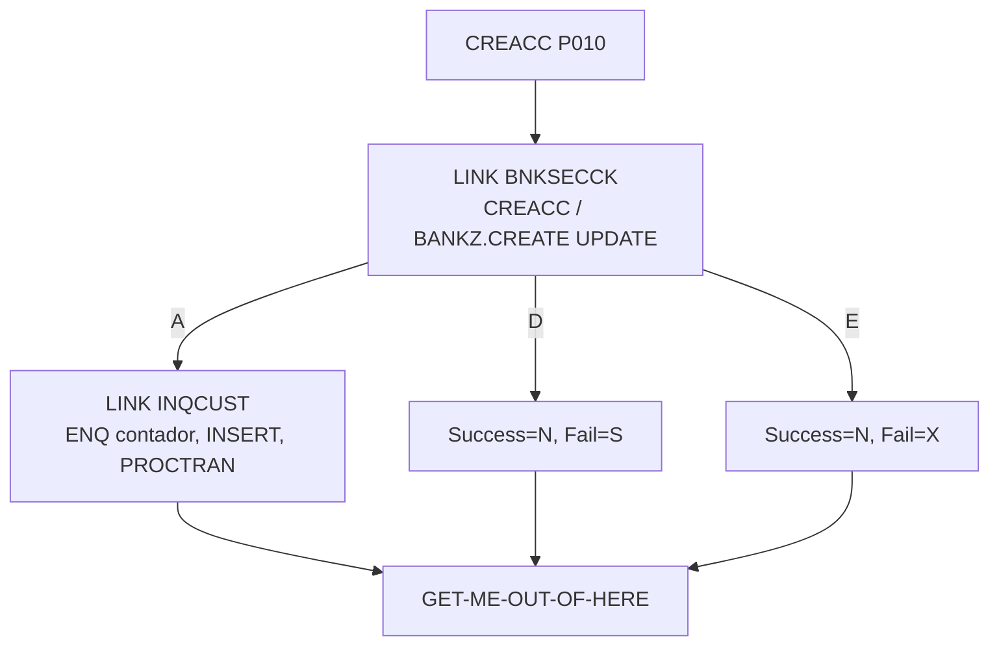

# Especificação Técnica — CREACC (alteração para segurança RACF)

**Versão:** 0.1  
**Data:** 2026-11-05  
**Autor:** Gerado via IBM Bob Z Architect  
**Status:** Rascunho para validação  
**Origem:** [`RACF-security-functional-spec.md`](RACF-security-functional-spec.md) (RF-11) · **Padrão de integração:** [`RACF-security-technical-index.md`](RACF-security-technical-index.md) §3 · **Verificador:** [`BNKSECCK-technical-spec.md`](BNKSECCK-technical-spec.md)

---

## 1. Identificação do Programa

| Atributo | Valor |
|----------|-------|
| Nome do Programa | [`CREACC`](../../src/base/cics/cobol/CREACC.cbl) |
| Tipo | Subprograma CICS (LINK) com DB2 |
| Cabeçalho | `CBL CICS('SP,EDF')` + `CBL SQL` |
| Entrada | `PROCEDURE DIVISION USING DFHCOMMAREA` (linha 301); `COPY CREACC` ([`CREACC.cpy`](../../src/base/cics/copy/CREACC.cpy)) |
| Chamador | `BNK1CAC` (linha 776). Sem ativo de API |
| Seção principal | `PREMIERE SECTION.` / `P010.` (linhas 302–303) |
| Programas chamados | `INQCUST` (linha 327), `INQACCCU` (linha 1182) |
| Operação de segurança | `CREACC  ` → perfil `BANKZ.CREATE`, nível **UPDATE**, papéis `BZTELLER` e `BZMGR` |

## 2. Objetivo da alteração

Impedir criação de contas por papéis sem permissão (Auditor).

## 3. Origem dos Dados

Sem novas fontes. Perfil `BANKZ.CREATE` compartilhado com `CRECUST`.

## 4. Regras de Negócio

| ID | Regra |
|----|-------|
| RN-01 | A verificação ocorre no início de `P010`, antes do primeiro `DISPLAY` (linha 305), antes do `LINK` a `INQCUST` (linha 327) e antes de `ENQ-NAMED-COUNTER` (linha 408). Assim a existência do cliente não é revelada a quem não tem permissão e o contador de conta não é bloqueado. |
| RN-02 | Autorizado → fluxo inalterado. |
| RN-03 | Negado → `COMM-SUCCESS='N'`, `COMM-FAIL-CODE='S'`. |
| RN-04 | Erro de segurança → `COMM-SUCCESS='N'`, `COMM-FAIL-CODE='X'`. |
| RN-05 | Os códigos existentes `'1'`, `'3'`, `'5'`, `'7'`, `'8'`, `'9'`, `'A'` permanecem; `'S'` e `'X'` não colidem. |
| RN-06 | Por não haver ENQ pendente, o caminho negado não precisa de `DEQ-NAMED-COUNTER`. |

## 5. Lógica de Processamento

```
P010
  PERFORM SECURITY-CHECK                <- NOVO (antes da linha 305)
  IF NOT SEC-OK  -> PERFORM GET-ME-OUT-OF-HERE
  ... LINK INQCUST, ENQ contador, INSERT de conta, PROCTRAN ...
```

## 7. Estrutura — alterações no fonte

| Local | Alteração |
|-------|-----------|
| `WORKING-STORAGE` | `01 BNKSEC-COMMAREA. COPY BNKSEC.` e `WS-SEC-SW` com 88-level `SEC-OK` |
| `PREMIERE` | `PERFORM SECURITY-CHECK` no início de `P010` |
| Nova seção | `SECURITY-CHECK SECTION. SC010 … SC999. EXIT.` com `MOVE 'CREACC  ' TO BNKSEC-OPERATION` |
| Saída | `GET-ME-OUT-OF-HERE` (linha 1162) |

## 12. Códigos de Retorno (`COMM-FAIL-CODE`)

Atuais: `1` (cliente não encontrado), `3` (falha ENQ), `5` (falha DEQ), `7`, `8`, `9`, `A`. Novos:

| Código | Significado |
|--------|-------------|
| **`S`** | Acesso negado (RACF) |
| **`X`** | Erro na verificação de segurança |

`BNK1CAC` (linha 849) usa `EVALUATE SUBPGM-FAIL-CODE` com `'1'`–`'9'` e `'A'` e um `WHEN OTHER` (linha 918); `'S'`/`'X'` cairiam nele. Ver index §5.

## 15. Testes

| ID | Cenário | Esperado |
|----|---------|----------|
| CA-01 | `BZTELLER` cria conta para cliente existente | `'Y'` |
| CA-02 | `BZMGR` cria conta | `'Y'` |
| CA-03 | `BZAUDIT` tenta criar | `'N'`/`'S'`; sem conta, sem ENQ, contador intacto |
| CA-04 | `BZAUDIT` tenta criar para cliente inexistente | `'N'`/`'S'` (não `'1'`) |
| CA-05 | `BNKSECCK` indisponível | `'N'`/`'X'` |
| CA-06 | `BZTELLER`, cliente inexistente | `'N'`/`'1'` (preservado) |

## 16. Diagrama de Fluxo



## 17. Localização dos Artefatos

| Artefato | Caminho |
|----------|---------|
| Programa | [`CREACC.cbl`](../../src/base/cics/cobol/CREACC.cbl) |
| COMMAREA | [`CREACC.cpy`](../../src/base/cics/copy/CREACC.cpy) (sem mudança) |
| Tela chamadora | [`BNK1CAC.cbl`](../../src/base/cics/cobol/BNK1CAC.cbl) |
