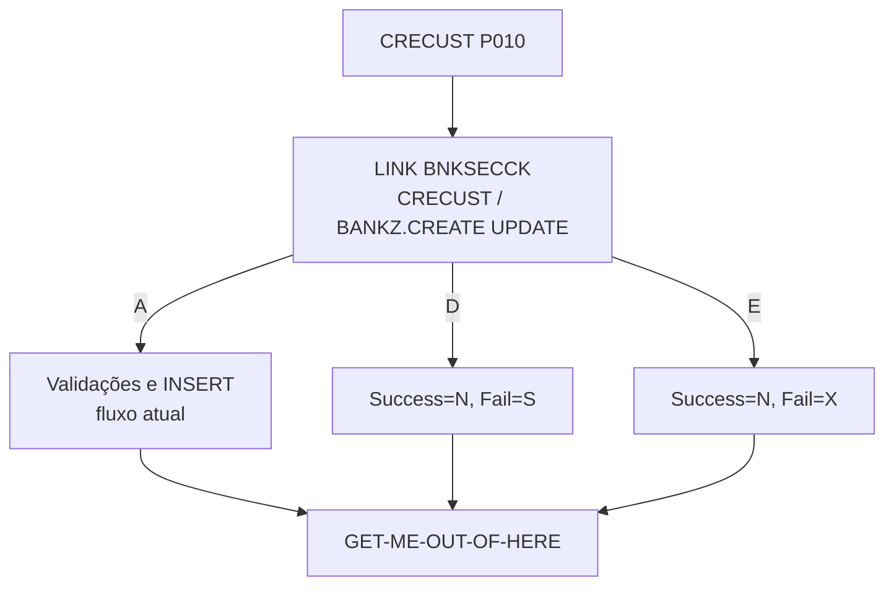

# Especificação Técnica — CRECUST (alteração para segurança RACF)

**Versão:** 0.1  
**Data:** 2026-11-05  
**Autor:** Gerado via IBM Bob Z Architect  
**Status:** Rascunho para validação  
**Origem:** [`RACF-security-functional-spec.md`](RACF-security-functional-spec.md) (RF-11) · **Padrão de integração:** [`RACF-security-technical-index.md`](RACF-security-technical-index.md) §3 · **Verificador:** [`BNKSECCK-technical-spec.md`](BNKSECCK-technical-spec.md)

---

## 1. Identificação do Programa

| Atributo | Valor |
|----------|-------|
| Nome do Programa | [`CRECUST`](../../src/base/cics/cobol/CRECUST.cbl) |
| Tipo | Subprograma CICS (LINK) com DB2 |
| Cabeçalho | `CBL CICS('SP,EDF')` + `CBL SQL` |
| Entrada | `PROCEDURE DIVISION USING DFHCOMMAREA` (linha 405); `COPY CRECUST` ([`CRECUST.cpy`](../../src/base/cics/copy/CRECUST.cpy)) |
| Chamadores | `BNK1CCS` (linha 998) e API `POST /customers` (ativo `CRECUST`) |
| Seção principal | `PREMIERE SECTION.` / `P010.` (linhas 406–407) |
| Operação de segurança | `CRECUST ` → perfil `BANKZ.CREATE`, nível **UPDATE**, papéis `BZTELLER` e `BZMGR` |

## 2. Objetivo da alteração

Impedir criação de clientes por papéis sem permissão (Auditor). Teller e Gerente continuam autorizados.

## 3. Origem dos Dados

Sem novas fontes. O perfil `BANKZ.CREATE` é **novo** em relação à spec funcional (ver [`BNKSECCK-technical-spec.md`](BNKSECCK-technical-spec.md) §4.1).

## 4. Regras de Negócio

| ID | Regra |
|----|-------|
| RN-01 | A verificação é a **primeira** ação de `P010`, antes da validação de título (linha 413) e antes de `ENQ-NAMED-COUNTER` (linha 508) e `UPD-NCS` (linha 513), para não bloquear nem consumir o contador de número de cliente em tentativa negada. Como a checagem precede o `ENQ`, o caminho negado **não** precisa chamar `DEQ-NAMED-COUNTER`. |
| RN-02 | Autorizado → fluxo inalterado. |
| RN-03 | Negado → `COMM-SUCCESS='N'`, `COMM-FAIL-CODE='S'`. |
| RN-04 | Erro de segurança → `COMM-SUCCESS='N'`, `COMM-FAIL-CODE='X'`. |
| RN-05 | Os códigos existentes `'T'`, `'G'`, `'3'`, `'5'`, `'A'`–`'H'`, `'1'`, `'4'`, `'O'`, `'Z'`, `'Y'` permanecem; `'S'` e `'X'` não colidem com nenhum deles. |

## 5. Lógica de Processamento

```
P010
  PERFORM SECURITY-CHECK                <- NOVO
  IF NOT SEC-OK  -> PERFORM GET-ME-OUT-OF-HERE
  ... validação de título, datas, scoring (CRDTAGY1-5), geração de número, INSERT ...
```

O programa possui vários `PERFORM GET-ME-OUT-OF-HERE` (ex.: linha 520); a saída negada reaproveita o mesmo ponto único (`EXEC CICS RETURN`).

## 7. Estrutura — alterações no fonte

| Local | Alteração |
|-------|-----------|
| `WORKING-STORAGE` | `01 BNKSEC-COMMAREA. COPY BNKSEC.` e `WS-SEC-SW` com 88-level `SEC-OK` |
| `PREMIERE` | `PERFORM SECURITY-CHECK` no início de `P010` |
| Nova seção | `SECURITY-CHECK SECTION. SC010 … SC999. EXIT.` com `MOVE 'CRECUST ' TO BNKSEC-OPERATION` |

## 12. Códigos de Retorno (`COMM-FAIL-CODE`)

Códigos atuais conforme os fontes (T título; G; 3; 5; A–H; 1; 4; O idade máxima; Z data inválida; Y data futura) mais:

| Código | Significado |
|--------|-------------|
| **`S`** | Acesso negado (RACF) |
| **`X`** | Erro na verificação de segurança |

`BNK1CCS` (linhas 1069–1084) trata apenas `'O'`, `'Y'`, `'Z'`; os demais, inclusive `'S'`/`'X'`, mostram "Sorry but unable to create Customer record". Ver index §5. API: `POST /customers` hoje mapeia `COMM-SUCCESS = "N"` para HTTP 400; negação deve ser 403 (index §6).

## 15. Testes

| ID | Cenário | Esperado |
|----|---------|----------|
| CC-01 | `BZTELLER` cria cliente válido | `'Y'`; número gerado |
| CC-02 | `BZMGR` cria cliente válido | `'Y'` |
| CC-03 | `BZAUDIT` tenta criar | `'N'`/`'S'`; nenhum registro; contador de número **não** consumido |
| CC-04 | `BNKSECCK` indisponível | `'N'`/`'X'` |
| CC-05 | `BZTELLER`, data de nascimento futura | `'N'`/`'Y'` (preservado) |
| CC-06 | API `POST /customers` com Auditor | HTTP 403 |

## 16. Diagrama de Fluxo



## 17. Localização dos Artefatos

| Artefato | Caminho |
|----------|---------|
| Programa | [`CRECUST.cbl`](../../src/base/cics/cobol/CRECUST.cbl) |
| COMMAREA | [`CRECUST.cpy`](../../src/base/cics/copy/CRECUST.cpy) (sem mudança) |
| Mapeamento API | `src/api/src/main/operations/%2Fcustomers/post/response_mapping.yaml` |
| Tela chamadora | [`BNK1CCS.cbl`](../../src/base/cics/cobol/BNK1CCS.cbl) |
