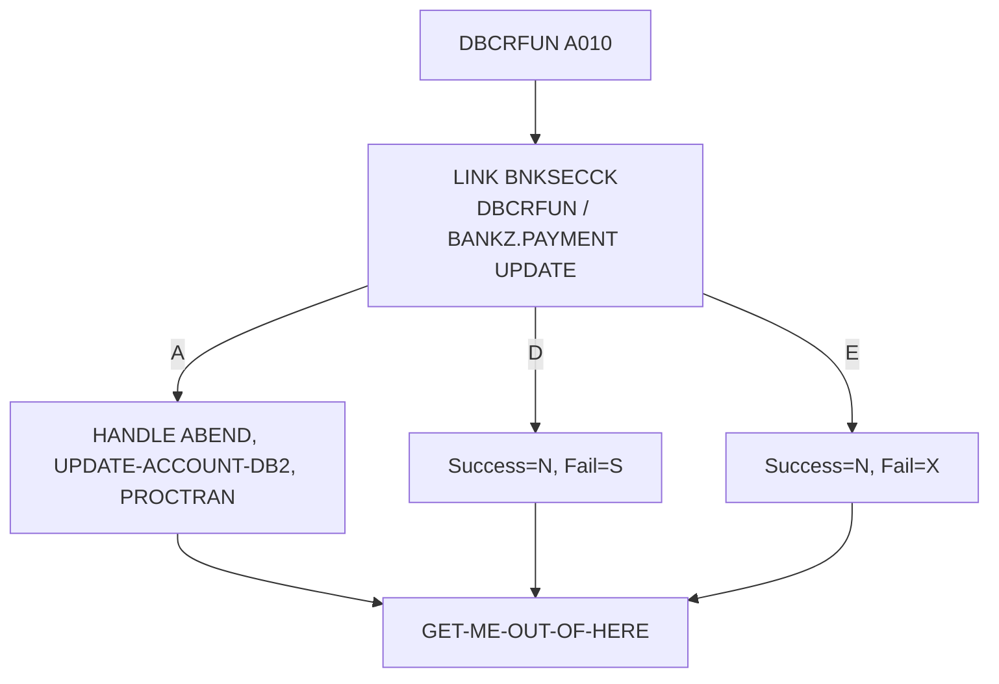

# Especificação Técnica — DBCRFUN (alteração para segurança RACF)

**Versão:** 0.1  
**Data:** 2026-11-05  
**Autor:** Gerado via IBM Bob Z Architect  
**Status:** Rascunho para validação  
**Origem:** [`RACF-security-functional-spec.md`](RACF-security-functional-spec.md) (RF-11, RF-21) · **Padrão de integração:** [`RACF-security-technical-index.md`](RACF-security-technical-index.md) §3 · **Verificador:** [`BNKSECCK-technical-spec.md`](BNKSECCK-technical-spec.md)

---

## 1. Identificação do Programa

| Atributo | Valor |
|----------|-------|
| Nome do Programa | [`DBCRFUN`](../../src/base/cics/cobol/DBCRFUN.cbl) |
| Tipo | Subprograma CICS (LINK) com DB2 — débito/crédito |
| Cabeçalho | `PROCESS` + `CBL CICS('SP,EDF')` + `CBL SQL` |
| Entrada | `PROCEDURE DIVISION USING DFHCOMMAREA` (linha 198); `COPY PAYDBCR` ([`PAYDBCR.cpy`](../../src/base/cics/copy/PAYDBCR.cpy)) |
| Chamadores | `BNK1CRA` (linha 512) e API `POST /accounts/{accountId}/deposit` (ativo `DBCRFUN`/`PAYDBCRZ`) |
| Seção principal | `PREMIERE SECTION.` / `A010.` (linhas 199–200) |
| Operação de segurança | `DBCRFUN ` → perfil `BANKZ.PAYMENT`, nível **UPDATE**, papéis `BZTELLER` e `BZMGR` |

## 2. Objetivo da alteração

1. Impedir débito/crédito por papéis sem permissão (Auditor).
2. Gravar o **usuário de origem** na trilha de auditoria (RF-21), hoje não aproveitado.

## 3. Origem dos Dados

`PAYDBCR.cpy` já traz `COMM-ORIGIN` com `COMM-APPLID`, `COMM-USERID`, `COMM-FACILITY-NAME`, `COMM-NETWRK-ID`, `COMM-FACILTYPE` e `COMM-DESCRIPTION`. O programa **não lê** `COMM-USERID`: em `PROCTRAN` usa `COMM-DESCRIPTION` quando preenchida e, senão, `COMM-ORIGIN(1:14)` (linhas 500–521). O `BNK1CRA` já preenche a origem usando `INQUIRE ASSOCIATION ... ODUSERID` (linhas ~503–509).

## 4. Regras de Negócio

| ID | Regra |
|----|-------|
| RN-01 | A verificação ocorre em `A010`, após as inicializações `COMM-SUCCESS='N'` e `COMM-FAIL-CODE='0'` (linhas 201–202) e **antes** do `HANDLE ABEND` e de `UPDATE-ACCOUNT-DB2` (linha 223). |
| RN-02 | Autorizado → fluxo inalterado. |
| RN-03 | Negado → `COMM-SUCCESS='N'`, `COMM-FAIL-CODE='S'`. |
| RN-04 | Erro de segurança → `COMM-SUCCESS='N'`, `COMM-FAIL-CODE='X'`. |
| RN-05 | Os códigos `'0'`–`'4'` existentes permanecem. Em `BNK1CRA` há `WHEN OTHER` (linha 612). |
| RN-06 | **Auditoria:** quando `COMM-USERID` vier em branco, o programa deve preenchê-lo com `BNKSEC-USERID` (usuário efetivamente verificado, devolvido pelo `BNKSECCK`). Alteração mínima e opcional **[A DECIDIR D-6]**; não altera o layout. |
| RN-07 | **Escopo da autorização por valor:** não há limite por valor nesta fase (questão Q3 da spec funcional em aberto). |

## 5. Lógica de Processamento

```
A010
  MOVE 'N' TO COMM-SUCCESS ; MOVE '0' TO COMM-FAIL-CODE        (existente)
  PERFORM SECURITY-CHECK                                         <- NOVO
  IF SEC-OK
     HANDLE ABEND ... MOVE SORTCODE ... PERFORM UPDATE-ACCOUNT-DB2
  END-IF
  PERFORM GET-ME-OUT-OF-HERE
```

O `HANDLE ABEND LABEL(ABEND-HANDLING)` (linha 207) precisa estar ativo antes de qualquer risco de abend; como a checagem não abenda (devolve `E`), ela pode vir antes dele sem perda de cobertura.

## 7. Estrutura — alterações no fonte

| Local | Alteração |
|-------|-----------|
| `WORKING-STORAGE` | `01 BNKSEC-COMMAREA. COPY BNKSEC.` e `WS-SEC-SW` com 88-level `SEC-OK` |
| `PREMIERE` | Ver §5 |
| Nova seção | `SECURITY-CHECK SECTION. SC010 … SC999. EXIT.` com `MOVE 'DBCRFUN ' TO BNKSEC-OPERATION` |
| Saída | `GET-ME-OUT-OF-HERE` (`EXEC CICS RETURN` + `GOBACK`) |

## 12. Códigos de Retorno (`COMM-FAIL-CODE`)

| Código | Origem | Significado |
|--------|--------|-------------|
| `0` | existente | Sem falha |
| `1`–`4` | existentes | Falhas de negócio/datastore |
| **`S`** | **novo** | Acesso negado (RACF) |
| **`X`** | **novo** | Erro na verificação de segurança |

API: `POST /accounts/{accountId}/deposit` usa `COMM-SUCCESS != "Y"` para HTTP 404 (`response_404`, linha 4 do mapeamento). Sem ajuste, a negação sairia como **404** em vez de 403. Ver index §6.

## 15. Testes

| ID | Cenário | Esperado |
|----|---------|----------|
| DB-01 | `BZTELLER` deposita em conta válida | `'Y'`; PROCTRAN gravado |
| DB-02 | `BZMGR` deposita | `'Y'` |
| DB-03 | `BZAUDIT` tenta depositar | `'N'`/`'S'`; saldo e PROCTRAN inalterados |
| DB-04 | `BNKSECCK` indisponível | `'N'`/`'X'` |
| DB-05 | API deposit com Auditor | HTTP 403 (e não 404) |
| DB-06 | Conta inexistente com `BZTELLER` | `'N'`/`'1'` (preservado) |

## 16. Diagrama de Fluxo



## 17. Localização dos Artefatos

| Artefato | Caminho |
|----------|---------|
| Programa | [`DBCRFUN.cbl`](../../src/base/cics/cobol/DBCRFUN.cbl) |
| COMMAREA | [`PAYDBCR.cpy`](../../src/base/cics/copy/PAYDBCR.cpy) (sem mudança de layout) |
| Mapeamento API | `src/api/src/main/operations/%2Faccounts%2F%7BaccountId%7D%2Fdeposit/post/response_mapping.yaml` |
| Ativo z/OS Connect | `src/api/src/main/zosAssets/DBCRFUN/` (não editar `providerFiles/gen/`) |
| Tela chamadora | [`BNK1CRA.cbl`](../../src/base/cics/cobol/BNK1CRA.cbl) |
