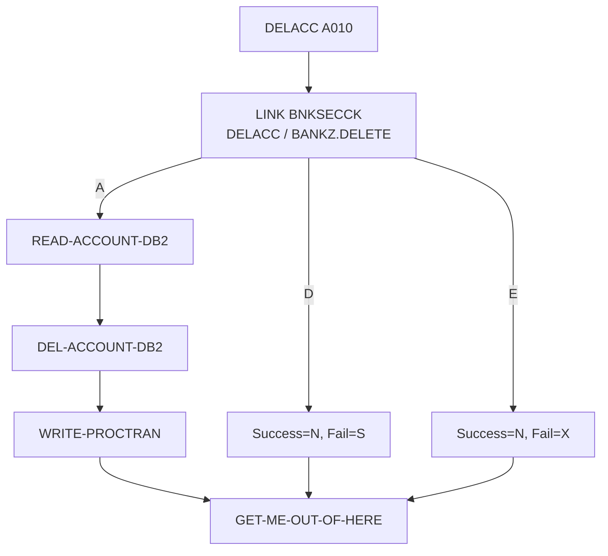

# Especificação Técnica — DELACC (alteração para segurança RACF)

**Versão:** 0.1  
**Data:** 2026-11-05  
**Autor:** Gerado via IBM Bob Z Architect  
**Status:** Rascunho para validação  
**Origem:** [`RACF-security-functional-spec.md`](RACF-security-functional-spec.md) (RF-11, RF-13) · **Padrão de integração:** [`RACF-security-technical-index.md`](RACF-security-technical-index.md) §3 · **Verificador:** [`BNKSECCK-technical-spec.md`](BNKSECCK-technical-spec.md)

---

## 1. Identificação do Programa

| Atributo | Valor |
|----------|-------|
| Nome do Programa | [`DELACC`](../../src/base/cics/cobol/DELACC.cbl) |
| Tipo | Subprograma CICS (LINK) com DB2 |
| Cabeçalho | `CBL CICS('SP,EDF')` + `CBL SQL` |
| Entrada | `COPY DELACC REPLACING DELACC-COMMAREA BY DFHCOMMAREA` (linha 200), `PROCEDURE DIVISION USING DFHCOMMAREA` |
| Chamadores | `BNK1DAC` (3270, linha 714) e `DELCUS` (cascata, linha 378) |
| Operação de segurança | `DELACC  ` → perfil `BANKZ.DELETE`, nível **UPDATE**, papel `BZMGR` |

## 2. Objetivo da alteração

Garantir que a exclusão de conta só ocorra para usuário com `UPDATE` em `BANKZ.DELETE`, tanto na chamada direta (tela) quanto na cascata de `DELCUS`.

## 3. Origem dos Dados

Sem novas fontes. Nova dependência: LINK para `BNKSECCK`.

## 4. Regras de Negócio

| ID | Regra |
|----|-------|
| RN-01 | Verificação executada antes de `READ-ACCOUNT-DB2` (linha 212). |
| RN-02 | Autorizado → fluxo inalterado (`READ-ACCOUNT-DB2`, `DEL-ACCOUNT-DB2`, `WRITE-PROCTRAN`). |
| RN-03 | Negado → `DELACC-DEL-SUCCESS = 'N'`, `DELACC-DEL-FAIL-CD = 'S'`. |
| RN-04 | Erro de segurança → `DELACC-DEL-SUCCESS = 'N'`, `DELACC-DEL-FAIL-CD = 'X'`. |
| RN-05 | Na cascata, `DELCUS` já verificou o mesmo perfil; a segunda checagem custa um LINK adicional por conta (impacto de desempenho a medir, meta RNF-02 ≤ 50 ms). **[A DECIDIR D-4]**: aceitar a repetição (recomendado, DELACC pode ser chamado isoladamente) ou criar um indicador "já autorizado" (rejeitado: permitiria burlar a checagem preenchendo o campo). |

## 5. Lógica de Processamento

```
A010
  MOVE SORTCODE TO REQUIRED-SORT-CODE OF ACCOUNT-KEY-RID   (existente, linha 207)
  PERFORM SECURITY-CHECK                                     <- NOVO
  IF SEC-OK
     PERFORM READ-ACCOUNT-DB2 ... (fluxo atual, linhas 212-224)
  END-IF
  PERFORM GET-ME-OUT-OF-HERE
```

O `IF DELACC-DEL-SUCCESS = 'Y'` do fluxo atual (linha 218) depende de `READ-ACCOUNT-DB2` ter posto `'Y'`; por isso a verificação deve **envolver** o `PERFORM READ-ACCOUNT-DB2` num `IF SEC-OK` (não apenas preceder), para que o sucesso não seja inferido de valor residual.

## 7. Estrutura — alterações no fonte

| Local | Alteração |
|-------|-----------|
| `WORKING-STORAGE` | `01 BNKSEC-COMMAREA. COPY BNKSEC.` e `WS-SEC-SW` com 88-level `SEC-OK` |
| `PREMIERE` | Ver §5 |
| Nova seção | `SECURITY-CHECK SECTION. SC010 … SC999. EXIT.` com `MOVE 'DELACC  ' TO BNKSEC-OPERATION` |
| Observação | O fail code `'2'` é tratado por `BNK1DAC` (linha 746) mas não é atribuído em `DELACC`; há abend `HRAC` (linha 339). Fora do escopo |

## 12. Códigos de Retorno (`DELACC-DEL-FAIL-CD`)

| Código | Origem | Significado |
|--------|--------|-------------|
| `1` | existente | Conta não encontrada |
| `2` | tratado só na tela | Erro de datastore |
| `3` | existente | Erro de delete |
| **`S`** | **novo** | Acesso negado (RACF) |
| **`X`** | **novo** | Erro na verificação de segurança |

`BNK1DAC` (linhas 734–779) tem os casos `'1'`, `'2'`, `'3'` e um caso genérico final ("delete error occurred"): `'S'`/`'X'` hoje cairiam na mensagem genérica. Ver index §5. **Atenção (verificado em [`DELCUS.cbl`](../../src/base/cics/cobol/DELCUS.cbl:367)):** `DELCUS` só exibe `DELACC-COMM-DEL-SUCCESS` e não o testa; depois apaga o cliente e grava `'Y'` incondicionalmente (linhas 347–348). Sem a correção RN-07 da [`DELCUS-technical-spec.md`](DELCUS-technical-spec.md), uma negação `'S'` em `DELACC` na cascata deixaria as contas e removeria o cliente. As duas alterações devem ser entregues juntas.

## 15. Testes

| ID | Cenário | Esperado |
|----|---------|----------|
| DA-01 | `BZMGR` exclui conta existente | `'Y'`; PROCTRAN gravado |
| DA-02 | `BZTELLER` tenta excluir | `'N'`/`'S'`; conta intacta |
| DA-03 | `BZMGR`, conta inexistente | `'N'`/`'1'` |
| DA-04 | `BNKSECCK` indisponível | `'N'`/`'X'` |
| DA-05 | `BZMGR` exclui cliente com 3 contas (cascata) | Todas excluídas; 3 checagens de segurança no log |
| DA-06 | `BZTELLER` aciona cascata via DELCUS | Bloqueado já em `DELCUS` |

## 16. Diagrama de Fluxo



## 17. Localização dos Artefatos

| Artefato | Caminho |
|----------|---------|
| Programa | [`DELACC.cbl`](../../src/base/cics/cobol/DELACC.cbl) |
| COMMAREA | [`DELACC.cpy`](../../src/base/cics/copy/DELACC.cpy) (sem mudança de layout) |
| Telas | [`BNK1DAC.cbl`](../../src/base/cics/cobol/BNK1DAC.cbl) |
| API | Sem ativo próprio (acesso apenas via `DELCUS`) |
