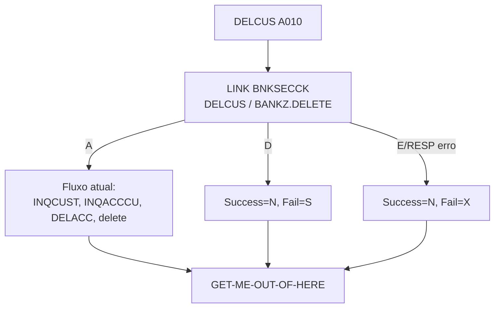

# Especificação Técnica — DELCUS (alteração para segurança RACF)

**Versão:** 0.1  
**Data:** 2026-11-05  
**Autor:** Gerado via IBM Bob Z Architect  
**Status:** Rascunho para validação  
**Origem:** [`RACF-security-functional-spec.md`](RACF-security-functional-spec.md) (RF-11, RF-13) · **Padrão de integração:** [`RACF-security-technical-index.md`](RACF-security-technical-index.md) §3 · **Verificador:** [`BNKSECCK-technical-spec.md`](BNKSECCK-technical-spec.md)

---

## 1. Identificação do Programa

| Atributo | Valor |
|----------|-------|
| Nome do Programa | [`DELCUS`](../../src/base/cics/cobol/DELCUS.cbl) |
| Tipo | Subprograma CICS (LINK) com DB2 |
| Cabeçalho | `CBL CICS('SP,EDF')` + `CBL SQL` |
| Entrada | `PROCEDURE DIVISION USING DFHCOMMAREA`, `COPY DELCUS` ([`DELCUS.cpy`](../../src/base/cics/copy/DELCUS.cpy)) |
| Chamadores | `BNK1DCS` (3270, linha 1012) e API `DELETE /customers/{customerId}` (ativo `DELCUSZ`) |
| Programas chamados | `INQCUST`, `INQACCCU`, `DELACC` (LINK, linha 378 sem `RESP`) |
| Operação de segurança | `DELCUS  ` → perfil `BANKZ.DELETE`, nível **UPDATE**, papel `BZMGR` |

## 2. Objetivo da alteração

Impedir que um usuário sem autorização de exclusão (Teller, Auditor) remova um cliente e suas contas, mesmo que o chamador não tenha feito a checagem (defesa em profundidade, RF-11). Comportamento funcional atual **não muda** para usuários autorizados.

## 3. Origem dos Dados

Sem novas fontes. Nova dependência: LINK para `BNKSECCK` (COMMAREA [`BNKSEC.cpy`](../../src/base/cics/copy/BNKSEC.cpy), 35 bytes).

## 4. Regras de Negócio

| ID | Regra |
|----|-------|
| RN-01 | A verificação ocorre **antes** de qualquer `DISPLAY` de dados, `LINK` a `INQCUST` ou acesso a DB2 (nenhum dado é lido para quem não tem direito). |
| RN-02 | `BNKSEC-ALLOWED` → fluxo atual inalterado. |
| RN-03 | `BNKSEC-DENIED` → `COMM-DEL-SUCCESS = 'N'`, `COMM-DEL-FAIL-CD = 'S'`, retorna sem tocar em cliente/contas. |
| RN-04 | `BNKSEC-ERROR` ou falha no `LINK` (RESP ≠ NORMAL) → `COMM-DEL-SUCCESS = 'N'`, `COMM-DEL-FAIL-CD = 'X'`. |
| RN-05 | Os códigos `'1'` (não encontrado), `'2'` (datastore) e `'3'` (erro de delete) permanecem; `'S'` e `'X'` são novos. |
| RN-06 | A exclusão em cascata chama `DELACC`, que fará sua própria verificação (mesmo perfil `BANKZ.DELETE`). Usuário autorizado em um é autorizado no outro. |
| RN-07 | **Risco existente, agravado pela segurança:** `DELETE-ACCOUNTS` (linhas 367–383) apenas exibe `DELACC-COMM-DEL-SUCCESS` e **não o testa**; ao final `DELCUS` grava `'Y'` incondicionalmente (linhas 347–348) e apaga o cliente. Se `DELACC` devolver `'N'` (inclusive `'S'`/`'X'`), as contas permanecem e o cliente é removido. Alteração proposta (mínima e necessária para a segurança): após cada LINK a `DELACC`, se `DELACC-COMM-DEL-SUCCESS = 'N'`, copiar o fail code para `COMM-DEL-FAIL-CD`, `'N'` para `COMM-DEL-SUCCESS` e **interromper** a cascata antes de `DEL-CUST-DB2`. **[A DECIDIR D-5]** pois muda o comportamento atual para falhas não relacionadas a segurança (ex.: conta não encontrada). |

## 5. Lógica de Processamento

```
A010 (início)
  PERFORM SECURITY-CHECK            <- NOVO (antes da linha 281)
  IF não autorizado -> PERFORM GET-ME-OUT-OF-HERE (ou GOBACK) com 'S'/'X'
  ... restante do fluxo atual (INQCUST -> INQACCCU -> DELACC -> delete -> PROCTRAN)
```

Ponto de inserção: imediatamente após `A010.` ([`DELCUS.cbl`](../../src/base/cics/cobol/DELCUS.cbl:279)), antes do primeiro `DISPLAY` (linha 281). O programa já usa `GET-ME-OUT-OF-HERE`; reutilizá-lo no caminho negado para manter um único ponto de saída.

## 7. Estrutura — alterações no fonte

| Local | Alteração |
|-------|-----------|
| `WORKING-STORAGE` | `01 BNKSEC-COMMAREA. COPY BNKSEC.` e switch `WS-SEC-SW` com 88-level `SEC-OK` / `SEC-NOT-OK` |
| `PREMIERE` | `PERFORM SECURITY-CHECK` e `IF NOT SEC-OK ... GO TO A999`/`PERFORM GET-ME-OUT-OF-HERE` |
| Nova seção | `SECURITY-CHECK SECTION. SC010 … SC999. EXIT.` conforme index §3 com `MOVE 'DELCUS  ' TO BNKSEC-OPERATION` |
| `WS-CICS-WORK-AREA` | Já existe (`WS-CICS-RESP` nível 05, linha 103) |
| Pontos a observar | LINK a `DELACC` (linha 378) não usa `RESP`/`RESP2`, em desacordo com o padrão do projeto; **fora do escopo** desta alteração, mas registrar como dívida técnica |

## 12. Códigos de Retorno (`COMM-DEL-FAIL-CD`)

| Código | Origem | Significado |
|--------|--------|-------------|
| `1` | existente | Cliente não encontrado |
| `2` | existente | Erro de datastore |
| `3` | existente | Erro de delete |
| **`S`** | **novo** | Acesso negado (RACF) |
| **`X`** | **novo** | Erro na verificação de segurança |

Tratamento nos chamadores: `BNK1DCS` (linhas 1084–1121) possui os casos `'1'`, `'2'`, `'3'` e um caso genérico; `'S'`/`'X'` hoje cairiam na mensagem genérica de erro de delete. Ver [`RACF-security-technical-index.md`](RACF-security-technical-index.md) §5. API: ver §5.2 do index (`response_403` / `response_503`).

## 15. Testes

| ID | Cenário | Esperado |
|----|---------|----------|
| DC-01 | `BZMGR` exclui cliente existente | `COMM-DEL-SUCCESS='Y'`; registros apagados; PROCTRAN gravado |
| DC-02 | `BZTELLER` tenta excluir | `'N'`/`'S'`; cliente e contas intactos; nenhum `LINK` a `INQCUST` |
| DC-03 | `BZAUDIT` tenta excluir | `'N'`/`'S'` |
| DC-04 | `BNKSECCK` indisponível (PROGRAM desabilitado) | `'N'`/`'X'` |
| DC-05 | `BZMGR`, cliente inexistente | `'N'`/`'1'` (comportamento atual preservado) |
| DC-06 | API `DELETE` com Teller | HTTP 403 (após ajuste do mapeamento) |
| DC-07 | `DELACC` devolve `'N'` na 2ª de 3 contas (simulado) | Cascata interrompida; cliente **não** é apagado; `COMM-DEL-SUCCESS='N'` (RN-07) |

## 16. Diagrama de Fluxo



## 17. Localização dos Artefatos

| Artefato | Caminho |
|----------|---------|
| Programa | [`DELCUS.cbl`](../../src/base/cics/cobol/DELCUS.cbl) |
| COMMAREA | [`DELCUS.cpy`](../../src/base/cics/copy/DELCUS.cpy) (sem mudança de layout) |
| Mapeamento API | `src/api/src/main/operations/%2Fcustomers%2F%7BcustomerId%7D/delete/response_mapping.yaml` |
| Tela chamadora | [`BNK1DCS.cbl`](../../src/base/cics/cobol/BNK1DCS.cbl) |
