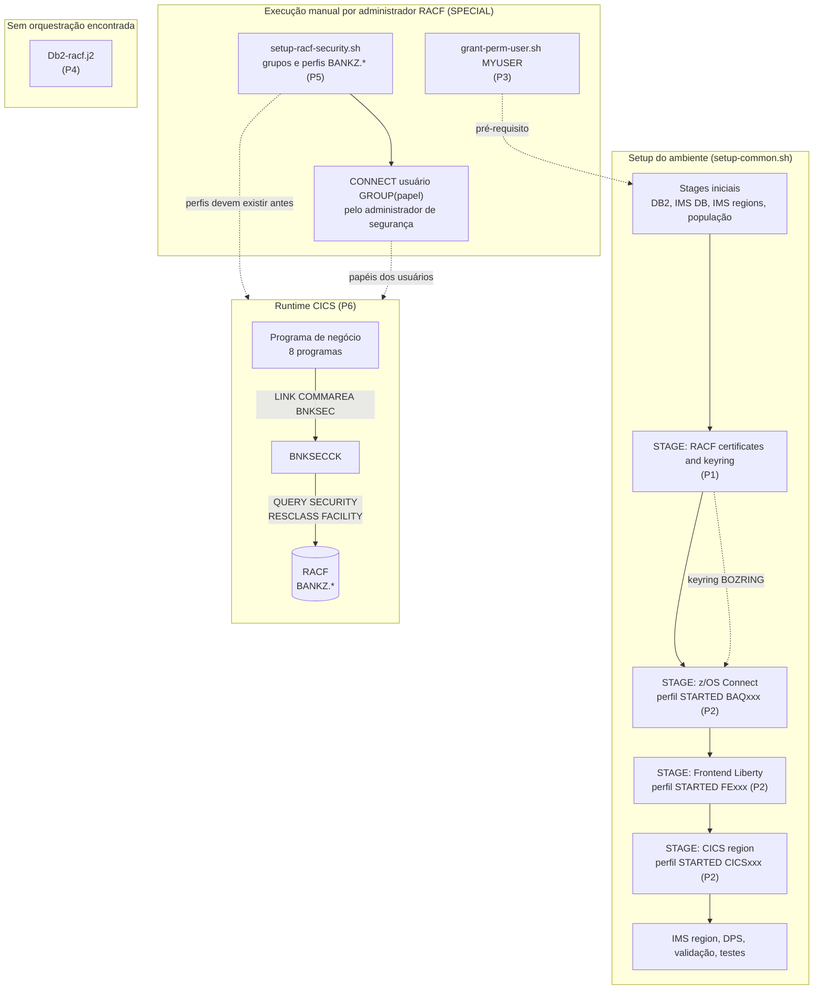
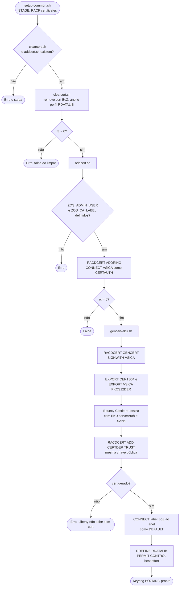
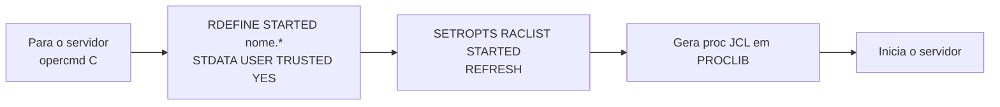
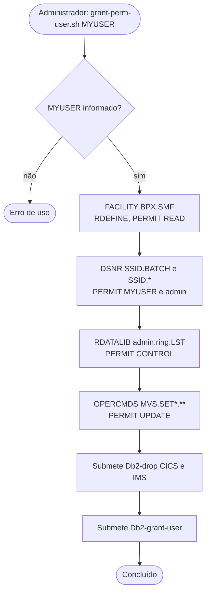
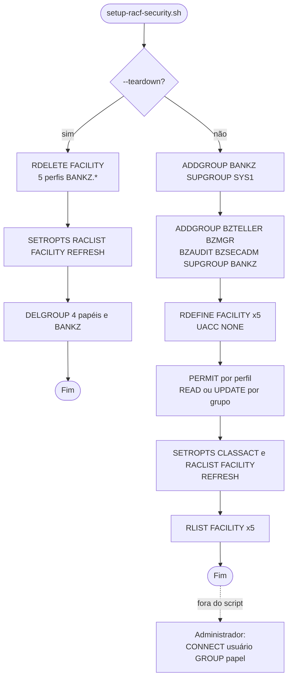
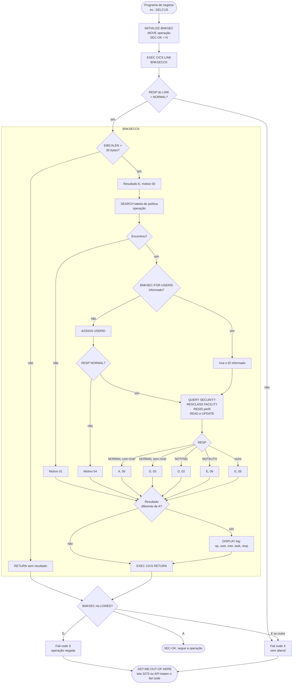
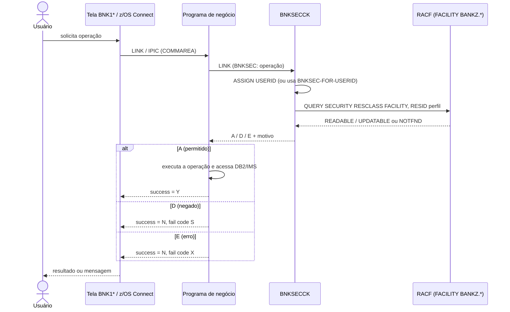
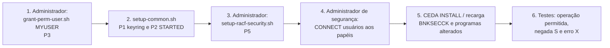

# Levantamento dos Processos RACF — Bank of Z

**Versão:** 1.0
**Autor:** Gerado via IBM Bob Z Architect
**Status:** Levantamento (as-is) para validação
**Escopo:** Todos os usos de RACF/SAF encontrados no repositório (provisionamento, execução CICS, servidores Liberty, DB2)
**Relacionados:** [`RACF-security-functional-spec.md`](RACF-security-functional-spec.md), [`RACF-security-technical-index.md`](RACF-security-technical-index.md), [`BNKSECCK-technical-spec.md`](BNKSECCK-technical-spec.md)

> Este documento descreve o que **existe hoje no código**. Onde o repositório contém apenas especificação (e não implementação), isso é indicado. Itens **[A VALIDAR]** dependem de confirmação no ambiente z/OS.

---

## 1. Resumo executivo

Foram identificados **6 grupos de processos RACF**:

| # | Grupo de processo | Quando executa | Artefato principal | Orquestrado por `setup-common.sh`? |
|---|-------------------|----------------|--------------------|:---:|
| P1 | Keyring e certificado TLS | Setup do ambiente | [`clearcert.sh`](../../.setup/setup/clearcert.sh), [`addcert.sh`](../../.setup/setup/addcert.sh), [`gencert-eku.sh`](../../.setup/setup/gencert-eku.sh) | Sim (estágio RACF) |
| P2 | Perfis `STARTED` dos servidores | Setup de z/OS Connect, Frontend e CICS | [`setup-zosconnect-server.sh`](../../.setup/setup/setup-zosconnect-server.sh), [`setup-frontend-server.sh`](../../.setup/setup/setup-frontend-server.sh), [`setup-cics-region.sh`](../../.setup/setup/setup-cics-region.sh) | Sim |
| P3 | Permissões de usuário (DB2, SMF, RDATALIB, OPERCMDS) | Uma vez por usuário, por administrador | [`grant-perm-user.sh`](../../.setup/setup/grant-perm-user.sh) | **Não** (manual) |
| P4 | RACF da infraestrutura DB2 (usuários STC, STARTED, DSNR, SERVER, OPERCMDS) | Provisionamento DB2 | [`Db2-racf.j2`](../../.setup/jcl/ims/Db2-racf.j2) | **Não** (sem referência encontrada) |
| P5 | Grupos e perfis `FACILITY` de negócio (`BANKZ.*`) | Setup de segurança de aplicação | [`setup-racf-security.sh`](../../.setup/setup/setup-racf-security.sh) | **Não** (manual) |
| P6 | Autorização em tempo de execução (CICS `QUERY SECURITY`) | Cada operação de negócio | [`BNKSECCK.cbl`](../../src/base/cics/cobol/BNKSECCK.cbl) + [`BNKSEC.cpy`](../../src/base/cics/copy/BNKSEC.cpy) | n/a (runtime) |

Contagem verificada duas vezes: **6** grupos de processo; **8** programas de negócio que chamam `BNKSECCK`; **10** operações na tabela de política do `BNKSECCK`; **5** perfis `FACILITY` e **5** grupos (1 pai + 4 papéis) criados por `setup-racf-security.sh`.

Mecanismo comum de execução dos comandos RACF: função `run_tso` ([`utilities.sh`](../../.setup/lib/utilities.sh:299)), que chama `tsocmd`, registra o RC e **não aborta** em falha (apenas avisa); `gencert-eku.sh` e `setup-cics-region.sh` chamam `tsocmd` diretamente.

---

## 2. Visão geral — fluxograma macro

---

## 3. Detalhamento por processo

### 3.1 P1 — Keyring e certificado TLS

**Objetivo:** criar um keyring RACF compartilhado (`ZOS_KEYRING`, padrão `BOZRING`) com certificado de servidor com EKU `serverAuth`, usado pelos dois servidores Liberty (z/OS Connect e Frontend) via `safkeyring://<ZOS_ADMIN_USER>/<ZOS_KEYRING>` (tipo `JCERACFKS`).

**Parâmetros** ([`config.yaml`](../../.setup/config/config.yaml:37)): `zos_admin_user`, `zos_ca_label` (`VSICA`), `zos_keyring` (`BOZRING`), `zos_create_certs`. Rótulo do certificado do servidor: `BoZ`.

| Etapa | Script | Comandos RACF / ações |
|-------|--------|------------------------|
| 1. Limpeza | `clearcert.sh` | `SETROPTS GENERIC(RDATALIB)`, `SETROPTS CLASSACT/RACLIST(RDATALIB)`, `RACDCERT REMOVE/DELETE/DELRING`, `PERMIT … CLASS(RDATALIB) … DELETE`, `RDELETE RDATALIB`, `SETROPTS RACLIST(DIGTRING/RDATALIB) REFRESH` — todos com `|| true` |
| 2. Keyring | `addcert.sh` | `RACDCERT ADDRING`, `RACDCERT CONNECT(CERTAUTH LABEL(VSICA) … USAGE(CERTAUTH))`, `SETROPTS RACLIST(DIGTRING) REFRESH` |
| 3. Certificado | `gencert-eku.sh` | `RACDCERT GENCERT … SIGNWITH(CERTAUTH)` (chave privada nasce e permanece no RACF) → `EXPORT` CERTB64 → re-assinatura com Bouncy Castle (EKU, SANs, validade limitada ao CAB Forum) → `RACDCERT ADD FORMAT(CERTDER) TRUST` → `SETROPTS RACLIST(DIGTCERT DIGTRING) REFRESH` |
| 4. Conexão | `addcert.sh` | `RACDCERT CONNECT(LABEL('BoZ') RING(…) DEFAULT)`, refresh `DIGTRING` |
| 5. Acesso ao keyring | `addcert.sh` | `RDEFINE RDATALIB <user>.<ring>.LST`, `PERMIT … ACCESS(CONTROL)`, `SETROPTS RACLIST(RDATALIB) REFRESH` — *best effort* (`|| true`) |

**Observações**
- A chave privada do VSICA é exportada para um `.p12` temporário em USS (diretório `chmod 700`, removido na trap de saída) para permitir a re-assinatura; datasets temporários `<user>.BOZ.CAKEY/CERTB64/NEWCERT` são apagados na saída.
- As permissões `RDATALIB` do `addcert.sh` só funcionam com autoridade RACF suficiente; caso contrário, é necessário `grant-perm-user.sh` (P3).

### 3.2 P2 — Perfis `STARTED` dos servidores

Associam as tarefas iniciadas (STC) a um usuário RACF com atributo `TRUSTED(YES)`.

| Servidor | Perfil `STARTED` | Usuário (`STDATA USER`) | Script |
|----------|------------------|-------------------------|--------|
| z/OS Connect | `BAQ${APP_SHORT_NAME}.*` | `ZOSCONNECT_TASK_USER` (= `zos_admin_user`) | `setup-zosconnect-server.sh:88` |
| Frontend Liberty | `FE${APP_SHORT_NAME}.*` | `FRONTEND_TASK_USER` (= `zos_admin_user`) | `setup-frontend-server.sh:159` |
| Região CICS | `CICS${APP_SHORT_NAME}.*` | `CICS_USER` | `setup-cics-region.sh:214` |

Todos seguem: `RDEFINE STARTED … STDATA(USER(x) TRUSTED(YES))` seguido de `SETROPTS RACLIST(STARTED) REFRESH`, com falha ignorada (`set +e`) — o perfil pode já existir.

### 3.3 P3 — Permissões de usuário (`grant-perm-user.sh MYUSER`)

Executado **manualmente** por administrador (RACF SPECIAL) quando o usuário não é `IBMUSER` — ver [`environment-configuration.md`](../../docs/docs/installation-and-setup/environment-configuration.md:100).

| Bloco | Classe | Comandos | Finalidade |
|-------|--------|----------|------------|
| SMF | `FACILITY` | `RDEFINE BPX.SMF UACC(NONE)`; `PERMIT … ID(MYUSER) READ`; refresh `FACILITY`; `RLIST` | Acesso a SMF via USS |
| DB2 | `DSNR` | `RDEFINE DSNR (<SSID>.BATCH)`; `PERMIT <SSID>.BATCH` e `<SSID>.*` para `MYUSER` e `ZOS_ADMIN_USER`; refresh | Conexão batch ao DB2 |
| Keyring | `RDATALIB` | `SETROPTS GENERIC/CLASSACT/RACLIST`; `RDEFINE <admin>.<ring>.LST UACC(NONE)`; `PERMIT … MYUSER CONTROL`; refresh | Liberty ler o keyring |
| Comandos | `OPERCMDS` | `PERMIT MVS.SET*.** … MYUSER UPDATE`; refresh | Comandos `SET` do MVS |
| DB2 (JCL) | — (não RACF) | Render e submissão de `Db2-drop.j2` (CICS e IMS) e `Db2-grant-user.j2` | Recriar objetos e conceder SQL GRANT |

Há um registro real do impacto de ausência de permissão `OPERCMDS`: [`fix-omen-abend-cino.md`](../../docs/fix-omen-abend-cino.md) (usuário sem `UPDATE` em `MVS.MODIFY.STC.CICSAOR1.CICSAOR1`).

### 3.4 P4 — RACF da infraestrutura DB2 (`Db2-racf.j2`)

Template JCL (`IKJEFT01`) com os comandos RACF para colocar o DB2 em funcionamento:

| Grupo de comandos | Classe | Conteúdo |
|-------------------|--------|----------|
| Usuários técnicos | — | `ADDUSER <SSID>MSTR` e `<SSID>IRLM` (`NOPASSWORD`, `OMVS AUTOUID`, `DFLTGRP(SYS1)`) |
| Superusuário | `FACILITY` | `PERMIT BPX.SUPERUSER … READ` |
| Tarefas iniciadas | `STARTED` | `RDEFINE` e `RALTER` de `MSTR`, `DBM1`, `DIST`, `IRLM`, `ADMT`, `WLM*` (6 perfis) |
| Recursos DB2 | `DSNR` | `.BATCH`, `.DIST`, `.RRSAF`, `.SASS`, `.MASS`, `.WLMENV.*`, `.WLM_REFRESH.*` |
| Servidor | `SERVER` | `DB2.*` |
| Comandos MVS | `OPERCMDS` | `MVS.**`, `MVS.VARY.**`, `MVS.START.STC.<SSID>*` |
| WLM | `FACILITY` | `MVSADMIN.WLM.POLICY` UPDATE |
| Refresh | — | `SETR RACLIST` para `DSNR`, `SERVER`, `FACILITY`, `STARTED`, `OPERCMDS`; `SETROPTS GENERIC(DATASET) REFRESH` |

**Achado:** não há, em `.setup/` ou na documentação, nenhuma chamada que renderize ou submeta este template (busca por `Db2-racf` retornou apenas o próprio arquivo). Está presente no diretório `jcl/ims/`, mas não é usado pelos estágios de `setup-common.sh`. **[A VALIDAR]** se é executado em outra etapa (por exemplo, fora do repositório) ou se está obsoleto.

### 3.5 P5 — Grupos e perfis `FACILITY` de negócio (`setup-racf-security.sh`)

Cria o modelo de papéis usado pelo `BNKSECCK`. Idempotente; ignora RC de comandos RACF (`set +e`); suporta `--teardown`.

**Grupos:** `BANKZ` (pai, `SUPGROUP(SYS1)`), `BZTELLER`, `BZMGR`, `BZAUDIT`, `BZSECADM` (filhos de `BANKZ`).

**Perfis** (`FACILITY`, `UACC(NONE)`) e acessos concedidos:

| Perfil | READ | UPDATE |
|--------|------|--------|
| `BANKZ.CUSTOMER` | `BZTELLER`, `BZAUDIT` | `BZMGR` |
| `BANKZ.ACCOUNT` | `BZTELLER`, `BZAUDIT` | `BZMGR` |
| `BANKZ.CREATE` | — | `BZTELLER`, `BZMGR` |
| `BANKZ.PAYMENT` | — | `BZTELLER`, `BZMGR` |
| `BANKZ.DELETE` | — | `BZMGR` |

> `UPDATE` implica leitura: `BZMGR` lê e atualiza `BANKZ.CUSTOMER` e `BANKZ.ACCOUNT`. `BZSECADM` é criado como grupo, mas **não recebe acesso a nenhum perfil** (por desenho: administra, não opera).

**Achados**
- O script **não é chamado** por `setup-common.sh` nem por outro estágio; deve ser executado manualmente. O cabeçalho cita o `BNKSECCK-technical-spec.md`.
- O script **não conecta usuários** (`CONNECT`) — tarefa do administrador de segurança.
- A identidade técnica `BZLINK`/`BZLNKID` prevista na [spec funcional](RACF-security-functional-spec.md) §4 e §8.1 **não é criada** pelo script.
- Como `zosconnect_authData` usa `CICS_USER`/`CICS_PASSWORD` fixos ([`setup-zosconnect-server.sh`](../../.setup/setup/setup-zosconnect-server.sh:144)), todo acesso via API chega ao CICS com a mesma identidade, que precisa estar conectada a um papel para passar em `BNKSECCK`.

### 3.6 P6 — Autorização em tempo de execução (`BNKSECCK`)

**Chamadores (8):** `DELCUS`, `DELACC`, `UPDCUST`, `UPDACC`, `CRECUST`, `CREACC`, `DBCRFUN`, `XFRFUN`. Cada um faz `EXEC CICS LINK PROGRAM('BNKSECCK')` com a COMMAREA `BNKSEC` (35 bytes) e, em negação, devolve o fail code `S`; em erro, `X`.

**Política** (tabela em memória do `BNKSECCK`, linhas 55–64):

| Operação | Perfil `FACILITY` | Nível exigido | Chamada por programa de negócio? |
|----------|-------------------|:---:|:---:|
| `INQCUST` | `BANKZ.CUSTOMER` | READ | **Não** (previsto, sem chamador) |
| `INQACC` | `BANKZ.ACCOUNT` | READ | **Não** (previsto, sem chamador) |
| `CRECUST`, `CREACC` | `BANKZ.CREATE` | UPDATE | Sim |
| `DBCRFUN`, `XFRFUN` | `BANKZ.PAYMENT` | UPDATE | Sim |
| `UPDCUST` | `BANKZ.CUSTOMER` | UPDATE | Sim |
| `UPDACC` | `BANKZ.ACCOUNT` | UPDATE | Sim |
| `DELCUS`, `DELACC` | `BANKZ.DELETE` | UPDATE | Sim |

**Resultado (`BNKSEC-RESULT`) e motivo (`BNKSEC-REASON`):**

| Resultado | Motivo | Causa |
|:---:|:---:|-------|
| `A` | `00` | `QUERY SECURITY` NORMAL com nível exigido |
| `D` | `02` | `NOTFND` — perfil não definido / classe inativa |
| `D` | `03` | NORMAL, mas sem o nível exigido |
| `E` | `01` | Operação inexistente na tabela |
| `E` | `04` | `ASSIGN USERID` falhou |
| `E` | `05` | Outro RESP em `QUERY SECURITY` |
| `E` | `06` | `NOTAUTH` (por exemplo, falha de *surrogate* ao usar `BNKSEC-FOR-USERID`) |
| `E` | `00` | Valor inicial (nada decidido) — nunca vira permissão |

Comportamento confirmado em documentação CICS: com `SEC=YES`, `QUERY SECURITY` consulta o RACF e devolve `READABLE`/`UPDATABLE` conforme o acesso (`READ` → só leitura; `UPDATE`/`CONTROL`/`ALTER` → leitura e atualização); com `SEC=NO`, devolve acesso total sem consultar o RACF; `RESCLASS` não aplica prefixo `SECPRFX`; o comando ignora `RESSEC`; `USERID` dispara verificação de *surrogate*.

**Sequência fim a fim (caminho 3270 e API)**

---

## 4. Inventário consolidado de objetos RACF

| Classe | Perfil / objeto | Criado por | Observação |
|--------|-----------------|------------|-----------|
| `DIGTCERT` / `DIGTRING` | Certificado `BoZ`, anel `BOZRING`, CA `VSICA` | P1 | Anel do usuário `ZOS_ADMIN_USER` |
| `RDATALIB` | `<admin>.<ring>.LST` | P1 (best effort), P3 | `ACCESS(CONTROL)` |
| `STARTED` | `BAQxxx.*`, `FExxx.*`, `CICSxxx.*` | P2 | `TRUSTED(YES)` |
| `STARTED` | `<SSID>MSTR/DBM1/DIST/IRLM/ADMT/WLM*.*` | P4 | Template sem orquestração |
| `FACILITY` | `BPX.SMF` | P3 | READ para `MYUSER` |
| `FACILITY` | `BPX.SUPERUSER`, `MVSADMIN.WLM.POLICY` | P4 | — |
| `FACILITY` | `BANKZ.CUSTOMER/ACCOUNT/CREATE/PAYMENT/DELETE` | P5 | Base do `BNKSECCK` |
| `DSNR` | `<SSID>.BATCH`, `<SSID>.*` | P3 | `MYUSER` e admin |
| `DSNR` / `SERVER` | `.BATCH`, `.DIST`, `.RRSAF`, `.SASS`, `.MASS`, `.WLMENV.*`, `.WLM_REFRESH.*`, `DB2.*` | P4 | Template sem orquestração |
| `OPERCMDS` | `MVS.SET*.**` | P3 | UPDATE para `MYUSER` |
| `OPERCMDS` | `MVS.**`, `MVS.VARY.**`, `MVS.START.STC.<SSID>*` | P4 | — |
| Grupos | `BANKZ`, `BZTELLER`, `BZMGR`, `BZAUDIT`, `BZSECADM` | P5 | — |
| Usuários | `<SSID>MSTR`, `<SSID>IRLM` | P4 | `NOPASSWORD` |

## 5. Configuração CICS relacionada (estado atual)

| Item | Valor | Fonte | Implicação |
|------|-------|-------|-----------|
| `SEC` | `YES` (`cics_sec`) | [`config.yaml`](../../.setup/config/config.yaml:66), [`cics-region.yaml`](../../.setup/zconfig/cics-region.yaml:61) | `QUERY SECURITY` consulta o RACF de fato |
| `XTRAN`, `XCMD`, `XDB2`, `XPPT`, `XUSER`, `XFCT`, `XTST`, `XDCT` | `NO` | `cics-region.yaml:66-73` | Sem verificação de transação/recursos via RACF; a única barreira de aplicação é o `BNKSECCK` |
| `ressec` / `cmdsec` das transações | `NO` | [`bank-of-z-definitions.yaml`](../../.setup/zconfig/bank-of-z-definitions.yaml:724) | Sem segurança de recurso/comando por transação |
| `PROGRAM(BNKSECCK)` | Definido no grupo `BANKZGRP` | `bank-of-z-definitions.yaml:686` | Sem DB2 |
| Link z/OS Connect → CICS | `zosconnect_authData` com `CICS_USER` fixo | `setup-zosconnect-server.sh:144` | Identidade única das chamadas de API |

---

## 6. Achados e lacunas

| ID | Achado | Impacto | Sugestão |
|----|--------|---------|----------|
| G-01 | `setup-racf-security.sh` (P5) não está no fluxo de `setup-common.sh` | Instalação nova roda sem perfis `BANKZ.*`; `QUERY SECURITY` devolve `NOTFND` e **todas** as operações protegidas caem em negação (`S`) | Incluir estágio opcional/parametrizado ou documentar pré-requisito no guia de instalação |
| G-02 | `Db2-racf.j2` (P4) sem referência de uso | Risco de template obsoleto ou execução fora do controle de versão | Confirmar uso; documentar ou remover |
| G-03 | Nenhum `CONNECT` de usuário a papéis é automatizado, e `CICS_USER` precisa de papel | Usuário do link da API é negado | Definir quem recebe `BZMGR`/`BZTELLER` no ambiente de testes |
| G-04 | `INQCUST` e `INQACC` estão na política, mas nenhum programa chama o `BNKSECCK` para eles | Leituras não passam pela autorização fina; `BZAUDIT` não tem efeito prático hoje | Decidir se a leitura será protegida (spec técnica §5) |
| G-05 | `BZLINK`/`BZLNKID` previstos na spec funcional não são criados | Propagação de identidade ainda não implementada | Tratar na fase de identidade (RF-16/RF-17) |
| G-06 | `XTRAN` e demais `X*` em `NO`; `ressec/cmdsec` em `NO` | Camada L4 (transação) inativa | Avaliar ativação conforme spec funcional §8.2/§8.4 |
| G-07 | Comandos RACF com RC ignorado (`run_tso`, `set +e`, `|| true`) | Falhas reais (por exemplo, falta de autoridade) ficam só em aviso; instalação "conclui com sucesso" sem perfis | Validar com `RLIST` ao final e falhar de forma explícita quando aplicável |
| G-08 | `gencert-eku.sh` exporta a chave privada do VSICA para USS temporariamente | Exposição transitória de material sensível | Manter permissões 700 e limpeza (já existentes); avaliar alternativa sem exportar a CA |
| G-09 | `TCPIPSERVICE ZOSEE` com `ssl: "NO"` e credenciais do link em texto em `cics.xml` | Tráfego IPIC sem TLS | Ver RF-19 da spec funcional |
| G-10 | `grant-perm-user.sh` mistura RACF e JCL de DB2 (`DROP` antes do `GRANT`) | Executar por engano recria tabelas | Documentar o efeito destrutivo |

## 7. Pré-requisitos e ordem recomendada de execução

Pontos de atenção:
- O passo 3 deve ocorrer **antes** de usar qualquer programa que chame `BNKSECCK`; sem perfis, o resultado é negação.
- Habilitar o modo `WARNING` nos perfis na primeira passagem em teste, conforme [`RACF-security-technical-index.md`](RACF-security-technical-index.md) §8.
- Validar após o passo 3: `RLIST FACILITY BANKZ.* ` e `SETROPTS LIST` (classe `FACILITY` ativa e `RACLIST`).

## 8. Itens a validar no ambiente

| ID | Item |
|----|------|
| V-1 | Classe `FACILITY` ativa com `RACLIST` e `QUERY SECURITY RESCLASS('FACILITY')` aceito na região |
| V-2 | Se `Db2-racf.j2` é executado em alguma etapa externa |
| V-3 | Usuário efetivo das chamadas de API (`CICS_USER`) e seu papel RACF |
| V-4 | Registros de auditoria gerados em negações (`ICH408I`/SMF) além do `DISPLAY` do `BNKSECCK` |
| V-5 | Impacto de `USERID` com *surrogate* quando `BNKSEC-FOR-USERID` for usado (hoje nenhum chamador preenche o campo) |

## 9. Referências no repositório

- Scripts: [`setup-racf-security.sh`](../../.setup/setup/setup-racf-security.sh), [`grant-perm-user.sh`](../../.setup/setup/grant-perm-user.sh), [`addcert.sh`](../../.setup/setup/addcert.sh), [`clearcert.sh`](../../.setup/setup/clearcert.sh), [`gencert-eku.sh`](../../.setup/setup/gencert-eku.sh), [`setup-common.sh`](../../.setup/setup-common.sh:336)
- JCL: [`Db2-racf.j2`](../../.setup/jcl/ims/Db2-racf.j2)
- COBOL: [`BNKSECCK.cbl`](../../src/base/cics/cobol/BNKSECCK.cbl), [`BNKSEC.cpy`](../../src/base/cics/copy/BNKSEC.cpy)
- Specs: [`BNKSECCK-technical-spec.md`](BNKSECCK-technical-spec.md), [`RACF-security-functional-spec.md`](RACF-security-functional-spec.md), [`RACF-security-technical-index.md`](RACF-security-technical-index.md), [`RACF-security-screens-technical-spec.md`](RACF-security-screens-technical-spec.md)
