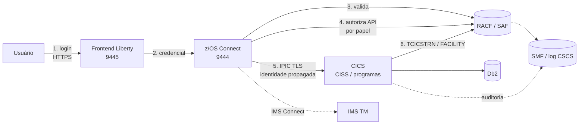
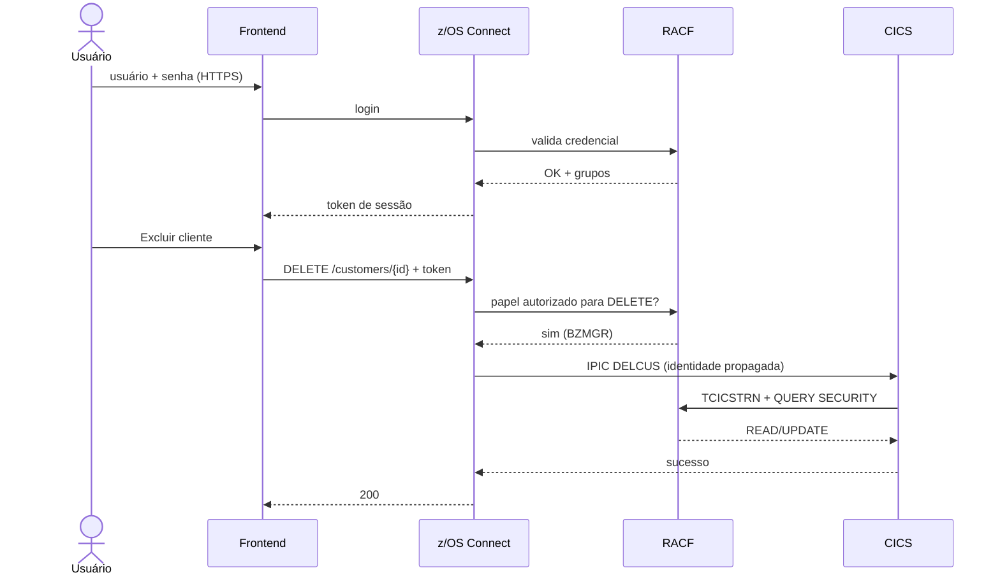

# Especificação Funcional — Autenticação e Autorização RACF (Bank of Z)

**Versão:** 0.2
**Autor:** Gerado via IBM Bob Z Architect
**Status:** Rascunho para validação
**Especificações técnicas derivadas:** [`RACF-security-technical-index.md`](RACF-security-technical-index.md)
**Escopo:** Ponta a ponta — Frontend → z/OS Connect → CICS / IMS

> Convenção de confiança: itens marcados **[A VALIDAR]** vêm de conhecimento geral ou de decisão proposta pelo arquiteto e devem ser confirmados na documentação do produto (CICS TS 6.3, RACF, z/OS Connect EE) antes da implementação.

---

## 1. Objetivo

Introduzir no Bank of Z um modelo único de **identidade, autenticação e autorização baseado em RACF (SAF)**, de modo que:

1. Cada usuário final se autentique com sua identidade RACF.
2. Cada operação bancária seja autorizada conforme o **papel** do usuário (atendente, gerente, auditor, administrador).
3. A identidade do usuário final seja **propagada** até o CICS/IMS, permitindo autorização e auditoria por usuário real.
4. Toda negação e toda operação sensível seja rastreável (RACF/SMF + log da aplicação).

## 2. Situação Atual (as-is) — evidências no repositório

| # | Constatação | Evidência |
|---|-------------|-----------|
| 1 | Frontend não possui tela de login; o ícone de usuário apenas navega para `admin.html` e o logout retorna a `index.html`. Nenhuma credencial é enviada nas chamadas. | [`headers.js`](src/frontend/js/components/headers.js), [`api.js`](src/frontend/js/api.js:23) |
| 2 | OpenAPI declara `OAuth2` com URLs fictícias (`auth.bankofz.example.com`) e escopos `accounts`, `customers`, `transactions`; não há implementação correspondente. | [`openapi.yaml`](src/api/src/main/api/openapi.yaml:651) |
| 3 | z/OS Connect acessa o CICS com **usuário fixo** (`zosconnect_authData`), ou seja, todas as requisições chegam ao CICS sob a mesma identidade. | [`setup-zosconnect-server.sh`](.setup/setup/setup-zosconnect-server.sh:144) |
| 4 | Servidores Liberty (API e frontend) rodam sob `zos_admin_user`. | [`config.yaml`](.setup/config/config.yaml:55) |
| 5 | A região CICS tem `cics_sec: "YES"`, porém as transações têm `ressec: "NO"` e `cmdsec: "NO"`. | [`config.yaml`](.setup/config/config.yaml:66), [`bank-of-z-definitions.yaml`](.setup/zconfig/bank-of-z-definitions.yaml:1056) |
| 6 | O TCPIPSERVICE IPIC (`ZOSEE`, porta 1234) está com `ssl: "NO"`. | [`bank-of-z-definitions.yaml`](.setup/zconfig/bank-of-z-definitions.yaml:1122) |
| 7 | RACF já é usado para infraestrutura (keyring TLS, perfis STARTED, permissões DB2). Não há perfis de negócio. | `.setup/setup/addcert.sh`, `grant-perm-user.sh` |
| 8 | `BNK1CRA` já captura o usuário de origem via `INQUIRE ASSOCIATION … ODUSERID`, base útil para auditoria. | [`BNK1CRA.cbl`](src/base/cics/cobol/BNK1CRA.cbl:503) |
| 9 | Existe precedente de negação RACF operacional (OPERCMDS) documentado. | [`fix-omen-abend-cino.md`](docs/fix-omen-abend-cino.md) |

## 3. Escopo

### 3.1 Dentro do escopo
- Login/logout no frontend e sessão autenticada.
- Autenticação das APIs z/OS Connect contra o registro SAF/RACF.
- Autorização por papel nas APIs REST, transações CICS 3270/API e operações IMS.
- Propagação de identidade ao CICS (e IMS, quando suportado).
- Auditoria de acessos e negações.
- Provisionamento RACF (grupos, perfis e permissões) automatizado em `.setup/`.

### 3.2 Fora do escopo
- Gestão de senha self-service, MFA e federação com IdP externo (candidatos a fase futura).
- Segurança de datasets, DB2 e infraestrutura já tratada nos scripts existentes.
- Segurança do canal Bank of Q / MQ.

## 4. Atores e Papéis

Cada papel é um **grupo RACF**. Nomes limitados a 8 caracteres.

| Papel de negócio | Grupo RACF | Descrição |
|------------------|-----------|-----------|
| Atendente | `BZTELLER` | Operação de balcão: consulta, cadastro, depósito e transferência |
| Gerente | `BZMGR` | Todas as operações do atendente + atualização e exclusão |
| Auditor | `BZAUDIT` | Somente leitura de clientes, contas e histórico |
| Administrador de segurança | `BZSECADM` | Gerencia grupos/perfis do Bank of Z; **sem** acesso a operações de negócio |
| Identidade técnica (link) | `BZLINK` (usuário `BZLNKID`) | Identidade do link IPIC z/OS Connect → CICS; privilégio máximo permitido a qualquer usuário final |

## 5. Matriz de Autorização (proposta)

Legenda: **S** = permitido · **N** = negado.

| Operação | API REST (`openapi.yaml`) | Transação CICS / Programa | `BZTELLER` | `BZMGR` | `BZAUDIT` |
|----------|---------------------------|---------------------------|:---:|:---:|:---:|
| Menu principal | — | `OMEN` / `BNKMENU` | S | S | S |
| Consultar cliente | `GET /customers/{id}`, `GET /ims/customers/{id}` | `ODCS` / `BNK1DCS`, `INQCUST` | S | S | S |
| Consultar contas do cliente | `GET /customers/{id}/accounts` | `OCCA` / `BNK1CCA`, `INQACCCU` | S | S | S |
| Consultar conta / saldo | `GET /accounts/{id}`, `/balances` | `ODAC` / `BNK1DAC`, `INQACC` | S | S | S |
| Listar contas | `GET /accounts` | `INQACCS` | S | S | S |
| Consultar transações | `GET /accounts/{id}/transactions[/{tid}]` | `INQTRANL`, `INQTRAND` | S | S | S |
| Criar cliente | `POST /customers` | `OCCS` / `BNK1CCS`, `CRECUST` | S | S | N |
| Criar conta | — (3270) | `OCAC` / `BNK1CAC`, `CREACC` | S | S | N |
| Depósito / débito-crédito | `POST /accounts/{id}/deposit` | `OCRA` / `BNK1CRA`, `DBCRFUN` | S | S | N |
| Transferir fundos | — (3270) | `OTFN` / `BNK1TFN`, `XFRFUN` | S | S | N |
| Atualizar cliente | `PUT /customers/{id}` | `UPDCUST` | N | S | N |
| Atualizar conta | — (3270) | `OUAC` / `BNK1UAC`, `UPDACC` | N | S | N |
| Excluir cliente | `DELETE /customers/{id}` | `DELCUS` | N | S | N |
| Excluir conta | — | `DELACC` | N | S | N |
| Transações internas de crédito (`OCR1`–`OCR5`, `CRDTAGY1`–`5`) | — | uso interno | N (somente identidade do sistema) | N | N |

**Premissa:** limites por valor (ex.: depósito/transferência acima de X exigir `BZMGR`) ficam como regra de negócio opcional (ver §12, questão Q3).

## 6. Arquitetura Proposta



### 6.1 Camadas de segurança

| Camada | Controle | Mecanismo |
|--------|----------|-----------|
| L1 — Transporte | TLS no frontend, z/OS Connect e IPIC | Keyring RACF existente (`BOZRING`) + TLS no TCPIPSERVICE `ZOSEE` |
| L2 — Autenticação | Identificação do usuário | Registro SAF no Liberty/z/OS Connect → RACF |
| L3 — Autorização de API | Acesso à operação REST por papel | Papéis SAF mapeados a grupos RACF **[A VALIDAR]** |
| L4 — Autorização CICS (transação) | `SEC=YES`, `XTRAN=YES`, perfis `TCICSTRN`/`GCICSTRN` | Perfis por transação, ACL por grupo |
| L5 — Autorização CICS (aplicação) | Verificação fina dentro do programa | `EXEC CICS QUERY SECURITY` |
| L6 — Auditoria | Rastreio de acessos e negações | RACF/SMF (`ICH408I`), mensagens `DFHXS1111`/`DFHXS1117`, TD queue `CSCS` |

### 6.2 Decisão proposta de autenticação (registrar em ADR) — **[A VALIDAR]**

Na pergunta de mecanismo, o responsável solicitou recomendação. Proposta:

| Opção | Avaliação |
|-------|-----------|
| A. Basic Auth + SAF + propagação via IPIC | Mais simples, 100% RACF; senha trafega a cada chamada |
| **B. Login SAF → token de sessão (JWT/LTPA) + propagação de identidade** | **Recomendada.** Senha trafega só no login; adequada a frontend web; token carrega o usuário e os papéis |
| C. OAuth2 com IdP externo → mapeamento a USERID RACF | Alinhada ao `openapi.yaml` atual, porém exige IdP e mapeamento; adiar para fase 2 |

**Recomendação:** adotar a opção **B** em fase 1, mantendo a declaração `securitySchemes` do OpenAPI atualizada para refletir o esquema real (substituir o OAuth2 fictício por `bearerAuth`/`basicAuth` conforme implementação). A evolução para C é compatível, pois a autorização continua baseada em grupos RACF.

## 7. Requisitos Funcionais

### 7.1 Autenticação

| ID | Requisito |
|----|-----------|
| RF-01 | O frontend deve exibir tela de login (usuário e senha/passphrase RACF) antes de qualquer acesso às funções. |
| RF-02 | Credenciais devem trafegar somente por HTTPS. |
| RF-03 | O sistema deve validar usuário e senha contra o RACF; senha inválida, usuário revogado ou senha expirada devem ser rejeitados. |
| RF-04 | Usuário com senha expirada deve ser orientado a alterá-la (alteração realizada fora do Bank of Z na fase 1). |
| RF-05 | Após *n* tentativas inválidas o RACF revoga o usuário (`SETROPTS PASSWORD(REVOKE(n))`); a aplicação deve exibir mensagem genérica sem revelar o motivo exato. |
| RF-06 | O logout deve invalidar a sessão/token no servidor (hoje apenas redireciona para `index.html`). |
| RF-07 | A sessão deve expirar por inatividade (valor padrão sugerido: 15 min, parametrizável). |
| RF-08 | Todas as chamadas à API (exceto login) devem exigir credencial válida; ausência → `401`. |

### 7.2 Autorização

| ID | Requisito |
|----|-----------|
| RF-09 | A autorização deve ser baseada em **grupos RACF** (papéis da §4); nenhum papel deve ser determinado no frontend como fonte de verdade. |
| RF-10 | O z/OS Connect deve negar com `403` operações não permitidas ao papel (conforme §5) antes de chamar o CICS/IMS. |
| RF-11 | O CICS deve revalidar a autorização da transação/programa (defesa em profundidade), independentemente da API. |
| RF-12 | O menu do frontend deve exibir apenas as opções permitidas ao papel do usuário (conveniência de UX; não substitui RF-10/RF-11). |
| RF-13 | Operações de alteração e exclusão (`UPDCUST`, `UPDACC`, `DELCUS`, `DELACC`) devem exigir autorização fina `UPDATE` em perfil de aplicação (ver §8.3). |
| RF-14 | Transações internas `OCR1`–`OCR5` e programas `CRDTAGY1`–`5` não devem ser acessíveis a usuários finais. |
| RF-15 | As transações 3270 (`OMEN`, `OCAC`, `OCCA`, `OCCS`, `OCRA`, `ODAC`, `ODCS`, `OTFN`, `OUAC`) devem ser protegidas pelos mesmos papéis da matriz §5. |

### 7.3 Propagação de identidade

| ID | Requisito |
|----|-----------|
| RF-16 | O USERID do usuário final deve chegar ao CICS como identidade da tarefa, substituindo o usuário fixo atual. **[A VALIDAR]** (identity propagation no IPIC com z/OS Connect). |
| RF-17 | Caso a propagação nativa não esteja disponível, deve-se adotar a alternativa: usuário técnico `BZLNKID` + passagem do USERID final na COMMAREA de auditoria, **com** autorização por papel já aplicada no z/OS Connect. Esta alternativa reduz a defesa em profundidade (RF-11) e deve ser registrada como risco. |
| RF-18 | O usuário técnico do link deve ter permissão não superior ao conjunto de transações necessárias (a segurança do usuário é subconjunto da segurança do link). |
| RF-19 | O TCPIPSERVICE IPIC `ZOSEE` deve operar com TLS e autenticação de cliente. |

### 7.4 Auditoria

| ID | Requisito |
|----|-----------|
| RF-20 | Toda negação de acesso (RACF `ICH408I`) deve ser registrada em SMF; perfis críticos devem ter `AUDIT(FAILURES)` e, para alteração/exclusão, `AUDIT(ALL)`. |
| RF-21 | Os programas de escrita devem registrar o usuário de origem; padrão já existente em `BNK1CRA` (`ODUSERID`) deve ser estendido às demais operações de escrita. |
| RF-22 | Logins com sucesso/falha devem ser consultáveis pelo auditor via relatório RACF (`IRRDBU00`/SMF type 80). |
| RF-23 | Falhas de autorização devem retornar código HTTP e mensagem padronizada (§10) sem expor nomes de perfis RACF. |

### 7.5 Provisionamento e Administração

| ID | Requisito |
|----|-----------|
| RF-24 | Scripts de setup devem criar grupos, perfis e permissões de forma idempotente, no padrão de `.setup/setup/*.sh` (parâmetros em `config.yaml`, sem HLQs/IDs fixos). |
| RF-25 | Deve existir procedimento de *teardown* que remova os perfis de negócio (análogo a `clearcert.sh`). |
| RF-26 | A concessão de papel a um usuário é feita exclusivamente por `CONNECT usuário GROUP(grupo)` pelo `BZSECADM`. |

## 8. Modelo RACF Proposto

> Todos os comandos abaixo são **rascunho ilustrativo [A VALIDAR]** na documentação RACF Command Language Reference; `<REGIAO>` e `<CICSUSR>` seguem o `config.yaml`.

### 8.1 Grupos e usuários

```
ADDGROUP BANKZ    SUPGROUP(SYS1)  OWNER(BZSECADM)
ADDGROUP BZTELLER SUPGROUP(BANKZ)
ADDGROUP BZMGR    SUPGROUP(BANKZ)
ADDGROUP BZAUDIT  SUPGROUP(BANKZ)
ADDGROUP BZSECADM SUPGROUP(BANKZ)
ADDUSER  BZLNKID  DFLTGRP(BZLINK) NOPASSWORD
CONNECT  <usuario> GROUP(BZTELLER)
```

### 8.2 Autorização de transações CICS (classe `TCICSTRN`/`GCICSTRN`)

Com `SEC=YES` e `XTRAN=YES`. O prefixo do nome do perfil depende de `SECPRFX`. **[A VALIDAR a definição na região]**

| Grupo de perfis (`GCICSTRN`) | Transações membros | Acesso |
|------------------------------|--------------------|--------|
| `BZ-CONSULTA` | `OMEN`, `ODCS`, `ODAC`, `OCCA` | READ para `BZTELLER`, `BZMGR`, `BZAUDIT` |
| `BZ-OPERACAO` | `OCCS`, `OCAC`, `OCRA`, `OTFN` | READ para `BZTELLER`, `BZMGR` |
| `BZ-GESTAO` | `OUAC` | READ para `BZMGR` |
| `BZ-INTERNO` | `OCR1`–`OCR5` | READ somente para identidade do sistema |

```
RDEFINE GCICSTRN BZ-CONSULTA UACC(NONE) ADDMEM(OMEN ODCS ODAC OCCA)
PERMIT  BZ-CONSULTA CLASS(GCICSTRN) ID(BZTELLER BZMGR BZAUDIT) ACCESS(READ)
SETROPTS RACLIST(TCICSTRN GCICSTRN) REFRESH
```

Também é necessário que a transação de entrada IPIC (`CISS`) esteja autorizada para a identidade do link/usuário.

### 8.3 Autorização fina de aplicação (`QUERY SECURITY`)

Para operações onde o nível de acesso diferencia o papel (ex.: atualizar/excluir), propõe-se uma classe geral com perfis de aplicação — **proposta de arquiteto**, a confirmar a classe a utilizar (`FACILITY` é candidata por já constar na CDT).

| Perfil de aplicação | Descrição | READ | UPDATE |
|---------------------|-----------|------|--------|
| `BANKZ.CUSTOMER` | Dados de cliente | Teller, Mgr, Audit | Mgr |
| `BANKZ.ACCOUNT` | Dados de conta | Teller, Mgr, Audit | Mgr |
| `BANKZ.CREATE` | Criação de cliente e conta (**incluído na v0.2**) | — | Teller, Mgr |
| `BANKZ.PAYMENT` | Depósito/transferência | — | Teller, Mgr |
| `BANKZ.DELETE` | Exclusão | — | Mgr |

> **v0.2:** a v0.1 não previa perfil para criação; sem ele, o Teller não conseguiria criar cliente/conta com `UPDATE` restrito a `BZMGR`. Mapeamento operação → perfil: [`BNKSECCK-technical-spec.md`](BNKSECCK-technical-spec.md) §4.1. Em falha de negócio por segurança, os programas devolvem os códigos `S` (negado) e `X` (erro de segurança); ver [`RACF-security-technical-index.md`](RACF-security-technical-index.md) §4.

Uso nos programas:

```cobol
EXEC CICS QUERY SECURITY
     RESCLASS('FACILITY')
     RESID(WS-PERFIL)
     RESIDLENGTH(WS-PERFIL-LEN)
     UPDATE(WS-CVDA-UPD)
     RESP(WS-CICS-RESP) RESP2(WS-CICS-RESP2)
END-EXEC
```

Regras: tratar `NOTFND`, `INVREQ` e o CVDA `NOTUPDATABLE`; seguir o padrão do projeto de capturar RESP/RESP2 em `WS-CICS-WORK-AREA` e abendar via `ABNDPROC` em erro inesperado. Negação de negócio retorna código de retorno funcional (não abend).

### 8.4 Recursos associados (SECURITY da região)

| Elemento | Situação atual | Alvo |
|----------|----------------|------|
| `SEC` (SIT) | `YES` | `YES` |
| `XTRAN` | não confirmado | `YES` |
| `XCMD`, `XPPT`, `XFCT`, `XDCT`, `XDB2` | não confirmado | Avaliar caso a caso (impacto de perfis adicionais) |
| `ressec` / `cmdsec` nas transações | `NO` | `YES` nas transações de negócio **[A VALIDAR impacto]** |
| TCPIPSERVICE `ZOSEE` `ssl` | `NO` | TLS com autenticação de cliente |

## 9. Fluxos Funcionais

### 9.1 Login e operação autorizada



### 9.2 Acesso negado

1. Usuário `BZTELLER` solicita `DELETE /customers/{id}`.
2. z/OS Connect verifica papel → ausente → responde `403` sem chamar o CICS.
3. Registro de falha em SMF/log do servidor.
4. Frontend exibe mensagem amigável; nenhuma ação é executada.

### 9.3 Falha de autenticação

Senha inválida / usuário revogado → `401` com mensagem genérica; evento registrado no RACF (SMF 80).

## 10. Contrato de Erros (API)

| Situação | HTTP | `code` | Mensagem ao usuário |
|----------|------|--------|---------------------|
| Credencial ausente ou inválida | 401 | `AUTH_REQUIRED` | Credenciais ausentes ou inválidas |
| Sessão expirada | 401 | `SESSION_EXPIRED` | Sessão expirada. Entre novamente |
| Papel sem permissão | 403 | `ACCESS_DENIED` | Você não tem permissão para esta operação |
| Falha de infraestrutura de segurança | 503 | `SECURITY_UNAVAILABLE` | Serviço indisponível. Tente novamente |

Segue a estrutura de erro já utilizada em [`api.js`](src/frontend/js/api.js:75) (`code`, `message`, `details`) e o componente `Unauthorized` do `openapi.yaml`.

## 11. Requisitos Não Funcionais

| ID | Requisito |
|----|-----------|
| RNF-01 | Senhas nunca devem ser registradas em logs, localStorage ou URLs. |
| RNF-02 | Impacto de latência da autorização ≤ 50 ms por chamada (meta; validar com testes). |
| RNF-03 | Perfis RACF ativados via `RACLIST`; qualquer alteração exige `SETROPTS RACLIST(...) REFRESH`. |
| RNF-04 | Conformidade: princípio do menor privilégio e segregação de funções (Admin de segurança ≠ operador de negócio). |
| RNF-05 | Contas técnicas (`BZLNKID`) sem senha interativa (`NOPASSWORD`) e sem permissão de logon em 3270. |
| RNF-06 | Alterações devem manter execução dos testes de integração em `tests/` (parametrizados com credencial de teste). |

## 12. Questões em Aberto

| ID | Questão | Impacto |
|----|---------|---------|
| Q1 | Confirmar a opção de autenticação (§6.2) e se o z/OS Connect da instalação suporta a propagação de identidade ao CICS via IPIC. | Define RF-16 vs RF-17 |
| Q2 | O IMS (via IMS Connect) também deve receber o usuário final ou permanecer com `IMS_USER` fixo? | Escopo IMS |
| Q3 | Haverá limites por valor (ex.: transferência acima de R$ X exige gerente)? | Regra de negócio / `BANKZ.PAYMENT` |
| Q4 | Os nomes de grupos (`BZ*`) seguem convenção corporativa? | Padronização |
| Q5 | O usuário final do 3270 também será migrado para esse modelo (hoje usa `RAFAELT`, `CICSUSER`)? | Provisionamento |
| Q6 | Quais classes RACF estão ativas (`SETROPTS LIST`) no ambiente de destino (`TCICSTRN`, `GCICSTRN`, `FACILITY`, `EJBROLE`)? | Viabilidade §8 |

## 13. Impacto nos Componentes

| Componente | Alteração |
|------------|-----------|
| `src/frontend/` | Página de login; envio de credencial/token em [`api.js`](src/frontend/js/api.js); menu condicionado por papel em `headers.js`; logout efetivo |
| `src/api/` | `securitySchemes` e `security` por operação no `openapi.yaml`; `403` nas respostas |
| `.setup/setup/` | Novo script de provisionamento RACF (idempotente) e teardown; ajuste `server.xml` do z/OS Connect (registro SAF, papéis, TLS) |
| `.setup/config/config.yaml` | Novas chaves: grupos, usuário de link, tempo de sessão |
| `.setup/zconfig/bank-of-z-definitions.yaml` | `ressec`/`cmdsec`, TCPIPSERVICE `ZOSEE` com TLS, IPCONN com segurança |
| `src/base/cics/cobol/` | Novo subprograma `BNKSECCK` ([spec](BNKSECCK-technical-spec.md)) e chamada a ele nos 8 programas de escrita: [`UPDCUST`](UPDCUST-technical-spec.md), [`UPDACC`](UPDACC-technical-spec.md), [`DELCUS`](DELCUS-technical-spec.md), [`DELACC`](DELACC-technical-spec.md), [`CRECUST`](CRECUST-technical-spec.md), [`CREACC`](CREACC-technical-spec.md), [`DBCRFUN`](DBCRFUN-technical-spec.md), [`XFRFUN`](XFRFUN-technical-spec.md); telas e menu: [`RACF-security-screens-technical-spec.md`](RACF-security-screens-technical-spec.md); registro do usuário de origem |
| `src/base/cics/copy/` | Novo copybook `BNKSEC.cpy` (35 bytes); `UPDACC.cpy` ganha `COMM-FAIL-CD` (99 → 100 bytes) |
| `tests/` | Casos de login, 401, 403 e matriz de papéis |
| `docs/` | Atualizar `application-components.md` e `application-flow.md` |

## 14. Critérios de Aceite

| ID | Cenário | Resultado esperado |
|----|---------|--------------------|
| CA-01 | Chamada sem credencial a `GET /customers/{id}` | `401` |
| CA-02 | Login válido de `BZAUDIT`, `GET /accounts/{id}` | `200` |
| CA-03 | `BZAUDIT` tenta `POST /customers` | `403`, nada gravado, falha em SMF |
| CA-04 | `BZTELLER` tenta `DELETE /customers/{id}` | `403` no z/OS Connect |
| CA-05 | `BZMGR` executa `DELETE /customers/{id}` | `200`; registro de auditoria com o USERID do gerente |
| CA-06 | Acesso direto ao CICS por 3270 com `BZTELLER` à transação `OUAC` | Negado pelo RACF (`TCICSTRN`) |
| CA-07 | Usuário revogado tenta login | `401` genérico |
| CA-08 | Sessão ociosa além do limite | `401 SESSION_EXPIRED` |
| CA-09 | Chamada ao IPIC sem TLS/cliente autenticado | Conexão recusada |
| CA-10 | Execução do script de setup duas vezes | Sem erro; mesmo estado final |

## 15. Fases Sugeridas

| Fase | Entrega |
|------|---------|
| 1 | Modelo RACF (grupos/perfis), TLS no IPIC, login + autorização na API, usuário técnico de link |
| 2 | Propagação de identidade ao CICS, `ressec/cmdsec`, `QUERY SECURITY` nos programas de escrita |
| 3 | Auditoria e relatórios, extensão ao IMS, avaliação de IdP externo/MFA |

## 16. Riscos

| Risco | Mitigação |
|-------|-----------|
| Impacto de `ressec/cmdsec=YES` quebrar transações existentes por perfis ausentes | Habilitar por transação, em ambiente de teste, com `WARNING` no RACF nos perfis durante a transição |
| Propagação de identidade indisponível | Alternativa RF-17 com risco registrado |
| Lockout de usuários de serviço (`STARTED`, link) | Usuários técnicos com `NOPASSWORD`/`PROTECTED` |
| Divergência entre papéis no frontend e no RACF | RACF como única fonte de verdade (RF-09) |
| Usuários de desenvolvimento (`IBMUSER`/`RAFAELT`) acumulam privilégios e mascaram falhas nos testes | Executar testes com usuários dedicados por papel |

## 17. Referências

- [`application-components.md`](docs/docs/architecture/application-components.md)
- [`openapi.yaml`](src/api/src/main/api/openapi.yaml)
- [`bank-of-z-definitions.yaml`](.setup/zconfig/bank-of-z-definitions.yaml)
- [`config.yaml`](.setup/config/config.yaml)
- [`fix-omen-abend-cino.md`](docs/fix-omen-abend-cino.md)
