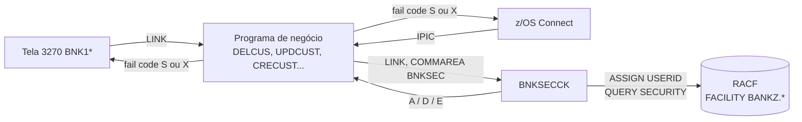
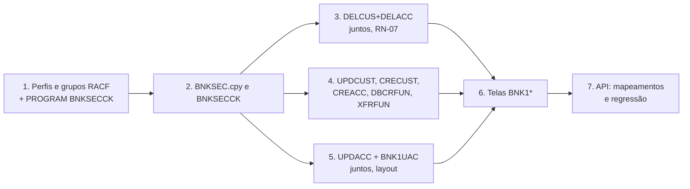

# Índice Técnico — Segurança RACF (Bank of Z)

**Versão:** 0.1  
**Data:** 2026-11-05  
**Autor:** Gerado via IBM Bob Z Architect  
**Status:** Rascunho para validação  
**Base:** [`RACF-security-functional-spec.md`](RACF-security-functional-spec.md)

> Este índice reúne o que é **comum** às especificações técnicas por programa: padrão de integração, códigos de falha, impactos em telas e API, decisões pendentes e ordem de entrega. Itens **[A VALIDAR]** dependem de confirmação em documentação ou ambiente; itens **[A DECIDIR]** dependem do responsável.

---

## 1. Especificações geradas

| # | Especificação | Tipo | Mudança de layout COMMAREA |
|---|---------------|------|:---:|
| 1 | [`BNKSECCK-technical-spec.md`](BNKSECCK-technical-spec.md) | Programa **novo** + copybook `BNKSEC` | n/a (novo) |
| 2 | [`DELCUS-technical-spec.md`](DELCUS-technical-spec.md) | Alteração | Não |
| 3 | [`DELACC-technical-spec.md`](DELACC-technical-spec.md) | Alteração | Não |
| 4 | [`UPDCUST-technical-spec.md`](UPDCUST-technical-spec.md) | Alteração | Não |
| 5 | [`UPDACC-technical-spec.md`](UPDACC-technical-spec.md) | Alteração | **Sim** (+1 byte) |
| 6 | [`CRECUST-technical-spec.md`](CRECUST-technical-spec.md) | Alteração | Não |
| 7 | [`CREACC-technical-spec.md`](CREACC-technical-spec.md) | Alteração | Não |
| 8 | [`DBCRFUN-technical-spec.md`](DBCRFUN-technical-spec.md) | Alteração | Não |
| 9 | [`XFRFUN-technical-spec.md`](XFRFUN-technical-spec.md) | Alteração | Não |
| 10 | [`RACF-security-screens-technical-spec.md`](RACF-security-screens-technical-spec.md) | `BNKMENU` e telas `BNK1*` | Não (exceto `BNK1UAC`) |

## 2. Visão da solução



Camadas: L4 (transação, `TCICSTRN`/`GCICSTRN`) bloqueia o acesso às transações 3270; **L5 (este conjunto de specs)** bloqueia a operação dentro do programa, inclusive no caminho da API, em que não há transação 3270.

## 3. Padrão de integração (idêntico em todos os programas de negócio)

### 3.1 Elementos adicionados

```cobol
       WORKING-STORAGE SECTION.
       01 BNKSEC-COMMAREA.
           COPY BNKSEC.
       01 SWITCHES.                       *> reutilizar o grupo existente quando houver
           03 WS-SEC-SW                PIC X VALUE 'N'.
              88 SEC-OK                VALUE 'Y'.
              88 SEC-NOT-OK            VALUE 'N'.
```

```cobol
       SECURITY-CHECK SECTION.
       SC010.
           INITIALIZE BNKSEC-COMMAREA.
           MOVE '<PROGRAMA>' TO BNKSEC-OPERATION.
           MOVE 'N' TO WS-SEC-SW.

           EXEC CICS LINK PROGRAM('BNKSECCK')
                COMMAREA(BNKSEC-COMMAREA)
                LENGTH(LENGTH OF BNKSEC-COMMAREA)
                RESP(WS-CICS-RESP) RESP2(WS-CICS-RESP2)
           END-EXEC.

           IF WS-CICS-RESP NOT = DFHRESP(NORMAL)
              <fail code 'X'>
           ELSE
              EVALUATE TRUE
                 WHEN BNKSEC-ALLOWED  SET SEC-OK TO TRUE
                 WHEN BNKSEC-DENIED   <fail code 'S'>
                 WHEN OTHER           <fail code 'X'>
              END-EVALUATE
           END-IF.
       SC999.
           EXIT.
```

Regras de implementação:

1. **Fail-closed:** `SEC-OK` só é ligado em `BNKSEC-ALLOWED` com RESP `NORMAL`. Qualquer outro caminho (RESP de erro, resultado em branco, `PROGRAM` desabilitado) é `'X'`. O valor inicial `'N'` e o `INITIALIZE` garantem que "sem resposta" nunca vira permissão.
2. **Sem abend por negação:** negação de negócio retorna fail code, não abenda (spec funcional §8.3). O programa chamador (`BNK1*`) decide a mensagem.
3. **Posição:** primeira ação do parágrafo principal, antes de qualquer leitura de dados ou reserva de recurso (ENQ, contador). Cada spec por programa indica a linha exata.
4. **COMMAREA de saída:** quando negado, preencher só `success='N'` e o fail code; não tocar nos demais campos.
5. **Nível dos campos:** `COPY BNKSEC` em nível 03 (padrão de copybooks do projeto), sob um `01`.
6. `WS-CICS-RESP`/`WS-CICS-RESP2` já existem em todos os oito programas (em `UPDCUST` estão em nível 03, mantido).

### 3.2 Tabela por programa

| Programa | `BNKSEC-OPERATION` | Campo de sucesso | Campo de fail code | Linha de inserção (aprox.) | Saída |
|----------|--------------------|------------------|--------------------|---------------------------|-------|
| `DELCUS` | `DELCUS  ` | `COMM-DEL-SUCCESS` | `COMM-DEL-FAIL-CD` | 279 (após `A010.`) | `GET-ME-OUT-OF-HERE` |
| `DELACC` | `DELACC  ` | `DELACC-DEL-SUCCESS` | `DELACC-DEL-FAIL-CD` | 207–212 | `GET-ME-OUT-OF-HERE` |
| `UPDCUST` | `UPDCUST ` | `COMM-UPD-SUCCESS` | `COMM-UPD-FAIL-CD` | 171 (após `A010.`) | `GET-ME-OUT-OF-HERE` |
| `UPDACC` | `UPDACC  ` | `COMM-SUCCESS` | **`COMM-FAIL-CD` (novo)** | 159 (após `A010.`) | `GET-ME-OUT-OF-HERE` |
| `CRECUST` | `CRECUST ` | `COMM-SUCCESS` | `COMM-FAIL-CODE` | 407 (após `P010.`) | `GET-ME-OUT-OF-HERE` |
| `CREACC` | `CREACC  ` | `COMM-SUCCESS` | `COMM-FAIL-CODE` | 303 (após `P010.`) | `GET-ME-OUT-OF-HERE` |
| `DBCRFUN` | `DBCRFUN ` | `COMM-SUCCESS` | `COMM-FAIL-CODE` | 202–207 | `GET-ME-OUT-OF-HERE` |
| `XFRFUN` | `XFRFUN  ` | `COMM-SUCCESS` | `COMM-FAIL-CODE` | 270 (após `A010.`) | `GET-ME-OUT-OF-HERE` |

Contagem: **8** programas de negócio alterados (verificada duas vezes) + 1 programa novo (`BNKSECCK`) + telas.

## 4. Códigos de falha de segurança

| Código | Significado | Origem no `BNKSECCK` |
|--------|-------------|----------------------|
| `S` | Acesso negado | `BNKSEC-DENIED` (reason `02` ou `03`) |
| `X` | Erro de segurança / verificador indisponível | `BNKSEC-ERROR`, RESP do LINK ≠ NORMAL, resposta vazia |

Verificado nos fontes de `src/base/cics/cobol/`: não existem literais `'S'` ou `'X'` atribuídos como fail code nem tratados em `WHEN`. Códigos já em uso (a evitar): `0`–`9`, `A`–`H`, `O`, `T`, `Y`, `Z`. **[A VALIDAR]** novamente imediatamente antes da implementação.

## 5. Impacto nas telas 3270

Os oito programas chamadores já testam `success = 'N'`, mas a maioria cai em mensagem genérica para fail codes desconhecidos. Mensagem proposta para `'S'` (campo `MESSAGE` dos mapas, `LENGTH=79`): `Sorry, you are not authorised to perform this operation.` (56 caracteres) e para `'X'`: `Security check unavailable. Please contact support.` (51 caracteres).

| Tela | Programa de negócio | Pontos (linhas aproximadas) | Tratamento atual de fail code | Alteração |
|------|---------------------|-----------------------------|-------------------------------|-----------|
| `BNK1CAC` | `CREACC` | 845–918 | `EVALUATE` `'1'`–`'9'`, `'A'`, `WHEN OTHER` | Incluir `WHEN 'S'` e `WHEN 'X'` |
| `BNK1CCS` | `CRECUST` | 1069–1084 | `IF` para `'O'`, `'Y'`, `'Z'` | Incluir `IF` para `'S'` e `'X'` |
| `BNK1CRA` | `DBCRFUN` | 581–616 | `EVALUATE` `'1'`–`'3'`, `WHEN OTHER` | Incluir `WHEN 'S'` e `WHEN 'X'` |
| `BNK1DAC` | `DELACC` | 734–779 | `IF` `'1'`, `'2'`, `'3'` e genérico | Incluir `IF` para `'S'` e `'X'` antes do genérico |
| `BNK1DCS` (delete) | `DELCUS` | 1084–1121 | `IF` `'1'`, `'2'`, `'3'` e genérico | Idem |
| `BNK1DCS` (update) | `UPDCUST` | 1291–1338 | `EVALUATE` `'1'`, `'2'`, `'3'`, `'T'`, `WHEN OTHER` | Incluir `WHEN 'S'` e `WHEN 'X'` |
| `BNK1TFN` | `XFRFUN` | 582–617 | `EVALUATE` `'1'`–`'4'`, `WHEN OTHER` | Incluir `WHEN 'S'` e `WHEN 'X'` |
| `BNK1UAC` | `UPDACC` | 1024 | Só `COMM-SUCCESS = 'N'` | Ler `COMM-FAIL-CD`; **mudança de layout** (ver [`UPDACC-technical-spec.md`](UPDACC-technical-spec.md) §5) |

Detalhes em [`RACF-security-screens-technical-spec.md`](RACF-security-screens-technical-spec.md).

## 6. Impacto na API (z/OS Connect)

Dos oito programas de negócio, quatro têm ativo z/OS Connect em `src/api/src/main/zosAssets/`: `CRECUST`, `DBCRFUN`, `DELCUS` e `UPDCUST`. `DELACC`, `CREACC`, `UPDACC` e `XFRFUN` não têm ativo próprio (`DELACC` é alcançado pela API apenas via `DELCUS`).

| Operação | `response_mapping.yaml` — condição atual | Problema com `'S'`/`'X'` | Ajuste |
|----------|------------------------------------------|---------------------------|--------|
| `POST /customers` | `COMM-SUCCESS = "N"` → 400 | Negação sairia 400 | Nova condição **antes**: `COMM-FAIL-CODE = "S"` → 403; `"X"` → 503 |
| `DELETE /customers/{id}` | `COMM-DEL-SUCCESS != 'Y'` → 404 | Negação sairia 404 | Idem com `COMM-DEL-FAIL-CD` |
| `PUT /customers/{id}` | só `COMM-UPD-SUCCESS = 'Y'` | Negação sem tratamento específico | Idem com `COMM-UPD-FAIL-CD` |
| `POST /accounts/{id}/deposit` | `COMM-SUCCESS != "Y"` → 404 | Negação sairia 404 | Idem com `COMM-FAIL-CODE` |

Regras:

- O `response_403.yaml` existente tem `condition: true`, que hoje funciona como *fallback*; a nova condição de 403 deve ficar **antes** na ordem de avaliação. **[A VALIDAR]** a ordem de avaliação no z/OS Connect Designer.
- `X` mapeia para 503 (`SECURITY_UNAVAILABLE`, spec funcional §10).
- Os campos `COMM-*` já estão nos ativos; como os layouts de COMMAREA **não mudam** nestes quatro programas, `providerFiles/gen/` **não precisa ser regenerado**. Só os arquivos `response_mapping.yaml` e `response_403/503.yaml` mudam.
- Os ativos de IMS (`/ims/...`) ficam fora desta fase (Q2 da spec funcional).

## 7. Infraestrutura e provisionamento

| Item | Arquivo | Ação |
|------|---------|------|
| `PROGRAM(BNKSECCK)` | [`bank-of-z-definitions.yaml`](../../.setup/zconfig/bank-of-z-definitions.yaml) | Adicionar definição (DB2 não é necessário) |
| Perfis `FACILITY` `BANKZ.CUSTOMER`, `BANKZ.ACCOUNT`, `BANKZ.CREATE`, `BANKZ.PAYMENT`, `BANKZ.DELETE` | novo script em `.setup/setup/` | `RDEFINE`/`PERMIT`/`SETROPTS RACLIST(FACILITY) REFRESH`; idempotente; parâmetros em `config.yaml` |
| Teardown | novo script | Análogo a `clearcert.sh` |
| Grupos `BZTELLER`, `BZMGR`, `BZAUDIT`, `BZSECADM` | mesmo script | Conforme spec funcional §8.1 |
| Build (DBB) | [`dbb-app.yaml`](../../dbb-app.yaml) | Verificar se o glob de `src/base/cics/cobol/*.cbl` já cobre `BNKSECCK` **[A VALIDAR]** |
| Spec funcional | `RACF-security-functional-spec.md` | Atualizar para v0.2 (ver §9) |

## 8. Ordem de entrega e dependências



Pontos de atenção:

- **Antes** de qualquer programa chamar `BNKSECCK`, perfis e programa devem existir; senão todo acesso devolve `'X'`.
- `DELCUS` e `DELACC` precisam sair juntos (correção RN-07).
- `UPDACC` e `BNK1UAC` precisam ser recompilados e recarregados juntos.
- Habilitar o modo `WARNING` nos perfis na primeira passagem em teste para detectar papéis incompletos antes de negar de fato.

## 9. Divergências em relação à spec funcional v0.1 (a refletir na v0.2)

| # | Divergência | Onde |
|---|-------------|------|
| 1 | Novo perfil `BANKZ.CREATE` (UPDATE: Teller, Mgr), necessário para criar cliente/conta | §8.3 |
| 2 | Operações `INQCUST` e `INQACC` entram na tabela de política do `BNKSECCK` (leitura, usadas pelo menu) | §5 |
| 3 | Códigos de falha `S` e `X` | §10 |
| 4 | `UPDACC` ganha campo `COMM-FAIL-CD` (layout) | §13 |
| 5 | Correção de `DELCUS` (RN-07) é pré-requisito da segurança | §13 |

## 10. Decisões pendentes

| ID | Decisão | Recomendação | Spec |
|----|---------|--------------|------|
| D-1 | Classe `FACILITY` para os perfis de aplicação, ou classe própria (ex.: `XFACILIT`/classe de usuário) | Manter `FACILITY` na fase 1; validar Q6 | `BNKSECCK` |
| D-2 | Nome de código `S`/`X` | Aprovar | todas |
| D-3 | `BNKSECCK` abenda em erro inesperado (padrão do projeto) ou devolve `E` | Devolver `E` e registrar | `BNKSECCK` §7 |
| D-4 | Repetir a checagem em `DELACC` na cascata de `DELCUS` | Repetir | `DELACC` RN-05 |
| D-5 | Cascata de `DELCUS` passa a interromper em falha de `DELACC` | Aprovar | `DELCUS` RN-07 |
| D-6 | `DBCRFUN` preencher `COMM-USERID` com `BNKSEC-USERID` | Aprovar | `DBCRFUN` RN-06 |

## 11. Itens a validar no ambiente

| ID | Item |
|----|------|
| V-1 | Classe `FACILITY` ativa e `RACLIST`; `QUERY SECURITY RESCLASS('FACILITY')` aceita na região |
| V-2 | `ASSIGN USERID` no caminho IPIC (depende de `USERAUTH` do IPCONN) e viabilidade de `USERID` com surrogate |
| V-3 | Se `QUERY SECURITY` gera registro SMF/`ICH408I` ou se o log da aplicação é o único (RF-20) |
| V-4 | Ordem de avaliação das condições no mapeamento do z/OS Connect |
| V-5 | Ausência de `'S'`/`'X'` como fail code no momento da implementação |
| V-6 | Desempenho do LINK extra (RNF-02 ≤ 50 ms) |
| V-7 | Inexistência de diretório `tests/` apesar da referência em `AGENTS.md`: definir onde ficarão os testes de integração |

## 12. Próximo passo

Estas especificações são de **planejamento**. A implementação (criar `BNKSECCK`/`BNKSEC`, alterar os programas, telas e mapeamentos, e criar os scripts RACF) deve ser feita em **modo Z Code**.
