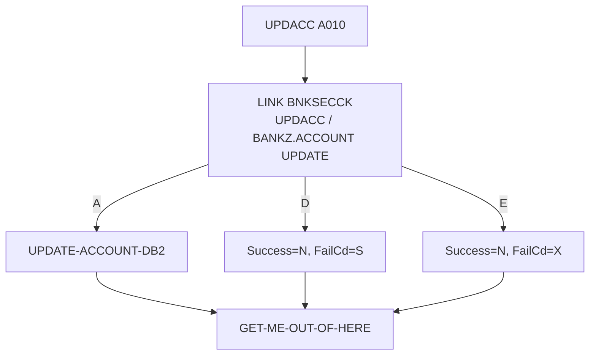

# Especificação Técnica — UPDACC (alteração para segurança RACF)

**Versão:** 0.1  
**Data:** 2026-11-05  
**Autor:** Gerado via IBM Bob Z Architect  
**Status:** Rascunho para validação  
**Origem:** [`RACF-security-functional-spec.md`](RACF-security-functional-spec.md) (RF-11, RF-13) · **Padrão de integração:** [`RACF-security-technical-index.md`](RACF-security-technical-index.md) §3 · **Verificador:** [`BNKSECCK-technical-spec.md`](BNKSECCK-technical-spec.md)

---

## 1. Identificação do Programa

| Atributo | Valor |
|----------|-------|
| Nome do Programa | [`UPDACC`](../../src/base/cics/cobol/UPDACC.cbl) |
| Tipo | Subprograma CICS (LINK) com DB2 |
| Cabeçalho | `PROCESS` + `CBL CICS('SP,EDF,DLI')` + `CBL SQL` |
| Entrada | `PROCEDURE DIVISION.` **sem** `USING` (linha 157); `COPY UPDACC` sob `01 DFHCOMMAREA` (linha 155) |
| Chamador | `BNK1UAC` (linha 955). Sem ativo de API |
| Operação de segurança | `UPDACC  ` → perfil `BANKZ.ACCOUNT`, nível **UPDATE**, papel `BZMGR` |

## 2. Objetivo da alteração

Restringir a atualização de dados da conta (tipo, taxa, limite de cheque especial) ao gerente. **Este é o único programa do conjunto que exige mudança de layout de COMMAREA**, porque hoje só devolve `COMM-SUCCESS`.

## 3. Origem dos Dados

Sem novas fontes. Nova dependência: LINK para `BNKSECCK`.

## 4. Regras de Negócio

| ID | Regra |
|----|-------|
| RN-01 | A verificação ocorre antes de `MOVE SORTCODE TO COMM-SCODE` (linha 161) e antes de `PERFORM UPDATE-ACCOUNT-DB2` (linha 167). |
| RN-02 | Autorizado → fluxo atual inalterado. |
| RN-03 | Negado → `COMM-SUCCESS='N'`, `COMM-FAIL-CD='S'`. |
| RN-04 | Erro de segurança → `COMM-SUCCESS='N'`, `COMM-FAIL-CD='X'`. |
| RN-05 | **`COMM-SUCCESS` deve continuar `'Y'`/`'N'`.** Em `BNK1UAC` (linha 1024) o teste é `IF COMM-SUCCESS = 'N' … ELSE` sucesso; qualquer outro valor seria tratado como **sucesso**. Por isso não se deve codificar a negação em `COMM-SUCCESS`. |

## 5. Mudança de layout da COMMAREA (impacto principal)

Layout atual de [`UPDACC.cpy`](../../src/base/cics/copy/UPDACC.cpy): 99 bytes (verificado: 4+10+6+8+8+6+8+8+8+8+12+12+1), terminando em `COMM-SUCCESS PIC X`.

Novo campo, ao **final**:

```cobol
           03 COMM-FAIL-CD             PIC X.
```

Novo tamanho: **100 bytes**.

**Risco de sobreposição em `BNK1UAC`:** a tela declara sua própria `DFHCOMMAREA` (linhas 179–193) com os mesmos campos de `UPDACC.cpy` **seguidos de** `COMM-PCB1-POINTER POINTER` (4 bytes), e faz `LINK PROGRAM('UPDACC') COMMAREA(DFHCOMMAREA)` (linha 955). O novo `COMM-FAIL-CD` ocuparia o 1º byte do ponteiro. Portanto, `BNK1UAC` deve declarar `03 COMM-FAIL-CD PIC X.` **entre** `COMM-SUCCESS` e `COMM-PCB1-POINTER`, mantendo o ponteiro alinhado após ele (o ponteiro passa a ficar no offset 100; o `SET COMM-PCB1-POINTER TO NULL` da linha 765 não é afetado). **Ambos os fontes devem ser alterados e recompilados juntos.**

Pontos de atenção:

- `BNK1UAC` também usa `COMMAREA(WS-COMM-AREA)` no `RETURN TRANSID('OUAC')` para o pseudo-conversacional da própria tela. **Implementado:** `WS-COMM-AREA` ganhou `03 WS-COMM-FAIL-CD PIC X.` após `WS-COMM-SUCCESS` e o `LENGTH` passou de 99 para **100**, para que `COMM-FAIL-CD` (offset 99 da `DFHCOMMAREA`) fique dentro da área recebida na reentrada. Observação pré-existente: `COMM-PCB1-POINTER` (offset 100 na `DFHCOMMAREA`) já ficava fora do `EIBCALEN`; não é alterado.
- Programas que ainda estejam carregados com o layout antigo (CICS `NEWCOPY`/`PHASEIN`) devem ser atualizados em conjunto.
- Sem ativo z/OS Connect para `UPDACC`, não há regeneração de assets de API.

## 7. Estrutura — alterações no fonte

| Local | Alteração |
|-------|-----------|
| `WORKING-STORAGE` | `01 BNKSEC-COMMAREA. COPY BNKSEC.` e `WS-SEC-SW` com 88-level `SEC-OK` |
| `PREMIERE` | `PERFORM SECURITY-CHECK` → `IF SEC-OK` envolve as linhas 161–167 → `PERFORM GET-ME-OUT-OF-HERE` |
| Nova seção | `SECURITY-CHECK SECTION. SC010 … SC999. EXIT.` com `MOVE 'UPDACC  ' TO BNKSEC-OPERATION` |
| `LINKAGE` | `COPY UPDACC` com o novo campo |
| Inicialização | `MOVE SPACE TO COMM-FAIL-CD` no início do `A010` para não devolver lixo em sucesso |

## 12. Códigos de Retorno

| `COMM-SUCCESS` | `COMM-FAIL-CD` | Significado |
|----------------|----------------|-------------|
| `Y` | espaço | Atualizado |
| `N` | espaço | Falha existente (tratada como "tente novamente") |
| `N` | **`S`** | Acesso negado (RACF) |
| `N` | **`X`** | Erro na verificação de segurança |

`BNK1UAC` hoje exibe, para qualquer `'N'`, "Update unsuccessful, try again later." Deve passar a testar `COMM-FAIL-CD` para a mensagem de negação (index §5).

## 15. Testes

| ID | Cenário | Esperado |
|----|---------|----------|
| UA-01 | `BZMGR` atualiza limite de cheque especial | `'Y'`; conta alterada |
| UA-02 | `BZTELLER` tenta atualizar | `'N'`/`'S'`; conta inalterada |
| UA-03 | `BZAUDIT` tenta atualizar | `'N'`/`'S'` |
| UA-04 | `BNKSECCK` indisponível | `'N'`/`'X'` |
| UA-05 | Sucesso devolve `COMM-FAIL-CD` em branco | espaço |
| UA-06 | `BNK1UAC` compilada com o layout novo e `UPDACC` com o antigo (teste de descompasso) | Documentar o comportamento; não liberar assim |
| UA-07 | `COMM-PCB1-POINTER` continua `NULL` após o retorno | verdadeiro |

## 16. Diagrama de Fluxo



## 17. Localização dos Artefatos

| Artefato | Caminho |
|----------|---------|
| Programa | [`UPDACC.cbl`](../../src/base/cics/cobol/UPDACC.cbl) |
| COMMAREA (**altera**) | [`UPDACC.cpy`](../../src/base/cics/copy/UPDACC.cpy) |
| Tela chamadora (**altera layout e mensagens**) | [`BNK1UAC.cbl`](../../src/base/cics/cobol/BNK1UAC.cbl) |
