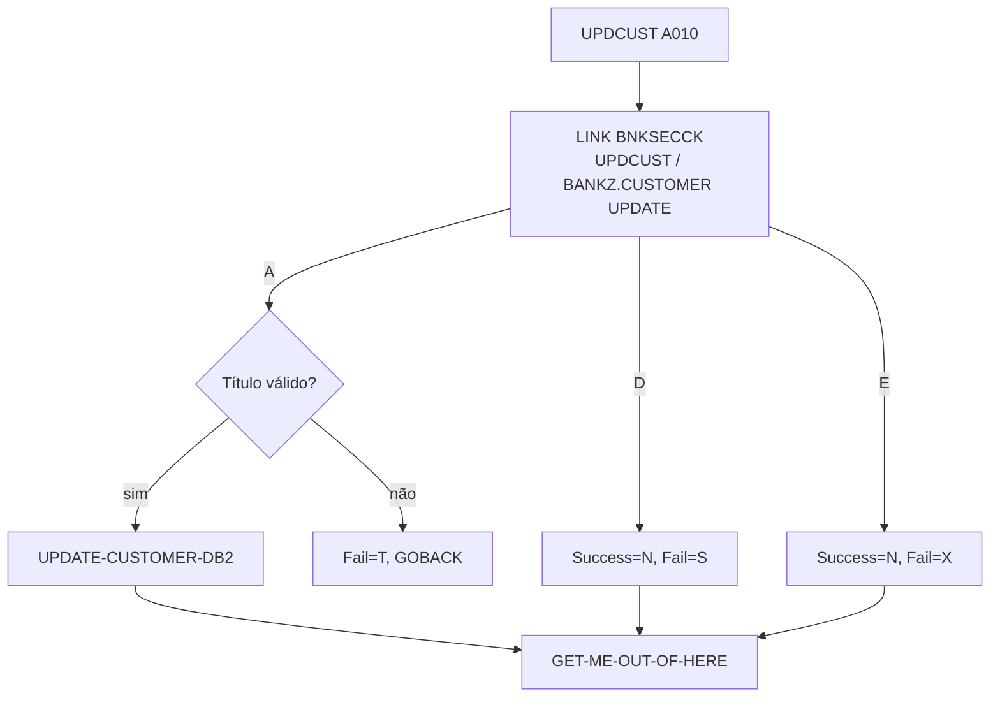

# Especificação Técnica — UPDCUST (alteração para segurança RACF)

**Versão:** 0.1  
**Data:** 2026-11-05  
**Autor:** Gerado via IBM Bob Z Architect  
**Status:** Rascunho para validação  
**Origem:** [`RACF-security-functional-spec.md`](RACF-security-functional-spec.md) (RF-11, RF-13) · **Padrão de integração:** [`RACF-security-technical-index.md`](RACF-security-technical-index.md) §3 · **Verificador:** [`BNKSECCK-technical-spec.md`](BNKSECCK-technical-spec.md)

---

## 1. Identificação do Programa

| Atributo | Valor |
|----------|-------|
| Nome do Programa | [`UPDCUST`](../../src/base/cics/cobol/UPDCUST.cbl) |
| Tipo | Subprograma CICS (LINK) com DB2 |
| Cabeçalho | `PROCESS` + `CBL CICS('SP,EDF,DLI')` + `CBL SQL` (exceção histórica do padrão) |
| Entrada | `PROCEDURE DIVISION.` **sem** `USING` (linha 169); `COPY UPDCUST` sob `01 DFHCOMMAREA` (linha 167) |
| Chamadores | `BNK1DCS` (linha 1217) e API `PUT /customers/{customerId}` (ativo `UPDCUST`) |
| Operação de segurança | `UPDCUST ` → perfil `BANKZ.CUSTOMER`, nível **UPDATE**, papel `BZMGR` |

## 2. Objetivo da alteração

Restringir a atualização de dados cadastrais de cliente ao gerente. O Teller e o Auditor podem consultar (`INQCUST`), mas não alterar.

## 3. Origem dos Dados

Sem novas fontes. Nova dependência: LINK para `BNKSECCK`. Observação: o comentário de cabeçalho do programa cita VSAM, porém o código acessa DB2.

## 4. Regras de Negócio

| ID | Regra |
|----|-------|
| RN-01 | A verificação ocorre **antes** do `MOVE COMM-SCODE TO DESIRED-SORT-CODE` (linha 173) e antes da validação do título. Não revelar a validade do título a quem não tem permissão. |
| RN-02 | Autorizado → fluxo atual inalterado (validação de título `'T'`, `UPDATE-CUSTOMER-DB2`). |
| RN-03 | Negado → `COMM-UPD-SUCCESS='N'`, `COMM-UPD-FAIL-CD='S'`. |
| RN-04 | Erro de segurança → `COMM-UPD-SUCCESS='N'`, `COMM-UPD-FAIL-CD='X'`. |
| RN-05 | Saída pelo ponto único existente `GET-ME-OUT-OF-HERE` (linha 432, `EXEC CICS RETURN`); o `GOBACK` do caminho de título inválido (linha 204) é preservado. |

## 5. Lógica de Processamento

```
A010
  PERFORM SECURITY-CHECK                <- NOVO (antes da linha 173)
  IF SEC-OK
     MOVE COMM-SCODE TO DESIRED-SORT-CODE ... validação de título ... UPDATE-CUSTOMER-DB2
  END-IF
  PERFORM GET-ME-OUT-OF-HERE
```

## 7. Estrutura — alterações no fonte

| Local | Alteração |
|-------|-----------|
| `WORKING-STORAGE` | `01 BNKSEC-COMMAREA. COPY BNKSEC.` e `WS-SEC-SW` com 88-level `SEC-OK` |
| `WS-CICS-WORK-AREA` | Já existe, porém com `WS-CICS-RESP` em **nível 03** (linha 84), diferente do padrão (nível 05). Manter o nível existente; não refatorar |
| `PREMIERE` | Ver §5 |
| Nova seção | `SECURITY-CHECK SECTION. SC010 … SC999. EXIT.` com `MOVE 'UPDCUST ' TO BNKSEC-OPERATION` |
| `PROCEDURE DIVISION` | Sem `USING`; o acesso à COMMAREA é implícito. Não alterar a assinatura |

## 12. Códigos de Retorno (`COMM-UPD-FAIL-CD`)

| Código | Origem | Significado |
|--------|--------|-------------|
| `1`, `2`, `3` | existentes | Não encontrado, erro de datastore, erro de update |
| `4` | existente | Nome/endereço vazio |
| `T` | existente | Título inválido |
| **`S`** | **novo** | Acesso negado (RACF) |
| **`X`** | **novo** | Erro na verificação de segurança |

Tela `BNK1DCS` (linhas 1291–1338): `EVALUATE COMM-UPD-FAIL-CD` com `'1'`, `'2'`, `'3'`, `'T'` e `WHEN OTHER`; `'S'`/`'X'` cairiam em `WHEN OTHER`. Ver index §5.

## 15. Testes

| ID | Cenário | Esperado |
|----|---------|----------|
| UC-01 | `BZMGR` atualiza endereço | `'Y'`; registro alterado |
| UC-02 | `BZTELLER` tenta atualizar | `'N'`/`'S'`; registro inalterado |
| UC-03 | `BZAUDIT` tenta atualizar | `'N'`/`'S'` |
| UC-04 | `BZMGR`, título inválido | `'N'`/`'T'` (preservado) |
| UC-05 | `BNKSECCK` indisponível | `'N'`/`'X'` |
| UC-06 | API `PUT` com Teller | HTTP 403 (após ajuste do mapeamento) |

## 16. Diagrama de Fluxo



## 17. Localização dos Artefatos

| Artefato | Caminho |
|----------|---------|
| Programa | [`UPDCUST.cbl`](../../src/base/cics/cobol/UPDCUST.cbl) |
| COMMAREA | [`UPDCUST.cpy`](../../src/base/cics/copy/UPDCUST.cpy) (sem mudança de layout) |
| Mapeamento API | `src/api/src/main/operations/%2Fcustomers%2F%7BcustomerId%7D/put/response_mapping.yaml` |
| Tela chamadora | [`BNK1DCS.cbl`](../../src/base/cics/cobol/BNK1DCS.cbl) |
