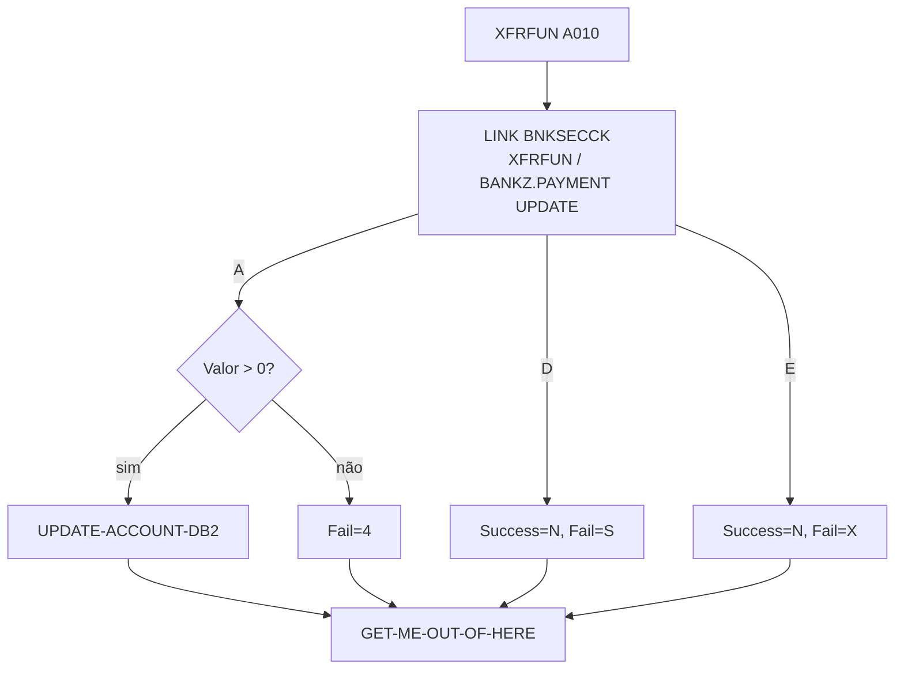

# Especificação Técnica — XFRFUN (alteração para segurança RACF)

**Versão:** 0.1  
**Data:** 2026-11-05  
**Autor:** Gerado via IBM Bob Z Architect  
**Status:** Rascunho para validação  
**Origem:** [`RACF-security-functional-spec.md`](RACF-security-functional-spec.md) (RF-11) · **Padrão de integração:** [`RACF-security-technical-index.md`](RACF-security-technical-index.md) §3 · **Verificador:** [`BNKSECCK-technical-spec.md`](BNKSECCK-technical-spec.md)

---

## 1. Identificação do Programa

| Atributo | Valor |
|----------|-------|
| Nome do Programa | [`XFRFUN`](../../src/base/cics/cobol/XFRFUN.cbl) |
| Tipo | Subprograma CICS (LINK) com DB2 — transferência entre contas |
| Cabeçalho | `PROCESS` + `CBL CICS('SP,EDF')` + `CBL SQL` |
| Entrada | `PROCEDURE DIVISION USING DFHCOMMAREA` (linha 268); `COPY XFRFUN` ([`XFRFUN.cpy`](../../src/base/cics/copy/XFRFUN.cpy)) |
| Chamador | `BNK1TFN` (linha 497). Sem ativo de API |
| Seção principal | `PREMIERE SECTION.` / `A010.` (linhas 269–270) |
| Operação de segurança | `XFRFUN  ` → perfil `BANKZ.PAYMENT`, nível **UPDATE**, papéis `BZTELLER` e `BZMGR` |

## 2. Objetivo da alteração

Impedir transferência de fundos por papéis sem permissão (Auditor).

## 3. Origem dos Dados

Sem novas fontes. Nota: `COMM-FAIL-CODE` vem **antes** de `COMM-SUCCESS` no copybook (ordem inversa dos demais).

## 4. Regras de Negócio

| ID | Regra |
|----|-------|
| RN-01 | A verificação ocorre em `A010`, antes do `HANDLE ABEND` (linha 272), das inicializações `HV-*` (276–279), da validação `COMM-AMT <= ZERO` (linha 289) e de `UPDATE-ACCOUNT-DB2` (linha 296). |
| RN-02 | Autorizado → fluxo inalterado. |
| RN-03 | Negado → `COMM-SUCCESS='N'`, `COMM-FAIL-CODE='S'`. |
| RN-04 | Erro de segurança → `COMM-SUCCESS='N'`, `COMM-FAIL-CODE='X'`. |
| RN-05 | Códigos `'1'`–`'4'` existentes permanecem (`'4'` = valor não positivo). |
| RN-06 | O caminho de `COMM-AMT <= ZERO` (linhas 289–293) executa `PERFORM GET-ME-OUT-OF-HERE`; o mesmo ponto de saída serve para o caminho negado. |

## 5. Lógica de Processamento

```
A010
  PERFORM SECURITY-CHECK                          <- NOVO (antes da linha 272)
  IF NOT SEC-OK  -> PERFORM GET-ME-OUT-OF-HERE
  HANDLE ABEND ... ; IF COMM-AMT <= ZERO -> '4' ; PERFORM UPDATE-ACCOUNT-DB2
```

## 7. Estrutura — alterações no fonte

| Local | Alteração |
|-------|-----------|
| `WORKING-STORAGE` | `01 BNKSEC-COMMAREA. COPY BNKSEC.` e `WS-SEC-SW` com 88-level `SEC-OK` |
| `PREMIERE` | Ver §5 |
| Nova seção | `SECURITY-CHECK SECTION. SC010 … SC999. EXIT.` com `MOVE 'XFRFUN  ' TO BNKSEC-OPERATION` |

## 12. Códigos de Retorno (`COMM-FAIL-CODE`)

| Código | Origem | Significado |
|--------|--------|-------------|
| `1`–`3` | existentes | Falhas de conta/datastore |
| `4` | existente | Valor não positivo |
| **`S`** | **novo** | Acesso negado (RACF) |
| **`X`** | **novo** | Erro na verificação de segurança |

`BNK1TFN` (linhas 582–617): `EVALUATE SUBPGM-FAIL-CODE` com `'1'`–`'4'` e `WHEN OTHER`. Ver index §5.

## 15. Testes

| ID | Cenário | Esperado |
|----|---------|----------|
| XF-01 | `BZTELLER` transfere valor válido | `'Y'` |
| XF-02 | `BZMGR` transfere | `'Y'` |
| XF-03 | `BZAUDIT` tenta transferir | `'N'`/`'S'`; saldos inalterados |
| XF-04 | `BNKSECCK` indisponível | `'N'`/`'X'` |
| XF-05 | `BZTELLER`, valor negativo | `'N'`/`'4'` (preservado) |
| XF-06 | `BZAUDIT`, valor negativo | `'N'`/`'S'` (segurança prevalece sobre validação) |

## 16. Diagrama de Fluxo



## 17. Localização dos Artefatos

| Artefato | Caminho |
|----------|---------|
| Programa | [`XFRFUN.cbl`](../../src/base/cics/cobol/XFRFUN.cbl) |
| COMMAREA | [`XFRFUN.cpy`](../../src/base/cics/copy/XFRFUN.cpy) (sem mudança) |
| Tela chamadora | [`BNK1TFN.cbl`](../../src/base/cics/cobol/BNK1TFN.cbl) |
