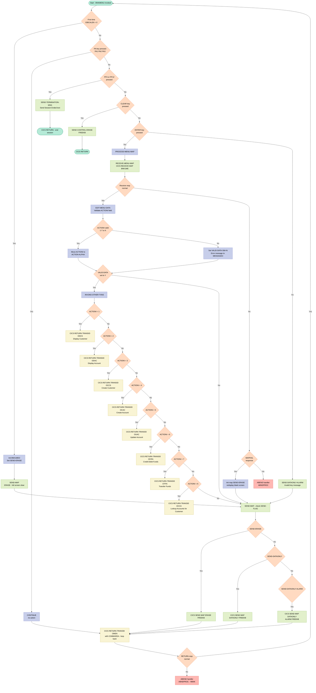

## Table of Contents

- [1. Purpose](#1-purpose)
- [2. Inputs](#2-inputs)
  - [2.1 Entradas do Terminal (Mapa BMS) — Entrada do Usuário](#21-entradas-do-terminal-mapa-bms--entrada-do-usuário)
  - [2.2 CICS Execute Interface Block (EIB) — Entradas Fornecidas pelo Sistema](#22-cics-execute-interface-block-eib--entradas-fornecidas-pelo-sistema)
  - [2.3 CICS COMMAREA / Estado entre Transações](#23-cics-commarea--estado-entre-transações)
  - [2.4 Atribuições do Sistema CICS (Ambiente de Execução)](#24-atribuições-do-sistema-cics-ambiente-de-execução)
- [3. Outputs](#3-outputs)
  - [3.1 Tela de Terminal BMS (`BNK1MEO` / Mapa `BNK1ME`, Mapset `BNK1MAI`)](#31-tela-de-terminal-bms-bnk1meo--mapa-bnk1me-mapset-bnk1mai)
  - [3.2 Mensagem de Texto de Encerramento de Sessão (`END-OF-SESSION-MESSAGE`)](#32-mensagem-de-texto-de-encerramento-de-sessão-end-of-session-message)
  - [3.3 Roteamento de Transação (CICS RETURN TRANSID)](#33-roteamento-de-transação-cics-return-transid)
  - [3.4 Invocação do Tratador de Abend (`ABNDINFO-REC` via `CICS LINK` para `ABNDPROC`)](#34-invocação-do-tratador-de-abend-abndinfo-rec-via-cics-link-para-abndproc)
  - [3.5 Encerramento Anormal de Tarefa (`CICS ABEND`)](#35-encerramento-anormal-de-tarefa-cics-abend)
- [4. Processing Logic](#4-processing-logic)
  - [4.1 Diagrama de Fluxo Mermaid](#41-diagrama-de-fluxo-mermaid)
  - [4.2 Descrição da Lógica de Processamento](#42-descrição-da-lógica-de-processamento)
  - [4.3 Tabelas de Banco de Dados](#43-tabelas-de-banco-de-dados)
- [5. Paragraphs](#5-paragraphs)
- [6. Dependencies](#6-dependencies)
  - [6.1 Mapas BMS](#61-mapas-bms)
  - [6.2 Copybooks](#62-copybooks)
  - [6.3 Programas Externos Invocados](#63-programas-externos-invocados)
  - [6.4 Dependências de Transações CICS](#64-dependências-de-transações-cics)
  - [6.5 Serviços de Sistema CICS](#65-serviços-de-sistema-cics)
  - [6.6 Bloco de Execução CICS (EIB)](#66-bloco-de-execução-cics-eib)
  - [6.7 Dados de Entrada](#67-dados-de-entrada)
- [7. Constraints](#7-constraints)
  - [7.1 Validação de Entrada](#71-validação-de-entrada)
  - [7.2 Restrições de Tratamento de Teclas de Atenção (AID)](#72-restrições-de-tratamento-de-teclas-de-atenção-aid)
  - [7.3 Restrições de Sessão e Estado Conversacional](#73-restrições-de-sessão-e-estado-conversacional)
  - [7.4 Restrições de Despacho de Transações](#74-restrições-de-despacho-de-transações)
  - [7.5 Restrições de Apresentação de Tela](#75-restrições-de-apresentação-de-tela)
  - [7.6 Restrições de Tratamento de Erros e Abend](#76-restrições-de-tratamento-de-erros-e-abend)
  - [7.7 Restrições de Tamanho de Dados e Comprimento de Campo](#77-restrições-de-tamanho-de-dados-e-comprimento-de-campo)
- [8. Error Handling](#8-error-handling)
  - [8.1 Validação de Entrada](#81-validação-de-entrada)
  - [8.2 Notificação ao Usuário via Tela e Alarme Sonoro](#82-notificação-ao-usuário-via-tela-e-alarme-sonoro)
  - [8.3 Verificação de Código de Resposta CICS (RESP / RESP2)](#83-verificação-de-código-de-resposta-cics-resp--resp2)
  - [8.4 Recuperação de MAPFAIL (Fallback Gracioso)](#84-recuperação-de-mapfail-fallback-gracioso)
  - [8.5 Captura de Informações de Abend e Delegação ao Tratador Central de Abend](#85-captura-de-informações-de-abend-e-delegação-ao-tratador-central-de-abend)
- [9. Examples](#9-examples)
  - [9.1 Exemplo 1 — Exibição Inicial da Tela (sem COMMAREA)](#91-exemplo-1--exibição-inicial-da-tela-sem-commarea)
  - [9.2 Exemplo 2 — Opção Válida Inserida (tecla Enter, opção `'1'`)](#92-exemplo-2--opção-válida-inserida-tecla-enter-opção-1)
  - [9.3 Exemplo 3 — Opção Inválida Inserida (tecla Enter, opção `'9'`)](#93-exemplo-3--opção-inválida-inserida-tecla-enter-opção-9)
  - [9.4 Exemplo 4 — Encerramento de Sessão (PF3 pressionado)](#94-exemplo-4--encerramento-de-sessão-pf3-pressionado)

## 1. Purpose

`BNKMENU` é o programa BMS de ponto de entrada para uma aplicação bancária online baseada em CICS que apresenta um menu principal aos usuários de terminal e os encaminha para a transação bancária apropriada. Na primeira invocação, ele envia uma tela de menu limpa (`BNK1ME`); nas invocações subsequentes, ele recebe a seleção de menu do usuário, valida se é um dos oito valores permitidos (`1`–`7` ou `A`), e imediatamente transfere o controle para a transação downstream correspondente — exibir detalhes do cliente (`ODCS`), exibir detalhes da conta (`ODAC`), criar um cliente (`OCCS`), criar uma conta (`OCAC`), atualizar uma conta (`OUAC`), creditar/debitar fundos (`OCRA`), transferir fundos (`OTFN`), ou consultar contas de um cliente (`OCCA`) — via `RETURN TRANSID` do CICS com a opção `IMMEDIATE`. O programa gerencia os identificadores padrão de atenção de terminal (teclas PA são ignoradas, PF3/PF12 encerram a sessão com uma mensagem "Session Ended", CLEAR apaga a tela, e qualquer outra tecla aciona um alarme e uma mensagem "Invalid key pressed"), mantém o estado conversacional retornando com `TRANSID('OMEN')` e um COMMAREA de um byte, e fornece tratamento abrangente de erros do CICS por meio do preenchimento de um registro de diagnóstico (`ABNDINFO-REC`) e da vinculação ao programa central de tratamento de abends (`ABNDPROC`) sempre que algum comando CICS retorna uma resposta não normal.

## 2. Inputs

### 2.1 Entradas do Terminal (Mapa BMS) — Entrada do Usuário

- **`ACTIONI`** — Campo de ação de um único caractere enviado pelo mapa BMS `BNK1ME` (mapset `BNK1MAI`), recebido via `EXEC CICS RECEIVE MAP INTO(BNK1MEI)`. É o único campo de entrada de dados que o usuário digita no terminal; os valores válidos são `'1'` a `'7'` e `'A'`, cada um roteando a sessão para uma transação bancária diferente (`ODCS`, `ODAC`, `OCCS`, `OCAC`, `OUAC`, `OCRA`, `OTFN`, `OCCA`, respectivamente).

---

### 2.2 CICS Execute Interface Block (EIB) — Entradas Fornecidas pelo Sistema

- **`EIBCALEN`** — Comprimento do COMMAREA passado para esta invocação. Verificado na entrada para determinar se a transação está sendo iniciada pela primeira vez (valor `ZERO`) ou se trata de um retorno pseudo-conversacional; controla se a tela será enviada com apagamento total ou processada normalmente.
- **`EIBAID`** — Byte de Identificador de Atenção definido pelo CICS para refletir a tecla pressionada pelo usuário no terminal. Conduz a decisão principal do `EVALUATE TRUE`:
  - `DFHPA1`, `DFHPA2`, `DFHPA3` — Teclas PA; nenhuma ação é executada.
  - `DFHPF3`, `DFHPF12` — Dispara o encerramento da sessão.
  - `DFHCLEAR` — Apaga a tela e retorna.
  - `DFHENTER` — Dispara o recebimento do mapa e o processamento do menu.
  - Qualquer outra tecla — Uma mensagem de tecla inválida é exibida.
- **`EIBRESP`** / **`EIBRESP2`** — Códigos de resposta primário e secundário do CICS, lidos após cada comando CICS. Utilizados para detectar falhas e preencher o registro de diagnóstico de abend (`ABNDINFO-REC`) antes de realizar o link para `ABNDPROC`.
- **`EIBTASKN`** — Número da tarefa CICS atual, capturado em `ABND-TASKNO-KEY` durante o registro de um abend.
- **`EIBTRNID`** — ID da transação atual, capturado em `ABND-TRANID` durante o registro de um abend.

---

### 2.3 CICS COMMAREA / Estado entre Transações

- **`DFHCOMMAREA`** — Campo de um byte na Linkage Section, passado pelo CICS a partir do ciclo pseudo-conversacional anterior. Sua presença (valor não zero em `EIBCALEN`) indica uma invocação de retorno em vez de uma inicialização nova; o conteúdo em si não é inspecionado, mas sua existência governa a lógica do ponto de entrada do programa.

---

### 2.4 Atribuições do Sistema CICS (Ambiente de Execução)

- **`ABND-APPLID`** — ID de aplicação da região CICS, recuperado em tempo de execução via `EXEC CICS ASSIGN APPLID(...)`. Utilizado exclusivamente no diagnóstico de abend para identificar qual região CICS encontrou a falha.
- **`ABND-PROGRAM`** — Nome do programa em execução atual, recuperado via `EXEC CICS ASSIGN PROGRAM(...)`. Capturado no registro de abend para identificar com precisão o programa com falha.

## 3. Outputs

### 3.1 Tela de Terminal BMS (`BNK1MEO` / Mapa `BNK1ME`, Mapset `BNK1MAI`)

- **CICS SEND MAP — exibição inicial (`SEND-ERASE`)**
  - Enviado quando a transação é invocada pela primeira vez (`EIBCALEN = ZERO`) ou quando ocorre um erro de `MAPFAIL` no recebimento do mapa
  - Enviado com as opções `ERASE` e `FREEKB`, limpando completamente a tela do terminal antes de apresentar o menu bancário em branco
  - A estrutura do mapa de saída (`BNK1MEO`) é inicializada com `LOW-VALUE` e o cursor posicionado no campo de ação (`ACTIONL = -1`)

- **CICS SEND MAP — atualização somente de dados (`SEND-DATAONLY`)**
  - Enviado com as opções `DATAONLY` e `FREEKB`, atualizando apenas os campos de dados sem apagar o cromado do mapa
  - Utilizado após um ciclo bem-sucedido de recebimento do mapa para reexibir a tela

- **CICS SEND MAP — somente dados com alarme sonoro (`SEND-DATAONLY-ALARM`)**
  - Enviado com as opções `DATAONLY`, `ALARM` e `FREEKB`, emitindo um bipe no terminal enquanto atualiza os campos de dados
  - Acionado quando uma tecla AID não reconhecida é pressionada (`WHEN OTHER`) — o campo `MESSAGEO` é preenchido com `'Invalid key pressed.'`
  - Também acionado após falha de validação de entrada em `EDIT-MENU-DATA` — `MESSAGEO` é definido como `'You must enter a valid value (1-7 or A).'`

- **`MESSAGEO` (campo do mapa de saída BMS)**
  - O campo de mensagem dentro de `BNK1MEO` escrito diretamente no terminal; carrega textos de erro ou status voltados ao usuário:
    - `'Invalid key pressed.'` — ao pressionar uma tecla AID não reconhecida
    - `'You must enter a valid value (1-7 or A).'` — ao inserir uma opção de menu inválida

### 3.2 Mensagem de Texto de Encerramento de Sessão (`END-OF-SESSION-MESSAGE`)

- **CICS SEND TEXT**
  - Envia o texto literal `'Session Ended'` ao terminal com `ERASE` e `FREEKB` quando o usuário pressiona PF3 ou PF12, sinalizando o encerramento deliberado da sessão
  - Seguido imediatamente por um `CICS RETURN` incondicional (sem `TRANSID`), encerrando a conversa

- **CICS SEND CONTROL (ERASE / FREEKB)**
  - Emitido quando o usuário pressiona CLEAR; limpa a tela do terminal e desbloqueia o teclado sem enviar nenhum mapa ou dados de texto, seguido por um `CICS RETURN` incondicional

### 3.3 Roteamento de Transação (CICS RETURN TRANSID)

- **`CICS RETURN TRANSID('OMEN')` com `COMMAREA(COMMUNICATION-AREA)`**
  - Emitido ao final de cada passagem normal pelo programa para recolocar na fila a transação do menu bancário (`OMEN`) para a próxima entrada do terminal, preservando o estado conversacional por meio do `COMMUNICATION-AREA` de um byte

- **`CICS RETURN TRANSID('ODCS') IMMEDIATE`** — roteia para a transação Exibir Cliente (opção de menu `1`)
- **`CICS RETURN TRANSID('ODAC') IMMEDIATE`** — roteia para a transação Exibir Conta (opção de menu `2`)
- **`CICS RETURN TRANSID('OCCS') IMMEDIATE`** — roteia para a transação Criar Cliente (opção de menu `3`)
- **`CICS RETURN TRANSID('OCAC') IMMEDIATE`** — roteia para a transação Criar Conta (opção de menu `4`)
- **`CICS RETURN TRANSID('OUAC') IMMEDIATE`** — roteia para a transação Atualizar Conta (opção de menu `5`)
- **`CICS RETURN TRANSID('OCRA') IMMEDIATE`** — roteia para a transação Creditar/Debitar Fundos (opção de menu `6`)
- **`CICS RETURN TRANSID('OTFN') IMMEDIATE`** — roteia para a transação Transferir Fundos (opção de menu `7`)
- **`CICS RETURN TRANSID('OCCA') IMMEDIATE`** — roteia para a transação Consultar Contas do Cliente (opção de menu `A`)

### 3.4 Invocação do Tratador de Abend (`ABNDINFO-REC` via `CICS LINK` para `ABNDPROC`)

- **`CICS LINK PROGRAM('ABNDPROC') COMMAREA(ABNDINFO-REC)`**
  - Invocado sempre que qualquer comando CICS retorna um código de resposta não normal; passa o registro `ABNDINFO-REC` completamente preenchido como área de comunicação para o programa central de tratamento de abend
  - `ABNDINFO-REC` carrega o seguinte conteúdo de diagnóstico escrito como saída para `ABNDPROC`:
    - `ABND-RESPCODE` / `ABND-RESP2CODE` — códigos CICS EIBRESP e EIBRESP2 do comando com falha
    - `ABND-APPLID` — ID da aplicação CICS da região com falha
    - `ABND-TRANID` — ID da transação no momento da falha (de `EIBTRNID`)
    - `ABND-TASKNO-KEY` — número da tarefa CICS (de `EIBTASKN`)
    - `ABND-DATE` / `ABND-TIME` — data (DD/MM/YYYY) e hora (HH:MM:MM) formatadas da falha
    - `ABND-UTIME-KEY` — valor de tempo absoluto utilizado como chave de registro única
    - `ABND-CODE` — código de abend codificado fixamente como `'HBNK'`
    - `ABND-PROGRAM` — nome do programa CICS no momento da falha (de `CICS ASSIGN PROGRAM`)
    - `ABND-FREEFORM` — string de mensagem de diagnóstico em formato livre identificando a seção com falha e os códigos de resposta (ex.: `'A010 - RETURN TRANSID(MENU) FAIL. EIBRESP=... RESP2=...'`)

### 3.5 Encerramento Anormal de Tarefa (`CICS ABEND`)

- **`CICS ABEND ABCODE('HBNK') NODUMP`**
  - Emitido em `ABEND-THIS-TASK` após a conclusão do link para `ABNDPROC`; encerra a tarefa CICS com o código de abend `HBNK` sem produzir um dump

- **`DISPLAY WS-FAIL-INFO`**
  - Escrito no log de job CICS / dados transitórios imediatamente antes do abend; contém o nome do programa (`BNKMENU`), uma mensagem de falha descritiva identificando a seção com falha e os valores numéricos de RESP/RESP2

## 4. Processing Logic

### 4.1 Diagrama de Fluxo Mermaid



---

### 4.2 Descrição da Lógica de Processamento

#### 4.2.1 Resumo de Alto Nível

`BNKMENU` é o ponto de entrada da transação CICS para a aplicação de terminal BMS do **Bank of Z**. Ele exibe um menu em tela cheia (mapa BMS `BNK1ME` no mapset `BNK1MAI`) para o usuário, valida um único campo de entrada (o código de ação) e, em seguida — dependendo da opção selecionada — transfere imediatamente o controle para uma das oito transações CICS subsequentes. O programa é **pseudo-conversacional**: após cada interação do usuário, ele emite `CICS RETURN TRANSID('OMEN')`, fazendo com que o CICS o reinvoque quando o usuário pressionar uma tecla novamente, sem manter nenhum recurso do servidor entre as interações.

---

#### 4.2.2 Fluxo de Execução

##### 4.2.2.1 Passo 1 — Entrada no Programa e Detecção de Tecla (`PREMIERE SECTION / A010`)

O ponto de entrada do programa avalia o Execute Interface Block (EIB) do CICS para determinar o contexto da invocação:

| Condição | Ação |
|-----------|--------|
| `EIBCALEN = 0` (primeira invocação, sem COMMAREA) | Inicializa a área de saída do mapa (`BNK1MEO`) com LOW-VALUES, define o comprimento do cursor como -1 no campo `ACTION`, define `SEND-FLAG` como `SEND-ERASE` e chama `SEND-MAP` para exibir uma tela de menu em branco |
| PA1 / PA2 / PA3 pressionada | `CONTINUE` — ignora o pressionamento de tecla e cai direto para o `RETURN` |
| PF3 ou PF12 pressionada | Chama `SEND-TERMINATION-MSG` para exibir o texto `Session Ended` na tela, depois executa `CICS RETURN` (sem TRANSID) para encerrar a tarefa definitivamente |
| CLEAR pressionada | Emite `CICS SEND CONTROL ERASE FREEKB` para limpar o terminal, depois `CICS RETURN` para sair |
| ENTER pressionada | Chama `PROCESS-MENU-MAP` para receber, validar e processar a entrada do usuário |
| Qualquer outra tecla | Grava `Invalid key pressed.` no campo de mensagem do mapa, define `SEND-DATAONLY-ALARM` e chama `SEND-MAP` para atualizar a tela com um alarme sonoro |

Após o bloco de avaliação, independentemente do ramo tomado, o programa emite:

```
EXEC CICS RETURN TRANSID('OMEN') COMMAREA(COMMUNICATION-AREA) LENGTH(1)
```

Isso recoloca a transação `OMEN` na fila, para que o CICS reinicie o `BNKMENU` na próxima tecla AID, mantendo o padrão pseudo-conversacional. Qualquer resposta não normal aciona o tratamento de abend.

---

##### 4.2.2.2 Passo 2 — Processamento do Mapa de Menu (`PROCESS-MENU-MAP SECTION`)

Esta seção orquestra três sub-etapas sequencialmente:

1. **Receber** — chama `RECEIVE-MENU-MAP`
2. **Validar** — chama `EDIT-MENU-DATA`
3. **Despachar** — se `VALID-DATA` for verdadeiro, chama `INVOKE-OTHER-TXNS`

Após o retorno de `INVOKE-OTHER-TXNS` (somente se todas as tentativas de despacho forem ignoradas, o que normalmente não acontece, pois um valor válido sempre leva a um RETURN imediato), `SEND-DATAONLY-ALARM` é definido e `SEND-MAP` é chamado para atualizar a tela.

---

##### 4.2.2.3 Passo 3 — Recebimento do Mapa (`RECEIVE-MENU-MAP SECTION`)

Emite `CICS RECEIVE MAP('BNK1ME') MAPSET('BNK1MAI') INTO(BNK1MEI)`.

- **Resposta normal**: prossegue normalmente.
- **Resposta MAPFAIL** (usuário pressionou Enter sem digitar dados): a área de saída do mapa é limpa, `SEND-ERASE` é definido e `SEND-MAP` é chamado para reexibir o menu limpo — a seção encerra sem processamento adicional.
- **Qualquer outra resposta anormal**: o tratamento de abend é acionado (veja o tratamento de erros abaixo).

---

##### 4.2.2.4 Passo 4 — Validação de Entrada (`EDIT-MENU-DATA SECTION`)

Verifica o campo de entrada recebido `ACTIONI` em relação ao conjunto de valores válidos: `'1'`, `'2'`, `'3'`, `'4'`, `'5'`, `'6'`, `'7'` e `'A'`.

- **Válido**: copia `ACTIONI` para `ACTION-ALPHA` (Working-Storage); `VALID-DATA-SW` permanece `'Y'`.
- **Inválido**: grava a mensagem `You must enter a valid value (1-7 or A).` em `MESSAGEO` e define `VALID-DATA-SW = 'N'`, impedindo o despacho da transação.

---

##### 4.2.2.5 Passo 5 — Despacho de Transação (`INVOKE-OTHER-TXNS SECTION`)

Apenas acessada quando `VALID-DATA` é verdadeiro. Cada opção do menu é associada a uma transação CICS específica via `CICS RETURN TRANSID ... IMMEDIATE`:

| Opção | ID da Transação | Finalidade |
|--------|---------------|---------|
| `1` | `ODCS` | Exibir detalhes do cliente |
| `2` | `ODAC` | Exibir detalhes da conta |
| `3` | `OCCS` | Criar um cliente |
| `4` | `OCAC` | Criar uma conta |
| `5` | `OUAC` | Atualizar uma conta |
| `6` | `OCRA` | Creditar / debitar fundos |
| `7` | `OTFN` | Transferir fundos entre contas |
| `A` | `OCCA` | Consultar todas as contas de um cliente |

Cada `CICS RETURN TRANSID ... IMMEDIATE` faz com que o CICS inicie imediatamente a transação nomeada no mesmo terminal, transferindo o controle completamente. Se o RETURN falhar (resposta não normal), o tratamento de abend é invocado.

---

##### 4.2.2.6 Passo 6 — Saída de Tela (`SEND-MAP SECTION`)

O valor de `SEND-FLAG` determina qual variante do comando BMS SEND é emitida:

| Flag | Comando BMS | Uso |
|------|-------------|-------|
| `SEND-ERASE` (`'1'`) | `SEND MAP ... ERASE FREEKB` | Primeira exibição ou após MAPFAIL — limpa a tela inteira |
| `SEND-DATAONLY` (`'2'`) | `SEND MAP ... DATAONLY FREEKB` | Atualização silenciosa de dados |
| `SEND-DATAONLY-ALARM` (`'3'`) | `SEND MAP ... DATAONLY ALARM FREEKB` | Atualização de dados com alerta sonoro — usado após falha de validação ou tecla inválida |

Cada variante captura RESP/RESP2 e aciona abend via `ABNDPROC` se o SEND falhar.

---

##### 4.2.2.7 Passo 7 — Encerramento (`SEND-TERMINATION-MSG SECTION`)

Emite `CICS SEND TEXT FROM(END-OF-SESSION-MESSAGE) ERASE FREEKB`, exibindo o literal `Session Ended` na tela. O código chamador (`A010`) então executa `CICS RETURN` sem TRANSID, encerrando a tarefa CICS.

---

##### 4.2.2.8 Passo 8 — Tratamento de Erros (Padrão Comum)

Sempre que qualquer comando CICS retorna uma resposta não normal, o programa segue um protocolo de abend consistente:

1. **Capturar** `EIBRESP` e `EIBRESP2` em `ABNDINFO-REC`.
2. **Atribuir** o ID da aplicação via `CICS ASSIGN APPLID`.
3. **Capturar** o número da tarefa (`EIBTASKN`) e o ID da transação (`EIBTRNID`).
4. **Chamar** `POPULATE-TIME-DATE` — usa `CICS ASKTIME` e `CICS FORMATTIME` para obter a data atual (DD/MM/AAAA) e a hora (HH:MM:SS), armazenadas em `WS-ORIG-DATE` e `WS-TIME-NOW`.
5. **Atribuir** o nome do programa atual via `CICS ASSIGN PROGRAM`.
6. **Construir** uma mensagem de diagnóstico em formato livre em `ABND-FREEFORM`, identificando a seção que falhou e os códigos de resposta.
7. **Vincular** ao `ABNDPROC` (`WS-ABEND-PGM`) passando `ABNDINFO-REC` como COMMAREA — isso centraliza o registro de abend.
8. **Preencher** `WS-FAIL-INFO` e **exibir** com `DISPLAY`.
9. **Executar** `CICS ABEND ABCODE('HBNK') NODUMP` via `ABEND-THIS-TASK` para forçar o encerramento da tarefa.

---

#### 4.2.3 Interações Externas

| Interação | Comando CICS | Finalidade |
|-------------|-------------|---------|
| Exibir menu bancário (primeira vez ou após MAPFAIL) | `CICS SEND MAP ... ERASE` | Renderizar o mapa BNK1ME do mapset BNK1MAI no terminal 3270 |
| Atualizar dados da tela | `CICS SEND MAP ... DATAONLY` | Atualizar campos de saída sem apagar o layout do mapa |
| Atualizar com alerta | `CICS SEND MAP ... DATAONLY ALARM` | Notificar o usuário sobre entrada inválida com alarme sonoro |
| Receber entrada do usuário | `CICS RECEIVE MAP` | Ler o código de ação digitado pelo usuário no campo ACTIONI do mapa |
| Despachar para transação subsequente | `CICS RETURN TRANSID(...) IMMEDIATE` | Transferir o controle do terminal para uma das 8 transações CICS subsequentes |
| Manter o loop pseudo-conversacional | `CICS RETURN TRANSID('OMEN') COMMAREA(...)` | Recolocar a transação de menu na fila para que ela reinicie na próxima entrada do usuário |
| Centralização de abend | `CICS LINK PROGRAM('ABNDPROC')` | Delegar o registro de erros e o processamento de abend a um programa manipulador compartilhado |
| Recuperação da hora atual | `CICS ASKTIME` / `CICS FORMATTIME` | Obter carimbo de data/hora para registros de diagnóstico de abend |
| Limpeza de tela na tecla CLEAR | `CICS SEND CONTROL ERASE FREEKB` | Limpar o terminal sem enviar dados do mapa |
| Mensagem de encerramento de sessão | `CICS SEND TEXT` | Exibir o texto simples `Session Ended` antes de sair |
| Encerramento forçado da tarefa | `CICS ABEND ABCODE('HBNK')` | Encerra a tarefa CICS com um código de abend personalizado quando a recuperação é impossível |

Nenhuma interação com banco de dados (DB2, VSAM, IMS) ocorre dentro deste programa. Todo acesso a dados persistentes é delegado às transações subsequentes.

---

#### 4.2.4 Resumo em Linguagem Simples

`BNKMENU` é a **porta de entrada** da aplicação de terminal do Bank of Z. Quando um caixa ou usuário inicia o sistema bancário em seu terminal de tela verde, este programa é a primeira coisa que ele vê — um menu listando oito operações bancárias.

O programa funciona em loop: exibe o menu, aguarda o usuário digitar um número ou letra e pressionar Enter, verifica se a entrada é válida (1 a 7, ou a letra A) e, em seguida, transfere imediatamente o controle para o programa bancário correto (por exemplo, digite `3` para criar um novo cliente, digite `6` para creditar ou debitar uma conta bancária).

Se o usuário pressionar PF3 ou PF12, a sessão encerra com elegância com uma mensagem `Session Ended`. Se pressionar uma tecla inesperada, a tela é atualizada com uma mensagem de erro e um bipe sonoro. Se algo der errado internamente (um comando CICS falha), o programa captura informações de diagnóstico completas e chama um tratador de erros central (`ABNDPROC`) antes de encerrar forçosamente a tarefa com o código de abend `HBNK`.

---

### 4.3 Tabelas de Banco de Dados

Nenhuma tabela de banco de dados é acessada pelo `BNKMENU`. O programa não contém instruções SQL do DB2, E/S de arquivo VSAM ou chamadas DL/I do IMS. Toda a persistência de dados é tratada pelas transações CICS subsequentes para as quais ele despacha.

## 5. Paragraphs

- **A010** — Ponto de entrada principal da PREMIERE SECTION. Atua como o hub de despacho primário do programa, utilizando um construto `EVALUATE TRUE` para examinar o identificador de atenção (`EIBAID`) e o comprimento da área de comunicação (`EIBCALEN`) e rotear a execução de acordo.
  - Quando `EIBCALEN = ZERO` (primeira invocação), inicializa `BNK1MEO` com LOW-VALUE, define o comprimento do cursor como -1, define `SEND-ERASE` e realiza `SEND-MAP` para apresentar uma tela de menu limpa.
  - Quando uma tecla PA (`DFHPA1`, `DFHPA2`, `DFHPA3`) é detectada, emite um `CONTINUE` — nenhuma ação tomada.
  - Quando PF3 ou PF12 é pressionado, realiza `SEND-TERMINATION-MSG` e em seguida emite um `CICS RETURN` incondicional para encerrar a sessão.
  - Quando CLEAR é pressionado, emite `CICS SEND CONTROL ERASE FREEKB` para limpar o terminal e, em seguida, `CICS RETURN` para encerrar.
  - Quando ENTER é pressionado, realiza `PROCESS-MENU-MAP` para receber e processar a seleção de menu do usuário.
  - Para qualquer outra tecla, insere a mensagem "Invalid key pressed." em `MESSAGEO`, define `SEND-DATAONLY-ALARM` e realiza `SEND-MAP`.
  - Após o `EVALUATE`, emite `CICS RETURN TRANSID('OMEN') COMMAREA(COMMUNICATION-AREA)` para recolocar a transação de menu na fila para a próxima interação.
  - Se o `RETURN` falhar, popula `ABNDINFO-REC` com os códigos de resposta do EIB, ID da aplicação, número da tarefa, ID da transação, timestamp (via `POPULATE-TIME-DATE`) e uma mensagem descritiva em formato livre, em seguida faz link para `ABNDPROC` e realiza `ABEND-THIS-TASK`.

- **A999** — Stub de encerramento da PREMIERE SECTION. Contém apenas uma instrução `EXIT`, marcando o fim lógico da seção.

- **PMM010** (dentro da `PROCESS-MENU-MAP SECTION`) — Orquestra o ciclo completo de processamento de entrada do menu quando o usuário pressiona ENTER.
  - Realiza `RECEIVE-MENU-MAP` para ler os dados do mapa BMS do terminal.
  - Realiza `EDIT-MENU-DATA` para validar o código de ação inserido.
  - Realiza condicionalmente `INVOKE-OTHER-TXNS` somente se `VALID-DATA` for verdadeiro (ou seja, `VALID-DATA-SW = 'Y'`), impedindo o despacho de transação em caso de entrada inválida.
  - Define `SEND-DATAONLY-ALARM` incondicionalmente após o bloco condicional.
  - Realiza `SEND-MAP` para atualizar a tela do terminal.

- **PMM999** — Stub de encerramento da seção `PROCESS-MENU-MAP`. Contém apenas uma instrução `EXIT`.

- **RMM010** (dentro da `RECEIVE-MENU-MAP SECTION`) — Recebe a entrada do mapa BMS do terminal em `BNK1MEI`.
  - Emite `CICS RECEIVE MAP('BNK1ME') MAPSET('BNK1MAI') INTO(BNK1MEI)` e captura os códigos de resposta.
  - Se a resposta for `MAPFAIL` (usuário pressionou ENTER sem dados), redefine `BNK1MEO` para LOW-VALUES, define o cursor como -1, define `SEND-ERASE` e realiza `SEND-MAP` para reexibir uma tela limpa.
  - Para qualquer outra resposta não normal, popula `ABNDINFO-REC` com contexto diagnóstico completo (códigos EIB, applid, IDs de tarefa/transação, timestamp, mensagem livre "RMM010 - RECEIVE MAP FAIL"), faz link para `ABNDPROC` e realiza `ABEND-THIS-TASK`.

- **RMM999** — Stub de encerramento da seção `RECEIVE-MENU-MAP`. Contém apenas uma instrução `EXIT`.

- **EMD010** (dentro da `EDIT-MENU-DATA SECTION`) — Valida o código de ação inserido pelo usuário no campo `ACTIONI`.
  - Verifica se `ACTIONI` é um dos oito valores válidos: `'1'` a `'7'` ou `'A'`.
  - Se o valor não for válido, move uma mensagem de erro ("You must enter a valid value (1-7 or A).") para `MESSAGEO` e define `VALID-DATA-SW` como `'N'`, bloqueando a invocação da transação.
  - Se o valor for válido, move `ACTIONI` para `ACTION-ALPHA` para uso posterior.

- **EMD999** — Stub de encerramento da seção `EDIT-MENU-DATA`. Contém apenas uma instrução `EXIT`.

- **IOT010** (dentro da `INVOKE-OTHER-TXNS SECTION`) — Despacha o controle para a transação bancária apropriada com base na seleção de menu validada, utilizando uma série de instruções `IF` independentes (uma por opção).
  - `'1'` → `CICS RETURN TRANSID('ODCS') IMMEDIATE` — Exibir detalhes do Cliente.
  - `'2'` → `CICS RETURN TRANSID('ODAC') IMMEDIATE` — Exibir detalhes da Conta.
  - `'3'` → `CICS RETURN TRANSID('OCCS') IMMEDIATE` — Criar um Cliente.
  - `'4'` → `CICS RETURN TRANSID('OCAC') IMMEDIATE` — Criar uma Conta.
  - `'5'` → `CICS RETURN TRANSID('OUAC') IMMEDIATE` — Atualizar uma Conta.
  - `'6'` → `CICS RETURN TRANSID('OCRA') IMMEDIATE` — Creditar/Debitar fundos.
  - `'A'` → `CICS RETURN TRANSID('OCCA') IMMEDIATE` — Consultar contas de um cliente.
  - `'7'` → `CICS RETURN TRANSID('OTFN') IMMEDIATE` — Transferir fundos.
  - Cada chamada `CICS RETURN IMMEDIATE` é seguida de uma verificação de erro; em caso de falha, `ABNDINFO-REC` é totalmente populado com dados diagnósticos e a execução é roteada para `ABNDPROC` via `CICS LINK`, seguido da realização de `ABEND-THIS-TASK`.

- **IOT999** — Stub de encerramento da seção `INVOKE-OTHER-TXNS`. Contém apenas uma instrução `EXIT`.

- **SMM010** (dentro da `SEND-MAP SECTION`) — Envia o mapa de menu BMS (`BNK1ME` / `BNK1MAI`) ao terminal utilizando um dos três modos determinados por `SEND-FLAG`.
  - Se `SEND-ERASE` (`'1'`): emite `CICS SEND MAP ... ERASE FREEKB`, limpando todos os campos do terminal antes de exibir o mapa. Em caso de sucesso, desvia para `SMM999` via `GO TO`.
  - Se `SEND-DATAONLY` (`'2'`): emite `CICS SEND MAP ... DATAONLY FREEKB`, atualizando apenas as partes de dados do mapa já exibido. Em caso de sucesso, desvia para `SMM999` via `GO TO`.
  - Se `SEND-DATAONLY-ALARM` (`'3'`): emite `CICS SEND MAP ... DATAONLY ALARM FREEKB`, atualizando os campos de dados e acionando o alarme do terminal (utilizado para falhas de validação e teclas inválidas pressionadas).
  - Cada variante de envio verifica a resposta do CICS; em caso de resposta não normal, os dados diagnósticos são montados em `ABNDINFO-REC`, `ABNDPROC` é chamado via `CICS LINK` e `ABEND-THIS-TASK` é realizado.

- **SMM999** — Stub de encerramento da seção `SEND-MAP`. Atua como destino do `GO TO` para saídas antecipadas após envios bem-sucedidos de ERASE ou DATAONLY. Contém apenas uma instrução `EXIT`.

- **STM010** (dentro da `SEND-TERMINATION-MSG SECTION`) — Envia a mensagem de encerramento de sessão ao terminal quando o usuário pressiona PF3 ou PF12.
  - Emite `CICS SEND TEXT FROM(END-OF-SESSION-MESSAGE) ERASE FREEKB`, exibindo o literal "Session Ended" e limpando a tela.
  - Em caso de falha, popula `ABNDINFO-REC` com informações diagnósticas completas (códigos EIB, applid, IDs de tarefa/transação, timestamp, mensagem livre "STM010 - SEND TEXT FAIL"), faz link para `ABNDPROC` e realiza `ABEND-THIS-TASK`.

- **STM999** — Stub de encerramento da seção `SEND-TERMINATION-MSG`. Contém apenas uma instrução `EXIT`.

- **ATT010** (dentro da `ABEND-THIS-TASK SECTION`) — Termina forçosamente a tarefa CICS atual após uma falha irrecuperável em um comando CICS.
  - Emite um `DISPLAY` de `WS-FAIL-INFO` para registrar os detalhes da falha no log de job do CICS.
  - Emite `CICS ABEND ABCODE('HBNK') NODUMP` para encerrar anormalmente a tarefa com um código de abend de quatro caracteres, suprimindo um dump de sistema.

- **ATT999** — Stub de encerramento da seção `ABEND-THIS-TASK`. Contém apenas uma instrução `EXIT`.

- **PTD010** (dentro da `POPULATE-TIME-DATE SECTION`) — Recupera e formata a data e hora atuais do sistema, fornecendo valores utilizados nos registros de diagnóstico de abend.
  - Emite `CICS ASKTIME ABSTIME(WS-U-TIME)` para capturar o tempo absoluto atual como um valor decimal compactado em `WS-U-TIME`.
  - Emite `CICS FORMATTIME ABSTIME(WS-U-TIME) DDMMYYYY(WS-ORIG-DATE) TIME(WS-TIME-NOW) DATESEP` para derivar uma data formatada (DD/MM/AAAA) em `WS-ORIG-DATE` e um valor de hora (HHMMSS) em `WS-TIME-NOW`, que é então dividido em seus subcampos de hora (`WS-TIME-NOW-GRP-HH`) e minuto (`WS-TIME-NOW-GRP-MM`) para montagem via `STRING` em `ABND-TIME`.
  - Uma instrução `DISPLAY` de depuração (prefixada com `D`) está presente, mas só é ativada quando o fonte é compilado com o modo de depuração habilitado.

- **PTD999** — Stub de encerramento da seção `POPULATE-TIME-DATE`. Contém apenas uma instrução `EXIT`.

## 6. Dependencies

### 6.1 Mapas BMS

- **`BNK1ME`** (nome do mapa) dentro do mapset **`BNK1MAI`** — mapa BMS do menu principal do banco. Utilizado em todas as chamadas `EXEC CICS SEND MAP` e `EXEC CICS RECEIVE MAP` para renderizar a tela do terminal e capturar a seleção de menu do usuário. Os dados são trocados por meio dos campos do mapa de descrição simbólica `BNK1MEI` (entrada) e `BNK1MEO` (saída), ambos definidos pelo copybook `BNK1MAI`.

### 6.2 Copybooks

- **`BNK1MAI`** (`COPY BNK1MAI`) — copybook de mapa de descrição simbólica BMS. Define todos os campos de entrada/saída do mapa `BNK1ME`, incluindo `ACTIONI`/`ACTIONL` (a entrada de ação do menu do usuário e seu atributo de comprimento) e `MESSAGEO` (o campo de saída de mensagem). Expande-se nas estruturas `BNK1MEI` e `BNK1MEO` utilizadas em todo o programa.
- **`DFHAID`** (`COPY DFHAID`) — copybook CICS fornecido pela IBM que define as constantes de identificador de atenção (AID). Fornece `DFHENTER`, `DFHPF3`, `DFHPF12`, `DFHPA1`, `DFHPA2`, `DFHPA3` e `DFHCLEAR`, que são utilizados para desviar o fluxo com base na tecla pressionada pelo usuário no terminal.
- **`ABNDINFO`** (expandido inline, originado de `src/base/cics/copy/ABNDINFO.cpy`) — copybook que define o layout do registro de informações de abend `ABNDINFO-REC`. Contém campos para chave VSAM, ID da aplicação, ID da transação, data/hora, códigos de resposta, nome do programa, código SQL e uma mensagem de formato livre, todos passados ao manipulador central de abend.

### 6.3 Programas Externos Invocados

- **`ABNDPROC`** (referenciado via `WS-ABEND-PGM`) — programa manipulador central de abend. Chamado via `EXEC CICS LINK` com `ABNDINFO-REC` como COMMAREA sempre que qualquer comando CICS falha. Recebe contexto de diagnóstico (códigos de resposta, timestamps, número de tarefa, ID de transação, nome do programa e mensagem de formato livre) e realiza o registro e processamento centralizado de abend.

### 6.4 Dependências de Transações CICS

- **`OMEN`** — ID de transação do próprio `BNKMENU`. Passado em `EXEC CICS RETURN TRANSID('OMEN')` com um `COMMUNICATION-AREA` de um byte para reinvocar o programa de menu na próxima interação do terminal, mantendo o estado pseudo-conversacional.
- **`ODCS`** — Transação Exibir Cliente. Retornada com `EXEC CICS RETURN TRANSID('ODCS') IMMEDIATE` quando o usuário seleciona a opção `1`.
- **`ODAC`** — Transação Exibir Conta. Retornada com `EXEC CICS RETURN TRANSID('ODAC') IMMEDIATE` quando o usuário seleciona a opção `2`.
- **`OCCS`** — Transação Criar Cliente. Retornada com `EXEC CICS RETURN TRANSID('OCCS') IMMEDIATE` quando o usuário seleciona a opção `3`.
- **`OCAC`** — Transação Criar Conta. Retornada com `EXEC CICS RETURN TRANSID('OCAC') IMMEDIATE` quando o usuário seleciona a opção `4`.
- **`OUAC`** — Transação Atualizar Conta. Retornada com `EXEC CICS RETURN TRANSID('OUAC') IMMEDIATE` quando o usuário seleciona a opção `5`.
- **`OCRA`** — Transação Creditar/Debitar Fundos. Retornada com `EXEC CICS RETURN TRANSID('OCRA') IMMEDIATE` quando o usuário seleciona a opção `6`.
- **`OTFN`** — Transação Transferir Fundos. Retornada com `EXEC CICS RETURN TRANSID('OTFN') IMMEDIATE` quando o usuário seleciona a opção `7`.
- **`OCCA`** — Transação Consultar Contas por Cliente. Retornada com `EXEC CICS RETURN TRANSID('OCCA') IMMEDIATE` quando o usuário seleciona a opção `A`.

### 6.5 Serviços de Sistema CICS

- **CICS RECEIVE MAP / SEND MAP** — serviços de E/S de terminal BMS utilizados para receber a entrada do usuário a partir de `BNK1MEI` e enviar a saída atualizada de `BNK1MEO` de volta ao terminal (com as opções ERASE, DATAONLY ou DATAONLY+ALARM).
- **CICS SEND TEXT** — utilizado para exibir a mensagem de encerramento de sessão (`'Session Ended'`) no terminal quando o usuário pressiona PF3 ou PF12.
- **CICS SEND CONTROL** — utilizado com `ERASE` e `FREEKB` para limpar a tela do terminal quando a tecla CLEAR é pressionada.
- **CICS RETURN** — utilizado tanto para reentrada pseudo-conversacional (com `TRANSID('OMEN')` e uma COMMAREA) quanto para transferência imediata de transação para as transações subsequentes.
- **CICS LINK** — utilizado para chamar sincronamente `ABNDPROC` com a COMMAREA de diagnóstico em caso de falha em qualquer comando CICS.
- **CICS ASSIGN** — utilizado para recuperar o ID da aplicação CICS (`APPLID`) e o nome do programa atual (`PROGRAM`) para preencher os registros de diagnóstico de abend.
- **CICS ASKTIME** — utilizado na seção `POPULATE-TIME-DATE` para obter o tempo absoluto atual em `WS-U-TIME`.
- **CICS FORMATTIME** — utilizado na seção `POPULATE-TIME-DATE` para converter o tempo absoluto em data formatada (`DDMMYYYY`) e hora para os registros de diagnóstico de abend.
- **CICS ABEND** — emitido com o código de abend `'HBNK'` e `NODUMP` na seção `ABEND-THIS-TASK` para encerrar anormalmente a tarefa após o registro dos detalhes de falha.

### 6.6 Bloco de Execução CICS (EIB)

- **`EIBCALEN`** — campo do Bloco de Interface de Execução CICS que indica o comprimento da COMMAREA de entrada. Verificado na entrada do programa para detectar a primeira invocação (valor zero) em comparação com uma reentrada.
- **`EIBAID`** — campo do EIB que contém o identificador de atenção da tecla pressionada pelo usuário. Avaliado em relação às constantes `DFHAID` para despachar o fluxo do programa.
- **`EIBRESP` / `EIBRESP2`** — campos de código de resposta do EIB verificados após cada comando CICS; também movidos para `ABNDINFO-REC` para relatório de diagnóstico.
- **`EIBTASKN`** — campo do EIB que contém o número de tarefa CICS atual, copiado em `ABND-TASKNO-KEY` para diagnóstico de abend.
- **`EIBTRNID`** — campo do EIB que contém o identificador de transação atual, copiado em `ABND-TRANID` para diagnóstico de abend.

### 6.7 Dados de Entrada

- **Entrada pelo teclado do terminal** — a única fonte de entrada em tempo de execução. O usuário digita uma opção de menu (`1`–`7` ou `A`) no campo `ACTIONI` do mapa BMS e pressiona Enter. Teclas PA (PA1–PA3) são toleradas silenciosamente; PF3/PF12 acionam o encerramento da sessão; CLEAR limpa a tela; qualquer outra tecla aciona um erro de tecla inválida.
- **`DFHCOMMAREA` / `COMMUNICATION-AREA`** — campo de um byte na Linkage Section. Na reentrada, sua presença (`EIBCALEN` diferente de zero) sinaliza que o programa está sendo reinvocado de forma pseudo-conversacional, em vez de ser iniciado do zero.

## 7. Constraints

### 7.1 Validação de Entrada

- **O campo de ação do menu (`ACTIONI`) é o único campo de entrada obrigatório** — o programa não aceita nenhum outro campo fornecido pelo usuário; o campo deve ser preenchido antes que qualquer transação possa ser invocada.
    - O campo deve conter exatamente um caractere do conjunto fechado `'1'`, `'2'`, `'3'`, `'4'`, `'5'`, `'6'`, `'7'` ou `'A'` (maiúsculo); qualquer outro valor, incluindo espaços, letras minúsculas ou dígitos fora deste intervalo, é rejeitado.
    - Aplicado em `EDIT-MENU-DATA` (linhas 387–398): uma comparação NOT-equal explícita contra cada valor válido é realizada; a falha define `VALID-DATA-SW` como `'N'` e grava a mensagem de erro `'You must enter a valid value (1-7 or A).'` em `MESSAGEO`.
    - O campo é um campo de entrada BMS de um único caractere (`PIC X`) (`ACTIONI`); nenhuma verificação de comprimento ou formato numérico é aplicada além da enumeração explícita de valores.
- **`VALID-DATA-SW` controla o processamento downstream** — `INVOKE-OTHER-TXNS` é executado somente quando `VALID-DATA` (valor de nível 88 `'Y'`) é verdadeiro; uma entrada inválida impede qualquer despacho de transação sem provocar um abend.
    - Aplicado pela guarda `IF VALID-DATA` na linha 281 em `PROCESS-MENU-MAP`.

### 7.2 Restrições de Tratamento de Teclas de Atenção (AID)

- **Somente ENTER aciona o processamento do mapa** — o programa aceita uma seleção de menu digitada e a passa para `PROCESS-MENU-MAP` exclusivamente quando `EIBAID = DFHENTER` (linha 179); todos os outros caminhos de tecla ignoram completamente a validação de campo e a invocação de transações.
- **Teclas PA (PA1, PA2, PA3) são explicitamente ignoradas** — pressionar qualquer tecla Program Attention causa um `CONTINUE` sem alteração de estado e sem erro; o RETURN ao final do loop principal reexibe a tela atual sem alterações.
- **PF3 ou PF12 encerra a sessão incondicionalmente** — ao receber qualquer uma dessas teclas, o programa envia `'Session Ended'` via `CICS SEND TEXT` (ERASE, FREEKB) e emite um `CICS RETURN` simples (sem TRANSID), encerrando permanentemente a cadeia pseudo-conversacional sem validar nenhuma entrada.
- **A tecla CLEAR apaga a tela e encerra** — `CICS SEND CONTROL ERASE FREEKB` seguido de `CICS RETURN` sem TRANSID; efetivamente um reset completo que sai da conversa do menu.
- **Qualquer outra tecla produz um erro de tecla inválida** — todos os valores AID não reconhecidos passam para a cláusula `WHEN OTHER` (linha 185), que define `MESSAGEO` como `'Invalid key pressed.'`, define o foco do cursor como `ACTIONL = -1` e envia o mapa com `SEND-DATAONLY-ALARM`, acionando um alerta sonoro.

### 7.3 Restrições de Sessão e Estado Conversacional

- **`EIBCALEN = ZERO` sinaliza a primeira invocação** — quando o comprimento da Área de Comunicação é zero, o programa envia incondicionalmente um mapa vazio apagado (`SEND-ERASE`) e reentra no loop pseudo-conversacional via `CICS RETURN TRANSID('OMEN') COMMAREA(COMMUNICATION-AREA) LENGTH(1)`; nenhuma entrada do usuário é processada na primeira passagem.
- **`COMMUNICATION-AREA` tem tamanho fixo de 1 byte** — o COMMAREA passado em cada `CICS RETURN TRANSID('OMEN')` é declarado `PIC X` e LENGTH(1); passar uma área maior não é suportado e seria ignorado.
- **O ID de transação de reentrada é fixado em código como `'OMEN'`** — o menu só pode ser retomado por meio desta transação CICS específica; não pode ser reentrado por nenhum outro identificador de transação.

### 7.4 Restrições de Despacho de Transações

- **Cada ação válida é mapeada para exatamente uma transação downstream** — o mapeamento é fixado em tempo de compilação e não pode ser alterado em tempo de execução:
    - `'1'` → `TRANSID('ODCS')` — Exibir detalhes do Cliente
    - `'2'` → `TRANSID('ODAC')` — Exibir detalhes da Conta
    - `'3'` → `TRANSID('OCCS')` — Criar Cliente
    - `'4'` → `TRANSID('OCAC')` — Criar Conta
    - `'5'` → `TRANSID('OUAC')` — Atualizar Conta
    - `'6'` → `TRANSID('OCRA')` — Creditar/Debitar fundos
    - `'7'` → `TRANSID('OTFN')` — Transferir fundos
    - `'A'` → `TRANSID('OCCA')` — Consultar contas de um cliente
- **O despacho usa `CICS RETURN … IMMEDIATE`** — cada ramo em `INVOKE-OTHER-TXNS` emite `CICS RETURN TRANSID(…) IMMEDIATE`, que transfere o controle para a transação de destino no próximo attach do CICS; nenhum dado é passado em um COMMAREA para a transação downstream a partir do próprio menu.
- **O despacho é mutuamente exclusivo** — cada ramo é protegido por seu próprio teste `IF ACTIONI = '…'` avaliado em sequência; como um RETURN válido com IMMEDIATE faz o CICS encerrar a tarefa, somente o primeiro ramo correspondente pode ser executado.

### 7.5 Restrições de Apresentação de Tela

- **O nome do mapa e o mapset são fixos** — todos os comandos `CICS RECEIVE MAP` e `CICS SEND MAP` referenciam o mapa `'BNK1ME'` e o mapset `'BNK1MAI'` exclusivamente; nenhuma seleção em tempo de execução de um mapa diferente é possível.
- **`SEND-FLAG` deve ser definido antes de cada chamada `PERFORM SEND-MAP`** — a seção `SEND-MAP` testa `SEND-ERASE`, `SEND-DATAONLY` e `SEND-DATAONLY-ALARM` em ordem estrita de cima para baixo; se nenhum for definido, a seção passa sem enviar nada.
    - `SEND-ERASE` (`'1'`): apagamento total da tela — utilizado na primeira exibição e em `MAPFAIL`.
    - `SEND-DATAONLY` (`'2'`): atualização somente dos campos de dados — não acionado no código atual, mas é um estado de flag válido.
    - `SEND-DATAONLY-ALARM` (`'3'`): atualização dos campos de dados com alerta sonoro — utilizado para entrada inválida e após todo o processamento normal da tecla Enter.
- **Após o processamento de ENTER, o mapa é sempre reenviado com alarme** — `PROCESS-MENU-MAP` define incondicionalmente `SEND-DATAONLY-ALARM` (linha 285) e chama `SEND-MAP` independentemente de a validação ter passado ou falhado; um despacho bem-sucedido via `CICS RETURN IMMEDIATE` encerra a tarefa antes que o envio seja alcançado, portanto o envio com alarme ocorre somente quando nenhum despacho aconteceu.
- **O cursor é forçado para o campo ACTION em caso de erro ou primeira exibição** — `ACTIONL` é definido como `-1` (posicionamento simbólico de cursor BMS) nos caminhos de primeira exibição, MAPFAIL e tecla inválida, garantindo que o cursor sempre retorne ao único campo de entrada.

### 7.6 Restrições de Tratamento de Erros e Abend

- **Toda falha de comando CICS é fatal** — qualquer resposta diferente de `DFHRESP(NORMAL)` de `CICS RECEIVE MAP`, `CICS SEND MAP`, `CICS SEND TEXT` ou `CICS RETURN TRANSID` aciona a sequência completa de abend: popular `ABNDINFO-REC`, `CICS LINK` para `ABNDPROC`, e então `CICS ABEND ABCODE('HBNK') NODUMP`.
    - A única exceção é `DFHRESP(MAPFAIL)` em `RECEIVE MAP`: isso é tratado como uma condição recuperável que reenvia o mapa em branco com ERASE em vez de provocar um abend.
- **O código de abend é fixo em `'HBNK'`** — todos os abends de tarefa emitidos a partir deste programa utilizam o código de 4 caracteres `'HBNK'`; nenhum código de abend alternativo é usado.
- **`ABNDINFO-REC` é limitado a 600 bytes de texto diagnóstico de formato livre** — o campo `ABND-FREEFORM` é `PIC X(600)`; strings de diagnóstico construídas via STRING são silenciosamente truncadas se excederem esse limite.
- **`ABND-SQLCODE` é sempre definido como zeros** — este programa não executa SQL no DB2; o campo de código SQL no registro de abend é permanentemente zerado, reforçando a restrição de que apenas os códigos de resposta do CICS carregam significado diagnóstico aqui.
- **O timestamp de diagnóstico requer duas chamadas CICS sequenciais** — `POPULATE-TIME-DATE` deve chamar `CICS ASKTIME` antes de `CICS FORMATTIME`; o valor ABSTIME produzido por ASKTIME é a entrada obrigatória para FORMATTIME, impondo uma ordem fixa nessas duas operações.

### 7.7 Restrições de Tamanho de Dados e Comprimento de Campo

- **`COMMUNICATION-AREA` tem exatamente 1 byte** (`PIC X`, LENGTH(1) no RETURN) — nenhum dado estruturado é carregado entre as reentradas do menu; o campo serve somente como sentinela de EIBCALEN não-zero.
- **A área de mensagem `WS-FAIL-INFO` tem 70 caracteres** (`WS-CICS-FAIL-MSG PIC X(70)`) — literais de mensagem de falha movidos para este campo são silenciosamente truncados se excederem 70 caracteres.
- **`ABND-FREEFORM` é limitado a 600 caracteres** — o texto diagnóstico de abend de formato livre construído por operações STRING é delimitado pela declaração `PIC X(600)` de `ABND-FREEFORM`.
- **`ACTION-ALPHA` / `ACTION-CHAR` armazena exatamente um caractere** (`PIC X`) — a entrada validada é armazenada neste campo de byte único; uma entrada de múltiplos caracteres no campo BMS seria silenciosamente truncada ao seu primeiro caractere antes do armazenamento.
- **`WS-ORIG-DATE` é formatado como DD/MM/YYYY (10 caracteres)** — a opção `CICS FORMATTIME DDMMYYYY DATESEP` produz exatamente este layout; o campo receptor `WS-ORIG-DATE` é `PIC X(10)`, que é o tamanho precisamente necessário.

## 8. Error Handling

### 8.1 Validação de Entrada

- **Detecção de opção de menu inválida** — Na seção EDIT-MENU-DATA, o campo de entrada ACTIONI é explicitamente comparado com cada valor aceito ('1' a '7' e 'A'). Se nenhuma das comparações corresponder, o indicador VALID-DATA-SW é definido como 'N', bloqueando a invocação da transação, e uma mensagem inline 'You must enter a valid value (1-7 or A).' é colocada no campo de mensagem de saída no mapa BMS.
- **Supressão do despacho de transação em caso de falha na validação** — Na seção PROCESS-MENU-MAP, a condição VALID-DATA (nível 88 verdadeiro quando VALID-DATA-SW = 'Y') controla a chamada a INVOKE-OTHER-TXNS, de modo que qualquer entrada inválida faz com que toda a lógica de roteamento de transações seja completamente ignorada.

### 8.2 Notificação ao Usuário via Tela e Alarme Sonoro

- **Atualização de tela acompanhada de alarme em caso de falha na validação** — Após a execução de EDIT-MENU-DATA, o SEND-FLAG é incondicionalmente definido como SEND-DATAONLY-ALARM, o que faz com que a próxima chamada SEND-MAP reenvie a tela usando as opções DATAONLY e ALARM. Isso alerta o usuário por meio de um bipe sonoro no terminal, bem como uma tela atualizada com a mensagem.
- **Notificação de tecla de atenção inválida** — No bloco principal EVALUATE (seção A010), quando o usuário pressiona qualquer tecla de identificação de atenção que não seja explicitamente tratada (ramificação WHEN OTHER), o campo de mensagem de saída é definido como 'Invalid key pressed.', SEND-FLAG é definido como SEND-DATAONLY-ALARM e SEND-MAP é executado, informando o usuário com uma mensagem e um alarme sonoro.
- **Mensagem de encerramento de sessão** — Quando PF3 ou PF12 é pressionado, o programa chama SEND-TERMINATION-MSG, que emite um CICS SEND TEXT com o literal 'Session Ended', apagando a tela e liberando o teclado antes que o comando CICS RETURN encerre a sessão.
- **Limpeza de tela na tecla CLEAR** — Quando a tecla de atenção CLEAR é pressionada, um CICS SEND CONTROL ERASE FREEKB é emitido para limpar o terminal, seguido imediatamente por um CICS RETURN, proporcionando uma redefinição visual limpa.

### 8.3 Verificação de Código de Resposta CICS (RESP / RESP2)

Cada comando CICS no programa captura seu resultado em WS-CICS-RESP e WS-CICS-RESP2 por meio das opções RESP e RESP2. Após cada comando, uma condição IF explícita verifica se WS-CICS-RESP não é igual a DFHRESP(NORMAL). Esse padrão é aplicado uniformemente em todas as seguintes operações:

- **Falha no CICS RECEIVE MAP** — Verificada na seção RECEIVE-MENU-MAP após o recebimento do mapa BMS. Uma resposta não normal (excluindo MAPFAIL, que é tratada separadamente) aciona a sequência completa de diagnóstico de abend.
- **Falha no CICS SEND MAP (ERASE)** — Verificada na seção SEND-MAP para o caminho SEND-ERASE.
- **Falha no CICS SEND MAP (DATAONLY)** — Verificada na seção SEND-MAP para o caminho SEND-DATAONLY.
- **Falha no CICS SEND MAP (DATAONLY ALARM)** — Verificada na seção SEND-MAP para o caminho SEND-DATAONLY-ALARM.
- **Falhas no CICS RETURN TRANSID** — Verificadas individualmente após cada um dos oito comandos CICS RETURN TRANSID em INVOKE-OTHER-TXNS (para as transações ODCS, ODAC, OCCS, OCAC, OUAC, OCRA, OTFN e OCCA).
- **Falha no CICS RETURN TRANSID('OMEN')** — Verificada na seção A010 após o RETURN conversacional que reinvoca a transação de menu.
- **Falha no CICS SEND TEXT** — Verificada na seção SEND-TERMINATION-MSG após o envio do texto de encerramento de sessão.

### 8.4 Recuperação de MAPFAIL (Fallback Gracioso)

- **Tratamento dedicado de MAPFAIL** — Dentro da verificação de resposta de RECEIVE-MENU-MAP, um IF aninhado testa especificamente DFHRESP(MAPFAIL). Quando essa condição é detectada (indicando que nenhum dado foi transmitido com o mapa), o programa reinicializa a área de saída com LOW-VALUES, posiciona o cursor no campo de ação, define SEND-FLAG como SEND-ERASE e re-executa SEND-MAP para reexibir uma tela limpa. Isso evita um abend e permite que o usuário reinsira dados sem uma escalada de erro.

### 8.5 Captura de Informações de Abend e Delegação ao Tratador Central de Abend

Para cada erro CICS não recuperável (qualquer resposta não normal que não seja um MAPFAIL tratado), o programa segue uma sequência consistente de quatro etapas de diagnóstico e escalada:

- **Preenchimento de ABNDINFO-REC** — O registro é inicializado e então preenchido com os valores de EIBRESP e EIBRESP2, o identificador de aplicação CICS (via CICS ASSIGN APPLID), o número da tarefa atual (EIBTASKN), o identificador de transação (EIBTRNID), uma data e hora formatadas (derivadas via POPULATE-TIME-DATE usando CICS ASKTIME e CICS FORMATTIME), o nome do programa (via CICS ASSIGN PROGRAM), o código de abend 'HBNK', um código SQL zero e uma mensagem STRING de formato livre que identifica a seção e o comando com falha (por exemplo, 'RMM010 - RECEIVE MAP FAIL.', 'SMM010 - SEND MAP ERASE FAIL.', etc.), juntamente com os valores numéricos de RESP e RESP2.
- **Delegação ao tratador central de abend** — Um CICS LINK ao programa nomeado em WS-ABEND-PGM ('ABNDPROC') é emitido, passando ABNDINFO-REC como COMMAREA. Isso encaminha todos os dados de diagnóstico para um programa compartilhado de processamento de abend para registro ou arquivamento centralizado.
- **Preparação de WS-FAIL-INFO** — A área WS-FAIL-INFO é inicializada e preenchida com uma mensagem de falha legível por humanos que identifica o programa, a seção e a operação (por exemplo, 'BNKMENU - RMM010 - RECEIVE MAP FAIL'), juntamente com os valores de exibição numéricos de RESP e RESP2.
- **Abend da tarefa via ABEND-THIS-TASK** — O programa executa (PERFORM) a seção ABEND-THIS-TASK, que primeiro emite um DISPLAY de WS-FAIL-INFO (gravando a mensagem de diagnóstico no log do sistema CICS) e, em seguida, emite um CICS ABEND com o código de abend 'HBNK' e a opção NODUMP para encerrar a tarefa de forma anormal sem produzir um dump do sistema.

## 9. Examples

### 9.1 Exemplo 1 — Exibição Inicial da Tela (sem COMMAREA)

**Cenário:** Um usuário digita o ID de transação `OMEN` em um terminal CICS pela primeira vez.

| Entrada | Valor |
|---|---|
| `EIBCALEN` | `0` (sem COMMAREA — primeira invocação) |
| Tecla AID | *(nenhuma; nenhuma tecla pressionada ainda)* |

**Saída Esperada:**
- O mapa BMS `BNK1ME` é enviado ao terminal com `ERASE` e `FREEKB`, limpando todos os campos e apresentando a tela do Menu do Banco em branco.
- `SEND-FLAG` é definido como `SEND-ERASE` (`'1'`).
- O CICS retorna com `TRANSID('OMEN')` e uma `COMMUNICATION-AREA` de um byte, mantendo a sessão ativa e aguardando a entrada do usuário.

**Como a lógica leva a essa saída:**
`EIBCALEN = ZERO` corresponde ao primeiro ramo WHEN do EVALUATE. `BNK1MEO` é definido como LOW-VALUE, o comprimento do cursor é definido como `-1` (apontando para o campo de ação), `SEND-ERASE` é definido como TRUE e `SEND-MAP` é executado, emitindo `CICS SEND MAP … ERASE FREEKB`. Após o envio, `CICS RETURN TRANSID('OMEN')` suspende a tarefa e a recoloca na fila sob o mesmo ID de transação.

---

### 9.2 Exemplo 2 — Opção Válida Inserida (tecla Enter, opção `'1'`)

**Cenário:** O menu já está exibido. O usuário digita `1` no campo Ação e pressiona Enter.

| Entrada | Valor |
|---|---|
| `EIBCALEN` | `1` (COMMAREA presente — não é a primeira vez) |
| Tecla AID (`EIBAID`) | `DFHENTER` |
| `ACTIONI` (campo do mapa BMS) | `'1'` |

**Saída Esperada:**
- `VALID-DATA-SW` permanece `'Y'` (a condição VALID-DATA é verdadeira).
- `ACTION-ALPHA` / `ACTION-CHAR` é definido como `'1'`.
- `INVOKE-OTHER-TXNS` é acionado e executa `CICS RETURN TRANSID('ODCS') IMMEDIATE`, transferindo o controle diretamente para a transação Exibir Detalhes do Cliente.
- O terminal não é reenviado; a nova transação assume a tela.

**Como a lógica leva a essa saída:**
`EIBAID = DFHENTER` aciona `PROCESS-MENU-MAP`. `RECEIVE-MENU-MAP` lê `BNK1MEI` do terminal. `EDIT-MENU-DATA` encontra `ACTIONI = '1'`, que satisfaz um dos valores válidos (`1`–`7` ou `A`), portanto `VALID-DATA-SW` permanece `'Y'` e `ACTIONI` é movido para `ACTION-ALPHA`. Como `VALID-DATA` é verdadeiro, `INVOKE-OTHER-TXNS` é executado, corresponde a `ACTIONI = '1'` e emite `CICS RETURN TRANSID('ODCS') IMMEDIATE`.

---

### 9.3 Exemplo 3 — Opção Inválida Inserida (tecla Enter, opção `'9'`)

**Cenário:** O menu está exibido. O usuário digita `9` no campo Ação e pressiona Enter.

| Entrada | Valor |
|---|---|
| `EIBCALEN` | `1` |
| Tecla AID (`EIBAID`) | `DFHENTER` |
| `ACTIONI` (campo do mapa BMS) | `'9'` |

**Saída Esperada:**
- `VALID-DATA-SW` é definido como `'N'`.
- O campo `MESSAGE` na tela exibe: `You must enter a valid value (1-7 or A).`
- O mapa é reenviado com `DATAONLY` + `ALARM` (bipe sonoro), atualizando apenas o campo de mensagem sem apagar a estrutura do menu.
- O CICS retorna com `TRANSID('OMEN')` para manter a sessão ativa.

**Como a lógica leva a essa saída:**
`PROCESS-MENU-MAP` chama `EDIT-MENU-DATA`, que verifica `ACTIONI` em relação a cada caractere válido (`1`–`7`, `A`). `'9'` não corresponde a nenhum deles, portanto a mensagem de erro é movida para `MESSAGEO` e `VALID-DATA-SW` é definido como `'N'`. De volta em `PROCESS-MENU-MAP`, `IF VALID-DATA` é falso, então `INVOKE-OTHER-TXNS` é ignorado. `SEND-DATAONLY-ALARM` (`'3'`) é então definido como TRUE e `SEND-MAP` emite `CICS SEND MAP … DATAONLY ALARM FREEKB`.

---

### 9.4 Exemplo 4 — Encerramento de Sessão (PF3 pressionado)

**Cenário:** O menu está exibido e o usuário pressiona PF3.

| Entrada | Valor |
|---|---|
| `EIBCALEN` | `1` |
| Tecla AID (`EIBAID`) | `DFHPF3` |

**Saída Esperada:**
- A tela do terminal é limpa e o texto `Session Ended` é exibido via `CICS SEND TEXT … ERASE FREEKB`.
- `CICS RETURN` (sem `TRANSID`) é executado, encerrando completamente a sessão conversacional — nenhuma transação `OMEN` adicional é colocada na fila.

**Como a lógica leva a essa saída:**
`EIBAID = DFHPF3` corresponde ao segundo ramo WHEN. `SEND-TERMINATION-MSG` é executado, enviando o conteúdo literal de `END-OF-SESSION-MESSAGE` (`'Session Ended'`) como texto livre com ERASE. Após o retorno da seção, `EXEC CICS RETURN END-EXEC` (sem `TRANSID`) encerra a tarefa, fechando a sessão.

---

Generated by IBM Bob Premium Package for Z
