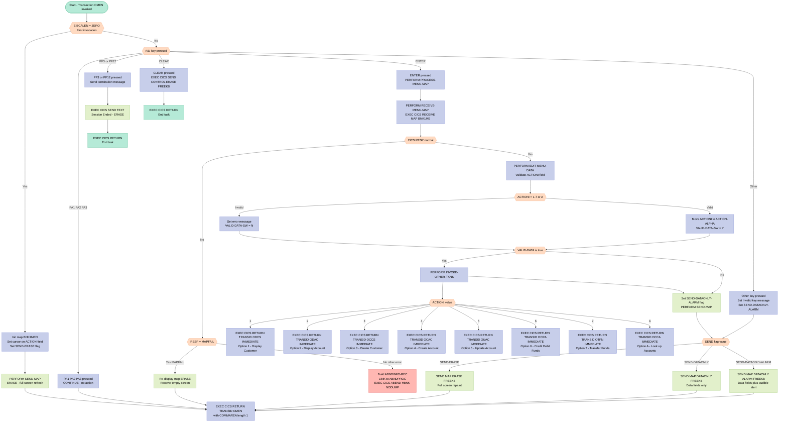

## Table of Contents

- [1. Purpose](#1-purpose)
- [2. Inputs](#2-inputs)
  - [2.1 Entradas do Terminal / Mapa BMS](#21-entradas-do-terminal--mapa-bms)
  - [2.2 Entradas do Sistema CICS (EIB — Bloco de Interface de Execução)](#22-entradas-do-sistema-cics-eib--bloco-de-interface-de-execução)
  - [2.3 Valores do CICS ASSIGN](#23-valores-do-cics-assign)
  - [2.4 Serviços de Runtime do CICS](#24-serviços-de-runtime-do-cics)
  - [2.5 Área de Comunicação CICS (Seção de Linkage)](#25-área-de-comunicação-cics-seção-de-linkage)
- [3. Outputs](#3-outputs)
  - [3.1 Saídas do Terminal (Tela)](#31-saídas-do-terminal-tela)
  - [3.2 Saídas de Controle de Transação CICS](#32-saídas-de-controle-de-transação-cics)
  - [3.3 Saídas de Erro e Abend](#33-saídas-de-erro-e-abend)
- [4. Processing Logic](#4-processing-logic)
  - [4.1 Diagrama de Fluxo Mermaid](#41-diagrama-de-fluxo-mermaid)
  - [4.2 Descrição da Lógica de Processamento](#42-descrição-da-lógica-de-processamento)
  - [4.3 Tabelas de Banco de Dados](#43-tabelas-de-banco-de-dados)
- [5. Paragraphs](#5-paragraphs)
- [6. Dependencies](#6-dependencies)
  - [6.1 Recursos BMS do CICS](#61-recursos-bms-do-cics)
  - [6.2 Transações CICS Invocadas](#62-transações-cics-invocadas)
  - [6.3 Programas Externos (`EXEC CICS LINK`)](#63-programas-externos-exec-cics-link)
  - [6.4 Copybooks](#64-copybooks)
  - [6.5 Serviços de Runtime do CICS](#65-serviços-de-runtime-do-cics)
  - [6.6 EIB do CICS (Bloco de Interface de Execução) — Campos](#66-eib-do-cics-bloco-de-interface-de-execução--campos)
  - [6.7 Definição de Transação CICS](#67-definição-de-transação-cics)
  - [6.8 Parâmetros de Entrada](#68-parâmetros-de-entrada)
- [7. Constraints](#7-constraints)
  - [7.1 Restrições de Validação de Entrada](#71-restrições-de-validação-de-entrada)
  - [7.2 Restrições de Interação com o Terminal (Identificador de Atenção)](#72-restrições-de-interação-com-o-terminal-identificador-de-atenção)
  - [7.3 Restrições de Sequenciamento e Fluxo](#73-restrições-de-sequenciamento-e-fluxo)
  - [7.4 Restrições da Área de Comunicação (COMMAREA)](#74-restrições-da-área-de-comunicação-commarea)
  - [7.5 Restrições do Modo de Envio de Tela](#75-restrições-do-modo-de-envio-de-tela)
  - [7.6 Restrições de Tratamento de Erros e Abend](#76-restrições-de-tratamento-de-erros-e-abend)
  - [7.7 Anomalia de Codificação Conhecida (Violação de Restrição Implícita)](#77-anomalia-de-codificação-conhecida-violação-de-restrição-implícita)
- [8. Error Handling](#8-error-handling)
  - [8.1 Validação de Entrada](#81-validação-de-entrada)
  - [8.2 Tratamento de Erros de E/S de Terminal](#82-tratamento-de-erros-de-es-de-terminal)
  - [8.3 Tratamento de Erros de Despacho de Transação](#83-tratamento-de-erros-de-despacho-de-transação)
  - [8.4 Tratamento de Erros no Retorno Pseudo-Conversacional](#84-tratamento-de-erros-no-retorno-pseudo-conversacional)
  - [8.5 Mecanismo Centralizado de Diagnóstico de Abend e Encerramento](#85-mecanismo-centralizado-de-diagnóstico-de-abend-e-encerramento)
  - [8.6 Notificação ao Usuário via Alarme de Terminal](#86-notificação-ao-usuário-via-alarme-de-terminal)
- [9. Examples](#9-examples)
  - [9.1 Exemplo 1 — Primeira Entrada (Sem COMMAREA): Menu Exibido pela Primeira Vez](#91-exemplo-1--primeira-entrada-sem-commarea-menu-exibido-pela-primeira-vez)
  - [9.2 Exemplo 2 — Seleção Válida `'1'` (Exibir Detalhes do Cliente)](#92-exemplo-2--seleção-válida-1-exibir-detalhes-do-cliente)
  - [9.3 Exemplo 3 — Seleção Inválida (Falha de Validação)](#93-exemplo-3--seleção-inválida-falha-de-validação)
  - [9.4 Exemplo 4 — Usuário Pressiona PF3 (Encerramento da Sessão)](#94-exemplo-4--usuário-pressiona-pf3-encerramento-da-sessão)

## 1. Purpose

`BNKMENU` é um programa COBOL CICS que serve como ponto de entrada principal e hub de navegação para a aplicação de banco online Bank of Z. Seu objetivo é apresentar uma tela de menu orientada por BMS ao usuário do terminal e encaminhar esse usuário para uma das oito funções bancárias disponíveis — exibir detalhes do cliente (`ODCS`), exibir detalhes da conta (`ODAC`), criar um cliente (`OCCS`), criar uma conta (`OCAC`), atualizar uma conta (`OUAC`), creditar ou debitar fundos (`OCRA`), transferir fundos entre contas (`OTFN`) ou consultar contas de um cliente (`OCCA`) — com base no caractere de opção (`'1'`–`'7'` ou `'A'`) inserido na tela. O programa opera em estilo pseudo-conversacional, validando a entrada do usuário a cada retorno, reapresentando o menu com um alarme sonoro e mensagem de erro caso a seleção seja inválida, exibindo uma mensagem de encerramento "Session Ended" quando o usuário pressiona `PF3` ou `PF12`, e delegando todos os erros CICS irrecuperáveis a um tratador de abend centralizado (`ABNDPROC`).

## 2. Inputs

### 2.1 Entradas do Terminal / Mapa BMS

- **`ACTIONI`** (`BNK1MEI` campo do mapa, mapset `BNK1MAI`)
  - O único campo recebido do mapa BMS `BNK1ME` via `EXEC CICS RECEIVE MAP`. Armazena o único caractere digitado pelo usuário na tela do menu bancário, representando a ação selecionada:
    - `'1'` – Exibir detalhes do Cliente (transação `ODCS`)
    - `'2'` – Exibir detalhes da Conta (transação `ODAC`)
    - `'3'` – Criar um Cliente (transação `OCCS`)
    - `'4'` – Criar uma Conta (transação `OCAC`)
    - `'5'` – Atualizar uma Conta (transação `OUAC`)
    - `'6'` – Creditar/Debitar fundos (transação `OCRA`)
    - `'7'` – Transferir fundos (transação `OTFN`)
    - `'A'` – Consultar contas de um cliente (transação `OCCA`)

### 2.2 Entradas do Sistema CICS (EIB — Bloco de Interface de Execução)

Esses valores são fornecidos automaticamente pelo CICS em tempo de execução por meio do Bloco de Interface de Execução:

- **`EIBCALEN`** – Comprimento da área de comunicação passada para esta invocação. Utilizado na entrada para determinar se esta é a primeira vez que o programa está sendo chamado (valor `ZERO` indica primeira invocação); determina a decisão de exibir um mapa novo e apagado.
- **`EIBAID`** – Identificador de atenção (tecla pressionada pelo usuário). Controla o fluxo principal do programa:
  - `DFHPA1`, `DFHPA2`, `DFHPA3` – Teclas PA; nenhuma ação executada
  - `DFHPF3`, `DFHPF12` – Encerrar a sessão
  - `DFHCLEAR` – Apagar a tela e retornar
  - `DFHENTER` – Processar a entrada do menu
- **`EIBRESP`** / **`EIBRESP2`** – Códigos de resposta primário e secundário retornados por cada comando `EXEC CICS`. Examinados após cada chamada CICS para detectar falhas; alimentados no registro de diagnóstico de abend quando uma resposta não normal é recebida.
- **`EIBTASKN`** – Número da tarefa CICS atual. Capturado em `ABND-TASKNO-KEY` para diagnósticos de abend.
- **`EIBTRNID`** – Identificador da transação atual. Capturado em `ABND-TRANID` para diagnósticos de abend.

### 2.3 Valores do CICS ASSIGN

- **`ABND-APPLID`** (preenchido via `EXEC CICS ASSIGN APPLID`) – O identificador da aplicação CICS da região em execução. Recuperado e armazenado no registro de abend sempre que um comando CICS falha.
- **`ABND-PROGRAM`** (preenchido via `EXEC CICS ASSIGN PROGRAM`) – O nome do programa em execução no momento. Recuperado e armazenado no registro de abend sempre que um comando CICS falha.

### 2.4 Serviços de Runtime do CICS

- **`EXEC CICS ASKTIME`** (resultado → `WS-U-TIME`) – Obtém o tempo absoluto atual do CICS. Utilizado como chave de tempo única no registro de diagnóstico de abend e como entrada para o `FORMATTIME`.
- **`EXEC CICS FORMATTIME`** (resultado → `WS-ORIG-DATE`, `WS-TIME-NOW`) – Converte o tempo absoluto em data (`DD/MM/YYYY`) e hora (`HHMMSS`) legíveis por humanos. Os valores formatados são armazenados no registro de diagnóstico de abend.

### 2.5 Área de Comunicação CICS (Seção de Linkage)

- **`DFHCOMMAREA`** (`PIC X`) – Uma área de comunicação de um único byte passada pelo CICS ao reinvocar o programa. Sua presença (indicada por `EIBCALEN > ZERO`) sinaliza que esta é uma invocação pseudo-conversacional de retorno, e não uma entrada pela primeira vez.

## 3. Outputs

### 3.1 Saídas do Terminal (Tela)

- **BMS Map `BNK1ME` (mapset `BNK1MAI`) — `EXEC CICS SEND MAP`**
  - A saída visual principal do programa; a tela do menu bancário enviada ao terminal CICS
  - Três modos distintos de envio são utilizados, todos gravando a partir da área do mapa de saída `BNK1MEO`:
    - **Modo ERASE** (`SEND-ERASE = '1'`): Limpa o terminal e apresenta um menu bancário novo e vazio — usado na primeira entrada (quando `EIBCALEN = ZERO`) ou quando `MAPFAIL` é recebido durante o recebimento do mapa
    - **Modo DATAONLY** (`SEND-DATAONLY = '2'`): Atualiza apenas os campos de dados variáveis sem redesenhar os elementos estáticos da tela
    - **Modo DATAONLY + ALARM** (`SEND-DATAONLY-ALARM = '3'`): Atualiza os campos de dados e aciona um alerta sonoro no terminal — usado para sinalizar pressionamentos de teclas inválidos ou falhas de validação de entrada
  - **`MESSAGEO`** (campo dentro de `BNK1MEO`): A mensagem de feedback exibida ao usuário na tela
    - Definida como `'Invalid key pressed.'` quando uma tecla AID não reconhecida é pressionada
    - Definida como `'You must enter a valid value (1-7 or A).'` quando a entrada da ação do menu falha na validação
  - **`ACTIONL`** (campo de comprimento do cursor dentro de `BNK1MEO`): Definido como `-1` para posicionar o cursor no campo de entrada de ação quando a tela é enviada

- **Mensagem de Encerramento — `EXEC CICS SEND TEXT`**
  - **`END-OF-SESSION-MESSAGE`**: O texto literal `'Session Ended'` enviado como uma mensagem de tela cheia (com `ERASE`) quando o usuário pressiona PF3 ou PF12 para sair do menu bancário
  - Imediatamente seguido por `EXEC CICS RETURN` (sem `TRANSID`), encerrando a tarefa conversacional CICS

---

### 3.2 Saídas de Controle de Transação CICS

- **`EXEC CICS RETURN TRANSID('OMEN') COMMAREA(COMMUNICATION-AREA) LENGTH(1)`**
  - O retorno pseudo-conversacional padrão ao final de cada ciclo; re-enfileira a transação `OMEN` (o menu bancário) com uma `COMMUNICATION-AREA` mínima de 1 byte para manter o estado da sessão

- **Roteamento de transação via `EXEC CICS RETURN TRANSID(...) IMMEDIATE`** (condicional ao `ACTIONI` validado):
  - `'ODCS'` — Exibir Detalhes do Cliente (opção de menu `1`)
  - `'ODAC'` — Exibir Detalhes da Conta (opção de menu `2`)
  - `'OCCS'` — Criar um Cliente (opção de menu `3`)
  - `'OCAC'` — Criar uma Conta (opção de menu `4`)
  - `'OUAC'` — Atualizar uma Conta (opção de menu `5`)
  - `'OCRA'` — Creditar/Debitar Fundos em uma Conta (opção de menu `6`)
  - `'OTFN'` — Transferir Fundos entre Contas (opção de menu `7`)
  - `'OCCA'` — Consultar Contas de um Cliente (opção de menu `A`)

- **`EXEC CICS SEND CONTROL ERASE FREEKB`**
  - Limpa a tela do terminal sem dados de mapa quando a tecla CLEAR é pressionada, imediatamente seguido por `EXEC CICS RETURN`

---

### 3.3 Saídas de Erro e Abend

- **`EXEC CICS LINK PROGRAM('ABNDPROC') COMMAREA(ABNDINFO-REC)`**
  - Invocado sempre que qualquer comando CICS retorna uma resposta não normal; passa o `ABNDINFO-REC` totalmente preenchido ao programa centralizador de tratamento de abend
  - **`ABNDINFO-REC`** carrega todos os dados de diagnóstico para `ABNDPROC`:
    - `ABND-RESPCODE` / `ABND-RESP2CODE` — códigos de resposta CICS do comando com falha
    - `ABND-APPLID` — ID da aplicação CICS da região onde a falha ocorreu
    - `ABND-TASKNO-KEY` — número da tarefa CICS da tarefa com falha
    - `ABND-TRANID` — ID da transação ativa no momento da falha
    - `ABND-DATE` / `ABND-TIME` — data (DD/MM/YYYY) e hora (HH:MM:MM) da falha, derivadas de `WS-ORIG-DATE` e `WS-TIME-NOW-GRP-HH`/`WS-TIME-NOW-GRP-MM`
    - `ABND-UTIME-KEY` — valor de tempo absoluto CICS (`WS-U-TIME`) utilizado como chave única para o registro de abend
    - `ABND-CODE` — código de abend fixo `'HBNK'`
    - `ABND-PROGRAM` — nome do programa no momento da falha (preenchido via `EXEC CICS ASSIGN PROGRAM`)
    - `ABND-SQLCODE` — definido como zeros (sem uso de DB2 neste programa)
    - `ABND-FREEFORM` — uma mensagem descritiva em formato livre identificando o parágrafo com falha e o comando CICS (ex.: `'A010 - RETURN TRANSID(MENU) FAIL. EIBRESP=... RESP2=...'`)

- **`DISPLAY WS-FAIL-INFO`** (em `ABEND-THIS-TASK`)
  - Grava uma mensagem de falha formatada no log de job CICS / console do sistema; inclui o nome do programa (`BNKMENU`), o identificador do parágrafo com falha e os códigos numéricos RESP/RESP2

- **`EXEC CICS ABEND ABCODE('HBNK') NODUMP`**
  - Força o encerramento anormal da tarefa CICS com o código de abend `HBNK` após o registro de erro ter sido despachado; `NODUMP` suprime um dump do sistema

## 4. Processing Logic

### 4.1 Diagrama de Fluxo Mermaid

---

### 4.2 Descrição da Lógica de Processamento

#### 4.2.1 Resumo de Alto Nível

**BNKMENU** é o programa de menu principal do Bank of Z em CICS, executado sob o ID de transação `OMEN`. Ele é o ponto de entrada da aplicação bancária dirigida por BMS. Apresenta uma tela de menu (`BNK1ME` / `BNK1MAI`) ao usuário do terminal, valida a seleção digitada (opções `1`–`7` ou `A`) e encaminha imediatamente o usuário para a transação bancária subsequente apropriada usando um comando `EXEC CICS RETURN TRANSID IMMEDIATE`. Ele opera em estilo **pseudo-conversacional**: cada vez que o usuário pressiona uma tecla, o programa é iniciado do zero, processa a entrada e então devolve o controle ao CICS — que reinvoca a mesma transação (`OMEN`) na próxima ação do usuário.

---

#### 4.2.2 Fluxo de Execução

**Passo 1 – Ponto de entrada e detecção da primeira vez (PREMIERE / A010)**

O programa começa na seção `PREMIERE`, no parágrafo `A010`. Ele usa uma construção `EVALUATE TRUE` para despachar com base no estado atual:

- **Primeira invocação (`EIBCALEN = ZERO`):** `EIBCALEN` é o campo do Execute Interface Block que contém o comprimento da COMMAREA passada do ciclo pseudo-conversacional anterior. Um valor zero significa que nenhuma COMMAREA existe, portanto esta é definitivamente a primeira vez que o menu foi invocado para esta sessão de terminal. O programa inicializa `BNK1MEO` com `LOW-VALUE`, define o comprimento do cursor como `-1` (posicionamento simbólico do cursor no campo ACTION), define `SEND-FLAG` como `SEND-ERASE` (`'1'`) e chama `SEND-MAP`. Isso apaga a tela do terminal e desenha o menu completo do zero.

- **Tecla PA (`DFHPA1`, `DFHPA2`, `DFHPA3`):** Teclas de atenção do programa não transportam dados. O verbo `CONTINUE` faz o programa prosseguir até o `EXEC CICS RETURN` final, efetivamente rearmando o terminal sem qualquer alteração na tela exibida.

- **PF3 ou PF12:** O usuário deseja sair. `SEND-TERMINATION-MSG` é chamado, o que emite `EXEC CICS SEND TEXT FROM(END-OF-SESSION-MESSAGE) ERASE FREEKB` para exibir o literal `'Session Ended'` na tela limpa. Em seguida, `EXEC CICS RETURN` (sem `TRANSID`) é emitido para encerrar a tarefa do CICS sem transação subsequente.

- **Tecla CLEAR (`DFHCLEAR`):** Emite `EXEC CICS SEND CONTROL ERASE FREEKB` para limpar a tela e então `EXEC CICS RETURN` para encerrar a tarefa.

- **Tecla ENTER (`DFHENTER`):** O usuário submeteu uma entrada. `PROCESS-MENU-MAP` é invocado (veja o Passo 2).

- **Qualquer outra tecla:** Uma mensagem "Invalid key pressed." é movida para o campo de mapa `MESSAGEO`, `SEND-FLAG` é definido como `SEND-DATAONLY-ALARM` (`'3'`) e o mapa é reenviado com alarme sonoro.

**Passo 2 – Rearme pseudo-conversacional (`EXEC CICS RETURN TRANSID OMEN`)**

Após todos os ramos (exceto PF3/PF12 e CLEAR, que emitem seu próprio RETURN), o controle chega ao único `EXEC CICS RETURN TRANSID('OMEN') COMMAREA(COMMUNICATION-AREA) LENGTH(1)` incondicional. Esta é a pedra angular do modelo pseudo-conversacional: ele instrui o CICS a reinvocar a transação `OMEN` na próxima entrada do terminal, passando uma COMMAREA de 1 byte para que `EIBCALEN` seja não zero na próxima invocação. Se esse comando falhar, o programa monta o registro de diagnóstico `ABNDINFO-REC` e chama `ABEND-THIS-TASK`.

**Passo 3 – Receber e validar a entrada do mapa (`PROCESS-MENU-MAP` / `RECEIVE-MENU-MAP` / `EDIT-MENU-DATA`)**

`PROCESS-MENU-MAP` (seção `PMM010`) orquestra três subetapas:

1. **`RECEIVE-MENU-MAP` (RMM010):** Emite `EXEC CICS RECEIVE MAP('BNK1ME') MAPSET('BNK1MAI') INTO(BNK1MEI)`. O código RESP é verificado imediatamente:
   - `MAPFAIL` (RESP=36): ocorre quando o terminal não envia dados de campo — por exemplo, o usuário pressionou ENTER em uma tela em branco ou pressionou uma tecla PA/CLEAR que ainda não havia sido tratada anteriormente. O mapa é reenviado com `SEND-ERASE` para recuperar uma tela limpa.
   - Qualquer outro RESP não normal: o fluxo do tratador de abend é acionado (veja Tratamento de Erros abaixo).

2. **`EDIT-MENU-DATA` (EMD010):** O campo `ACTIONI` (o caractere de ação recebido do mapa) é validado. Ele deve ser um entre `'1'`, `'2'`, `'3'`, `'4'`, `'5'`, `'6'`, `'7'` ou `'A'`. Qualquer outro valor faz com que:
   - Uma mensagem de erro `'You must enter a valid value (1-7 or A).'` seja colocada no campo `MESSAGEO`.
   - `VALID-DATA-SW` seja definido como `'N'` (invalidando a condição de nível 88 `VALID-DATA`).
   Se o valor for válido, `ACTIONI` é movido para `ACTION-ALPHA` e `VALID-DATA-SW` permanece `'Y'`.

3. **Verificação de guarda:** `IF VALID-DATA` controla a invocação de `INVOKE-OTHER-TXNS`. Se a validação falhar, esse bloco é ignorado.

4. Após a invocação opcional, `SEND-FLAG` é definido incondicionalmente como `SEND-DATAONLY-ALARM` e `SEND-MAP` é chamado. *(Observação: na prática, se `INVOKE-OTHER-TXNS` emitir com sucesso um `RETURN TRANSID IMMEDIATE`, o CICS termina imediatamente a tarefa atual e esse código nunca é alcançado para seleções válidas.)*

**Passo 4 – Roteamento de transação (`INVOKE-OTHER-TXNS` / IOT010)**

Para cada caractere de ação válido, um `EXEC CICS RETURN TRANSID(...) IMMEDIATE` dedicado é emitido:

| Seleção | ID da Transação | Função Bancária |
|-----------|---------------|-----------------|
| `1` | `ODCS` | Exibir detalhes do cliente |
| `2` | `ODAC` | Exibir detalhes da conta |
| `3` | `OCCS` | Criar um cliente |
| `4` | `OCAC` | Criar uma conta |
| `5` | `OUAC` | Atualizar uma conta |
| `6` | `OCRA` | Creditar / Debitar fundos |
| `7` | `OTFN` | Transferir fundos |
| `A` | `OCCA` | Pesquisar contas de um cliente |

A opção `IMMEDIATE` ignora quaisquer transações ATI (Automatic Transaction Initiation) enfileiradas e roteia diretamente para a transação nomeada. Como o CICS trata esse RETURN como uma terminação imediata da tarefa e novo despacho, nenhum código adicional em `BNKMENU` é executado para esse ciclo de interação.

**Passo 5 – Envio do mapa (`SEND-MAP` / SMM010)**

O modo de envio do mapa é controlado por `SEND-FLAG`:

- **`SEND-ERASE` (`'1'`):** `EXEC CICS SEND MAP ... ERASE FREEKB` — limpa todo o buffer da tela e redesenha o menu completo a partir da definição do mapa BMS. Necessário na primeira entrada e após uma recuperação de MAPFAIL.
- **`SEND-DATAONLY` (`'2'`):** `EXEC CICS SEND MAP ... DATAONLY FREEKB` — transmite apenas os campos de dados variáveis (por exemplo, `MESSAGEO`). Rótulos estáticos e atributos já presentes na tela não são alterados.
- **`SEND-DATAONLY-ALARM` (`'3'`):** `EXEC CICS SEND MAP ... DATAONLY ALARM FREEKB` — igual ao DATAONLY, mas também aciona o alarme sonoro do 3270 para alertar o usuário sobre uma condição de erro.

As três variantes desbloqueiam o teclado (`FREEKB`) para que o usuário possa digitar novamente.

**Passo 6 – Preenchimento de hora/data (`POPULATE-TIME-DATE` / PTD010)**

Chamado exclusivamente dentro dos caminhos de tratamento de erro. `EXEC CICS ASKTIME ABSTIME(WS-U-TIME)` obtém a hora atual como um valor de tempo absoluto em decimal compactado. `EXEC CICS FORMATTIME ABSTIME(...) DDMMYYYY(WS-ORIG-DATE) TIME(WS-TIME-NOW) DATESEP` formata isso em campos legíveis por humanos DD/MM/YYYY e HHMMSS usados no registro de diagnóstico de abend.

---

#### 4.2.3 Tratamento de Erros

Cada comando CICS é seguido por uma verificação de RESP/RESP2. Quando `WS-CICS-RESP NOT = DFHRESP(NORMAL)`:

1. `ABNDINFO-REC` é inicializado e preenchido com: `EIBRESP` / `EIBRESP2`, ID da aplicação (via `EXEC CICS ASSIGN APPLID`), número da tarefa (`EIBTASKN`), ID da transação (`EIBTRNID`), data e hora atuais, nome do programa (via `EXEC CICS ASSIGN PROGRAM`), código SQL (definido como zeros — não há DB2 neste programa) e uma string descritiva livre identificando o comando que falhou.
2. `EXEC CICS LINK PROGRAM('ABNDPROC') COMMAREA(ABNDINFO-REC)` direciona para o tratador de abend centralizado, que registra as informações de diagnóstico.
3. `ABEND-THIS-TASK` é então executado: ele exibe `WS-FAIL-INFO` (contendo o nome do programa, mensagem, códigos RESP) no log do CICS e emite `EXEC CICS ABEND ABCODE('HBNK') NODUMP` — encerrando a tarefa com anormalidade com o código `HBNK` sem produzir um dump da transação.

---

#### 4.2.4 Interações Externas

| Interação | Comando CICS | Finalidade |
|-------------|-------------|---------|
| Exibir tela de menu | `EXEC CICS SEND MAP BNK1ME MAPSET BNK1MAI` | Desenha / atualiza o menu principal no terminal 3270 |
| Receber entrada do usuário | `EXEC CICS RECEIVE MAP BNK1ME MAPSET BNK1MAI` | Lê o campo de ação digitado no mapa |
| Exibição de encerramento de sessão | `EXEC CICS SEND TEXT` | Mostra "Session Ended" na saída do terminal |
| Limpar tela | `EXEC CICS SEND CONTROL ERASE` | Limpa o terminal ao pressionar CLEAR |
| Rotear para subtransação | `EXEC CICS RETURN TRANSID(...) IMMEDIATE` | Passa o controle para a função bancária selecionada |
| Rearmar pseudo-conversação | `EXEC CICS RETURN TRANSID('OMEN') COMMAREA(...)` | Instrui o CICS a reinvocar `OMEN` na próxima entrada do terminal |
| Obter hora atual | `EXEC CICS ASKTIME / FORMATTIME` | Preenche data/hora para diagnósticos de abend |
| Obter informações do sistema | `EXEC CICS ASSIGN APPLID / PROGRAM` | Preenche o registro de abend com APPLID e nome do programa |
| Tratador de abend | `EXEC CICS LINK PROGRAM('ABNDPROC')` | Registra dados de diagnóstico em qualquer falha de comando CICS |
| Abendar tarefa | `EXEC CICS ABEND ABCODE('HBNK') NODUMP` | Encerra a tarefa anormalmente sem dump de armazenamento |

Nenhum SQL DB2, IMS DL/I, MQ, E/S de arquivo VSAM ou operações de fila de dados transitórios está presente neste programa.

---

#### 4.2.5 Resumo em Linguagem Simples

BNKMENU é a "porta de entrada" da aplicação Bank of Z. Quando um operador bancário digita a transação `OMEN` em seu terminal 3270, este programa é executado. Na primeira execução, ele limpa a tela e mostra um menu numerado de opções bancárias (1 a 7, mais a opção A). O operador digita um número ou letra e pressiona Enter.

O programa lê o que foi digitado, verifica se é uma das opções permitidas e — se for válido — transfere imediatamente o operador para a função bancária correta (por exemplo, a opção 3 leva diretamente à tela de criação de cliente). Se a entrada for inválida, o programa faz o terminal emitir um beep, mostra uma mensagem de erro e espera que o operador tente novamente.

Quando o operador pressiona PF3 ou PF12, o programa mostra "Session Ended" e encerra a sessão de forma limpa. Se algo der errado internamente (um comando CICS falhar), o programa captura informações completas de diagnóstico — hora, data, códigos de erro, nome do programa — envia isso para um tratador de erro central e encerra a tarefa com um código de abend `HBNK`.

---

### 4.3 Tabelas de Banco de Dados

Nenhuma tabela de banco de dados (DB2, VSAM, IMS) é acessada por BNKMENU. O programa interage somente com o terminal CICS (mapa BMS) e outras transações CICS. Nenhum `erDiagram` é aplicável.

## 5. Paragraphs

- **A010** — Ponto de entrada principal e despachante primário do programa de menu bancário. Este parágrafo forma o coração do ciclo CICS pseudo-conversacional. Ele utiliza uma estrutura `EVALUATE TRUE` para ramificar com base nas condições de entrada do terminal detectadas por meio dos campos EIB:
  - Quando `EIBCALEN = ZERO`, o programa está sendo invocado pela primeira vez (nenhum COMMAREA está presente), portanto, inicializa a área de saída do mapa BMS (`BNK1MEO`) com `LOW-VALUE`, define a posição do cursor no campo `ACTION`, define `SEND-ERASE` como TRUE e executa `SEND-MAP` para apresentar uma tela de menu recém-apagada.
  - Quando uma tecla PA (`DFHPA1`, `DFHPA2` ou `DFHPA3`) é pressionada, o processamento simplesmente continua sem nenhuma ação (`CONTINUE`).
  - Quando PF3 ou PF12 é pressionado, executa `SEND-TERMINATION-MSG` para exibir uma mensagem de encerramento e, em seguida, emite `EXEC CICS RETURN` sem TRANSID para encerrar a tarefa.
  - Quando a tecla CLEAR é pressionada, emite `EXEC CICS SEND CONTROL ERASE FREEKB` para limpar a tela e, em seguida, retorna imediatamente.
  - Quando a tecla ENTER é pressionada, executa `PROCESS-MENU-MAP` para receber, validar e processar a seleção do usuário.
  - Para qualquer outra tecla, popula o campo de mensagem com `'Invalid key pressed.'`, define `SEND-DATAONLY-ALARM` e executa `SEND-MAP` para alertar o usuário.
  - Após o `EVALUATE`, um `EXEC CICS RETURN TRANSID('OMEN') COMMAREA(COMMUNICATION-AREA) LENGTH(1)` é emitido para completar o ciclo pseudo-conversacional, agendando a transação de menu (`OMEN`) para ser retomada na próxima entrada do terminal.
  - Se este RETURN falhar, o parágrafo constrói o registro de diagnóstico `ABNDINFO-REC`, chama `POPULATE-TIME-DATE`, faz link para o tratador de abend (`ABNDPROC`) e, em seguida, executa `ABEND-THIS-TASK`.

- **A999** — Marcador de saída de parágrafo para a `PREMIERE SECTION`. Contém apenas uma instrução `EXIT`; serve como limite de terminação da seção.

- **PMM010** — Orquestrador principal para tratar um pressionamento da tecla ENTER no menu bancário. Ele sequencia três operações subordinadas:
  - Chama `RECEIVE-MENU-MAP` para recuperar os dados de entrada do mapa BMS do terminal.
  - Chama `EDIT-MENU-DATA` para validar a seleção de menu do usuário.
  - Se `VALID-DATA` for TRUE (ou seja, a validação foi aprovada), chama `INVOKE-OTHER-TXNS` para despachar a transação bancária apropriada.
  - Incondicionalmente define `SEND-DATAONLY-ALARM` e executa `SEND-MAP` para atualizar a tela, fornecendo feedback ao usuário independentemente de a seleção ter sido válida ou não.

- **PMM999** — Marcador de saída de parágrafo para a `PROCESS-MENU-MAP SECTION`. Contém apenas uma instrução `EXIT`.

- **RMM010** — Recebe os dados do mapa BMS enviados pelo usuário a partir do terminal. Emite `EXEC CICS RECEIVE MAP('BNK1ME') MAPSET('BNK1MAI') INTO(BNK1MEI)` com captura de `RESP`/`RESP2`. O tratamento condicional de erros segue:
  - Se a resposta for `MAPFAIL` (por exemplo, nenhum dado inserido, tecla CLEAR ou PA pressionada), a área de saída do mapa é limpa, o cursor é reposicionado, `SEND-ERASE` é definido e `SEND-MAP` é executado para reapresentar um menu limpo.
  - Para qualquer outra resposta não normal, inicializa `ABNDINFO-REC`, captura `EIBRESP`/`EIBRESP2`, atribui `APPLID` e `PROGRAM`, chama `POPULATE-TIME-DATE`, constrói strings de diagnóstico, faz link para o tratador de abend e, em seguida, executa `ABEND-THIS-TASK`.

- **RMM999** — Marcador de saída de parágrafo para a `RECEIVE-MENU-MAP SECTION`. Contém apenas uma instrução `EXIT`.

- **EMD010** — Valida o campo de entrada de ação de menu do usuário (`ACTIONI`). Verifica se o valor é um dos caracteres aceitos: `'1'` a `'7'` ou `'A'`. Lógica condicional:
  - Se o valor estiver fora deste conjunto aceito, uma mensagem de erro de validação (`'You must enter a valid value (1-7 or A).'`) é movida para o campo de saída de mensagem e `VALID-DATA-SW` é definido como `'N'`, impedindo a invocação de transações posteriores.
  - Se o valor for válido, `ACTIONI` é movido para `ACTION-ALPHA` para uso pela lógica subsequente.

- **EMD999** — Marcador de saída de parágrafo para a `EDIT-MENU-DATA SECTION`. Contém apenas uma instrução `EXIT`.

- **IOT010** — Despacha o controle para a subtransação bancária apropriada com base na seleção de menu validada. Avalia `ACTIONI` por meio de uma série de instruções `IF` independentes, cada uma emitindo `EXEC CICS RETURN TRANSID(...) IMMEDIATE` para transferir imediatamente o controle para a transação de destino sem aguardar nova entrada do terminal:
  - `'1'` → Transação `ODCS` — Exibir Detalhes do Cliente.
  - `'2'` → Transação `ODAC` — Exibir Detalhes da Conta.
  - `'3'` → Transação `OCCS` — Criar um Cliente.
  - `'4'` → Transação `OCAC` — Criar uma Conta.
  - `'5'` → Transação `OUAC` — Atualizar uma Conta.
  - `'6'` → Transação `OCRA` — Creditar/Debitar fundos em uma Conta.
  - `'7'` → Transação `OTFN` — Transferir fundos entre Contas.
  - `'A'` → Transação `OCCA` — Consultar Contas de um determinado Cliente.
  - Para cada chamada `EXEC CICS RETURN`, uma resposta não normal é tratada construindo o registro de diagnóstico `ABNDINFO-REC`, chamando `POPULATE-TIME-DATE`, fazendo link para o tratador de abend e, em seguida, executando `ABEND-THIS-TASK`.

- **IOT999** — Marcador de saída de parágrafo para a `INVOKE-OTHER-TXNS SECTION`. Contém apenas uma instrução `EXIT`.

- **SMM010** — Envia o mapa BMS `BNK1ME` do mapset `BNK1MAI` para o terminal. Utiliza os nomes de condição `SEND-FLAG` para selecionar o modo de envio apropriado:
  - Se `SEND-ERASE` for TRUE, emite `EXEC CICS SEND MAP ... ERASE FREEKB` para limpar toda a tela e gravar tanto o conteúdo estático do mapa quanto os dados da aplicação. Após um envio bem-sucedido, o controle salta diretamente para `SMM999` via `GO TO`.
  - Se `SEND-DATAONLY` for TRUE, emite `EXEC CICS SEND MAP ... DATAONLY FREEKB` para atualizar apenas os campos de dados variáveis sem redesenhar os elementos estáticos. Após o sucesso, `GO TO SMM999`.
  - Se `SEND-DATAONLY-ALARM` for TRUE, emite `EXEC CICS SEND MAP ... DATAONLY ALARM FREEKB` para atualizar os campos de dados e simultaneamente acionar um alerta sonoro no terminal, utilizado para sinalizar entradas inválidas.
  - Cada variante de envio verifica `WS-CICS-RESP`; uma resposta não normal aciona a sequência padrão de tratamento de abend: popular `ABNDINFO-REC`, chamar `POPULATE-TIME-DATE`, fazer link para `ABNDPROC` e executar `ABEND-THIS-TASK`.

- **SMM999** — Marcador de saída de parágrafo e destino de `GO TO` para a `SEND-MAP SECTION`. Contém apenas uma instrução `EXIT`; as instruções `GO TO SMM999` nos ramos ERASE e DATAONLY causam saída antecipada após um envio bem-sucedido, ignorando as verificações de modo subsequentes.

- **STM010** — Envia uma mensagem de encerramento em texto simples ao terminal quando o usuário sai do menu bancário. Emite `EXEC CICS SEND TEXT FROM(END-OF-SESSION-MESSAGE) ERASE FREEKB`, que exibe o texto `'Session Ended'` e limpa a tela. Se o envio falhar com uma resposta não normal, a sequência padrão de tratamento de abend é invocada: popular `ABNDINFO-REC`, chamar `POPULATE-TIME-DATE`, fazer link para `ABNDPROC` e executar `ABEND-THIS-TASK`.

- **STM999** — Marcador de saída de parágrafo para a `SEND-TERMINATION-MSG SECTION`. Contém apenas uma instrução `EXIT`.

- **ATT010** — Encerra a tarefa CICS de forma anormal após um erro não recuperável. Primeiro emite um `DISPLAY WS-FAIL-INFO` para gravar a descrição da falha (incluindo o nome do programa, mensagem de erro, códigos RESP e RESP2) no log do sistema CICS. Em seguida, emite `EXEC CICS ABEND ABCODE('HBNK') NODUMP` para encerrar anormalmente a tarefa com o código de abend de quatro caracteres `HBNK`. A opção `NODUMP` suprime a geração de um dump de transação, mantendo o encerramento leve.

- **ATT999** — Marcador de saída de parágrafo para a `ABEND-THIS-TASK SECTION`. Contém apenas uma instrução `EXIT`.

- **PTD010** — Recupera e formata a data e hora atuais do sistema para uso nos registros de diagnóstico de abend. Executa duas chamadas CICS sequenciais:
  - `EXEC CICS ASKTIME ABSTIME(WS-U-TIME)` — recupera o tempo absoluto atual (milissegundos desde 1º de janeiro de 1900) no campo decimal compactado `WS-U-TIME`.
  - `EXEC CICS FORMATTIME ABSTIME(WS-U-TIME) DDMMYYYY(WS-ORIG-DATE) TIME(WS-TIME-NOW) DATESEP` — converte o tempo absoluto em uma data legível por humanos no formato `DD/MM/YYYY` (armazenada em `WS-ORIG-DATE`) e um valor de hora de seis dígitos (`HHMMSS`) armazenado em `WS-TIME-NOW`, que é acessado por meio de seus subcampos `REDEFINES` (`WS-TIME-NOW-GRP-HH`, `WS-TIME-NOW-GRP-MM`) para construir a string `ABND-TIME` nos tratadores de abend.

- **PTD999** — Marcador de saída de parágrafo para a `POPULATE-TIME-DATE SECTION`. Contém apenas uma instrução `EXIT`.

## 6. Dependencies

### 6.1 Recursos BMS do CICS

- **Mapa BMS: `BNK1ME`** — O mapa de tela de terminal interativo utilizado para todas as operações de exibição e entrada. Enviado via `EXEC CICS SEND MAP` (com as opções ERASE, DATAONLY ou DATAONLY+ALARM) e recebido via `EXEC CICS RECEIVE MAP`. Apresenta o menu bancário e captura a seleção de ação do usuário.
- **Mapset BMS: `BNK1MAI`** — O mapset BMS que contém o mapa `BNK1ME`. Referenciado em todos os comandos `EXEC CICS SEND MAP` e `EXEC CICS RECEIVE MAP`. Incorporado à Working Storage via `COPY BNK1MAI`, que define as estruturas de mapa simbólico `BNK1MEI` (entrada) e `BNK1MEO` (saída), incluindo os campos `ACTIONI`, `ACTIONL` e `MESSAGEO`.

### 6.2 Transações CICS Invocadas

- **Transação `OMEN`** — O identificador de transação autorreferencial do próprio programa do menu bancário. Utilizado em `EXEC CICS RETURN TRANSID('OMEN')` para implementar o laço pseudo-conversacional, reinvocando BNKMENU após cada interação do usuário.
- **Transação `ODCS`** *(opção de menu 1)* — Exibir Detalhes do Cliente. Invocada via `EXEC CICS RETURN TRANSID('ODCS') IMMEDIATE` quando o usuário seleciona a opção 1.
- **Transação `ODAC`** *(opção de menu 2)* — Exibir Detalhes da Conta. Invocada via `EXEC CICS RETURN TRANSID('ODAC') IMMEDIATE` quando o usuário seleciona a opção 2.
- **Transação `OCCS`** *(opção de menu 3)* — Criar um Cliente. Invocada via `EXEC CICS RETURN TRANSID('OCCS') IMMEDIATE` quando o usuário seleciona a opção 3.
- **Transação `OCAC`** *(opção de menu 4)* — Criar uma Conta. Invocada via `EXEC CICS RETURN TRANSID('OCAC') IMMEDIATE` quando o usuário seleciona a opção 4.
- **Transação `OUAC`** *(opção de menu 5)* — Atualizar uma Conta. Invocada via `EXEC CICS RETURN TRANSID('OUAC') IMMEDIATE` quando o usuário seleciona a opção 5.
- **Transação `OCRA`** *(opção de menu 6)* — Creditar/Debitar Fundos. Invocada via `EXEC CICS RETURN TRANSID('OCRA') IMMEDIATE` quando o usuário seleciona a opção 6.
- **Transação `OTFN`** *(opção de menu 7)* — Transferir Fundos. Invocada via `EXEC CICS RETURN TRANSID('OTFN') IMMEDIATE` quando o usuário seleciona a opção 7.
- **Transação `OCCA`** *(opção de menu A)* — Consultar Contas de um Cliente. Invocada via `EXEC CICS RETURN TRANSID('OCCA') IMMEDIATE` quando o usuário seleciona a opção A.

### 6.3 Programas Externos (`EXEC CICS LINK`)

- **`ABNDPROC`** — Programa centralizador de tratamento de abend. Chamado via `EXEC CICS LINK PROGRAM(WS-ABEND-PGM)` com `COMMAREA(ABNDINFO-REC)` sempre que qualquer comando CICS retornar uma resposta não normal. Recebe a estrutura `ABNDINFO-REC` totalmente preenchida, contendo dados de diagnóstico (códigos RESP, APPLID, número da tarefa, identificador de transação, data, hora, nome do programa e uma descrição de erro em formato livre).

### 6.4 Copybooks

- **`BNK1MAI`** — Copybook de mapa simbólico BMS incluído via `COPY BNK1MAI`. Define as estruturas de mapa simbólico de entrada (`BNK1MEI`) e saída (`BNK1MEO`) para o mapa `BNK1ME`, incluindo o campo de entrada do usuário `ACTIONI`/`ACTIONL` e o campo de saída de mensagem `MESSAGEO`.
- **`DFHAID`** — Copybook fornecido pelo CICS, incluído via `COPY DFHAID`. Fornece as constantes padrão de identificador de atenção (AID) (`DFHENTER`, `DFHPF3`, `DFHPF12`, `DFHCLEAR`, `DFHPA1`, `DFHPA2`, `DFHPA3`) utilizadas para identificar qual tecla o usuário pressionou.
- **`ABNDINFO`** *(expandido inline)* — Copybook do registro de informações de abend. A instrução `COPY ABNDINFO` está comentada e seu conteúdo é expandido inline (linhas 111–126). Define a estrutura `ABNDINFO-REC` utilizada para passar dados de diagnóstico ao handler de erros `ABNDPROC`.

### 6.5 Serviços de Runtime do CICS

- **`EXEC CICS RETURN TRANSID`** — Mecanismo de retorno pseudo-conversacional. Utilizado tanto para o laço próprio (`OMEN`) quanto para a transferência imediata a transações bancárias subordinadas. Passa uma `COMMUNICATION-AREA` mínima de 1 byte.
- **`EXEC CICS RECEIVE MAP`** — Recebe dados de entrada do terminal a partir do mapa BMS `BNK1ME`/`BNK1MAI` na área de mapa simbólico `BNK1MEI`.
- **`EXEC CICS SEND MAP`** — Envia o mapa `BNK1ME` para o terminal em um de três modos: ERASE completo, DATAONLY ou DATAONLY com ALARM.
- **`EXEC CICS SEND TEXT`** — Envia uma mensagem de encerramento em texto simples (`'Session Ended'`) quando o usuário pressiona PF3 ou PF12.
- **`EXEC CICS SEND CONTROL`** — Envia um comando somente de controle (ERASE + FREEKB) para limpar o terminal quando a tecla CLEAR é pressionada.
- **`EXEC CICS ASSIGN`** — Utilizado para recuperar valores do sistema em tempo de execução: `APPLID` (identificador da aplicação) e `PROGRAM` (nome do programa atual), ambos armazenados no registro de diagnóstico de abend.
- **`EXEC CICS ASKTIME`** — Recupera o tempo absoluto atual (`ABSTIME`) em `WS-U-TIME` para uso em registros de abend e formatação de hora.
- **`EXEC CICS FORMATTIME`** — Formata o tempo absoluto em uma data legível (`DDMMYYYY` em `WS-ORIG-DATE`) e hora (`WS-TIME-NOW`) para preenchimento nos registros de diagnóstico de abend.
- **`EXEC CICS ABEND`** — Emite um abend CICS definitivo com o código de abend `HBNK` e `NODUMP` quando um erro irrecuperável é detectado, encerrando a tarefa.
- **`EXEC CICS LINK`** — Vincula ao programa externo `ABNDPROC` com a COMMAREA de informações de abend preenchida.

### 6.6 EIB do CICS (Bloco de Interface de Execução) — Campos

- **`EIBCALEN`** — Verificado na entrada do programa para determinar se esta é a primeira invocação (comprimento zero = primeira entrada, disparando o envio do mapa com ERASE).
- **`EIBAID`** — Contém o identificador de atenção da tecla pressionada pelo usuário; comparado com as constantes DFHAID para desviar ao caminho de processamento adequado.
- **`EIBRESP` / `EIBRESP2`** — Códigos de resposta primário e secundário do CICS, copiados para o registro de diagnóstico de abend em qualquer falha de comando CICS.
- **`EIBTASKN`** — Número da tarefa atual, armazenado no registro de abend como `ABND-TASKNO-KEY`.
- **`EIBTRNID`** — Identificador da transação atual, armazenado no registro de abend como `ABND-TRANID`.

### 6.7 Definição de Transação CICS

- **ID de Transação `OMEN`** — Deve ser definido no CSD do CICS (Control Store Definition) e mapeado para o programa `BNKMENU`. O programa depende que esta definição de transação esteja presente para que o laço `RETURN TRANSID` pseudo-conversacional funcione corretamente.

### 6.8 Parâmetros de Entrada

- **`DFHCOMMAREA` (Seção de Ligação, 1 byte)** — A área de comunicação passada em cada reinvocação pseudo-conversacional. Sua presença (indicada por `EIBCALEN > 0`) sinaliza que esta não é a primeira entrada no programa. Seu conteúdo não é interrogado; apenas seu comprimento é verificado.

## 7. Constraints

### 7.1 Restrições de Validação de Entrada

- **O campo de ação do menu é obrigatório e deve ser um único caractere de um conjunto enumerado**
  - Aplicado em `EDIT-MENU-DATA` (linhas 387–398): `ACTIONI` é testado contra cada um dos valores `'1'`, `'2'`, `'3'`, `'4'`, `'5'`, `'6'`, `'7'` e `'A'` usando condições explícitas de desigualdade
  - Qualquer valor fora deste conjunto faz com que `VALID-DATA-SW` seja definido como `'N'`, uma mensagem de erro descritiva (`'You must enter a valid value (1-7 or A).'`) seja colocada em `MESSAGEO`, e o terminal seja atualizado com um alarme sonoro (`SEND-DATAONLY-ALARM`)
  - O campo `ACTIONI` é um campo de entrada BMS de um único caractere; nenhuma outra verificação de comprimento ou formato é aplicada além do teste de enumeração

- **A validação deve ser aprovada antes que qualquer transação downstream seja invocada**
  - Aplicado em `PROCESS-MENU-MAP` (linhas 281–283): `PERFORM INVOKE-OTHER-TXNS` é protegido por `IF VALID-DATA`, o que significa que `INVOKE-OTHER-TXNS` só é alcançado quando `VALID-DATA-SW = 'Y'`
  - A validação (`EDIT-MENU-DATA`) deve ser concluída antes que a porta de despacho seja avaliada

- **O RECEIVE do MAP deve ser bem-sucedido antes que a validação possa prosseguir**
  - Aplicado em `RECEIVE-MENU-MAP` (linhas 309–376): se `EXEC CICS RECEIVE MAP` retornar `MAPFAIL`, a tela é reenviada com ERASE e o cursor no campo de ação; nenhum processamento adicional dos dados do usuário ocorre
  - Qualquer outra resposta CICS não normal causa um abend imediato via `ABEND-THIS-TASK`; validação e despacho não são alcançados

---

### 7.2 Restrições de Interação com o Terminal (Identificador de Atenção)

- **Apenas a tecla ENTER aciona o processamento de dados**
  - Aplicado no bloco principal `EVALUATE TRUE` (linhas 138–192): `WHEN EIBAID = DFHENTER` é o único ramo que chama `PROCESS-MENU-MAP`; todas as outras teclas AID são roteadas para resultados diferentes

- **PF3 ou PF12 encerra a sessão incondicionalmente**
  - Aplicado nas linhas 158–163: pressionar qualquer uma das teclas aciona `SEND-TERMINATION-MSG` seguido imediatamente por `EXEC CICS RETURN` (sem TRANSID), encerrando a tarefa; nenhuma entrada do usuário é processada

- **A tecla CLEAR apaga a tela e encerra a tarefa sem retornar ao menu**
  - Aplicado nas linhas 168–174: `EXEC CICS SEND CONTROL ERASE FREEKB` é emitido, seguido de `EXEC CICS RETURN`; o ciclo pseudo-conversacional não reaposta a transação de menu

- **As teclas PA1, PA2 e PA3 são silenciosamente ignoradas**
  - Aplicado nas linhas 152–153: `WHEN EIBAID = DFHPA1 OR DFHPA2 OR DFHPA3` é mapeado para `CONTINUE`; o programa continua para emitir `EXEC CICS RETURN TRANSID('OMEN')` e reapostar a mesma tela sem nenhum processamento

- **Qualquer tecla de atenção não reconhecida é rejeitada com um alarme**
  - Aplicado nas linhas 185–190: o ramo `WHEN OTHER` define a mensagem `'Invalid key pressed.'`, redefine a saída do mapa para `LOW-VALUES` e define `SEND-DATAONLY-ALARM`, atualizando a tela com um alerta sonoro

---

### 7.3 Restrições de Sequenciamento e Fluxo

- **A detecção de primeira entrada é obrigatória antes que o modo de exibição do mapa possa ser escolhido**
  - Aplicado nas linhas 143–147: `WHEN EIBCALEN = ZERO` identifica a primeira invocação (sem COMMAREA presente); o programa incondicionalmente define `SEND-ERASE` e limpa a saída do mapa para `LOW-VALUE`; nenhum processamento de entrada é tentado
  - Nas invocações subsequentes, `EIBCALEN` será diferente de zero (comprimento do COMMAREA é 1), portanto este ramo é ignorado

- **O recebimento do mapa deve preceder a edição de dados, que deve preceder o despacho de transações**
  - Aplicado pela sequência de chamadas fixa em `PROCESS-MENU-MAP` (linhas 273–283): `PERFORM RECEIVE-MENU-MAP` → `PERFORM EDIT-MENU-DATA` → `IF VALID-DATA PERFORM INVOKE-OTHER-TXNS`; estas três etapas não podem ser reordenadas

- **Um SEND-MAP deve sempre ser executado ao final de `PROCESS-MENU-MAP`, independentemente do resultado da validação**
  - Aplicado nas linhas 285–290: `SET SEND-DATAONLY-ALARM TO TRUE` e `PERFORM SEND-MAP` aparecem incondicionalmente após a porta de validação, garantindo que o terminal sempre receba uma resposta mesmo quando uma transferência de transação não é invocada

- **O despacho de transações é mutuamente exclusivo por valor de tecla; apenas o ramo correspondente é acionado**
  - Aplicado em `INVOKE-OTHER-TXNS` (linhas 413–992): cada valor de ação (`'1'`–`'7'`, `'A'`) é testado em uma instrução `IF` separada; cada ramo bem-sucedido emite `EXEC CICS RETURN TRANSID(...) IMMEDIATE`, que transfere o controle para fora da tarefa atual, portanto apenas uma transação pode ser iniciada por ciclo

- **`EXEC CICS RETURN TRANSID('OMEN')` é sempre a instrução final do fluxo principal**
  - Aplicado nas linhas 197–203: após o bloco `EVALUATE` ser concluído (que por si mesmo pode incluir um `PERFORM` que emite seu próprio `RETURN`), o programa incondicionalmente emite `EXEC CICS RETURN TRANSID('OMEN') COMMAREA(COMMUNICATION-AREA) LENGTH(1)`, repostando o menu bancário como a próxima transação para o terminal

---

### 7.4 Restrições da Área de Comunicação (COMMAREA)

- **O COMMAREA passado no retorno pseudo-conversacional tem exatamente 1 byte fixo**
  - Aplicado nas linhas 197–203: `LENGTH(1)` é codificado diretamente em `EXEC CICS RETURN TRANSID('OMEN')`; o campo `COMMUNICATION-AREA` é declarado como `PIC X` (um byte)
  - O único propósito deste COMMAREA é tornar `EIBCALEN` diferente de zero na próxima invocação, distinguindo entradas subsequentes da primeira

- **O conteúdo do COMMAREA nunca é lido ou inspecionado**
  - A `LINKAGE SECTION` declara `DFHCOMMAREA PIC X` (linha 131), mas nenhum código na `PROCEDURE DIVISION` o referencia; o único uso do COMMAREA é sua existência (`EIBCALEN` diferente de zero) para ignorar o ramo de primeira entrada

---

### 7.5 Restrições do Modo de Envio de Tela

- **Exatamente um dos três modos de envio deve estar ativo antes que `SEND-MAP` seja chamado**
  - Aplicado pela exclusividade mútua dos valores de `SEND-FLAG` (`'1'` = ERASE, `'2'` = DATAONLY, `'3'` = DATAONLY+ALARM); a seção `SEND-MAP` testa cada flag em ordem com `IF` / `GO TO SMM999`, portanto apenas o primeiro flag correspondente é acionado
  - Se nenhum dos três flags estiver definido, `SEND-MAP` sai silenciosamente sem enviar nada — uma restrição implícita de que o chamador deve sempre definir o flag antes de invocar `SEND-MAP`

- **Um envio com ERASE causa uma saída imediata de `SEND-MAP` via `GO TO SMM999`**
  - Aplicado na linha 1074: após o ramo ERASE ser concluído (ou seu tratamento de erros ser executado), `GO TO SMM999` impede que os ramos DATAONLY sejam avaliados na mesma invocação; o mesmo padrão se aplica ao ramo DATAONLY na linha 1151

---

### 7.6 Restrições de Tratamento de Erros e Abend

- **Todo comando CICS deve retornar `DFHRESP(NORMAL)`; qualquer resposta não normal é uma condição fatal**
  - Aplicado uniformemente após cada comando `EXEC CICS`: `IF WS-CICS-RESP NOT = DFHRESP(NORMAL)` aciona o caminho de abend — popula `ABNDINFO-REC`, vincula a `ABNDPROC` e chama `ABEND-THIS-TASK`
  - Aplica-se a: `EXEC CICS RECEIVE MAP`, `EXEC CICS SEND MAP` (todos os três modos), `EXEC CICS SEND TEXT`, `EXEC CICS RETURN TRANSID(...)` para todas as oito opções de menu e o `EXEC CICS RETURN TRANSID('OMEN')` final

- **`MAPFAIL` no RECEIVE MAP é a única resposta CICS não normal tratada de forma não fatal**
  - Aplicado nas linhas 311–315: `IF WS-CICS-RESP = DFHRESP(MAPFAIL)` reenvia o mapa com ERASE e retorna sem provocar abend; todas as outras respostas não normais são fatais

- **O código de abend é fixo como `'HBNK'` para todas as condições de erro neste programa**
  - Aplicado na linha 1317: `EXEC CICS ABEND ABCODE('HBNK') NODUMP`; o mesmo literal também é movido para `ABND-CODE` em cada caminho de erro

- **As informações de diagnóstico devem ser totalmente preenchidas antes de vincular ao manipulador de abend**
  - Aplicado pela sequência consistente em cada caminho de erro: `INITIALIZE ABNDINFO-REC` → mover RESP/RESP2 → `EXEC CICS ASSIGN APPLID` → mover campos de tarefa/transação → `PERFORM POPULATE-TIME-DATE` → construir string `ABND-TIME` → mover U-TIME → mover código de abend → `EXEC CICS ASSIGN PROGRAM` → mover código SQL (zero) → construir `ABND-FREEFORM` → `EXEC CICS LINK PROGRAM(WS-ABEND-PGM)`; esta sequência deve ser concluída na íntegra antes que `ABEND-THIS-TASK` seja chamado

- **O registro de diagnóstico de abend tem um máximo fixo de 600 caracteres para a descrição de formato livre**
  - Aplicado pela declaração de `ABND-FREEFORM PIC X(600)` (linha 126); as instruções STRING que o preenchem são todas delimitadas por `DELIMITED BY SIZE`, portanto o overflow é silenciosamente truncado em 600 bytes

- **`POPULATE-TIME-DATE` deve ser chamado antes que quaisquer campos de hora/data em `ABNDINFO-REC` sejam preenchidos**
  - Aplicado pela ordenação em cada caminho de erro: `PERFORM POPULATE-TIME-DATE` é sempre chamado antes de `MOVE WS-ORIG-DATE TO ABND-DATE` e da construção STRING de `ABND-TIME`

---

### 7.7 Anomalia de Codificação Conhecida (Violação de Restrição Implícita)

- **O componente de segundos de `ABND-TIME` é incorretamente preenchido com o valor dos minutos**
  - Nas linhas 231, 343, 447, 519, 591, 663, 735, 807, 881, 955, 1041, 1115, 1191, 1271: a construção STRING de `ABND-TIME` referencia `WS-TIME-NOW-GRP-MM` duas vezes (no lugar de `WS-TIME-NOW-GRP-SS` para o slot de segundos); o horário armazenado no registro de abend sempre mostrará `HH:MM:MM` em vez de `HH:MM:SS` — isso é um defeito em vez de uma restrição intencional, mas limita a precisão dos registros de data e hora de diagnóstico

## 8. Error Handling

### 8.1 Validação de Entrada

- **Verificação de ação de menu inválida** — Na seção `EDIT-MENU-DATA`, o campo de entrada `ACTIONI` é testado explicitamente contra o conjunto completo de valores aceitos (`'1'` a `'7'` e `'A'`). Se o valor não corresponder a nenhum deles, a condição é considerada inválida.
  - O sinalizador `VALID-DATA-SW` é definido como `'N'`, ativando o caminho de falha.
  - Uma mensagem descritiva inline, `'You must enter a valid value (1-7 or A).'`, é gravada no campo de mapa `MESSAGEO` para notificar o usuário no terminal.
  - A invocação da transação subsequente é bloqueada: a guarda `IF VALID-DATA` em `PROCESS-MENU-MAP` impede que `INVOKE-OTHER-TXNS` seja executado quando `VALID-DATA-SW` contém `'N'`.

- **Tecla de identificação de atenção (AID) inválida** — No bloco principal `EVALUATE TRUE` da seção `PREMIERE`, qualquer tecla de atenção não tratada explicitamente (diferente de Enter, PF3, PF12, PA1–PA3 ou CLEAR) cai no ramo `WHEN OTHER`.
  - A área de saída do mapa é limpa com valores baixos e a mensagem `'Invalid key pressed.'` é colocada no campo `MESSAGEO`.
  - O cursor é reposicionado para o campo de entrada de ação (comprimento definido como `-1`), e a tela é atualizada via `SEND-DATAONLY-ALARM`, produzindo uma atualização visual combinada com um alarme sonoro no terminal.

---

### 8.2 Tratamento de Erros de E/S de Terminal

Cada comando CICS voltado ao terminal captura seus códigos de resposta em `WS-CICS-RESP` e `WS-CICS-RESP2` por meio das opções `RESP`/`RESP2`, e cada comando é seguido de uma verificação explícita de resposta não normal (`IF WS-CICS-RESP NOT = DFHRESP(NORMAL)`).

- **Falha no `EXEC CICS RECEIVE MAP`** — Na seção `RECEIVE-MENU-MAP`, se o recebimento do mapa falhar:
  - Se a resposta específica for `DFHRESP(MAPFAIL)` (significando que o usuário enviou a tela sem inserir dados), ela é tratada como uma condição recuperável: o mapa é atualizado com um envio `ERASE` em vez de acionar um abend.
  - Para qualquer outra resposta não normal, o caminho completo de diagnóstico de abend é seguido (descrito abaixo).

- **Falha no `EXEC CICS SEND MAP` (modo `ERASE`)** — Na seção `SEND-MAP`, a falha no envio do mapa com apagamento completo aciona o caminho de diagnóstico de abend com o descritor `'SMM010 - SEND MAP ERASE FAIL'`.

- **Falha no `EXEC CICS SEND MAP` (modo `DATAONLY`)** — A falha em uma atualização de mapa apenas com dados aciona o caminho de diagnóstico de abend com o descritor `'SMM010 - SEND MAP DATAONLY FAIL'`.

- **Falha no `EXEC CICS SEND MAP` (modo `DATAONLY ALARM`)** — A falha no envio de mapa apenas com dados acompanhado de alarme aciona o caminho de diagnóstico de abend com o descritor `'SMM010 - SEND MAP DATAONLY ALARM FAIL'`.

- **Falha no `EXEC CICS SEND TEXT`** — Na seção `SEND-TERMINATION-MSG`, a falha no envio da mensagem de encerramento de sessão (`'Session Ended'`) aciona o caminho de diagnóstico de abend com o descritor `'STM010 - SEND TEXT FAIL'`.

---

### 8.3 Tratamento de Erros de Despacho de Transação

Cada uma das oito chamadas `EXEC CICS RETURN TRANSID … IMMEDIATE` do CICS (para as transações `ODCS`, `ODAC`, `OCCS`, `OCAC`, `OUAC`, `OCRA`, `OTFN` e `OCCA`) é individualmente protegida por uma verificação `RESP`/`RESP2`. Se algum desses comandos de retorno falhar com uma resposta não normal:

- O registro de diagnóstico de abend (`ABNDINFO-REC`) é populado com os códigos RESP relevantes, APPLID, número da tarefa, ID da transação, data/hora, nome do programa, código de abend `'HBNK'` e uma descrição livre identificando a transação específica (ex.: `'IOT010 - RETURN TRANSID(ODCS) FAIL'`).
- O controle é vinculado ao programa tratador de abend (`ABNDPROC`) via `EXEC CICS LINK`.
- A tarefa é então encerrada via `PERFORM ABEND-THIS-TASK`.

---

### 8.4 Tratamento de Erros no Retorno Pseudo-Conversacional

- **Falha no `EXEC CICS RETURN TRANSID`** — Após o bloco principal `EVALUATE`, o programa emite um `EXEC CICS RETURN TRANSID('OMEN')` pseudo-conversacional com uma `COMMAREA` mínima. Se esse retorno falhar (resposta não normal em `WS-CICS-RESP`), o caminho completo de diagnóstico de abend é seguido com o descritor `'A010 - RETURN TRANSID(MENU) FAIL'`.

---

### 8.5 Mecanismo Centralizado de Diagnóstico de Abend e Encerramento

Todos os caminhos de erro não recuperáveis no programa seguem um padrão uniforme de abend em múltiplas etapas:

- **População do `ABNDINFO-REC`** — O registro é inicializado e populado com:
  - Campos EIB do CICS: `EIBRESP` → `ABND-RESPCODE`, `EIBRESP2` → `ABND-RESP2CODE`, `EIBTASKN` → `ABND-TASKNO-KEY`, `EIBTRNID` → `ABND-TRANID`.
  - APPLID recuperado via `EXEC CICS ASSIGN APPLID`.
  - Nome do programa corrente recuperado via `EXEC CICS ASSIGN PROGRAM`.
  - Data e hora populadas via a seção `POPULATE-TIME-DATE`, que chama `EXEC CICS ASKTIME` para obter o tempo absoluto e `EXEC CICS FORMATTIME` para formatá-lo em `WS-ORIG-DATE` (DD/MM/AAAA) e `WS-TIME-NOW` (HHMMSS).
  - Uma string de diagnóstico livre identificando o parágrafo e o comando com falha, além de ambos os códigos de resposta, é montada em `ABND-FREEFORM` usando uma instrução `STRING`.
  - O código SQL é zerado (`ABND-SQLCODE = ZEROS`), pois este programa não possui interação com o DB2.

- **`EXEC CICS LINK` para `ABNDPROC`** — O `ABNDINFO-REC` populado é passado como `COMMAREA` para o programa tratador de abend centralizado `ABNDPROC`, permitindo que ele registre as informações de diagnóstico.

- **Construção de `WS-FAIL-INFO` e `DISPLAY`** — Antes de emitir o abend do CICS, `WS-FAIL-INFO` é populado com o identificador do programa (`BNKMENU`), uma mensagem de falha legível e as representações decimais de `WS-CICS-RESP` e `WS-CICS-RESP2`. Este registro composto é gravado na saída padrão da tarefa CICS via uma instrução `DISPLAY` em `ABEND-THIS-TASK`.

- **`EXEC CICS ABEND` com código `'HBNK'`** — A seção `ABEND-THIS-TASK` encerra a tarefa CICS emitindo `EXEC CICS ABEND ABCODE('HBNK') NODUMP`, que aciona um abend CICS com o código definido pela aplicação `HBNK` sem gerar um dump do sistema.

---

### 8.6 Notificação ao Usuário via Alarme de Terminal

- Quando a validação de entrada falha ou uma tecla inválida é pressionada, o sinalizador `SEND-DATAONLY-ALARM` é definido como `TRUE` antes de executar `SEND-MAP`. Isso faz com que o mapa BMS seja enviado com as opções `DATAONLY` e `ALARM`, acionando um alerta sonoro no terminal além de exibir a mensagem de erro no campo `MESSAGEO`. Isso fornece um caminho de notificação imediato e sem abend para erros corrigíveis pelo usuário.

## 9. Examples

### 9.1 Exemplo 1 — Primeira Entrada (Sem COMMAREA): Menu Exibido pela Primeira Vez

**Entrada:**
- `EIBCALEN = 0` (sem COMMAREA anterior — primeira invocação da transação `OMEN`)
- Nenhuma tecla pressionada ainda (terminal acabou de iniciar a transação)

**Saída Esperada:**
- O mapa BMS `BNK1ME` é enviado ao terminal com `ERASE`, limpando a tela e apresentando o menu bancário vazio.
- O cursor é posicionado no campo `ACTION` (`ACTIONL = -1`).
- O CICS retorna o controle com `TRANSID('OMEN')` e uma COMMAREA de 1 byte, mantendo a sessão pseudo-conversacional.

**Como Funciona:**
Quando `EIBCALEN = 0`, o programa sabe que é a primeira vez na execução. Ele inicializa `BNK1MEO` com `LOW-VALUE`, define `SEND-ERASE TO TRUE` e chama `SEND-MAP`, que emite `EXEC CICS SEND MAP … ERASE FREEKB`. O terminal recebe uma tela completamente limpa com o layout do menu. O CICS é então instruído a reinvocar `OMEN` na próxima interação do usuário.

---

### 9.2 Exemplo 2 — Seleção Válida `'1'` (Exibir Detalhes do Cliente)

**Entrada:**
- `EIBCALEN = 1` (ciclo pseudo-conversacional de retorno)
- `EIBAID = DFHENTER` (usuário pressionou Enter)
- `ACTIONI = '1'` (usuário digitou `1` no campo de ação)

**Saída Esperada:**
- O CICS transfere imediatamente o controle para a transação `ODCS` (Exibir Detalhes do Cliente).
- O menu `OMEN` não está mais ativo; a nova transação assume a sessão do terminal.

**Como Funciona:**
`EIBAID = DFHENTER` direciona a execução para `PROCESS-MENU-MAP`. O mapa é recebido e `EDIT-MENU-DATA` verifica se `ACTIONI` está no intervalo `'1'`–`'7'` ou `'A'` — `'1'` é aprovado. `VALID-DATA-SW` permanece `'Y'`, então `INVOKE-OTHER-TXNS` é executado. O bloco `IF ACTIONI = '1'` emite `EXEC CICS RETURN TRANSID('OCDC') IMMEDIATE`, transferindo o terminal diretamente para a transação de exibição do cliente.

---

### 9.3 Exemplo 3 — Seleção Inválida (Falha de Validação)

**Entrada:**
- `EIBCALEN = 1` (ciclo pseudo-conversacional de retorno)
- `EIBAID = DFHENTER`
- `ACTIONI = 'X'` (usuário digitou um caractere inválido)

**Saída Esperada:**
- A tela é atualizada com a mensagem: `You must enter a valid value (1-7 or A).`
- Um alarme sonoro é ativado no terminal (opção `ALARM`).
- O cursor retorna ao campo `ACTION`.
- O CICS retorna o controle para `OMEN` novamente, aguardando uma entrada corrigida.

**Como Funciona:**
Em `EDIT-MENU-DATA`, `ACTIONI = 'X'` não corresponde a nenhum valor aceito (`'1'`–`'7'` ou `'A'`), portanto `VALID-DATA-SW` é definido como `'N'` e a mensagem de erro é movida para `MESSAGEO`. Como `VALID-DATA` agora é falso, `INVOKE-OTHER-TXNS` é ignorado. De volta a `PROCESS-MENU-MAP`, `SEND-DATAONLY-ALARM` é definido como `TRUE`, fazendo com que `SEND-MAP` emita `EXEC CICS SEND MAP … DATAONLY ALARM FREEKB` — atualizando apenas os campos de dados e acionando o bipe do terminal.

---

### 9.4 Exemplo 4 — Usuário Pressiona PF3 (Encerramento da Sessão)

**Entrada:**
- `EIBCALEN = 1`
- `EIBAID = DFHPF3`

**Saída Esperada:**
- O terminal exibe o texto `Session Ended` em uma tela limpa.
- A tarefa CICS é encerrada (`EXEC CICS RETURN` sem `TRANSID`), encerrando a sessão bancária.

**Como Funciona:**
O bloco `WHEN EIBAID = DFHPF3 OR DFHPF12` chama `SEND-TERMINATION-MSG`, que emite `EXEC CICS SEND TEXT FROM(END-OF-SESSION-MESSAGE) ERASE FREEKB`. O literal `'Session Ended'` (armazenado em `END-OF-SESSION-MESSAGE`) é gravado na tela limpa do terminal. Um `EXEC CICS RETURN` incondicional encerra então a tarefa sem especificar uma próxima transação, finalizando a sessão completamente.

---

Generated by IBM Bob Premium Package for Z
