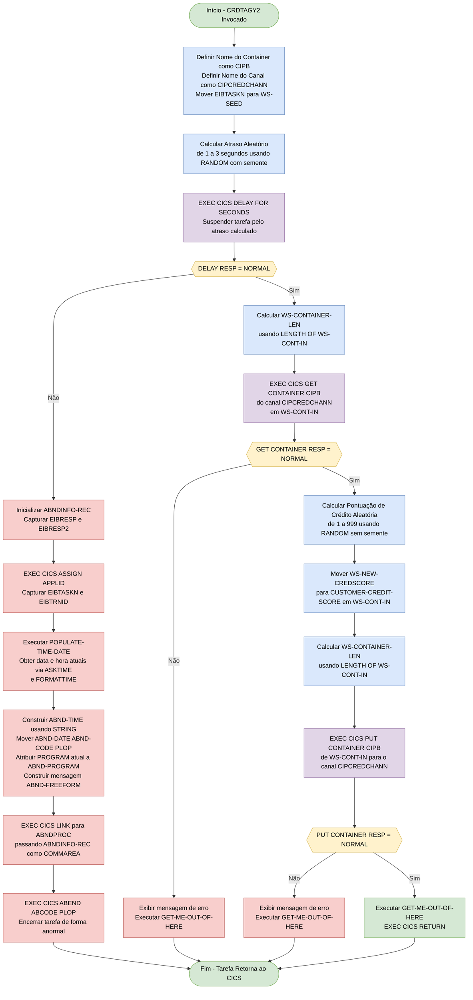
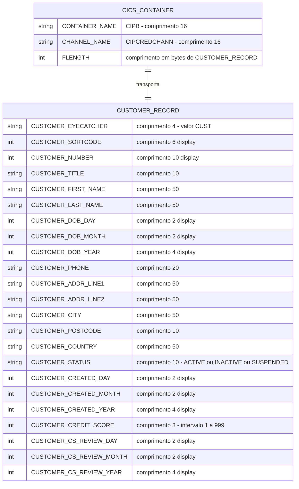

## Table of Contents

- [1. Purpose](#1-purpose)
- [2. Inputs](#2-inputs)
- [3. Outputs](#3-outputs)
- [4. Processing Logic](#4-processing-logic)
  - [4.1 Diagrama de Fluxo Mermaid](#41-diagrama-de-fluxo-mermaid)
  - [4.2 Descrição da Lógica de Processamento](#42-descrição-da-lógica-de-processamento)
  - [4.3 Tabelas de Banco de Dados](#43-tabelas-de-banco-de-dados)
- [5. Paragraphs](#5-paragraphs)
- [6. Dependencies](#6-dependencies)
- [7. Constraints](#7-constraints)
  - [7.1 Restrições de Validação de Dados](#71-restrições-de-validação-de-dados)
  - [7.2 Restrições de Canal e Contêiner](#72-restrições-de-canal-e-contêiner)
  - [7.3 Restrições de Sequenciamento e Temporização](#73-restrições-de-sequenciamento-e-temporização)
  - [7.4 Restrições de Recursos e Intervalo de Valores](#74-restrições-de-recursos-e-intervalo-de-valores)
  - [7.5 Restrições de Tratamento de Erros](#75-restrições-de-tratamento-de-erros)
- [8. Error Handling](#8-error-handling)
  - [8.1 Verificação de Código de Resposta CICS (Padrão RESP/RESP2)](#81-verificação-de-código-de-resposta-cics-padrão-respresp2)
  - [8.2 Tratamento Completo de Abend (Caminho de Falha no DELAY)](#82-tratamento-completo-de-abend-caminho-de-falha-no-delay)
  - [8.3 Tratamento de Erros Simplificado (Caminhos de Falha em GET/PUT CONTAINER)](#83-tratamento-de-erros-simplificado-caminhos-de-falha-em-getput-container)
  - [8.4 Encerramento Controlado da Tarefa (Saída Normal e de Erro)](#84-encerramento-controlado-da-tarefa-saída-normal-e-de-erro)
  - [8.5 Captura de Data/Hora para Diagnóstico (Mecanismo de Suporte)](#85-captura-de-datahora-para-diagnóstico-mecanismo-de-suporte)
- [9. Examples](#9-examples)
  - [9.1 Exemplo 1 — Geração de Pontuação de Crédito Bem-Sucedida (Fluxo Normal)](#91-exemplo-1--geração-de-pontuação-de-crédito-bem-sucedida-fluxo-normal)
  - [9.2 Exemplo 2 — O Atraso Causa Timeout no Programa Pai (Pontuação Chega Tarde Demais)](#92-exemplo-2--o-atraso-causa-timeout-no-programa-pai-pontuação-chega-tarde-demais)

## 1. Purpose

CRDTAGY2 é um programa simulado de agência de crédito que opera de forma assíncrona em um ambiente CICS para atribuir uma pontuação de crédito gerada aleatoriamente a um registro de cliente. Quando invocado, ele recupera os dados do cliente de um canal e contêiner CICS (`CIPCREDCHANN`/`CIPB`), introduz um atraso aleatório de entre 1 e 3 segundos para emular a latência de resposta de uma agência de crédito externa real e, em seguida, calcula uma pontuação de crédito aleatória entre 1 e 999 usando a função COBOL `RANDOM`, inicializada com o número atual da tarefa CICS. A nova pontuação gerada é gravada de volta no registro do cliente e retornada ao canal, tornando-se disponível para o programa pai que iniciou a chamada assíncrona — com o atraso deliberado criando uma chance realista de 1 em 4 de que a pontuação não seja retornada dentro da janela de tempo limite de 3 segundos do programa pai.

## 2. Inputs

**Canal CICS / Contêiner (Entrada Externa Principal)**

- **`WS-CHANNEL-NAME`** (`'CIPCREDCHANN'`) — Identifica o canal CICS utilizado para transportar os dados do cliente. Passado para `EXEC CICS GET CONTAINER` e `EXEC CICS PUT CONTAINER` para localizar o canal de comunicação correto estabelecido pelo programa chamador (pai).
- **`WS-CONTAINER-NAME`** (`'CIPB'`) — Identifica o contêiner CICS específico dentro do canal que carrega o registro do cliente. Utilizado nos comandos `GET CONTAINER` e `PUT CONTAINER`.
- **`WS-CONT-IN`** — O registro de dados do cliente lido do contêiner CICS via `EXEC CICS GET CONTAINER`. Este é o payload de entrada principal entregue pelo programa pai por meio da API Assíncrona. Inclui todos os campos do cliente (chave, nome, data de nascimento, endereço, status, pontuação de crédito, data de revisão) que foram colocados no contêiner antes de `CRDTAGY2` ser iniciado de forma assíncrona.

**Bloco de Interface Executiva do CICS (EIB) — Contexto de Execução**

- **`EIBTASKN`** — O número da tarefa CICS atual, fornecido automaticamente pelo ambiente de execução do CICS por meio do EIB. Utilizado como valor semente (`WS-SEED`) para a chamada `FUNCTION RANDOM`, garantindo resultados variados de atraso e pontuação de crédito a cada execução de tarefa.
- **`EIBRESP` / `EIBRESP2`** — Códigos de resposta do CICS definidos pelo ambiente de execução após cada comando CICS (`DELAY`, `GET CONTAINER`, `PUT CONTAINER`). Verificados para detectar erros e preencher o registro de informações de abend.
- **`EIBTRNID`** — O ID de transação da tarefa CICS atual, lido do EIB e armazenado em `ABND-TRANID` durante a construção do registro de diagnóstico de abend.

## 3. Outputs

**Saída do Container CICS — Registro de Cliente Atualizado**

- **WS-CONT-IN (CUSTOMER-RECORD)**
  - A principal saída do programa. A estrutura completa do registro de cliente, com o novo score de crédito aplicado em `CUSTOMER-CREDIT-SCORE`, é gravada de volta no container CICS `CIPB` no canal `CIPCREDCHANN` via `EXEC CICS PUT CONTAINER`. Esta é a única saída de dados consumida pelo programa pai (que aciona `CRDTAGY2` de forma assíncrona via API Assíncrona do CICS).
  - **CUSTOMER-CREDIT-SCORE** — O campo específico dentro do registro de cliente que é atualizado. Ele recebe o score calculado aleatoriamente (1–999) derivado de `WS-NEW-CREDSCORE` antes que o container seja gravado de volta.

**Invocação do Tratador de Abend CICS (Caminho de Erro)**

- **ABNDINFO-REC** — Preenchido e passado como `COMMAREA` para o programa tratador de abend `ABNDPROC` via `EXEC CICS LINK` sempre que um comando CICS retorna uma resposta não normal. Contém o contexto de diagnóstico completo encaminhado ao subsistema de tratamento de erros:
  - **ABND-RESPCODE / ABND-RESP2CODE** — Códigos de resposta CICS capturados de `EIBRESP` / `EIBRESP2` no ponto da falha.
  - **ABND-APPLID** — ID da aplicação da região CICS em execução, obtido via `EXEC CICS ASSIGN APPLID`.
  - **ABND-TRANID** — ID da transação extraído de `EIBTRNID`.
  - **ABND-TASKNO-KEY** — Número da tarefa extraído de `EIBTASKN`.
  - **ABND-DATE** — Data atual formatada (DD/MM/AAAA) preenchida a partir de `WS-ORIG-DATE` via `EXEC CICS FORMATTIME`.
  - **ABND-TIME** — Hora atual formatada (HH:MM:MM) construída por um `STRING` a partir de `WS-TIME-NOW-GRP-HH` e `WS-TIME-NOW-GRP-MM`.
  - **ABND-UTIME-KEY** — Valor de tempo absoluto obtido via `EXEC CICS ASKTIME` em `WS-U-TIME`.
  - **ABND-CODE** — Código de abend fixo `'PLOP'`.
  - **ABND-PROGRAM** — Nome do programa em execução, obtido via `EXEC CICS ASSIGN PROGRAM`.
  - **ABND-SQLCODE** — Definido como zeros (sem atividade DB2 neste programa).
  - **ABND-FREEFORM** — Mensagem de diagnóstico em formato livre descrevendo qual comando CICS falhou, juntamente com os valores de RESP e RESP2.

**Mensagens Impressas / Console (Caminho de Erro)**

- `'*** The delay messed up ! ***'` — Escrito via `DISPLAY` quando o comando `EXEC CICS DELAY` retorna uma resposta não normal.
- `'CRDTAGY2 - UNABLE TO GET CONTAINER. RESP=... RESP2=...'` e detalhes de container/canal/comprimento — Escrito via `DISPLAY` quando `EXEC CICS GET CONTAINER` falha.
- `'CRDTAGY2 - UNABLE TO PUT CONTAINER. RESP=... RESP2=...'` e detalhes de container/canal/comprimento — Escrito via `DISPLAY` quando `EXEC CICS PUT CONTAINER` falha.

**Abend CICS (Caminho de Erro)**

- `EXEC CICS ABEND ABCODE('PLOP')` — Emitido após o link para o tratador de abend quando o comando `EXEC CICS DELAY` falha, encerrando anormalmente a tarefa CICS com o código de abend `PLOP`.

## 4. Processing Logic

### 4.1 Diagrama de Fluxo Mermaid

---

### 4.2 Descrição da Lógica de Processamento

#### 4.2.1 Resumo de Alto Nível

**CRDTAGY2** é um programa simulado de agência de crédito executado como uma tarefa filha do CICS, invocado de forma assíncrona por um programa pai por meio da API Async do CICS. Seu objetivo é:
1. Introduzir um **atraso aleatório** de 1 a 3 segundos (simulando a latência de resposta de uma agência externa do mundo real), e
2. Produzir uma **pontuação de crédito aleatória** (1–999) para o cliente cujos dados foram transmitidos via canal e container do CICS.

O tempo limite de 3 segundos do pai combinado com o atraso de 1 a 3 segundos do CRDTAGY2 cria uma **probabilidade deliberada de 1 em 3** de que a pontuação não seja retornada a tempo — simulando o cenário do mundo real em que uma agência nem sempre responde dentro do SLA exigido.

---

#### 4.2.2 Fluxo de Execução

**Etapa 1 — Inicialização (A010)**
- O nome do container `CIPB` e o nome do canal `CIPCREDCHANN` são movidos para campos de working-storage.
- `EIBTASKN` (o número da tarefa CICS proveniente do Execute Interface Block) é movido para `WS-SEED` a fim de garantir que o gerador de números aleatórios produza valores únicos por execução de tarefa.

**Etapa 2 — Calcular e Aplicar Atraso Aleatório**
- `FUNCTION RANDOM(WS-SEED)` é invocado com o número da tarefa como semente, gerando um número pseudo-aleatório.
- A fórmula `((3 - 1) * RANDOM) + 1` mapeia a saída para um intervalo de **1 a 3 segundos**, armazenado em `WS-DELAY-AMT`.
- `EXEC CICS DELAY FOR SECONDS(WS-DELAY-AMT)` suspende a tarefa pela duração calculada. O CICS suspende a tarefa emissora e a retoma após o intervalo expirar.

**Etapa 3 — Tratamento de Erro do DELAY**
- Se o código RESP do CICS não for `DFHRESP(NORMAL)`:
  - `ABNDINFO-REC` é inicializado e preenchido com `EIBRESP`, `EIBRESP2`, número da tarefa, ID da transação e ID da aplicação (via `EXEC CICS ASSIGN APPLID`).
  - `EXEC CICS ASKTIME` obtém o tempo absoluto atual (milissegundos desde 1º de janeiro de 1900) em `WS-U-TIME` (PIC S9(15) COMP-3).
  - `EXEC CICS FORMATTIME` converte `WS-U-TIME` em data legível por humanos (`DDMMYYYY` com separador → `WS-ORIG-DATE`) e hora (`HHMMSS` → `WS-TIME-NOW`).
  - Uma instrução `STRING` formata os componentes HH:MM:SS em `ABND-TIME` e constrói uma mensagem de diagnóstico em `ABND-FREEFORM`.
  - O código de abend `PLOP` e o nome do programa atual (via `EXEC CICS ASSIGN PROGRAM`) são registrados.
  - `EXEC CICS LINK PROGRAM('ABNDPROC') COMMAREA(ABNDINFO-REC)` passa o controle para o tratador centralizado de abend com todos os dados de diagnóstico.
  - `EXEC CICS ABEND ABCODE('PLOP')` encerra a tarefa de forma anormal (produzindo um dump de transação), encerrando a execução.

**Etapa 4 — Recuperar Dados do Cliente do Container**
- `WS-CONTAINER-LEN` é definido como o comprimento em bytes de `WS-CONT-IN` utilizando o registrador especial `LENGTH OF`.
- `EXEC CICS GET CONTAINER(CIPB) CHANNEL(CIPCREDCHANN) INTO(WS-CONT-IN) FLENGTH(WS-CONTAINER-LEN)` lê o registro do cliente do container do canal para a estrutura de working-storage. O parâmetro `FLENGTH` especifica o comprimento máximo dos dados a recuperar.
- Se o RESP não for normal, uma mensagem de erro é exibida e `GET-ME-OUT-OF-HERE` é executado (emitindo `EXEC CICS RETURN`).

**Etapa 5 — Gerar Pontuação de Crédito Aleatória**
- Como a função RANDOM já foi inicializada com semente na Etapa 2, uma segunda chamada `FUNCTION RANDOM` (sem semente) continua a mesma sequência pseudo-aleatória.
- A fórmula `((999 - 1) * RANDOM) + 1` mapeia o resultado para uma **pontuação entre 1 e 999**, armazenada em `WS-NEW-CREDSCORE`.
- `WS-NEW-CREDSCORE` é movido para `CUSTOMER-CREDIT-SCORE` dentro da estrutura de cliente `WS-CONT-IN`.

**Etapa 6 — Gravar Dados Atualizados do Cliente de Volta ao Container**
- `WS-CONTAINER-LEN` é recalculado.
- `EXEC CICS PUT CONTAINER(CIPB) FROM(WS-CONT-IN) FLENGTH(WS-CONTAINER-LEN) CHANNEL(CIPCREDCHANN)` grava o registro atualizado do cliente (agora contendo a nova pontuação de crédito) de volta ao container. Se o container nomeado já existir, seu conteúdo anterior é sobrescrito.
- Se o RESP não for normal, uma mensagem de erro é exibida e `GET-ME-OUT-OF-HERE` é chamado.

**Etapa 7 — Encerramento Normal**
- `GET-ME-OUT-OF-HERE` é executado incondicionalmente, executando `EXEC CICS RETURN`, que devolve o controle ao CICS. O programa pai pode subsequentemente utilizar `FETCH` para recuperar o canal de resposta desta tarefa filha e obter o container atualizado.

---

#### 4.2.3 Interações Externas

| Interação | Comando | Finalidade |
|---|---|---|
| **CICS DELAY** | `EXEC CICS DELAY FOR SECONDS` | Suspende a tarefa por 1 a 3 segundos para simular a latência de uma agência externa |
| **CICS Channel/Container (Leitura)** | `EXEC CICS GET CONTAINER` | Lê o registro do cliente do container `CIPB` no canal `CIPCREDCHANN` |
| **CICS Channel/Container (Escrita)** | `EXEC CICS PUT CONTAINER` | Grava o registro atualizado do cliente (com a nova pontuação de crédito) de volta ao mesmo container |
| **CICS ASKTIME / FORMATTIME** | `EXEC CICS ASKTIME` / `EXEC CICS FORMATTIME` | Obtém e formata a data/hora atual para diagnóstico de abend |
| **CICS ASSIGN** | `EXEC CICS ASSIGN APPLID / PROGRAM` | Recupera o ID da aplicação CICS e o nome do programa atual para registros de abend |
| **CICS LINK** | `EXEC CICS LINK PROGRAM('ABNDPROC')` | Invoca o tratador centralizado de abend com informações de diagnóstico em caso de erro |
| **CICS ABEND** | `EXEC CICS ABEND ABCODE('PLOP')` | Encerra a tarefa de forma anormal com um código de dump em caso de erro irrecuperável |
| **CICS RETURN** | `EXEC CICS RETURN` | Devolve o controle ao CICS ao fim da tarefa (sinal de conclusão da tarefa filha para o `FETCH` do pai) |

---

#### 4.2.4 Resumo em Linguagem Simples

CRDTAGY2 atua como um **birô de crédito externo fictício**. Quando a aplicação bancária precisa de uma pontuação de crédito para um cliente, ela inicia o CRDTAGY2 como uma tarefa filha em segundo plano, entregando os detalhes do cliente por meio de um container de dados nomeado.

CRDTAGY2 primeiro **aguarda um período aleatório de 1 a 3 segundos** para simular uma agência externa real que leva tempo para responder. Em seguida, **escolhe um número aleatório entre 1 e 999** como pontuação de crédito, registra-o no cadastro do cliente e **coloca o registro atualizado de volta no container** para que o programa pai o colete.

Como o programa pai aguarda no máximo 3 segundos pela resposta, e o CRDTAGY2 pode levar até 3 segundos, há aproximadamente **1 chance em 3 de o pai não receber a pontuação a tempo** — simulando intencionalmente a confiabilidade imperfeita de agências de crédito terceirizadas do mundo real. Se algo der errado com o atraso do CICS ou com as operações de container de dados, o programa registra um diagnóstico detalhado e executa um abend em vez de falhar silenciosamente.

---

### 4.3 Tabelas de Banco de Dados

Nenhuma tabela de banco de dados (DB2/VSAM) é acessada diretamente pelo CRDTAGY2. Todo o intercâmbio de dados é realizado exclusivamente por meio do mecanismo de canal e container do CICS. A estrutura de dados do cliente transportada no container é descrita abaixo para referência:

## 5. Paragraphs

- **A010** — Parágrafo de processamento principal dentro da `PREMIERE SECTION`. Este é o ponto de entrada principal do programa e orquestra todas as operações principais.
  - Inicializa o canal CICS e os nomes dos contêineres movendo os valores literais `'CIPB            '` para `WS-CONTAINER-NAME` e `'CIPCREDCHANN    '` para `WS-CHANNEL-NAME`.
  - Alimenta a função COBOL `RANDOM` movendo `EIBTASKN` (o número da tarefa CICS atual) para `WS-SEED`, garantindo resultados variados entre execuções.
  - Calcula um valor de atraso aleatório entre 1 e 3 segundos usando `FUNCTION RANDOM(WS-SEED)` e armazena em `WS-DELAY-AMT`.
  - Invoca `EXEC CICS DELAY FOR SECONDS(WS-DELAY-AMT)` para suspender a tarefa pelo intervalo calculado, simulando a latência de resposta assíncrona de uma agência de crédito.
  - Verifica `WS-CICS-RESP` contra `DFHRESP(NORMAL)` após o atraso:
    - Se anormal, inicializa `ABNDINFO-REC`, captura `EIBRESP` e `EIBRESP2`, obtém o ID da aplicação via `EXEC CICS ASSIGN APPLID`, captura o número da tarefa (`EIBTASKN`) e o ID da transação (`EIBTRNID`), executa `POPULATE-TIME-DATE` para obter data e hora, formata uma string de hora de abend usando uma instrução `STRING` a partir de `WS-TIME-NOW-GRP-HH` e `WS-TIME-NOW-GRP-MM`, obtém o nome do programa via `EXEC CICS ASSIGN PROGRAM`, define o código de abend `'PLOP'`, grava uma mensagem de diagnóstico em `ABND-FREEFORM`, linka ao programa handler de abend via `EXEC CICS LINK PROGRAM(WS-ABEND-PGM) COMMAREA(ABNDINFO-REC)`, e emite `EXEC CICS ABEND ABCODE('PLOP')` para encerrar a tarefa de forma anormal.
  - Calcula o comprimento de `WS-CONT-IN` usando o registrador especial `LENGTH OF` em `WS-CONTAINER-LEN`.
  - Emite `EXEC CICS GET CONTAINER(WS-CONTAINER-NAME) CHANNEL(WS-CHANNEL-NAME) INTO(WS-CONT-IN) FLENGTH(WS-CONTAINER-LEN)` para recuperar dados do cliente a partir do contêiner do canal CICS `'CIPB'` no canal `'CIPCREDCHANN'`.
  - Se o `GET CONTAINER` falhar (resposta não normal em `RESP`), exibe mensagens de diagnóstico mostrando o nome do contêiner, nome do canal, códigos de resposta, e executa `GET-ME-OUT-OF-HERE` para sair.
  - Calcula um novo score de crédito aleatório entre 1 e 999 usando `FUNCTION RANDOM` (sem semente, continuando a sequência previamente semeada) e armazena em `WS-NEW-CREDSCORE`.
  - Move `WS-NEW-CREDSCORE` para `CUSTOMER-CREDIT-SCORE OF WS-CONT-IN`, atualizando o registro do cliente com o score de crédito gerado.
  - Recalcula `WS-CONTAINER-LEN` e emite `EXEC CICS PUT CONTAINER(WS-CONTAINER-NAME) FROM(WS-CONT-IN) FLENGTH(WS-CONTAINER-LEN) CHANNEL(WS-CHANNEL-NAME)` para gravar os dados atualizados do cliente de volta no contêiner, substituindo o conteúdo anterior.
  - Se o `PUT CONTAINER` falhar, exibe mensagens de diagnóstico e executa `GET-ME-OUT-OF-HERE`.
  - Ao concluir com sucesso, executa `GET-ME-OUT-OF-HERE` para devolver o controle ao CICS.

- **A999** — Parágrafo terminal da `PREMIERE SECTION`. Contém apenas uma instrução `EXIT`; serve como marcador estruturado de fim de seção sem nenhuma lógica executável.

- **GET-ME-OUT-OF-HERE SECTION / GMOFH010** — Parágrafo de encerramento do programa. Emite `EXEC CICS RETURN` para devolver o controle ao CICS, encerrando a tarefa normalmente. Este é o único ponto de saída para todos os caminhos de execução — tanto o caminho de conclusão normal quanto os caminhos de erro que não podem continuar.

- **GMOFH999** — Parágrafo terminal da `GET-ME-OUT-OF-HERE SECTION`. Contém apenas uma instrução `EXIT`; serve como delimitador estruturado de fim de seção sem nenhuma lógica executável.

- **POPULATE-TIME-DATE SECTION / PTD010** — Parágrafo de recuperação de data e hora, chamado apenas durante o tratamento de erros dentro de `A010`.
  - Emite `EXEC CICS ASKTIME ABSTIME(WS-U-TIME)` para obter o tempo absoluto atual (milissegundos desde as 00:00 de 1º de janeiro de 1900) como um valor decimal compactado em `WS-U-TIME`.
  - Emite `EXEC CICS FORMATTIME ABSTIME(WS-U-TIME) DDMMYYYY(WS-ORIG-DATE) TIME(WS-TIME-NOW) DATESEP` para converter o tempo absoluto em uma data formatada (DD/MM/AAAA com separador) armazenada em `WS-ORIG-DATE` e um horário de seis dígitos (HHMMSS) armazenado em `WS-TIME-NOW`.
  - Os campos preenchidos são posteriormente usados pelo chamador (`A010`) para preencher `ABND-DATE` e `ABND-TIME` dentro do registro de abend `ABNDINFO-REC`.

- **PTD999** — Parágrafo terminal da `POPULATE-TIME-DATE SECTION`. Contém apenas uma instrução `EXIT`; serve como delimitador estruturado de fim de seção sem nenhuma lógica executável.

## 6. Dependencies

**Canal e Contêiner CICS (API Assíncrona)**
- `CIPCREDCHANN` — nome do canal CICS utilizado como veículo de comunicação entre este programa e seu chamador pai; passado em cada comando `EXEC CICS GET CONTAINER` e `EXEC CICS PUT CONTAINER`
- `CIPB` — nome do contêiner CICS dentro de `CIPCREDCHANN`; transporta o registro de cliente serializado (`WS-CONT-IN`) tanto na entrada (dados do cliente a serem pontuados) quanto na saída (dados do cliente com a nova pontuação de crédito gerada e gravada)

**Copybooks**
- `SORTCODE.cpy` (`src/base/cics/copy/SORTCODE.cpy`) — define a constante `SORTCODE` (`PIC 9(6) VALUE 987654`); incluída na Working-Storage
- `CUSTOMER.cpy` (`src/base/cics/copy/CUSTOMER.cpy`) — define o layout completo de `CUSTOMER-RECORD` (campos de eyecatcher, chave, nome, data de nascimento, telefone, endereço, status, pontuação de crédito e data de revisão) que forma o corpo de `WS-CONT-IN`; o campo de pontuação de crédito (`CUSTOMER-CREDIT-SCORE`) dentro deste copybook é a saída principal do programa
- `ABNDINFO.cpy` (`src/base/cics/copy/ABNDINFO.cpy`) — define a estrutura `ABNDINFO-REC` (chave VSAM, ID da aplicação, ID da transação, data, hora, código de abend, nome do programa, códigos de resposta, código SQL, mensagem de texto livre) utilizada para passar dados de diagnóstico ao tratador de abend

**Programas Externos Invocados**
- `ABNDPROC` — programa tratador de abend; invocado via `EXEC CICS LINK PROGRAM(WS-ABEND-PGM) COMMAREA(ABNDINFO-REC)` sempre que um comando CICS retorna uma resposta não normal; recebe o `ABNDINFO-REC` completamente preenchido como seu COMMAREA

**Serviços CICS Utilizados**
- `EXEC CICS DELAY FOR SECONDS(WS-DELAY-AMT)` — introduz uma pausa calculada aleatoriamente (1–3 segundos) para simular a latência assíncrona de uma agência de crédito externa
- `EXEC CICS GET CONTAINER` — recupera o registro de cliente do contêiner `CIPB` no canal `CIPCREDCHANN` para dentro de `WS-CONT-IN`
- `EXEC CICS PUT CONTAINER` — grava o registro de cliente atualizado (com a nova pontuação de crédito) de volta no mesmo contêiner e canal
- `EXEC CICS ASSIGN APPLID` / `EXEC CICS ASSIGN PROGRAM` — recupera o ID da aplicação CICS atual e o nome do programa para diagnósticos de abend
- `EXEC CICS ASKTIME` / `EXEC CICS FORMATTIME` — obtém e formata a data atual (`DD/MM/YYYY`) e a hora (`HHMMSS`) para registros de abend
- `EXEC CICS LINK PROGRAM(ABNDPROC)` — faz link para o programa tratador de abend em condições de erro
- `EXEC CICS ABEND ABCODE('PLOP')` — força um abend CICS com o código `PLOP` após uma falha no delay, para tratamento de encerramento anormal
- `EXEC CICS RETURN` — devolve o controle ao CICS nos pontos de saída normais e de erro

**Campos EIB do CICS (Entrada em Tempo de Execução)**
- `EIBTASKN` — número da tarefa CICS atual; utilizado como semente para a chamada de `FUNCTION RANDOM` e copiado para `ABND-TASKNO-KEY`
- `EIBRESP` / `EIBRESP2` — códigos de resposta primário e secundário capturados após cada comando CICS e armazenados em `ABND-RESPCODE` / `ABND-RESP2CODE`
- `EIBTRNID` — ID da transação atual; armazenado em `ABND-TRANID` dentro do registro de abend

**Funções Internas de Tempo de Execução / Linguagem**
- `FUNCTION RANDOM(WS-SEED)` — função intrínseca COBOL semeada com `EIBTASKN` para gerar a quantidade de delay aleatória (1–3 s); uma segunda chamada sem semente produz a pontuação de crédito (1–999)
- `LENGTH OF WS-CONT-IN` — registrador especial utilizado para calcular o comprimento em bytes do payload do contêiner tanto no `GET CONTAINER` quanto no `PUT CONTAINER`
- `DFHRESP(NORMAL)` — constante figurativa fornecida pelo CICS utilizada para testar uma resposta bem-sucedida após cada chamada à API CICS

## 7. Constraints

### 7.1 Restrições de Validação de Dados

- **Campo eyecatcher do cliente (`CUSTOMER-EYECATCHER`)** — Declarado como `PIC X(4)` com um nome de condição de nível 88 `CUSTOMER-EYECATCHER-VALUE` exigindo o valor `'CUST'`. O programa não verifica explicitamente essa condição antes do processamento, mas a estrutura determina que qualquer registro de cliente válido deve conter esse valor sentinela.
- **Campo de status do cliente (`CUSTOMER-STATUS`)** — Declarado como `PIC X(10)` com três condições de nível 88 mutuamente exclusivas: `CUSTOMER-STATUS-ACTIVE` (`'ACTIVE'`), `CUSTOMER-STATUS-INACTIVE` (`'INACTIVE'`) e `CUSTOMER-STATUS-SUSPENDED` (`'SUSPENDED'`). Apenas esses três valores literais são considerados representações de status válidas; qualquer outro valor deixa nenhum dos níveis 88 verdadeiro.
- **Campo de pontuação de crédito (`CUSTOMER-CREDIT-SCORE`)** — Declarado como `PIC 999` (numérico sem sinal de três dígitos), impondo uma restrição no nível de armazenamento que limita o campo a valores de 0 a 999.
  - A pontuação de crédito calculada (`WS-NEW-CREDSCORE`) é computada como `((999 - 1) * FUNCTION RANDOM) + 1`, produzindo valores no intervalo de **1 a 999** inclusivo, sendo ainda mais restrito para caber dentro da imagem `PIC 999` de três dígitos.
- **Sub-campos de data do cliente** — Dia (`PIC 99`), mês (`PIC 99`) e ano (`PIC 9999`) são todos declarados como numéricos `DISPLAY`, impondo que apenas caracteres de dígitos válidos possam ocupar essas posições. Nenhuma validação de intervalo (por exemplo, dia ≤ 31, mês ≤ 12) é realizada programaticamente além da cláusula picture.
- **Campos de nome e endereço do cliente** — Campos de caractere de comprimento fixo (`CUSTOMER-TITLE PIC X(10)`, `CUSTOMER-FIRST-NAME PIC X(50)`, `CUSTOMER-LAST-NAME PIC X(50)`, linhas de endereço `PIC X(50)`, `CUSTOMER-POSTCODE PIC X(10)`, `CUSTOMER-COUNTRY PIC X(50)`) impõem um limite superior rígido nos dados que podem ser armazenados; conteúdo que exceda esses comprimentos será truncado silenciosamente pelo COBOL.
- **Telefone do cliente** — `PIC X(20)` impõe um máximo de 20 caracteres sem validação de formato além do tamanho de armazenamento.
- **Códigos de resposta de ABND** — `ABND-RESPCODE` e `ABND-RESP2CODE` são declarados como `PIC S9(8) DISPLAY SIGN LEADING SEPARATE`, restringindo os valores do código de resposta de abend a números decimais com sinal de 8 dígitos; `ABND-SQLCODE` segue a mesma imagem e está codificado como `ZEROS` (linha 238) pois nenhum SQL é executado neste programa.
- **Mensagem de formato livre de abend** — `ABND-FREEFORM PIC X(600)` impõe um limite de 600 caracteres no texto de diagnóstico composto na instrução STRING; qualquer estouro é descartado silenciosamente.

---

### 7.2 Restrições de Canal e Contêiner

- **Nome de canal fixo** — `WS-CHANNEL-NAME` está codificado como `'CIPCREDCHANN    '` (16 caracteres, preenchido com espaços). Tanto o `EXEC CICS GET CONTAINER` quanto o `EXEC CICS PUT CONTAINER` devem referenciar exatamente esse nome de canal; qualquer divergência causaria uma resposta CICS não-NORMAL.
- **Nome de contêiner fixo** — `WS-CONTAINER-NAME` está codificado como `'CIPB            '` (16 caracteres, preenchido). O mesmo nome de contêiner deve ser usado tanto para a operação GET quanto para a PUT.
  - Os nomes de canal e contêiner são ambos `PIC X(16)` — o CICS restringe os nomes de canal a 1–16 caracteres, e qualquer nome fora desse intervalo é inválido.
- **Comprimento do contêiner (`WS-CONTAINER-LEN`)** — Declarado `PIC S9(8) COMP` e calculado via `LENGTH OF WS-CONT-IN` antes de cada operação de contêiner. Um valor negativo em `FLENGTH` em um comando `PUT CONTAINER` seria rejeitado pelo CICS com uma resposta de erro; o uso de `LENGTH OF` garante que o valor seja sempre o comprimento estrutural exato da área de dados, prevenindo underflow ou overflow.
- **GET CONTAINER deve ter sucesso antes do PUT CONTAINER** — O programa aborta incondicionalmente (via `PERFORM GET-ME-OUT-OF-HERE`) se a resposta do `GET CONTAINER` não for `DFHRESP(NORMAL)`. A gravação de retorno da pontuação de crédito e o `PUT CONTAINER` são, portanto, alcançados apenas se o GET foi bem-sucedido, impondo uma ordenação estrita de leitura antes de gravação no contêiner.

---

### 7.3 Restrições de Sequenciamento e Temporização

- **O atraso deve ser concluído antes do acesso ao contêiner** — O programa emite `EXEC CICS DELAY FOR SECONDS(WS-DELAY-AMT)` antes de qualquer I/O de contêiner. Se o atraso falhar (resposta não-NORMAL), o programa executa o processamento completo de abend e emite `EXEC CICS ABEND ABCODE('PLOP')`, impedindo que qualquer leitura de contêiner ou computação de pontuação de crédito ocorra.
- **O semente RANDOM deve ser inicializado antes das chamadas subsequentes sem semente** — `FUNCTION RANDOM(WS-SEED)` é chamado primeiro para inicializar o gerador de números pseudoaleatórios do COBOL usando `EIBTASKN`. Somente então `FUNCTION RANDOM` (sem argumento) é chamado para gerar a pontuação de crédito. De acordo com o comportamento do Enterprise COBOL, a primeira chamada sem semente após uma chamada com semente continua a mesma sequência, portanto a etapa de semente deve preceder a etapa de geração da pontuação.
- **O link do manipulador de abend deve preceder o EXEC CICS ABEND** — Em cada caminho de erro, o programa primeiro preenche `ABNDINFO-REC`, depois executa `EXEC CICS LINK PROGRAM(WS-ABEND-PGM) COMMAREA(ABNDINFO-REC)`, e somente depois emite `EXEC CICS ABEND`. Esse sequenciamento garante que o registro de diagnóstico seja gravado antes do término da tarefa.
- **EXEC CICS RETURN encerra a tarefa** — `GET-ME-OUT-OF-HERE` consiste exclusivamente em `EXEC CICS RETURN`, que incondicionalmente retorna o controle ao CICS e encerra a tarefa. Nenhuma lógica de programa adicional pode ser executada após essa chamada, tornando-a o único ponto de saída obrigatório.

---

### 7.4 Restrições de Recursos e Intervalo de Valores

- **Intervalo de atraso: 1–3 segundos** — Calculado como `((3 - 1) * FUNCTION RANDOM(WS-SEED)) + 1`. Como `FUNCTION RANDOM` retorna um valor no intervalo [0, 1), o atraso é limitado a [1, 3) segundos (ou seja, pelo menos 1 segundo, estritamente menor que 3 segundos). `WS-DELAY-AMT` é `PIC S9(8) COMP`, que é um tipo binário de palavra completa válido para o parâmetro `SECONDS` no `EXEC CICS DELAY`.
- **Intervalo de pontuação de crédito: 1–999** — `WS-NEW-CREDSCORE` é `PIC 999`, restringindo o armazenamento a valores de 0 a 999. A fórmula `((999 - 1) * FUNCTION RANDOM) + 1` restringe ainda mais o valor gerado a [1, 999). O valor é movido diretamente para `CUSTOMER-CREDIT-SCORE PIC 999`.
- **Tamanho do valor de semente** — `WS-SEED` é `PIC S9(15) COMP`. `EIBTASKN` (o número de tarefa do CICS) é um campo numérico; seu valor quando movido para um campo binário com sinal de 15 dígitos estará dentro do intervalo aceito por `FUNCTION RANDOM` (0–2.147.483.645 para uma sequência pseudoaleatória distinta). Números de tarefa que excedam esse intervalo não produzirão uma sequência distinta, embora nenhuma proteção esteja codificada para isso.
- **Imutabilidade do código de classificação** — `SORTCODE PIC 9(6) VALUE 987654` é uma constante codificada. O programa nunca a modifica; o valor está implicitamente fixado em 987654 durante toda a execução.

---

### 7.5 Restrições de Tratamento de Erros

- **Toda resposta de comando CICS é verificada** — `WS-CICS-RESP` e `WS-CICS-RESP2` são capturados em cada comando `EXEC CICS` (`DELAY`, `GET CONTAINER`, `PUT CONTAINER`). Qualquer resposta não-`DFHRESP(NORMAL)` aciona o processamento completo de abend ou causa um `EXEC CICS RETURN` imediato via `GET-ME-OUT-OF-HERE`, prevenindo a propagação silenciosa de erros.
- **O código de abend não deve começar com 'A'** — O programa usa o código de abend `'PLOP'`. O CICS reserva códigos de abend que começam com `'A'` para uso próprio; códigos definidos pelo usuário começando com `'A'` violariam essa restrição. `'PLOP'` está em conformidade com essa restrição.
- **O nome do programa de abend é fixo** — `WS-ABEND-PGM PIC X(8) VALUE 'ABNDPROC'` é uma constante literal. O nome do programa manipulador de abend não pode ser alterado em tempo de execução; se `ABNDPROC` não estiver instalado na região CICS, o próprio `EXEC CICS LINK` falhará.
- **Hora e data preenchidas apenas no caminho de erro** — `POPULATE-TIME-DATE` (que chama `EXEC CICS ASKTIME` e `EXEC CICS FORMATTIME`) é executado via `PERFORM` apenas dentro do ramo de erro de falha de DELAY. Os campos `WS-ORIG-DATE` e `WS-TIME-NOW` permanecem em seus valores iniciais em todos os caminhos de execução sem erro.

## 8. Error Handling

### 8.1 Verificação de Código de Resposta CICS (Padrão RESP/RESP2)

Cada comando CICS em CRDTAGY2 utiliza as opções `RESP` e `RESP2` para capturar os códigos de resposta primário e secundário em `WS-CICS-RESP` e `WS-CICS-RESP2`. Após cada comando, a resposta primária é comparada com `DFHRESP(NORMAL)` — a constante simbólica fornecida pelo CICS para uma resposta bem-sucedida — usando a condição `IF WS-CICS-RESP NOT = DFHRESP(NORMAL)`. Esse padrão é aplicado de forma consistente a três operações CICS:

- **EXEC CICS DELAY** — verificado após a emissão do atraso aleatório
- **EXEC CICS GET CONTAINER** — verificado após a recuperação do contêiner de dados do cliente
- **EXEC CICS PUT CONTAINER** — verificado após a gravação do contêiner atualizado

---

### 8.2 Tratamento Completo de Abend (Caminho de Falha no DELAY)

Quando o comando `EXEC CICS DELAY` falha, o programa implementa o caminho de tratamento de erros mais completo:

- A estrutura `ABNDINFO-REC` é inicializada e populada com informações de diagnóstico abrangentes:
  - `EIBRESP` e `EIBRESP2` (os códigos de resposta CICS brutos do EIB) são movidos para `ABND-RESPCODE` e `ABND-RESP2CODE`
  - `EXEC CICS ASSIGN APPLID` recupera o identificador de aplicação da região CICS, armazenado em `ABND-APPLID`
  - `EIBTASKN` e `EIBTRNID` (número da tarefa e ID de transação do EIB) são movidos para `ABND-TASKNO-KEY` e `ABND-TRANID`
  - O parágrafo `POPULATE-TIME-DATE` é chamado para obter o tempo absoluto atual via `EXEC CICS ASKTIME` e formatá-lo via `EXEC CICS FORMATTIME`, produzindo uma data no formato `DD/MM/YYYY` (`WS-ORIG-DATE`) e um horário no formato `HHMMSS` (`WS-TIME-NOW`)
  - A data formatada e uma string de horário no formato `HH:MM:MM` (construída usando uma instrução `STRING` a partir de `WS-TIME-NOW-GRP-HH` e `WS-TIME-NOW-GRP-MM`) são armazenadas em `ABND-DATE` e `ABND-TIME`
  - `WS-U-TIME` (o valor de tempo absoluto) é movido para `ABND-UTIME-KEY`
  - O código de abend literal `'PLOP'` é colocado em `ABND-CODE`
  - `EXEC CICS ASSIGN PROGRAM` recupera o nome do programa em execução em `ABND-PROGRAM`
  - `ABND-SQLCODE` é definido como zeros (sem SQL neste programa)
  - Uma mensagem de diagnóstico em formato livre, incluindo os valores de RESP e RESP2, é montada em `ABND-FREEFORM` usando uma instrução `STRING`
- `EXEC CICS LINK PROGRAM(WS-ABEND-PGM) COMMAREA(ABNDINFO-REC)` é emitido para invocar o programa externo de tratamento de abend `ABNDPROC`, passando o `ABNDINFO-REC` totalmente populado como sua área de comunicação — isso delega o registro e processamento centralizado de abend a um handler dedicado
- Uma instrução `DISPLAY` grava a mensagem `'*** The delay messed up ! ***'` no console/log do sistema CICS como notificação adicional
- `EXEC CICS ABEND ABCODE('PLOP')` é então emitido para encerrar a tarefa CICS de forma anormal com o código de abend de quatro caracteres `PLOP`, fazendo com que o CICS libere o armazenamento da tarefa e produza um dump de transação

---

### 8.3 Tratamento de Erros Simplificado (Caminhos de Falha em GET/PUT CONTAINER)

Quando `EXEC CICS GET CONTAINER` ou `EXEC CICS PUT CONTAINER` falha, um caminho de erro mais simples, porém ainda explícito, é acionado:

- Para uma falha em **GET CONTAINER**:
  - Duas instruções `DISPLAY` registram informações de diagnóstico no console CICS: a primeira emite os códigos RESP e RESP2; a segunda emite o nome do contêiner, o nome do canal e o comprimento dos dados
  - `PERFORM GET-ME-OUT-OF-HERE` é chamado para encerrar a tarefa de forma controlada via `EXEC CICS RETURN`

- Para uma falha em **PUT CONTAINER**:
  - O mesmo padrão é aplicado: duas instruções `DISPLAY` emitem os códigos RESP e RESP2, juntamente com detalhes do contêiner, canal e comprimento
  - `PERFORM GET-ME-OUT-OF-HERE` é chamado para encerramento controlado da tarefa

Observe que esses caminhos **não** invocam o handler de abend nem emitem `EXEC CICS ABEND` — eles realizam um retorno controlado em vez de uma terminação anormal.

---

### 8.4 Encerramento Controlado da Tarefa (Saída Normal e de Erro)

- A seção `GET-ME-OUT-OF-HERE` é tanto o caminho de saída normal quanto o caminho de saída de erro alternativo para falhas em contêineres
  - Ela emite `EXEC CICS RETURN`, que devolve o controle ao CICS e encerra a tarefa de forma ordenada
  - É chamada incondicionalmente ao final do processamento bem-sucedido, e também chamada a partir de ambos os handlers de erro de contêiner, garantindo um único ponto de saída consistente, independentemente do caminho de execução percorrido

---

### 8.5 Captura de Data/Hora para Diagnóstico (Mecanismo de Suporte)

- O parágrafo `POPULATE-TIME-DATE` fornece infraestrutura de suporte para o registro de informações de abend
  - `EXEC CICS ASKTIME ABSTIME(WS-U-TIME)` recupera o tempo absoluto atual como um valor decimal compactado
  - `EXEC CICS FORMATTIME` o formata em uma data `DD/MM/YYYY` e um horário `HHMMSS`, que são usados para registrar o timestamp do abend para rastreabilidade de diagnóstico

## 9. Examples

### 9.1 Exemplo 1 — Geração de Pontuação de Crédito Bem-Sucedida (Fluxo Normal)

**Cenário:** O programa pai (por exemplo, um orquestrador de pontuação de crédito) invoca `CRDTAGY2` de forma assíncrona via CICS Async API. Ele coloca um registro de cliente no canal `CIPCREDCHANN`, contêiner `CIPB`, antes de iniciar a tarefa.

**Entrada (registro de cliente colocado no contêiner):**

| Campo | Valor |
|---|---|
| `CUSTOMER-EYECATCHER` | `CUST` |
| `CUSTOMER-SORTCODE` | `987654` |
| `CUSTOMER-NUMBER` | `0000000042` |
| `CUSTOMER-NAME` | `Mr John Smith` |
| `CUSTOMER-STATUS` | `ACTIVE` |
| `CUSTOMER-CREDIT-SCORE` | `000` *(espaço reservado — a ser sobrescrito)* |
| `EIBTASKN` (número da tarefa CICS) | `1234` *(utilizado como semente do RANDOM)* |

**Etapas de execução do programa:**

1. `WS-SEED` ← `EIBTASKN` (1234). `RANDOM(1234)` produz uma fração pseudoaleatória, por exemplo `0.47`.  
   `WS-DELAY-AMT` = ((3 − 1) × 0,47) + 1 = **~1 segundo** → `EXEC CICS DELAY FOR SECONDS(1)`.
2. O registro do cliente é recuperado do contêiner `CIPB` no canal `CIPCREDCHANN` para `WS-CONT-IN`.
3. Uma segunda chamada a `RANDOM` (sem nova semente, continuando a mesma sequência) retorna, por exemplo, `0.71`.  
   `WS-NEW-CREDSCORE` = ((999 − 1) × 0,71) + 1 = **~709**.
4. `CUSTOMER-CREDIT-SCORE` em `WS-CONT-IN` é definido como `709`.
5. O registro atualizado é gravado de volta no mesmo contêiner `CIPB` / canal `CIPCREDCHANN`.
6. `EXEC CICS RETURN` encerra a tarefa.

**Saída (contêiner `CIPB` atualizado):**

| Campo | Valor |
|---|---|
| `CUSTOMER-CREDIT-SCORE` | `709` *(pontuação recém-atribuída)* |
| Todos os outros campos do cliente | inalterados |

---

### 9.2 Exemplo 2 — O Atraso Causa Timeout no Programa Pai (Pontuação Chega Tarde Demais)

**Cenário:** Mesma configuração do Exemplo 1, mas o número da tarefa CICS produz um valor de `RANDOM` próximo a `1.0`, empurrando o atraso para quase 3 segundos.

**Entrada:**

| Campo | Valor |
|---|---|
| `EIBTASKN` | `9999` *(semente que gera uma fração aleatória alta, por exemplo 0,97)* |
| Registro do cliente | igual ao Exemplo 1 |

**Etapas de execução do programa:**

1. `WS-DELAY-AMT` = ((3 − 1) × 0,97) + 1 = **~2,94 segundos** → `EXEC CICS DELAY FOR SECONDS(2)` *(truncado para inteiro pelo campo COMP)*.
2. O atraso é concluído normalmente (RESP = NORMAL), portanto nenhum abend é gerado.
3. O contêiner é recuperado, uma nova pontuação de crédito (por exemplo, `850`) é calculada e gravada de volta — exatamente como no Exemplo 1.

**Resultado da perspectiva do programa pai:**  
O programa pai aguarda até 3 segundos por todos os filhos da agência de crédito. Como `CRDTAGY2` consumiu ~2–3 segundos, o pai **pode** atingir o timeout antes de coletar esse resultado, o que significa que a pontuação de crédito atualizada nunca é lida pelo pai nessa execução da transação. O próprio programa é concluído com sucesso e retorna normalmente — é a janela de `FETCH` de 3 segundos do pai que determina se a pontuação será consumida.

**Observação comportamental importante:** Existe aproximadamente **1 chance em 4** de o atraso exceder a janela de 3 segundos do pai, simulando intencionalmente uma agência de crédito externa lenta ou sem resposta.

---

Generated by IBM Bob Premium Package for Z
