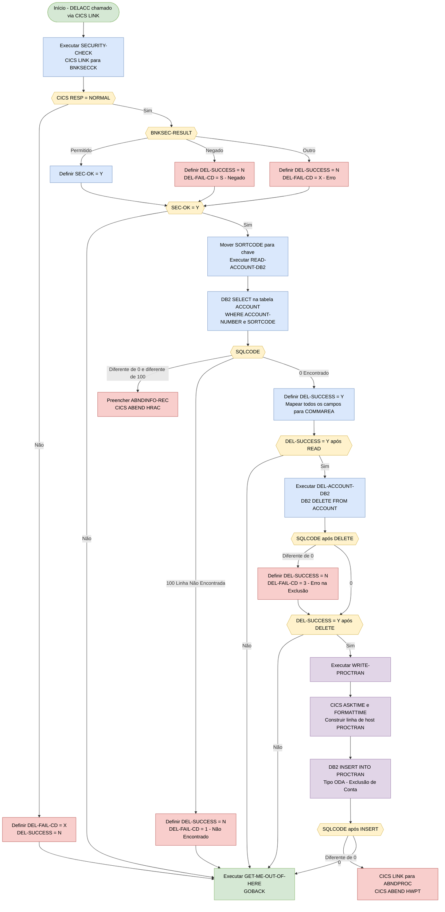
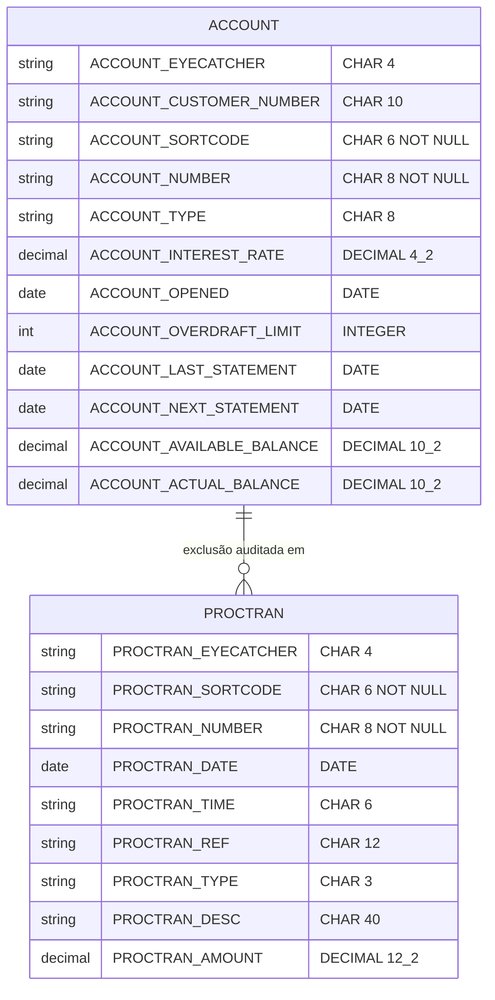

## Table of Contents

- [1. Purpose](#1-purpose)
- [2. Inputs](#2-inputs)
  - [2.1 Área de Comunicação (DFHCOMMAREA — Copybook DELACC)](#21-área-de-comunicação-dfhcommarea--copybook-delacc)
  - [2.2 Subsistema de Segurança — BNKSECCK](#22-subsistema-de-segurança--bnksecck)
  - [2.3 Banco de Dados DB2 — Tabela ACCOUNT](#23-banco-de-dados-db2--tabela-account)
  - [2.4 Banco de Dados DB2 — Tabela PROCTRAN](#24-banco-de-dados-db2--tabela-proctran)
  - [2.5 Sistema CICS (EIB) — Entradas](#25-sistema-cics-eib--entradas)
  - [2.6 Configuração Estática](#26-configuração-estática)
- [3. Outputs](#3-outputs)
  - [3.1 Área de Comunicação (DFHCOMMAREA) — Valores de Retorno para o Programa Chamador](#31-área-de-comunicação-dfhcommarea--valores-de-retorno-para-o-programa-chamador)
  - [3.2 Gravações no Banco de Dados DB2](#32-gravações-no-banco-de-dados-db2)
  - [3.3 Efeitos Colaterais de Abend / Erro no CICS](#33-efeitos-colaterais-de-abend--erro-no-cics)
  - [3.4 Mensagens no Console / Sysout (`DISPLAY`)](#34-mensagens-no-console--sysout-display)
- [4. Processing Logic](#4-processing-logic)
  - [4.1 Diagrama de Fluxo Mermaid](#41-diagrama-de-fluxo-mermaid)
  - [4.2 Descrição da Lógica de Processamento](#42-descrição-da-lógica-de-processamento)
  - [4.3 Tabelas do Banco de Dados](#43-tabelas-do-banco-de-dados)
- [5. Paragraphs](#5-paragraphs)
- [6. Dependencies](#6-dependencies)
  - [6.1 Copybooks](#61-copybooks)
  - [6.2 Tabelas DB2](#62-tabelas-db2)
  - [6.3 Área de Sistema DB2](#63-área-de-sistema-db2)
  - [6.4 Programas Externos (CICS LINK)](#64-programas-externos-cics-link)
  - [6.5 Serviços CICS](#65-serviços-cics)
  - [6.6 Parâmetros de Entrada](#66-parâmetros-de-entrada)
  - [6.7 Campos do EIB CICS (Bloco de Interface de Execução)](#67-campos-do-eib-cics-bloco-de-interface-de-execução)
  - [6.8 Valores de Configuração / Ambiente](#68-valores-de-configuração--ambiente)
- [7. Constraints](#7-constraints)
  - [7.1 Restrições de Segurança](#71-restrições-de-segurança)
  - [7.2 Restrições de Entrada / Chave](#72-restrições-de-entrada--chave)
  - [7.3 Restrições de Ordem de Processamento / Sequenciamento](#73-restrições-de-ordem-de-processamento--sequenciamento)
  - [7.4 Restrições de DB2 / Armazenamento de Dados](#74-restrições-de-db2--armazenamento-de-dados)
  - [7.5 Restrições de Segurança (detalhadas)](#75-restrições-de-segurança-detalhadas)
  - [7.6 Restrições de Sequenciamento e Ordem de Processamento](#76-restrições-de-sequenciamento-e-ordem-de-processamento)
  - [7.7 Restrições de Validação de Entrada](#77-restrições-de-validação-de-entrada)
  - [7.8 Restrições de SQLCODE DB2](#78-restrições-de-sqlcode-db2)
  - [7.9 Restrições de Saída e Código de Resultado](#79-restrições-de-saída-e-código-de-resultado)
  - [7.10 Restrições de Formato de Dados e Tamanho de Campo](#710-restrições-de-formato-de-dados-e-tamanho-de-campo)
  - [7.11 Restrições de Recurso e Escopo](#711-restrições-de-recurso-e-escopo)
- [8. Error Handling](#8-error-handling)
  - [8.1 Verificações de Segurança (Security-Gating Checks)](#81-verificações-de-segurança-security-gating-checks)
  - [8.2 Tratamento de Erros SQL no DB2](#82-tratamento-de-erros-sql-no-db2)
  - [8.3 Sinalização de Flags na Área de Comunicação (Notificação ao Chamador)](#83-sinalização-de-flags-na-área-de-comunicação-notificação-ao-chamador)
  - [8.4 Imposição de Segurança](#84-imposição-de-segurança)
  - [8.5 Tratamento de Erros de Leitura da Conta no DB2 (`READ-ACCOUNT-DB2`)](#85-tratamento-de-erros-de-leitura-da-conta-no-db2-read-account-db2)
  - [8.6 Tratamento de Erros de Exclusão da Conta no DB2 (`DEL-ACCOUNT-DB2`)](#86-tratamento-de-erros-de-exclusão-da-conta-no-db2-del-account-db2)
  - [8.7 Tratamento de Erros de Gravação em PROCTRAN no DB2 (`WRITE-PROCTRAN-DB2`)](#87-tratamento-de-erros-de-gravação-em-proctran-no-db2-write-proctran-db2)
  - [8.8 Flags de Falha na Área de Comunicação](#88-flags-de-falha-na-área-de-comunicação)
  - [8.9 Infraestrutura de Abend e Preenchimento de Diagnósticos](#89-infraestrutura-de-abend-e-preenchimento-de-diagnósticos)
- [9. Examples](#9-examples)
  - [9.1 Exemplo 1 — Exclusão de conta bem-sucedida](#91-exemplo-1--exclusão-de-conta-bem-sucedida)
  - [9.2 Exemplo 2 — Conta Não Encontrada](#92-exemplo-2--conta-não-encontrada)
  - [9.3 Exemplo 3 — Negação de Segurança](#93-exemplo-3--negação-de-segurança)

## 1. Purpose

DELACC é um programa CICS COBOL responsável por excluir com segurança um registro de conta bancária da tabela DB2 ACCOUNT em nome de uma aplicação chamadora. Ao ser invocado, ele primeiro realiza uma verificação de segurança RACF vinculando-se ao programa BNKSECCK; somente se o chamador estiver explicitamente autorizado é que ele prossegue para recuperar o registro completo da conta no DB2 utilizando o número da conta e o código de agência fornecidos na área de comunicação. Se a conta for encontrada, ela é permanentemente removida da tabela ACCOUNT, e o perfil completo da conta — incluindo número do cliente, tipo de conta, saldos, taxa de juros, limite de cheque especial e datas de extrato — é retornado ao chamador por meio da área de comunicação. Uma exclusão bem-sucedida é então registrada de forma durável como uma entrada de auditoria na tabela PROCTRAN, capturando o tipo de transação, carimbo de data/hora, referência e o saldo real da conta no momento da exclusão. Ao longo do processo, qualquer falha — seja uma negação de segurança, uma conta inexistente ou um erro de DB2 — é comunicada de volta ao chamador por meio de campos dedicados de sucesso e código de falha na área de comunicação, e erros irrecuperáveis de DB2 acionam um abend do CICS por meio do programa padrão de tratamento de abend.

## 2. Inputs

### 2.1 Área de Comunicação (DFHCOMMAREA — Copybook DELACC)

Estes são os campos passados pelo programa chamador via CICS COMMAREA ao invocar DELACC. Eles representam o contrato de entrada principal do programa.

- **`DELACC-ACCNO`** — O número de conta de 8 dígitos que identifica a conta bancária a ser exc### Área de Comunicação (DFHCOMMAREA — Copybook DELACC)

Estes são os campos passados pelo programa chamador via CICS COMMAREA ao invocar `DELACC`. Eles representam o contrato de entrada principal do programa.

- **`DELACC-ACCNO`** — O número de conta de 8 dígitos que identifica a conta bancária a ser excluída. Utilizado como campo de chave primária nas instruções SQL `SELECT` e `DELETE` contra a tabela `ACCOUNT` no DB2.
- **`DELACC-DEL-SUCCESS`** — Flag lida no início do fluxo principal para determinar se a etapa de leitura da conta foi bem-sucedida antes de prosseguir com a exclusão. Também gravada de volta ao chamador como o resultado geral da operação (`Y`/`N`).
- **`DELACC-DEL-FAIL-CD`** — Código de falha de um único caractere gravado de volta para indicar o motivo de uma exclusão malsucedida (`1` = não encontrado, `3` = erro de exclusão no DB2, `S` = acesso negado pela segurança, `X` = falha no sistema de segurança).

---

### 2.2 Subsistema de Segurança — BNKSECCK

O programa realiza um CICS `LINK` para o programa de verificação de segurança `BNKSECCK` antes de qualquer acesso a dados. O resultado dessa chamada direciona todo o processamento subsequente.

- **`BNKSEC-COMMAREA`** — A área de comunicação trocada com `BNKSECCK` (definida via copybook `BNKSEC`):
  - **`BNKSEC-OPERATION`** — Definido como `'DELACC  '`; informa ao programa de segurança qual operação está sendo autorizada.
  - **`BNKSEC-FOR-USERID`** / **`BNKSEC-USERID`** — Campos de identidade do usuário preenchidos e avaliados por `BNKSECCK` para determinar a autorização.
  - **`BNKSEC-RESULT`** — Retornado por `BNKSECCK`; `A` (permitido), `D` (negado) ou `E` (erro). Controla se `WS-SEC-SW` é definido como `SEC-OK` ou `SEC-NOT-OK`.
  - **`BNKSEC-RESP`** / **`BNKSEC-RESP2`** — Códigos de resposta CICS retornados pelo `LINK`; uma resposta diferente de `NORMAL` causa o retorno imediato do código de falha `X` ao chamador.

---

### 2.3 Banco de Dados DB2 — Tabela ACCOUNT

O programa lê e exclui uma linha da tabela DB2 `ACCOUNT`. As variáveis de host a seguir são as chaves utilizadas para localizar a linha e os dados recuperados dela.

- **`HV-ACCOUNT-SORTCODE`** — Preenchido a partir da constante interna `SORTCODE` (`987654`); forma parte da chave composta nas instruções SQL `SELECT` e `DELETE`.
- **`HV-ACCOUNT-ACC-NO`** — Preenchido a partir de `DELACC-ACCNO`; a metade do número de conta na chave composta. Direciona tanto a operação de `SELECT` (leitura) quanto a de `DELETE`.
- **`HV-ACCOUNT-CUST-NO`** — Recuperado da linha da tabela `ACCOUNT`; representa o cliente proprietário da conta. Retornado ao chamador via COMMAREA.
- **`HV-ACCOUNT-ACC-TYPE`** — Classificação da conta (por exemplo, corrente, poupança) recuperada da tabela `ACCOUNT` e retornada ao chamador.
- **`HV-ACCOUNT-ACTUAL-BAL`** — Saldo monetário real recuperado da tabela `ACCOUNT`. Preservado em `ACCOUNT-ACT-BAL-STORE` e gravado como o valor da transação no registro de auditoria `PROCTRAN`.
- **`HV-ACCOUNT-AVAIL-BAL`** — Saldo disponível recuperado da tabela `ACCOUNT` e retornado ao chamador.
- **`HV-ACCOUNT-OVERDRAFT-LIM`** — Limite de cheque especial autorizado recuperado da tabela `ACCOUNT` e retornado ao chamador.
- **`HV-ACCOUNT-INT-RATE`** — Taxa de juros recuperada da tabela `ACCOUNT` e retornada ao chamador.

---

### 2.4 Banco de Dados DB2 — Tabela PROCTRAN

Após uma exclusão bem-sucedida, o programa insere um registro de auditoria na tabela `PROCTRAN`. Os dados alimentados nessa inserção são derivados da linha de conta recuperada acima e de campos do sistema CICS.

- **`EIBTASKN`** — Campo do CICS Executive Interface Block que fornece o número da tarefa atual; utilizado para preencher `HV-PROCTRAN-REF` (a referência da transação no registro de auditoria).
- **`EIBTRNID`** — Campo do EIB CICS que fornece o identificador da transação; utilizado em registros de diagnóstico de abend.

---

### 2.5 Sistema CICS (EIB) — Entradas

Estes valores são lidos diretamente do CICS Executive Interface Block em tempo de execução.

- **`EIBTASKN`** — Número da tarefa CICS atual; utilizado como referência da transação gravada na linha de auditoria `PROCTRAN`.
- **`EIBTRNID`** — ID da transação CICS atual; utilizado em registros do tratador de abend.
- **`EIBRESP`** / **`EIBRESP2`** — Códigos de resposta CICS examinados após o `LINK` para `BNKSECCK`; uma resposta diferente do normal aciona o fluxo imediato de falha de segurança.

---

### 2.6 Configuração Estática

- **`SORTCODE`** (valor `987654`, proveniente do copybook `SORTCODE`) — O código de classificação (sort code) do próprio banco. Definido como constante e utilizado para restringir todas as leituras e exclusões no DB2 à agência correta.

## 3. Outputs

### 3.1 Área de Comunicação (DFHCOMMAREA) — Valores de Retorno para o Programa Chamador

- **`DELACC-DEL-SUCCESS`** — Indicador primário de sucesso/falha retornado ao programa chamador. Definido como `'Y'` quando a conta é encontrada e excluída com sucesso; definido como `'N'` em caso de negação de segurança, conta não encontrada ou falha no DELETE do DB2.
- **`DELACC-DEL-FAIL-CD`** — Código de motivo que acompanha uma exclusão com falha. Valores: `'1'` (conta não encontrada), `'3'` (erro no DELETE do DB2), `'S'### Área de Comunicação (DFHCOMMAREA) — Valores de Retorno para o Programa Chamador

- **`DELACC-DEL-SUCCESS`** — Indicador primário de sucesso/falha retornado ao programa chamador. Definido como `'Y'` quando a conta é encontrada e excluída com sucesso; definido como `'N'` em caso de negação de segurança, conta não encontrada ou falha no DELETE do DB2.
- **`DELACC-DEL-FAIL-CD`** — Código de motivo que acompanha uma exclusão com falha. Valores: `'1'` (conta não encontrada), `'3'` (erro no DELETE do DB2), `'S'` (segurança negada pelo BNKSECCK), `'X'` (programa de verificação de segurança indisponível ou resposta anormal).
- **`DELACC-DEL-APPLID`** — ID da aplicação da região CICS; preenchido como parte da área de comunicação retornada ao chamador.
- **Campos do perfil da conta** — O registro completo da conta recuperado do DB2 antes da exclusão é devolvido ao chamador para que o programa chamador possa exibir ou auditar os dados que foram removidos:
  - **`DELACC-EYE`** — Valor de identificação visual (`ACCT`) da conta excluída.
  - **`DELACC-CUSTNO`** — Número do cliente que era titular da conta excluída.
  - **`DELACC-SCODE`** — Código de ordenação da conta excluída.
  - **`DELACC-ACCNO`** — Número da conta excluída.
  - **`DELACC-ACC-TYPE`** — Classificação da conta (ex.: corrente, poupança, empréstimo).
  - **`DELACC-INT-RATE`** — Taxa de juros da conta excluída.
  - **`DELACC-OPENED`** — Data de abertura da conta (formato DDMMAAAA).
  - **`DELACC-OVERDRAFT`** — Limite de cheque especial da conta excluída.
  - **`DELACC-LAST-STMT-DT`** — Data do último extrato da conta excluída.
  - **`DELACC-NEXT-STMT-DT`** — Data do próximo extrato da conta excluída.
  - **`DELACC-AVAIL-BAL`** — Saldo disponível no momento da exclusão.
  - **`DELACC-ACTUAL-BAL`** — Saldo real no momento da exclusão.

---

### 3.2 Gravações no Banco de Dados DB2

- **Tabela `ACCOUNT` — DELETE** (seção `DEL-ACCOUNT-DB2`) — A linha na tabela `ACCOUNT` que corresponde à chave composta `ACCOUNT_SORTCODE` + `ACCOUNT_NUMBER` é removida permanentemente. Em caso de falha, define `DELACC-DEL-SUCCESS = 'N'` e `DELACC-DEL-FAIL-CD = '3'`.
- **Tabela `PROCTRAN` — INSERT** (seção `WRITE-PROCTRAN-DB2`) — Uma linha de auditoria/histórico de transações é gravada na `PROCTRAN` somente quando o DELETE é bem-sucedido. O registro inserido contém:
  - Identificador visual `'PRTR'`; código de ordenação e número da conta excluída.
  - Carimbo de data/hora (data obtida via `CICS FORMATTIME`, hora via `CICS ASKTIME`).
  - Número da tarefa (obtido de `EIBTASKN`) como referência da transação.
  - Código de tipo `'ODA'` (Exclusão de Conta em Agência, via `PROC-TY-BRANCH-DELETE-ACCOUNT`).
  - Descrição (`PROC-TRAN-DESC-DELACC`) contendo: número do cliente, tipo de conta, data do último extrato, data do próximo extrato e o rodapé literal `'DELETE'`.
  - Valor (`HV-PROCTRAN-AMOUNT`) definido como `ACCOUNT-ACT-BAL-STORE` — o saldo real da conta no momento da exclusão.

---

### 3.3 Efeitos Colaterais de Abend / Erro no CICS

- **`CICS ABEND ABCODE('HRAC')`** — Emitido quando o SELECT do DB2 na tabela `ACCOUNT` retorna um SQLCODE inesperado (diferente de 0 ou +100). Encerra a transação de forma anormal e impede o processamento subsequente.
- **`CICS ABEND ABCODE('HWPT')`** — Emitido quando o INSERT do DB2 na tabela `PROCTRAN` falha. Antes do abend, o programa realiza um LINK para o programa de tratamento de abend `ABNDPROC` (`WS-ABEND-PGM`), passando `ABNDINFO-REC` com informações de diagnóstico detalhadas (APPLID, TRANID, número da tarefa, data/hora, SQLCODE e uma mensagem em texto livre).
- **CICS LINK para `ABNDPROC`** — Invocado antes do abend `HWPT` para transferir informações de diagnóstico estruturadas (`ABNDINFO-REC`) ao tratador centralizado de abends para registro e arquivamento.

---

### 3.4 Mensagens no Console / Sysout (`DISPLAY`)

- **`DISPLAY 'Issue with ACCOUNT row select...'`** — Gravado no log de job do CICS quando o SELECT do DB2 na tabela `ACCOUNT` retorna um SQLCODE inesperado. Inclui `SQLCODE-DISPLAY`, `HV-ACCOUNT-ACC-NO` e `HV-ACCOUNT-SORTCODE`.
- **`DISPLAY 'In DELACC (WPD010) UNABLE TO WRITE TO PROCTRAN ROW DATASTORE...'`** — Gravado no log de job do CICS quando o INSERT na tabela `PROCTRAN` falha. Inclui `SQLCODE-DISPLAY` e o conteúdo de `HOST-PROCTRAN-ROW`.

## 4. Processing Logic

### 4.1 Diagrama de Fluxo Mermaid



---

### 4.2 Descrição da Lógica de Processamento

#### 4.2.1 Resumo de Alto Nível

DELACC é um programa CICS COBOL que exclui um registro de conta bancária da tabela DB2 `ACCOUNT`. Ele opera em modo de segurança fail-closed: primeiro verifica se o chamador está autorizado a excluir contas por meio do sub-programa de segurança `BNKSECCK`, em seguida lê a linha da conta-alvo, a exclui fisicamente e registra uma entrada permanente de trilha de auditoria na tabela `PROCTRAN`. Todos os resultados e o perfil completo da conta excluída são retornados ao chamador por meio da área de comunicação CICS (`DFHCOMMAREA`).

---

#### 4.2.2 Fluxo de Execução

**Passo 1 — Entrada e Verificação de Segurança (`SECURITY-CHECK`)**

O programa é invocado por um CICS LINK com uma `DFHCOMMAREA` contendo o número da conta a ser excluída (`DELACC-ACCNO`). A primeira ação — antes de qualquer dado ser lido ou modificado — é uma verificação de segurança. `WS-SEC-SW` é inicializado como `N` (SEC-NOT-OK), e `BNKSEC-COMMAREA` é preenchida com o código de operação `DELACC  `. Um `CICS LINK` é feito para o sub-programa `BNKSECCK`.

- Se a resposta do CICS não for `NORMAL` (falha no link): `DELACC-DEL-SUCCESS = 'N'`, `DELACC-DEL-FAIL-CD = 'X'`, e o programa encerra imediatamente.
- Se `BNKSEC-RESULT = 'A'` (Permitido): `SEC-OK` é definido como `TRUE` e o processamento continua.
- Se `BNKSEC-RESULT = 'D'` (Negado): `DELACC-DEL-SUCCESS = 'N'`, `DELACC-DEL-FAIL-CD = 'S'`, e o programa encerra.
- Se qualquer outro resultado: `DELACC-DEL-SUCCESS = 'N'`, `DELACC-DEL-FAIL-CD = 'X'`, e o programa encerra.

**Passo 2 — Leitura do Registro de Conta (`READ-ACCOUNT-DB2`)**

Somente alcançado quando `SEC-OK` é `TRUE`. O próprio `SORTCODE` constante do banco (987654) é movido para a variável de chave, e `DELACC-ACCNO` é movido para `HV-ACCOUNT-ACC-NO`. Um DB2 `SELECT` recupera todas as doze colunas da linha `ACCOUNT` correspondente usando a chave composta `ACCOUNT_NUMBER + ACCOUNT_SORTCODE`.

- Se `SQLCODE ≠ 0` e `SQLCODE ≠ +100` (erro DB2 inesperado): O programa coleta diagnósticos (APPLID, número da tarefa, ID da transação, hora/data, SQLCODE), preenche `ABNDINFO-REC`, exibe uma mensagem de erro e emite um `CICS ABEND` com código `HRAC`.
- Se `SQLCODE = +100` (linha não encontrada): `DELACC-DEL-SUCCESS = 'N'`, `DELACC-DEL-FAIL-CD = '1'`, a área de comunicação é parcialmente inicializada, e o processamento encerra.
- Se `SQLCODE = 0` (encontrado): Todos os campos recuperados são mapeados das variáveis de host DB2 por meio da área de trabalho `OUTPUT-DATA` para os campos de saída do `DFHCOMMAREA`. Datas armazenadas no DB2 no formato `YYYY-MM-DD` são analisadas por meio do grupo `DB2-DATE-REFORMAT` em sub-campos separados de dia/mês/ano. O saldo real é preservado em `ACCOUNT-ACT-BAL-STORE` para uso posterior no registro de auditoria. `DELACC-DEL-SUCCESS` é definido como `'Y'`.

**Passo 3 — Exclusão da Linha da Conta (`DEL-ACCOUNT-DB2`)**

Somente alcançado quando `DELACC-DEL-SUCCESS = 'Y'` após a leitura. Um `DELETE FROM ACCOUNT` DB2 é emitido usando os mesmos valores de variáveis de host de chave composta (`ACCOUNT_SORTCODE + ACCOUNT_NUMBER`) usados no SELECT. Se `SQLCODE ≠ 0`, `DELACC-DEL-SUCCESS` é definido como `'N'` e `DELACC-DEL-FAIL-CD` como `'3'`; nenhum abend é gerado para esta condição, o controle simplesmente retorna.

**Passo 4 — Gravação do Registro de Auditoria (`WRITE-PROCTRAN` / `WRITE-PROCTRAN-DB2`)**

Somente alcançado quando `DELACC-DEL-SUCCESS = 'Y'` após a exclusão. Uma linha de auditoria `PROCTRAN` é construída:

- Identificador: `PRTR`
- Código de agência e número de conta a partir das variáveis de host
- Número da tarefa CICS (`EIBTASKN`) como referência de transação
- `CICS ASKTIME` e `CICS FORMATTIME` para obter hora/data atuais formatadas como data `DDMMYYYY` e hora `HHMMSS`
- Campo de descrição (`PROC-TRAN-DESC-DELACC`) preenchido com número do cliente, tipo de conta e datas dos últimos/próximos extratos
- Tipo de transação definido como `'ODA'` (Exclusão de Conta na Agência) via `SET PROC-TY-BRANCH-DELETE-ACCOUNT TO TRUE`
- Indicador de rodapé `'DELETE'` via `SET PROC-DESC-DELACC-FLAG TO TRUE`
- `ACCOUNT-ACT-BAL-STORE` (saldo no momento da exclusão) movido para `HV-PROCTRAN-AMOUNT`
- `INSERT INTO PROCTRAN` executado

Se o `INSERT` falhar (`SQLCODE ≠ 0`), o programa preenche `ABNDINFO-REC`, faz link para o programa manipulador de abend **ABNDPROC** e então emite `CICS ABEND HWPT` — um abend fatal, pois a integridade da trilha de auditoria é obrigatória.

**Passo 5 — Retorno (`GET-ME-OUT-OF-HERE`)**

Emite `GOBACK` para devolver o controle ao CICS, que retorna a `DFHCOMMAREA` preenchida ao programa chamador.

---

#### 4.2.3 Interações Externas

| Sistema | Comando / SQL | Finalidade |
|---|---|---|
| **BNKSECCK** (programa CICS) | `CICS LINK` | Verificação de autorização com suporte RACF — confirma se o usuário solicitante pode realizar exclusão de contas |
| **DB2 — tabela ACCOUNT** | `SELECT` | Recuperar a linha completa da conta pela chave composta antes da exclusão |
| **DB2 — tabela ACCOUNT** | `DELETE` | Remover a linha da conta permanentemente |
| **DB2 — tabela PROCTRAN** | `INSERT` | Gravar um registro imutável de auditoria/transação do evento de exclusão |
| **ABNDPROC** (programa CICS) | `CICS LINK` | Manipulador centralizado de abend — chamado em caso de falha no INSERT no PROCTRAN antes de emitir ABEND |
| **CICS EIB** | `ASKTIME`, `FORMATTIME`, `ASSIGN` | Obter hora/data atuais, ID da aplicação, número da tarefa, ID da transação para registros de auditoria e abend |

---

#### 4.2.4 Resumo em Linguagem Simples

Quando um operador bancário solicita a exclusão de uma conta, este programa atua como o mecanismo de back-end. Ele primeiro consulta um serviço de segurança para verificar se o usuário tem permissão para excluir contas. Se não tiver, ele reporta falha imediatamente sem tocar em nenhum dado.

Se autorizado, ele busca a conta no banco de dados usando o número da conta e o código de agência do próprio banco. Se a conta não existir, informa ao chamador "não encontrado". Se existir, recupera todos os detalhes da conta, os copia de volta ao chamador e então exclui o registro do banco de dados.

Após uma exclusão bem-sucedida, o programa registra uma entrada de trilha de auditoria capturando a conta, o saldo no momento da exclusão, a data e hora e o tipo de operação — garantindo um log permanente e à prova de adulteração do que foi excluído e quando. Qualquer erro inesperado de banco de dados durante a gravação da auditoria é tratado como uma condição fatal e causa um abend para evitar perda silenciosa de dados.

---

### 4.3 Tabelas do Banco de Dados



## 5. Paragraphs

- **A010** — Ponto de entrada principal e controlador primário do fluxo lógico do programa.
  - Inicia a execução chamando `PERFORM SECURITY-CHECK` para verificar se o usuário está autorizado a excluir contas.
  - Contém uma guarda condicional de nível superior `IF SEC-OK`: somente quando a chave de segurança (`WS-SEC-SW`) está definida como `'Y'` o processamento continua.
  - Dentro da guarda de segurança, preenche `REQUIRED-SORT-CODE` a partir da constante `SORTCODE` e chama `PERFORM READ-ACCOUNT-DB2` para recuperar a conta-alvo.
  - Um condicional aninhado `IF DELACC-DEL-SUCCESS = 'Y'` controla a exclusão: se a leitura for bem-sucedida, `PERFORM DEL-ACCOUNT-DB2` é chamado; se isso também for bem-sucedido (um segundo `IF DELACC-DEL-SUCCESS = 'Y'`), `PERFORM WRITE-PROCTRAN` registra a trilha de auditoria.
  - Conclui chamando `PERFORM GET-ME-OUT-OF-HERE` incondicionalmente para encerrar o programa.
  - O parágrafo `A999` serve como rótulo de saída da seção (`EXIT`).

- **SECURITY-CHECK (SC010)** — Impõe uma barreira de segurança RACF fail-closed antes que qualquer dado de conta seja acessado.
  - Inicializa `WS-SEC-SW` com `'N'` (SEC-NOT-OK) como padrão seguro e limpa `BNKSEC-COMMAREA`.
  - Move o nome da operação `'DELACC  '` para `BNKSEC-OPERATION` e emite um `CICS LINK` para o subprograma de verificação de segurança `BNKSECCK`, passando `BNKSEC-COMMAREA`.
  - Verifica `WS-CICS-RESP`: se a própria chamada CICS não retornar `DFHRESP(NORMAL)`, define `DELACC-DEL-SUCCESS = 'N'`, `DELACC-DEL-FAIL-CD = 'X'` e desvia para `SC999`, contornando todo o processamento da conta.
  - Usa um bloco `EVALUATE TRUE` para interpretar `BNKSEC-RESULT`:
    - `BNKSEC-ALLOWED` → define `WS-SEC-SW` como `'Y'` (SEC-OK), permitindo que o processamento prossiga.
    - `BNKSEC-DENIED` → define os indicadores de falha `'N'` / `'S'`.
    - `WHEN OTHER` → define os indicadores de falha `'N'` / `'X'` para uma resposta de segurança inesperada.
  - O parágrafo `SC999` é o rótulo de saída da seção (`EXIT`).

- **READ-ACCOUNT-DB2 (RAD010)** — Recupera a linha completa da conta da tabela DB2 `ACCOUNT` usando a chave composta fornecida na área de comunicação.
  - Move `DELACC-ACCNO` para `HV-ACCOUNT-ACC-NO` e `SORTCODE` para `HV-ACCOUNT-SORTCODE` para preencher as variáveis hospedeiras do DB2.
  - Executa um `SELECT` DB2 buscando todas as doze colunas de `ACCOUNT` (eye-catcher, número do cliente, código de classificação, número da conta, tipo, taxa de juros, data de abertura, limite de cheque especial, data do último extrato, data do próximo extrato, saldo disponível, saldo real) em `HOST-ACCOUNT-ROW`, filtrado por `ACCOUNT_NUMBER` e `ACCOUNT_SORTCODE`.
  - Lógica condicional pós-`SELECT`:
    - Se `SQLCODE` não for `0` nem `+100` (erro inesperado): monta um registro completo `ABNDINFO-REC`, atribui o `APPLID` e `PROGRAM` do CICS, chama `PERFORM POPULATE-TIME-DATE`, formata uma string de diagnóstico `ABND-FREEFORM` e emite `CICS ABEND` com o código `'HRAC'`.
    - Se `SQLCODE = +100` (linha não encontrada): limpa `OUTPUT-DATA`, define `DELACC-DEL-SUCCESS = 'N'` e `DELACC-DEL-FAIL-CD = '1'`, então desvia para `RAD999` para retornar sem excluir.
    - Se `SQLCODE = 0` (sucesso): define `DELACC-DEL-SUCCESS = 'Y'` e limpa o código de falha.
  - Reformata os três campos de data do DB2 (`ACCOUNT_OPENED`, `ACCOUNT_LAST_STATEMENT`, `ACCOUNT_NEXT_STATEMENT`) do formato de string `YYYY-MM-DD` por meio de `DB2-DATE-REFORMAT` para os subcampos `DD/MM/YYYY` de `OUTPUT-DATA`.
  - Copia todos os campos da conta de `OUTPUT-DATA` de volta para os campos da área de comunicação (`DFHCOMMAREA`) (`DELACC-EYE` até `DELACC-ACTUAL-BAL`).
  - Salva `HV-ACCOUNT-ACTUAL-BAL` em `ACCOUNT-ACT-BAL-STORE` para uso posterior no registro de auditoria `PROCTRAN`.
  - O parágrafo `RAD999` é o rótulo de saída da seção (`EXIT`).

- **DEL-ACCOUNT-DB2 (DADB010)** — Exclui a linha da conta da tabela DB2 `ACCOUNT`.
  - Executa uma instrução DB2 `DELETE FROM ACCOUNT` usando as variáveis hospedeiras `HV-ACCOUNT-SORTCODE` e `HV-ACCOUNT-ACC-NO` como predicado de chave composta (`WHERE ACCOUNT_SORTCODE = :HV-ACCOUNT-SORTCODE AND ACCOUNT_NUMBER = :HV-ACCOUNT-ACC-NO`).
  - Após a exclusão, verifica `SQLCODE`: se não for `0`, define `DELACC-SUCCESS` como `' '`, `DELACC-DEL-SUCCESS` como `'N'` e `DELACC-DEL-FAIL-CD` como `'3'` para sinalizar uma falha na exclusão ao chamador. Nenhum abend é disparado aqui; a falha é comunicada de volta por meio dos sinalizadores da área de comunicação.
  - O parágrafo `DADB999` é o rótulo de saída da seção (`EXIT`).

- **WRITE-PROCTRAN (WP010)** — Parágrafo despachante enxuto que delega a gravação do registro de auditoria à subseção específica de DB2.
  - Contém uma única chamada `PERFORM WRITE-PROCTRAN-DB2`.
  - O parágrafo `WP999` é o rótulo de saída da seção (`EXIT`).

- **WRITE-PROCTRAN-DB2 (WPD010)** — Constrói e insere um registro de auditoria de transação de processo na tabela DB2 `PROCTRAN` para registrar permanentemente o evento de exclusão da conta.
  - Inicializa `HOST-PROCTRAN-ROW` e `WS-EIBTASKN12`, então preenche os campos de cabeçalho da auditoria: eye-catcher `'- **A010** — Ponto de entrada principal da `PREMIERE SECTION`. Atua como controlador de nível superior do programa, orquestrando todas as etapas principais de processamento em sequência.
  - Chama `SECURITY-CHECK` para determinar se o usuário solicitante está autorizado a excluir contas.
  - Se a chave `SEC-OK` for verdadeira, move `SORTCODE` para o campo de trabalho de código de classificação requerido, então chama `READ-ACCOUNT-DB2` para recuperar a linha da conta-alvo.
  - Chama condicionalmente `DEL-ACCOUNT-DB2` somente quando `DELACC-DEL-SUCCESS` é `'Y'` após a leitura.
  - Se a exclusão também for bem-sucedida (`DELACC-DEL-SUCCESS` permanecer `'Y'`), chama `WRITE-PROCTRAN` para gravar a entrada de trilha de auditoria.
  - Finaliza chamando `GET-ME-OUT-OF-HERE` incondicionalmente.
  - O fluxo de controle é governado por testes `IF` aninhados em `SEC-OK` e `DELACC-DEL-SUCCESS`; não há repetição.

- **A999** — Terminador de parágrafo para `PREMIERE SECTION`; contém apenas `EXIT`.

- **SECURITY-CHECK (SC010)** — Impõe uma barreira de autorização RACF fail-closed antes que qualquer dado seja acessado.
  - Inicializa `WS-SEC-SW` com `'N'` (SEC-NOT-OK) e limpa `BNKSEC-COMMAREA`.
  - Emite um `CICS LINK` para o programa de verificação de segurança `BNKSECCK`, passando o nome da operação `'DELACC  '`.
  - Se a resposta do CICS não for `DFHRESP(NORMAL)`, define `DELACC-DEL-SUCCESS` como `'N'`, código de falha `'X'`, e desvia imediatamente para `SC999`.
  - Se a chamada for bem-sucedida, avalia `BNKSEC-RESULT` por meio de um bloco `EVALUATE TRUE`:
    - `BNKSEC-ALLOWED` → define `SEC-OK` como `'Y'` (o processamento pode prosseguir).
    - `BNKSEC-DENIED` → define `DELACC-DEL-SUCCESS` como `'N'` e código de falha `'S'`.
    - `WHEN OTHER` → define `DELACC-DEL-SUCCESS` como `'N'` e código de falha `'X'`.
  - Interage com sistema externo: `CICS LINK` para `BNKSECCK`.

- **SC999** — Terminador de parágrafo para `SECURITY-CHECK SECTION`; contém apenas `EXIT`.

- **READ-ACCOUNT-DB2 (RAD010)** — Recupera a linha completa da conta da tabela DB2 `ACCOUNT` usando o número da conta recebido como chave de pesquisa.
  - Move `DELACC-ACCNO` para a variável hospedeira `HV-ACCOUNT-ACC-NO` e `SORTCODE` para `HV-ACCOUNT-SORTCODE`.
  - Executa um `SELECT` DB2 de todas as doze colunas de `ACCOUNT` para o grupo de variáveis hospedeiras `HOST-ACCOUNT-ROW`, filtrando por `ACCOUNT_NUMBER` e `ACCOUNT_SORTCODE`.
  - **Caminho de erro de `SQLCODE`** (`SQLCODE NOT = 0 AND NOT = +100`): preenche `ABNDINFO-REC` com número da tarefa, ID da transação, timestamp, nome do programa e uma mensagem descritiva, então emite `CICS ABEND` com código `'HRAC'`. A chamada de abend é uma terminação forçada; ela chama `POPULATE-TIME-DATE` antes para obter os dados de timestamp.
  - **Caminho de linha não encontrada** (`SQLCODE = +100`): inicializa `OUTPUT-DATA`, define `DELACC-DEL-SUCCESS` como `'N'` e código de falha `'1'`, então desvia para `RAD999` com `GO TO`.
  - **Caminho de sucesso** (`SQLCODE = 0`): define `DELACC-DEL-SUCCESS` como `'Y'` e move todos os campos recuperados das variáveis hospedeiras tanto para `OUTPUT-DATA` quanto para os campos de `DFHCOMMAREA`. Os campos de data do DB2 (`ACCOUNT_OPENED`, `ACCOUNT_LAST_STATEMENT`, `ACCOUNT_NEXT_STATEMENT`) são analisados por meio do grupo `DB2-DATE-REFORMAT` para separar `YYYY-MM-DD` em subcampos de dia, mês e ano. Preserva `HV-ACCOUNT-ACTUAL-BAL` em `ACCOUNT-ACT-BAL-STORE` para uso posterior na auditoria.
  - Interage com sistema externo: DB2 `SELECT` na tabela `ACCOUNT`; `CICS ABEND` em erro SQL fatal.

- **RAD999** — Terminador de parágrafo para `READ-ACCOUNT-DB2 SECTION`; contém apenas `EXIT`.

- **DEL-ACCOUNT-DB2 (DADB010)** — Exclui a linha da conta da tabela DB2 `ACCOUNT`.
  - Executa um DB2 `DELETE FROM ACCOUNT` usando a chave composta `ACCOUNT_SORTCODE` e `ACCOUNT_NUMBER` já carregada em `HV-ACCOUNT-SORTCODE` e `HV-ACCOUNT-ACC-NO` a partir da leitura anterior.
  - Se `SQLCODE NOT = 0`, define `DELACC-DEL-SUCCESS` como `'N'` e código de falha `'3'`, impedindo a gravação de auditoria subsequente.
  - Não há lógica de abend presente; a falha é sinalizada exclusivamente por meio dos sinalizadores da área de comunicação.
  - Interage com sistema externo: DB2 `DELETE` na tabela `ACCOUNT`.

- **DADB999** — Terminador de parágrafo para `DEL-ACCOUNT-DB2 SECTION`; contém apenas `EXIT`.

- **WRITE-PROCTRAN (WP010)** — Parágrafo despachante enxuto para a etapa de gravação da auditoria da transação.
  - Simplesmente chama `WRITE-PROCTRAN-DB2` via `PERFORM` e sai.
  - Não contém lógica própria; fornece uma camada de indireção que permite substituir ou estender a etapa de auditoria sem alterar o parágrafo chamador.

- **WP999** — Terminador de parágrafo para `WRITE-PROCTRAN SECTION`; contém apenas `EXIT`.

- **WRITE-PROCTRAN-DB2 (WPD010)** — Grava um registro de auditoria na tabela DB2 `PROCTRAN` documentando a exclusão bem-sucedida da conta.
  - Inicializa `HOST-PROCTRAN-ROW` e `WS-EIBTASKN12`, então preenche as variáveis hospedeiras: eyecatcher `'PRTR'`, código de classificação e número da conta a partir de `OUTPUT-DATA`, número da tarefa a partir de `EIBTASKN` preenchido à esquerda até 12 dígitos como a referência da transação.
  - Emite `CICS ASKTIME` para obter o timestamp absoluto e `CICS FORMATTIME` para produzir uma data formatada `DDMMYYYY` e hora `HHMMSS`; mapeia a data formatada por meio de `WS-ORIG-DATE-GRP-X` para `HV-PROCTRAN-DATE`.
  - Preenche o redefine `PROC-TRAN-DESC-DELACC` de `PROCTRAN-AREA` com número do cliente, tipo de conta e componentes das datas do último/próximo extrato; define o sinalizador de rodapé da descrição como `'DELETE'` e o tipo de transação como `'ODA'` (exclusão de conta na agência) usando instruções `SET` de nível 88.
  - Move o saldo real armazenado `ACCOUNT-ACT-BAL-STORE` para `HV-PROCTRAN-AMOUNT` para registrar o saldo da conta no momento da exclusão.
  - Executa um DB2 `INSERT INTO PROCTRAN` para todas as nove colunas.
  - **Caminho de erro** (`SQLCODE NOT = 0`): preenche `ABNDINFO-REC` com `EIBRESP`, `EIBRESP2`, identificadores de tarefa/transação e uma string de mensagem em formato livre; emite `CICS LINK` para o programa de tratamento de abend `ABNDPROC` e depois `CICS ABEND` com código `'HWPT'`.
  - Interage com sistemas externos: `CICS ASKTIME`, `CICS FORMATTIME`, `CICS LINK` para `ABNDPROC` (caminho de erro), `CICS ABEND` (caminho de erro), DB2 `INSERT` na tabela `PROCTRAN`.

- **WPD999** — Terminador de parágrafo para `WRITE-PROCTRAN-DB2 SECTION`; contém apenas `EXIT`.

- **GET-ME-OUT-OF-HERE (GMOFH010)** — Encerra o programa executando `GOBACK`, retornando o controle ao CICS.
  - Nenhuma lógica além da única instrução `GOBACK`.

- **GMOFH999** — Terminador de parágrafo para `GET-ME-OUT-OF-HERE SECTION`; contém apenas `EXIT`.

- **POPULATE-TIME-DATE (PTD010)** — Parágrafo utilitário que obtém e formata a data e hora atuais do CICS para uso em registros de abend.
  - Emite `CICS ASKTIME` para capturar a hora absoluta atual em `WS-U-TIME`.
  - Emite `CICS FORMATTIME` para formatar `WS-U-TIME` em formato `DDMMYYYY` em `WS-ORIG-DATE` e hora `HHMMSS` em `WS-TIME-NOW`, usando o separador de data padrão.
  - Chamado por `READ-ACCOUNT-DB2` e `WRITE-PROCTRAN-DB2` antes de preencher `ABNDINFO-REC` em condições de erro.
  - Interage com sistema externo: `CICS ASKTIME` e `CICS FORMATTIME`.

- **PTD999** — Terminador de parágrafo para `POPULATE-TIME-DATE SECTION`; contém apenas `EXIT`.

---

        **INSTRUÇÕES DE TRADUÇÃO**

        Traduza o conteúdo acima para o idioma identificado pelo código de localidade `pt-br`.

        Siga estas regras sem exceção:

        1. **Traduza todo o texto em linguagem natural** (explicações, descrições, resumos, títulos, marcadores) para o idioma de destino.
        2. **NÃO traduza nem altere** nenhum dos itens a seguir — reproduza-os caractere por caractere:
        - Código-fonte, trechos de código e blocos de código (conteúdo dentro de blocos delimitados por ``` ou spans inline com crases)
        - Palavras-chave de linguagens de programação (por exemplo, `PERFORM`, `CALL`, `PROCEDURE`, `if`, `while`)
        - Nomes de variáveis, nomes de parágrafos, nomes de procedimentos, nomes de rótulos e identificadores
        - Nomes de arquivos, nomes de datasets, nomes DD, nomes de programas
        - Sintaxe de comandos SQL, JCL, CICS, MQ, IMS e outros comandos de mainframe
        - Nomes de APIs, nomes de ferramentas, nomes de comandos e chaves de configuração
        - Literais numéricos, literais hexadecimais e valores constantes
        - URLs, caminhos e placeholders técnicos
        3. **Preserve toda a formatação Markdown** (títulos, negrito, itálico, listas, tabelas, blocos de código) exatamente como estruturada no original.
        4. **Não adicione, remova nem reordene seções** — a resposta traduzida deve ter a mesma estrutura da original.

        > ⚠️ **CRÍTICO**: Sob nenhuma circunstância o texto original em `en` deve aparecer em qualquer lugar da sua resposta. Produza SOMENTE a versão traduzida em `pt-br`.

## 6. Dependencies

### 6.1 Copybooks

- **SORTCODE** (`src/base/cics/copy/SORTCODE.cpy`)
  - Fornece a constante de código de classificação bancária codificada (`987654`) usada para delimitar todas as leituras e exclusões de contas no DB2 à agência correta
- **BNKSEC** (`src/base/cics/copy/BNKSEC.cpy`)
  - Define o layout da área de comunicação (`BNKSEC-COMMAREA`) passada ao programa de verificação de segurança `BNKSECCK`; carrega o nome da operação, IDs de usuário e o resultado da autorização
- **ACCDB2** (`src/base/cics/copy/ACCDB2.cpy`)
  - Declara a estrutura da tabela DB2 `ACCOUNT` (via `EXEC SQL DECLARE`) e fornece o grupo de variáveis de host COBOL `HOST-ACCOUNT-ROW` utilizado em todas as instruções SQL contra essa tabela
- **PROCDB2** (`src/base/cics/copy/PROCDB2.cpy`)
  - Declara a estrutura da tabela DB2 `PROCTRAN` e fornece o grupo de variáveis de host `HOST-PROCTRAN-ROW` utilizado na inserção do registro de trilha de auditoria
- **ACCOUNT** (`src/base/cics/copy/ACCOUNT.cpy`)
  - Define o layout do registro de conta na working storage (`OUTPUT-DATA / ACCOUNT-DATA`) utilizado para receber e reformatar os dados recuperados do DB2 antes de propagá-los para a área de comunicação
- **PROCTRAN** (`src/base/cics/copy/PROCTRAN.cpy`)
  - Define o layout do registro de transação de processo (`PROCTRAN-AREA`), incluindo todos os valores de nível 88 para tipo de transação; utilizado para construir a linha de auditoria gravada em `PROCTRAN`
- **ACCTCTRL** (`src/base/cics/copy/ACCTCTRL.cpy`)
  - Define o layout do registro de controle de conta (`ACCOUNT-CONTROL`) referenciado na working storage; descreve a estrutura do registro de controle (marcador de identificação, código de classificação, contagem de contas, último número, indicadores de sucesso/falha)
- **ABNDINFO** (`src/base/cics/copy/ABNDINFO.cpy`)
  - Define o registro de informações de abend (`ABNDINFO-REC`) preenchido em caso de erros e passado ao programa de tratamento de abend `ABNDPROC`
- **DELACC** (`src/base/cics/copy/DELACC.cpy`)
  - Define o layout da área de comunicação voltada ao chamador (`DFHCOMMAREA`); carrega o número da conta de entrada e o código de classificação na entrada, e retorna o perfil completo da conta excluída mais os indicadores de sucesso/falha na saída

---

### 6.2 Tabelas DB2

- **ACCOUNT**
  - Lida via `SELECT` (chaveada em `ACCOUNT_NUMBER` + `ACCOUNT_SORTCODE`) para recuperar a linha completa da conta antes da exclusão; em seguida, alvo de `DELETE` usando a mesma chave composta para remover o registro
- **PROCTRAN**
  - Recebe um `INSERT` após a exclusão bem-sucedida de uma conta; registra o tipo de transação, código de classificação, número da conta, data/hora, referência, descrição e saldo como entrada permanente de trilha de auditoria

---

### 6.3 Área de Sistema DB2

- **SQLCA** (Área de Comunicação SQL — `INCLUDE SQLCA`)
  - Incluída no momento da pré-compilação; fornece `SQLCODE` e campos relacionados que o programa inspeciona após cada instrução SQL para detectar sucesso, linha não encontrada (`+100`) ou erros fatais

---

### 6.4 Programas Externos (CICS LINK)

- **BNKSECCK**
  - Sub-programa de verificação de segurança invocado via `EXEC CICS LINK` antes de qualquer acesso a dados; avalia se o usuário solicitante está autorizado a realizar exclusões de contas; retorna `BNKSEC-ALLOWED`, `BNKSEC-DENIED` ou `BNKSEC-ERROR` em `BNKSEC-COMMAREA`
- **ABNDPROC** (valor de `WS-ABEND-PGM`)
  - Programa de tratamento de abend invocado via `EXEC CICS LINK` quando ocorre um erro fatal (por exemplo, falha no INSERT em `PROCTRAN`); recebe a área de comunicação `ABNDINFO-REC` preenchida contendo APPLID, ID de transação, número de tarefa, SQLCODE, códigos RESP e uma mensagem de diagnóstico em formato livre

---

### 6.5 Serviços CICS

- **EXEC CICS LINK** — utilizado para chamar `BNKSECCK` e `ABNDPROC`
- **EXEC CICS ASKTIME** — recupera o horário absoluto atual (`WS-U-TIME`) para carimbar o registro `PROCTRAN` e para diagnósticos de abend
- **EXEC CICS FORMATTIME** — converte o horário absoluto para strings legíveis de data (`WS-ORIG-DATE`, formato `DDMMYYYY`) e hora (`HV-PROCTRAN-TIME` / `WS-TIME-NOW`)
- **EXEC CICS ASSIGN APPLID** — recupera o identificador de aplicação CICS (`ABND-APPLID` / `WS-APPLID`) para registros de abend
- **EXEC CICS ASSIGN PROGRAM** — recupera o nome do programa em execução (`ABND-PROGRAM`) para registros de abend
- **EXEC CICS ABEND** — força um abend controlado de transação com os códigos `HRAC` (erro no SELECT de conta) ou `HWPT` (erro no INSERT em PROCTRAN)
- **DFHRESP(NORMAL)** — constante de sistema CICS comparada com `WS-CICS-RESP` após `CICS LINK` para detectar erros de comunicação com `BNKSECCK`

---

### 6.6 Parâmetros de Entrada

- **DFHCOMMAREA** (mapeado pelo copybook `DELACC.cpy`)
  - Passado pelo programa chamador na invocação da transação; deve conter `DELACC-ACCNO` (o número de conta de 8 dígitos a ser excluído) e implicitamente o código de classificação; todos os demais campos são preenchidos por `DELACC` e retornados ao chamador

---

### 6.7 Campos do EIB CICS (Bloco de Interface de Execução)

- **EIBTASKN** — número da tarefa atual; utilizado como campo de referência em `PROCTRAN` e em registros de abend
- **EIBTRNID** — identificador da transação atual; registrado nas informações de abend
- **EIBRESP / EIBRESP2** — códigos de resposta CICS capturados em `ABND-RESPCODE` / `ABND-RESP2CODE` em caso de falha na gravação em `PROCTRAN`

---

### 6.8 Valores de Configuração / Ambiente

- **Constante de código de classificação (`987654`)** — fornecida pelo copybook `SORTCODE`; delimita todas as operações DB2 à agência proprietária; precisaria ser alterada (ou tornada dinâmica) para suportar uma instituição diferente
- **Opções de compilador** — diretivas `CBL CICS('SP,EDF')` e `CBL SQL` no topo do arquivo-fonte; exigem que os pré-processadores CICS e DB2 estejam ativos durante a compilação

## 7. Constraints

### 7.1 Restrições de Segurança

- **Portão de segurança fail-closed**: `WS-SEC-SW` é inicializado como `'N'` (SEC-NOT-OK) antes da chamada LINK para BNKSECCK; o switch de segurança só é promovido para SEC-OK (`'Y'`) quando `BNKSEC-RESULT` é igual a `'A'` (BNKSEC-ALLOWED). Qualquer outro resultado — incluindo uma falha no CICS link — mantém o portão fechado, e nenhum dado de conta é lido ou excluído.
- **A resposta CICS LINK deve ser NORMAL**: Se o `EXEC CICS LINK PROGRAM('BNKSECCK')` retornar uma resposta diferente de `DFHRESP(NORMAL)`, o processamento é encerrado imediatamente com `DELACC-DEL-SUCCESS = 'N'` e `DELACC-DEL-FAIL-CD = 'X'` (segurança indisponível). A verificação de segurança é, portanto, um pré-requisito obrigatório para todas as operações subsequentes.
- **Negação de autorização**: Quando BNKSECCK retorna `BNKSEC-DENIED` (`'D'`), `DELACC-DEL-SUCCESS` é definido como `'N'` e `DELACC-DEL-FAIL-CD` é definido como `'S'`; nenhuma leitura ou exclusão de conta é tentada.
- **Qualquer resultado de segurança diferente de permitido/negado** (BNKSEC-ERROR ou qualquer outro valor) é tratado como falha de sistema e igualmente define o código de falha `'X'` e o sinalizador de sucesso `'N'`.

---

### 7.2 Restrições de Entrada / Chave

- **O número da conta é a entrada principal obrigatória**: `DELACC-ACCNO` (PIC 9(8)) deve ser fornecido no DFHCOMMAREA antes da invocação. O programa não valida o número da conta quanto a conteúdo não nulo ou não espaço; ele é passado diretamente para a variável hospedeira DB2 `HV-ACCOUNT-ACC-NO` e usado como chave no SELECT.
- **O código de classificação é implicitamente fixo**: A linha ACCOUNT é chaveada pelo composto `(ACCOUNT_SORTCODE, ACCOUNT_NUMBER)`. O componente do código de classificação é sempre proveniente da constante hard-coded `SORTCODE` (VALUE 987654). O chamador não pode substituir o código de classificação — qualquer valor de código de classificação em `DELACC-SCODE` no COMMAREA é ignorado na entrada e apenas gravado de volta na saída.
- **Unicidade da chave composta**: O SELECT DB2 usa `WHERE ACCOUNT_NUMBER = :HV-ACCOUNT-ACC-NO AND ACCOUNT_SORTCODE = :HV-ACCOUNT-SORTCODE`. Apenas uma única linha é esperada; não há cursor ou loop, portanto o esquema da tabela deve impor uma restrição de unicidade nessa chave composta para que o programa se comporte corretamente.

---

### 7.3 Restrições de Ordem de Processamento / Sequenciamento

- **A segurança deve ser concluída antes do acesso aos dados**: `PERFORM SECURITY-CHECK` é a primeira ação na seção PREMIERE. A leitura e exclusão de contas são incondicionalmente ignoradas se o portão de segurança não estiver aberto.
- **A conta deve ser lida com sucesso antes da exclusão**: `PERFORM DEL-ACCOUNT-DB2` é invocado apenas dentro do bloco protegido por `IF DELACC-DEL-SUCCESS = 'Y'` após `PERFORM READ-ACCOUNT-DB2`. Se o SELECT retornar SQLCODE +100 (não encontrado), o programa define o sinalizador como `'N'` e ramifica para `RAD999`, impedindo qualquer tentativa de exclusão.
- **O registro de auditoria PROCTRAN só é gravado após uma exclusão bem-sucedida**: `PERFORM WRITE-PROCTRAN` é aninhado dentro de um segundo teste `IF DELACC-DEL-SUCCESS = 'Y'` que segue `PERFORM DEL-ACCOUNT-DB2`. Uma falha no DB2 DELETE (SQLCODE ≠ 0, definindo o código de falha `'3'`) impede a execução do INSERT de auditoria.
- **O saldo deve ser capturado antes de o registro ser excluído**: `ACCOUNT-ACT-BAL-STORE` é populado a partir de `HV-ACCOUNT-ACTUAL-BAL` durante a fase SELECT (READ-ACCOUNT-DB2). Esse valor armazenado é posteriormente gravado como `PROCTRAN_AMOUNT` em WRITE-PROCTRAN-DB2, garantindo que o saldo no momento da exclusão seja preservado mesmo após a remoção da linha de origem.

---

### 7.4 Restrições de DB2 / Armazenamento de Dados

- **SQLCODE = 0 é o único resultado bem-sucedido do SELECT**: Qualquer SQLCODE diferente de `0` (sucesso) ou `+100` (não encontrado) durante o SELECT causa um CICS ABEND imediato com código `'HRAC'`. O programa trata erros SQL inesperados como irrecuperáveis.
- **Conta não encontrada é um erro definido e não fatal**: SQLCODE `+100` define `DELACC-DEL-SUCCESS = 'N'` e `DELACC-DEL-FAIL-CD = '1'`, e o controle retorna ao chamador sem abend.
- **Falha no DB2 DELETE é um erro suave para o chamador, mas sem abend**: Quando o DELETE retorna SQLCODE ≠ 0, `DELACC-DEL-SUCCESS` é definido como `'N'` e `DELACC-DEL-FAIL-CD` é definido como `'3'`; o programa não executa abend. A gravação de auditoria é ignorada porque o sinalizador de sucesso a impede.
- **Falha no PROCTRAN INSERT é fatal (abend)**: Se o `INSERT INTO PROCTRAN` retornar SQLCODE ≠ 0, o programa faz link para `ABNDPROC` e então emite `EXEC CICS ABEND ABCODE('HWPT')`. Não há caminho de erro recuperável para uma gravação de trilha de auditoria com falha.
- **Os tamanhos das variáveis hospedeiras restringem os dados aceitáveis**: `HV-ACCOUNT-ACC-NO` é PIC X(8) e `HV-ACCOUNT-SORTCODE` é PIC X(6), correspondendo às declarações de coluna DB2 de `CHAR(8)` e `CHAR(6)` respectivamente. Números de conta ou códigos de classificação que excedam esses campos serão truncados silenciosamente.

---

### 7.5 Restrições de Segurança (detalhadas)

- **Portão de segurança fail-closed**: `WS-SEC-SW` é inicializado como `'N'` (SEC-NOT-OK) no início do programa. O subprograma BNKSECCK é invocado via `EXEC CICS LINK` antes que qualquer dado de conta seja lido ou excluído. Somente um resultado explícito `BNKSEC-ALLOWED` ('A') do BNKSECCK com uma resposta CICS `NORMAL` faz com que `WS-SEC-SW` seja definido como `'Y'` (SEC-OK); todos os outros resultados o mantêm como `'N'`, bloqueando todo o processamento subsequente. Isso garante que nenhuma conta possa ser excluída a menos que a autorização seja positivamente confirmada.
  - Se o próprio CICS LINK para BNKSECCK falhar (RESP ≠ NORMAL), `DELACC-DEL-SUCCESS` é definido como `'N'` e `DELACC-DEL-FAIL-CD` é definido como `'X'`, e o programa sai sem tocar nos dados da conta.
  - Se BNKSECCK retornar `BNKSEC-DENIED` ('D'), `DELACC-DEL-SUCCESS` é definido como `'N'` e `DELACC-DEL-FAIL-CD` é definido como `'S'`.
  - Qualquer resultado de BNKSECCK diferente de ALLOWED ou DENIED (BNKSEC-ERROR ou qualquer valor inesperado) é tratado de forma idêntica a uma falha de sistema: `DELACC-DEL-FAIL-CD` = `'X'`.

---

### 7.6 Restrições de Sequenciamento e Ordem de Processamento

- **A verificação de segurança deve preceder todo acesso a dados**: O parágrafo `SECURITY-CHECK` é a primeira operação executada na seção `PREMIERE`. `READ-ACCOUNT-DB2` e `DEL-ACCOUNT-DB2` só são acessados dentro do bloco `IF SEC-OK`; eles não podem ser alcançados se a verificação de segurança não tiver sido concluída e definido `SEC-OK`.
- **A leitura da conta deve preceder a exclusão**: `PERFORM READ-ACCOUNT-DB2` é invocado primeiro. `DEL-ACCOUNT-DB2` só é invocado quando `DELACC-DEL-SUCCESS = 'Y'` após a leitura, garantindo que o registro da conta exista e tenha sido recuperado antes de qualquer tentativa de exclusão.
- **A gravação do registro de auditoria deve seguir uma exclusão bem-sucedida**: `WRITE-PROCTRAN` só é invocado após `READ-ACCOUNT-DB2` e `DEL-ACCOUNT-DB2` terem retornado `DELACC-DEL-SUCCESS = 'Y'`. Nenhuma entrada PROCTRAN é gravada se qualquer etapa falhar.
- **O saldo deve ser capturado antes da exclusão**: `ACCOUNT-ACT-BAL-STORE` é populado a partir de `HV-ACCOUNT-ACTUAL-BAL` durante `READ-ACCOUNT-DB2`, antes de o DELETE ser emitido. Isso preserva o saldo para o registro de auditoria mesmo que a linha seja subsequentemente removida.

---

### 7.7 Restrições de Validação de Entrada

- **O número da conta é a única chave de entrada**: O programa aceita `DELACC-ACCNO` (PIC 9(8)) do `DFHCOMMAREA` como identificador da conta. Nenhuma validação de entrada adicional (por exemplo, verificação de não nulo, verificação de formato) é realizada no código COBOL; o comentário do programa afirma que "é assumido que o número de cliente recebido será válido."
- **O código de classificação é internamente fixo**: O código de classificação usado em todas as operações DB2 é proveniente exclusivamente da constante de working-storage `SORTCODE` (VALUE 987654 hard-coded do copybook SORTCODE). O campo `DELACC-SCODE` fornecido pelo chamador não é usado como entrada de chave; o programa sempre limita as operações aos dados de uma única filial representada por essa constante.
- **Requisito de chave composta**: As instruções DB2 SELECT e DELETE exigem correspondência na chave composta `(ACCOUNT_NUMBER, ACCOUNT_SORTCODE)`. Uma linha que corresponda apenas a uma coluna não será selecionada ou excluída.

---

### 7.8 Restrições de SQLCODE DB2

- **SELECT: SQLCODE não nulo e diferente de 100 causa abend**: Em `READ-ACCOUNT-DB2`, se `SQLCODE NOT = 0 AND SQLCODE NOT = +100`, o programa emite `EXEC CICS ABEND ABCODE('HRAC') NODUMP`. Isso significa que qualquer erro DB2 inesperado no SELECT é tratado como fatal e irrecuperável.
- **Tratamento de conta não encontrada**: Se `SQLCODE = +100` (linha não encontrada) do SELECT, `DELACC-DEL-SUCCESS` é definido como `'N'` e `DELACC-DEL-FAIL-CD` é definido como `'1'`; o processamento retorna ao chamador sem tentar a exclusão.
- **DELETE: SQLCODE não nulo define sinalizador de falha**: Em `DEL-ACCOUNT-DB2`, se `SQLCODE NOT = 0` após o DELETE, `DELACC-DEL-SUCCESS` é definido como `'N'` e `DELACC-DEL-FAIL-CD` é definido como `'3'`. O programa não executa abend em uma falha de DELETE; ele sinaliza o erro ao chamador e ignora a gravação de PROCTRAN.
- **PROCTRAN INSERT: SQLCODE não nulo causa abend**: Em `WRITE-PROCTRAN-DB2`, se `SQLCODE NOT = 0` após o INSERT, o programa faz link para `ABNDPROC` e então emite `EXEC CICS ABEND ABCODE('HWPT')`. A falha em registrar a trilha de auditoria é tratada como um erro fatal e irrecuperável.

---

### 7.9 Restrições de Saída e Código de Resultado

- **`DELACC-DEL-SUCCESS` é o sinalizador de resultado definitivo**: Todos os chamadores devem inspecionar este campo (`'Y'` = sucesso, `'N'` = falha). O campo complementar `DELACC-DEL-FAIL-CD` contém um código de motivo de um único caractere:
  - `'1'` — conta não encontrada (SELECT retornou +100)
  - `'3'` — falha no DB2 DELETE (SQLCODE ≠ 0 no DELETE)
  - `'S'` — segurança negada por BNKSECCK
  - `'X'` — verificação de segurança indisponível (falha no CICS LINK ou resultado de erro do BNKSECCK)
- **Os dados da conta são populados no commarea mesmo quando não encontrada**: Quando a conta não é encontrada (SQLCODE +100), `OUTPUT-DATA` é parcialmente inicializado com o código de classificação e número da conta antes do retorno de falha, de modo que o commarea reflete a chave tentada.

---

### 7.10 Restrições de Formato de Dados e Tamanho de Campo

- **O formato de data DB2 deve ser YYYY-MM-DD**: Todas as três colunas DATE (`ACCOUNT_OPENED`, `ACCOUNT_LAST_STATEMENT`, `ACCOUNT_NEXT_STATEMENT`) são recuperadas em variáveis hospedeiras de 10 caracteres e analisadas por meio de `DB2-DATE-REFORMAT` (layout YYYY-MM-DD). O programa assume exatamente esse formato; qualquer desvio produziria valores incorretos de dia/mês/ano na saída do commarea.
- **O eyecatcher do PROCTRAN deve ser 'PRTR'**: O literal `'PRTR'` é hard-coded em `HV-PROCTRAN-EYECATCHER` antes de cada INSERT. A linha PROCTRAN será rejeitada ou identificada incorretamente por consumidores downstream se esse valor não estiver presente.
- **O tipo do PROCTRAN deve ser 'ODA' (PROC-TY-BRANCH-DELETE-ACCOUNT)**: O tipo de transação é definido usando `SET PROC-TY-BRANCH-DELETE-ACCOUNT TO TRUE`, que equivale ao valor `'ODA'`. Este é o único código de tipo válido gravado para uma exclusão de conta no caminho de filial.
- **O rodapé de descrição do PROCTRAN deve ser 'DELETE'**: `SET PROC-DESC-DELACC-FLAG TO TRUE` popula o campo de rodapé de 6 caracteres com o literal `'DELETE'`, conforme exigido pela condição de nível 88 `PROC-DESC-DELACC-FOOTER`.
- **O valor do PROCTRAN é o saldo real no momento da exclusão**: `ACCOUNT-ACT-BAL-STORE` (PIC S9(10)V99) carrega o saldo capturado durante o SELECT e é gravado diretamente em `PROCTRAN_AMOUNT`. O saldo disponível não é registrado na trilha de auditoria.

---

### 7.11 Restrições de Recurso e Escopo

- **Operação de linha única apenas**: O SELECT recupera exatamente uma linha (sem cursor, sem loop FETCH). Se a chave composta `(ACCOUNT_NUMBER, ACCOUNT_SORTCODE)` não for única na tabela ACCOUNT, o DB2 levantará um erro; o programa não tem tratamento para múltiplas linhas retornadas.
- **Sem lógica de repetição para operações DB2**: Ao contrário de alguns programas complementares que implementam loops de repetição (`SYSIDERR-RETRY`, `FILE-RETRY`), as operações DELETE e INSERT não têm mecanismo de repetição; uma única falha é imediatamente terminal ou reportada como código de falha.
- **O escopo do código de classificação é fixo em tempo de compilação/implantação**: A constante VALUE 987654 no copybook SORTCODE significa que o programa só pode operar contra os dados de uma única instituição. Nenhuma substituição em tempo de execução é possível.

## 8. Error Handling

### 8.1 Verificações de Segurança (Security-Gating Checks)

- **Portão de segurança pré-processamento via seção `SECURITY-CHECK`:** Antes de qualquer acesso a dados, o programa vincula ao subprograma de segurança externo `BNKSECCK` via comando `CICS LINK`, passando uma área de comunicação que identifica a operação `DELACC` e o usuário solicitante. O programa implementa uma política estritamente restritiva (*fail-closed*): `WS-SEC-SW` é inicializado como `'N'` (SEC-NOT-OK) antes da chamada, e `SEC-OK` só é definido como `'Y'` se a chamada for bem-sucedida e o resultado for explicitamente `BNKSEC-ALLOWED`. Todo o processamento subsequente — leitura da conta no DB2, exclusão e gravação de auditoria — está aninhado dentro da condição `IF SEC-OK`, portanto nenhum dado é acessado se a segurança não for confirmada.

- **Verificação de resposta CICS LINK para a chamada de segurança:** Após o `CICS LINK` para `BNKSECCK`, o valor de CICS RESP capturado em `WS-CICS-RESP` é comparado a `DFHRESP(NORMAL)`. Se a própria chamada falhar no nível CICS (ou seja, o programa de segurança não puder ser invocado), o programa imediatamente define `DELACC-DEL-SUCCESS` como `'N'` e `DELACC-DEL-FAIL-CD` como `'X'`, e então desvia para encerrar a seção de segurança sem habilitar o switch de segurança.

- **Avaliação do resultado de segurança via `EVALUATE`:** O campo `BNKSEC-RESULT` retornado por `BNKSECCK` é avaliado em relação às condições de nível 88:
    - `BNKSEC-ALLOWED` — habilita `SEC-OK`, permitindo que o processamento prossiga.
    - `BNKSEC-DENIED` — define `DELACC-DEL-SUCCESS` como `'N'` e `DELACC-DEL-FAIL-CD` como `'S'`, sinalizando uma negação deliberada de segurança ao chamador.
    - `WHEN OTHER` — trata qualquer resultado inesperado como erro de sistema, definindo `DELACC-DEL-SUCCESS` como `'N'` e `DELACC-DEL-FAIL-CD` como `'X'`.

---

### 8.2 Tratamento de Erros SQL no DB2

- **Verificação de SQLCODE no SELECT da conta — erro DB2 fatal (caminho de abend):** Após o `SELECT` no DB2 na tabela `ACCOUNT` em `READ-ACCOUNT-DB2`, o SQLCODE é inspecionado. Se não for nem `0` (sucesso) nem `+100` (linha não encontrada), o programa trata o resultado como um erro DB2 fatal e irrecuperável. Ele monta um registro completo `ABNDINFO-REC` preenchido com número de tarefa, ID de transação, ID de aplicação, data e hora atuais, código de abend `'HRAC'`, valor de exibição do SQLCODE e uma mensagem de texto livre identificando o código de agência e número de conta envolvidos. Um comando `DISPLAY` grava uma mensagem no operador/log. O programa então emite `EXEC CICS ABEND ABCODE('HRAC') NODUMP`, forçando um abend CICS imediato sem produzir dump.

- **Verificação de SQLCODE no SELECT da conta — linha não encontrada (caminho gracioso):** Quando o SQLCODE é igual a `+100`, o registro da conta não existe. O programa inicializa a área de saída, define `DELACC-DEL-SUCCESS` como `'N'`, define `DELACC-DEL-FAIL-CD` como `'1'` e desvia diretamente para o final da seção via `GO TO RAD999`. Nenhuma exclusão ou gravação de auditoria é tentada.

- **Verificação de SQLCODE no SELECT da conta — flag de sucesso:** Quando o SQLCODE é igual a `0`, `DELACC-DEL-SUCCESS` é definido como `'Y'` e `DELACC-DEL-FAIL-CD` é limpo, permitindo que a lógica chamadora em `PREMIERE` prossiga para a etapa de exclusão.

- **Verificação de SQLCODE no DELETE da conta — erro DB2 não fatal:** Após o `DELETE` no DB2 em `DEL-ACCOUNT-DB2`, o SQLCODE é verificado. Qualquer valor diferente de zero faz com que `DELACC-DEL-SUCCESS` seja definido como `'N'` e `DELACC-DEL-FAIL-CD` como `'3'`. Esse erro é retornado ao chamador via área de comunicação; nenhum abend é emitido pela própria falha de exclusão. Como a gravação de auditoria (`WRITE-PROCTRAN`) é condicional a `DELACC-DEL-SUCCESS = 'Y'` na lógica principal de `PREMIERE`, uma falha na exclusão impede automaticamente a criação de qualquer registro de auditoria.

- **Verificação de SQLCODE no INSERT em PROCTRAN — erro DB2 fatal (caminho de abend):** Após o `INSERT` no DB2 na tabela de auditoria `PROCTRAN` em `WRITE-PROCTRAN-DB2`, o SQLCODE é verificado novamente. Um valor diferente de zero aciona o caminho completo de abend: `ABNDINFO-REC` é preenchido com número de tarefa, ID de transação, ID de aplicação, `EIBRESP` e `EIBRESP2`, SQLCODE e uma mensagem de texto livre citando a linha completa da variável de host do `PROCTRAN`. O programa vincula ao programa manipulador de abend externo `ABNDPROC` (identificado por `WS-ABEND-PGM`) via `CICS LINK`, passando `ABNDINFO-REC` como commarea. Um comando `DISPLAY` também registra o detalhe da falha. Por fim, `EXEC CICS ABEND ABCODE('HWPT')` é emitido para forçar um abend CICS.

---

### 8.3 Sinalização de Flags na Área de Comunicação (Notificação ao Chamador)

- **Flag `DELACC-DEL-SUCCESS`:** Campo de um único caractere na área de comunicação usado para comunicar o resultado final da exclusão ao chamador. É definido como `'Y'` em uma leitura de conta bem-sucedida, e substituído por `'N'` em qualquer condição de falha.

---

### 8.4 Imposição de Segurança

- **Portão de segurança restritivo (*fail-closed*):** Antes de qualquer dado de conta ser lido ou excluído, o programa chama o subprograma de segurança externo `BNKSECCK` via comando `CICS LINK`. O switch de armazenamento de trabalho `WS-SEC-SW` é inicializado como `'N'` (SEC-NOT-OK) antes da chamada, de modo que, se algo der errado, o padrão é o estado negado.
- **Verificação de CICS RESP na chamada de segurança:** Após o `LINK` para `BNKSECCK`, o código de resposta CICS armazenado em `WS-CICS-RESP` é verificado em relação a `DFHRESP(NORMAL)`. Se a resposta for diferente de normal, o programa imediatamente define `DELACC-DEL-SUCCESS` como `'N'`, define `DELACC-DEL-FAIL-CD` como `'X'` (falha no sistema de segurança) e desvia para o final da seção de segurança, ignorando todo o processamento posterior.
- **Avaliação do resultado de segurança:** Se a própria chamada CICS for bem-sucedida, o resultado retornado em `BNKSEC-RESULT` é avaliado usando condições de nível 88:
  - `BNKSEC-ALLOWED` — define `WS-SEC-SW` como `'Y'` (SEC-OK), permitindo a execução do restante da lógica.
  - `BNKSEC-DENIED` — define `DELACC-DEL-SUCCESS` como `'N'` e `DELACC-DEL-FAIL-CD` como `'S'` (negação de segurança), interrompendo o processamento posterior.
  - `WHEN OTHER` (qualquer resultado inesperado) — define `DELACC-DEL-SUCCESS` como `'N'` e `DELACC-DEL-FAIL-CD` como `'X'`, tratando um estado desconhecido como falha.
- **Fluxo principal bloqueado:** Na seção principal `PREMIERE`, todo o caminho de leitura, exclusão e gravação de auditoria da conta está aninhado dentro de `IF SEC-OK`, garantindo que nenhuma das operações DB2 possa ser alcançada a menos que a verificação de segurança conceda acesso explicitamente.

---

### 8.5 Tratamento de Erros de Leitura da Conta no DB2 (`READ-ACCOUNT-DB2`)

- **Erro SQL fatal — caminho de ABEND:** Após o `SELECT` na tabela `ACCOUNT`, o SQLCODE é testado. Se não for nem `0` (sucesso) nem `+100` (linha não encontrada), um erro irrecuperável é assumido. O programa:
  - Move o SQLCODE para um campo exibível.
  - Inicializa a estrutura `ABNDINFO-REC` e a preenche com ID de aplicação (de `EXEC CICS ASSIGN APPLID`), número de tarefa, ID de transação, data/hora, código de abend `'HRAC'`, nome do programa e uma mensagem de diagnóstico de texto livre identificando o número de conta e o código de agência envolvidos.
  - Emite um comando `DISPLAY` para gravar uma mensagem de diagnóstico no log do sistema.
  - Executa `EXEC CICS ABEND ABCODE('HRAC') NODUMP`, encerrando a tarefa com um código de abend nomeado e suprimindo a geração de dump.
- **Conta não encontrada — retorno gracioso:** Se o SQLCODE for igual a `+100`, indicando que a linha de conta solicitada não existe:
  - Os dados de saída são inicializados e parcialmente preenchidos com o código de agência e o número de conta para contexto.
  - `DELACC-DEL-SUCCESS` é definido como `'N'` e `DELACC-DEL-FAIL-CD` como `'1'` (conta não encontrada).
  - Um `GO TO RAD999` desvia para a saída da seção, retornando o controle ao chamador sem que nenhuma exclusão ou gravação de auditoria seja tentada.
- **Leitura bem-sucedida — flags de sucesso:** Se o SQLCODE for igual a `0`, `DELACC-DEL-SUCCESS` é definido como `'Y'` e `DELACC-DEL-FAIL-CD` é limpo, habilitando a fase de exclusão para prosseguir.

---

### 8.6 Tratamento de Erros de Exclusão da Conta no DB2 (`DEL-ACCOUNT-DB2`)

- **SQLCODE diferente de zero após DELETE:** Após a instrução `DELETE FROM ACCOUNT`, o SQLCODE é verificado. Se não for `0`, o programa define `DELACC-DEL-SUCCESS` como `'N'` e `DELACC-DEL-FAIL-CD` como `'3'` (erro de DELETE no DB2). Nenhum abend é emitido; a falha é comunicada de volta ao chamador por meio dos flags da área de comunicação.
- **Proteção condicional subsequente:** Na seção principal `PREMIERE`, `WRITE-PROCTRAN` só é executado se `DELACC-DEL-SUCCESS` ainda for `'Y'` após a tentativa de exclusão, impedindo que um registro de auditoria seja gravado para uma exclusão fracassada.

---

### 8.7 Tratamento de Erros de Gravação em PROCTRAN no DB2 (`WRITE-PROCTRAN-DB2`)

- **Erro SQL fatal — caminho de ABEND:** Após a instrução `INSERT INTO PROCTRAN`, o SQLCODE é testado. Se não for `0`:
  - O SQLCODE é movido para um campo exibível.
  - `ABNDINFO-REC` é inicializado e preenchido com `EIBRESP`, `EIBRESP2`, ID de aplicação, número de tarefa, ID de transação, data/hora, código de abend `'HWPT'`, nome do programa, SQLCODE e uma mensagem de texto livre contendo a linha completa de dados da variável de host do `PROCTRAN`.
  - O programa vincula ao programa manipulador de abend externo `ABNDPROC` (referenciado por `WS-ABEND-PGM`) via `EXEC CICS LINK`, passando `ABNDINFO-REC` como área de comunicação. Isso permite que um manipulador centralizado registre e processe os detalhes do abend.
  - Um comando `DISPLAY` grava uma mensagem de diagnóstico incluindo o SQLCODE e os dados da linha no log do sistema.
  - `EXEC CICS ABEND ABCODE('HWPT')` é emitido (sem `NODUMP`), encerrando a tarefa com um código de abend nomeado e permitindo a captura de um dump.

---

### 8.8 Flags de Falha na Área de Comunicação

- **`DELACC-DEL-SUCCESS`** — flag de um único caractere na área de comunicação que é retornado ao programa chamador. É definido como `'Y'` somente quando a conta é encontrada e excluída com sucesso; é definido como `'N'` em todas as condições de erro (falha de segurança, conta não encontrada, falha de exclusão, indisponibilidade do sistema de segurança).
- **`DELACC-DEL-FAIL-CD`** — código de motivo de falha complementar também retornado ao chamador, carregando um discriminador específico:
  - `'1'` — conta não encontrada na tabela DB2.
  - `'3'` — instrução DB2 DELETE retornou um SQLCODE diferente de zero.
  - `'S'` — acesso negado pelo subprograma de segurança.
  - `'X'` — a própria verificação de segurança falhou (erro de CICS LINK ou resultado inesperado de `BNKSECCK`).

---

### 8.9 Infraestrutura de Abend e Preenchimento de Diagnósticos

- **Estrutura `ABNDINFO-REC`:** Registro padronizado de armazenamento de trabalho usado de forma consistente em ambos os caminhos de acionamento de abend (`HRAC` e `HWPT`). Ele agrega ID de aplicação, identificadores de tarefa e transação, uma chave de timestamp em microssegundos, data, hora, código de abend, nome do programa, códigos RESP/RESP2, SQLCODE e uma mensagem de texto livre de 600 bytes, fornecendo um instantâneo de diagnóstico completo no ponto de falha.
- **Seção utilitária `POPULATE-TIME-DATE`:** Chamada a partir de ambos os caminhos de abend para obter o tempo absoluto atual via `EXEC CICS ASKTIME` e formatá-lo com `EXEC CICS FORMATTIME`, garantindo que os registros de abend carreguem um timestamp preciso.
- **Padrão de notificação dupla:** Ambos os caminhos de abend combinam um `DISPLAY` (para visibilidade imediata no operador/log) com um `CICS ABEND` estruturado (para a infraestrutura de exceções do CICS), e o caminho de gravação em `PROCTRAN` adicionalmente invoca o manipulador centralizado `ABNDPROC` antes de emitir o abend, proporcionando notificação em camadas.

## 9. Examples

### 9.1 Exemplo 1 — Exclusão de conta bem-sucedida

**Entrada (DFHCOMMAREA):**

| Campo | Valor |
|---|---|
| `DELACC-ACCNO` | `00000042` |
| `DELACC-DEL-SUCCESS` | *(ainda não definido — preenchido pelo programa)* |

O código da agência bancária é fixado internamente como `987654` (obtido da constante do copybook `SORTCODE`).

**Fluxo do programa:**
1. `SECURITY-CHECK` chama `BNKSECCK` via `EXEC CICS LINK`. `BNKSECCK` retorna `BNKSEC-RESULT = 'A'` (permitido) com `DFHRESP(NORMAL)`, então `WS-SEC-SW` é definido como `'Y'` (`SEC-OK`).
2. `READ-ACCOUNT-DB2` emite um `SELECT` do DB2 na tabela `ACCOUNT` com chave em `ACCOUNT_NUMBER = '00000042'` e `ACCOUNT_SORTCODE = '987654'`. SQLCODE = 0; a linha completa da conta é recuperada e copiada de volta para os campos de `DFHCOMMAREA` (`DELACC-CUSTNO`, `DELACC-ACC-TYPE`, `DELACC-AVAIL-BAL`, etc.). `DELACC-DEL-SUCCESS` é definido como `'Y'`.
3. `DEL-ACCOUNT-DB2` emite um `DELETE` para a mesma chave composta. SQLCODE = 0 → `DELACC-DEL-SUCCESS` permanece `'Y'`.
4. `WRITE-PROCTRAN` insere uma linha em `PROCTRAN` com o eyecatcher `'PRTR'`, tipo `'ODA'` (exclusão de conta da agência), o saldo real da conta como valor da transação e o número da tarefa CICS como### Exemplo 1 — Exclusão de Conta Bem-Sucedida

**Entrada (DFHCOMMAREA):**

| Campo | Valor |
|---|---|
| `DELACC-ACCNO` | `00000042` |
| `DELACC-DEL-SUCCESS` | *(ainda não definido — preenchido pelo programa)* |

O código da agência bancária é fixado internamente como `987654` (proveniente da constante do copybook `SORTCODE`).

**Fluxo do programa:**
1. `SECURITY-CHECK` chama `BNKSECCK` via `EXEC CICS LINK`. `BNKSECCK` retorna `BNKSEC-RESULT = 'A'` (permitido) com `DFHRESP(NORMAL)`, então `WS-SEC-SW` é definido como `'Y'` (`SEC-OK`).
2. `READ-ACCOUNT-DB2` emite um `SELECT` do DB2 na tabela `ACCOUNT`, com chave em `ACCOUNT_NUMBER = '00000042'` e `ACCOUNT_SORTCODE = '987654'`. SQLCODE = 0; a linha completa da conta é recuperada e copiada de volta para os campos de `DFHCOMMAREA` (`DELACC-CUSTNO`, `DELACC-ACC-TYPE`, `DELACC-AVAIL-BAL`, etc.). `DELACC-DEL-SUCCESS` é definido como `'Y'`.
3. `DEL-ACCOUNT-DB2` emite um `DELETE` para a mesma chave composta. SQLCODE = 0 → `DELACC-DEL-SUCCESS` permanece `'Y'`.
4. `WRITE-PROCTRAN` insere uma linha em `PROCTRAN` com eyecatcher `'PRTR'`, tipo `'ODA'` (exclusão de conta pela agência), o saldo real da conta como valor da transação e o número da tarefa CICS como referência.

**Saída (DFHCOMMAREA):**

| Campo | Valor |
|---|---|
| `DELACC-CUSTNO` | `0000000123` *(o número do cliente proprietário da conta, vindo do DB2)* |
| `DELACC-ACC-TYPE` | `CURRENT ` |
| `DELACC-ACTUAL-BAL` | `+0000001500.00` |
| `DELACC-AVAIL-BAL` | `+0000001500.00` |
| `DELACC-DEL-SUCCESS` | `Y` |
| `DELACC-DEL-FAIL-CD` | *(espaço)* |

Um registro de auditoria `PROCTRAN` é gravado, capturando o evento de exclusão, o saldo no momento da exclusão e o timestamp.

---

### 9.2 Exemplo 2 — Conta Não Encontrada

**Entrada (DFHCOMMAREA):**

| Campo | Valor |
|---|---|
| `DELACC-ACCNO` | `99999999` *(um número de conta inexistente)* |

**Fluxo do programa:**
1. `SECURITY-CHECK` é bem-sucedido como acima (`SEC-OK = 'Y'`).
2. `READ-ACCOUNT-DB2` emite o `SELECT` com `ACCOUNT_NUMBER = '99999999'`. O DB2 retorna SQLCODE `+100` (linha não encontrada).
3. O programa inicializa `OUTPUT-DATA`, preenche `DELACC-ACCNO` com o número solicitado, define `DELACC-DEL-SUCCESS = 'N'` e `DELACC-DEL-FAIL-CD = '1'`, e então sai imediatamente de `READ-ACCOUNT-DB2` via `GO TO RAD999`.
4. Como `DELACC-DEL-SUCCESS ≠ 'Y'`, nem `DEL-ACCOUNT-DB2` nem `WRITE-PROCTRAN` são executados. Nenhuma linha do DB2 é excluída e nenhum registro `PROCTRAN` é gravado.

**Saída (DFHCOMMAREA):**

| Campo | Valor |
|---|---|
| `DELACC-DEL-SUCCESS` | `N` |
| `DELACC-DEL-FAIL-CD` | `1` |
| Todos os outros campos da conta | Espaços / zeros (inicializado em `OUTPUT-DATA`) |

---

### 9.3 Exemplo 3 — Negação de Segurança

**Entrada (DFHCOMMAREA):**

| Campo | Valor |
|---|---|
| `DELACC-ACCNO` | `00000042` |

**Fluxo do programa:**
1. `SECURITY-CHECK` chama `BNKSECCK`. `BNKSECCK` retorna `BNKSEC-RESULT = 'D'` (negado).
2. O `EVALUATE` define `DELACC-DEL-SUCCESS = 'N'` e `DELACC-DEL-FAIL-CD = 'S'`. `WS-SEC-SW` permanece `'N'` (`SEC-NOT-OK`).
3. A guarda `IF SEC-OK` na seção principal é falsa, então `READ-ACCOUNT-DB2`, `DEL-ACCOUNT-DB2` e `WRITE-PROCTRAN` são todos totalmente ignorados.

**Saída (DFHCOMMAREA):**

| Campo | Valor |
|---|---|
| `DELACC-DEL-SUCCESS` | `N` |
| `DELACC-DEL-FAIL-CD` | `S` |
| Todos os campos de dados da conta | Inalterados / não inicializados |

---

Generated by IBM Bob Premium Package for Z
